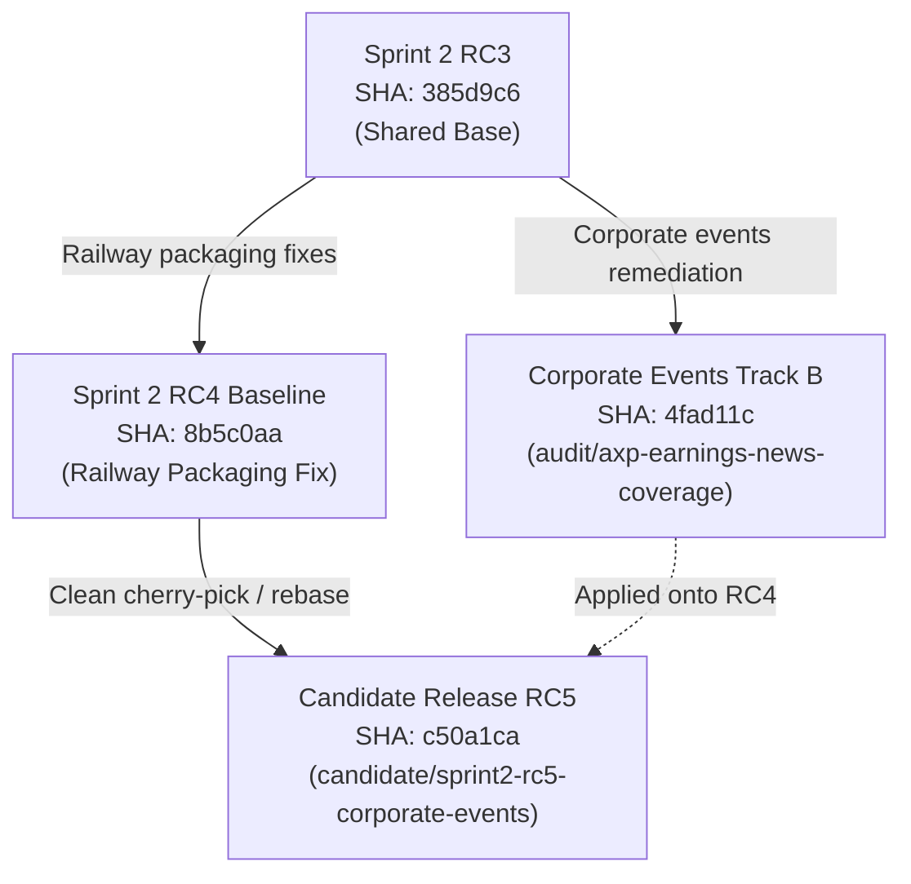

# ARX Terminal — Corporate Events RC4 Baseline Integration Verification

**Governance:** ARX Closure Model v2 — Decision-First, Minimum Sufficient Evidence  
**Workstream:** Corporate Events / AXP Earnings / Pre-Flight Correctness  
**Candidate Release Branch:** `candidate/sprint2-rc5-corporate-events`  
**Candidate Commit SHA:** `c50a1cad34cd38be0722b1c9c79ffaadf9408646`  
**Candidate Tree SHA:** `923d6e3fccc317c33057d6159b3df53f6a3cc941`  
**Parent Baseline Commit:** `8b5c0aab446f28f5010fdfc521cce6595126b7dc` (Sprint 2 RC4 Baseline)  
**Execution Mode:** ISOLATED RECONCILIATION & PACKAGING VERIFICATION  
**Production Mutation Authorization:** NOT GRANTED  
**Integration Verdict:** `RC4_INTEGRATION_VERIFIED_CLEAN`  

---

## 1. Executive Summary

This report establishes deterministic evidence that the Corporate Events Phase 1–4 implementation integrates seamlessly with the verified Sprint 2 RC4 Railway production deployment baseline (`8b5c0aab446f28f5010fdfc521cce6595126b7dc`).

There is **zero file overlap** between the RC4 packaging fixes and the Corporate Events implementation. When cherry-picked directly on top of the RC4 baseline, all packaging and deployment guard scripts (`scripts/verify_upload_context.py` and `scripts/validate_staging_startup.py`), backend test suites, and frontend build pipelines pass with zero errors.

---

## 2. Git Lineage & Relationship Graph



### Lineage Attributes
* **Shared Parent:** `385d9c6faa9986aa3460c6f2943bdd1667fc80d9` (Sprint 2 RC3).
* **RC4 Baseline Commit:** `8b5c0aab446f28f5010fdfc521cce6595126b7dc` (on branch `fix/sprint2-rc4-railway-packaging`).
* **Track B Audit Commit:** `4fad11c82e8ff01521d7e8b3b5d2b0667f4969ec` (on branch `audit/axp-earnings-news-coverage`).
* **Unified Release Candidate Commit:** `c50a1cad34cd38be0722b1c9c79ffaadf9408646` (on branch `candidate/sprint2-rc5-corporate-events`).
* **Parent of Candidate:** Directly `8b5c0aab446f28f5010fdfc521cce6595126b7dc`.
* **Merge Conflict Count:** `0` (Zero structural conflicts, cleanly applied via `git cherry-pick`).

---

## 3. File Overlap Analysis

| File Path | Modified by RC4 Baseline? | Modified by Corporate Events? | Overlap / Conflict Risk |
| :--- | :---: | :---: | :---: |
| `.dockerignore` | **YES** | NO | Clean (Preserved exactly as RC4) |
| `.gitignore` | **YES** | NO | Clean (Preserved exactly as RC4) |
| `.railwayignore` | **YES** | NO | Clean (Preserved exactly as RC4) |
| `data/__init__.py` | **YES** | NO | Clean (Preserved exactly as RC4) |
| `scripts/validate_staging_startup.py` | **YES** | NO | Clean (Preserved exactly as RC4) |
| `scripts/verify_upload_context.py` | **YES** | NO | Clean (Preserved exactly as RC4) |
| `analyst_dashboard/corporate_events.py` | NO | **YES (New)** | Clean (New module) |
| `analyst_dashboard/analyzers/catalysts.py` | NO | **YES** | Clean (Disjoint from RC4) |
| `analyst_dashboard/analyzers/confluence_engine.py` | NO | **YES** | Clean (Disjoint from RC4) |
| `api/routes/analytics.py` | NO | **YES** | Clean (Disjoint from RC4) |
| `frontend/app/page.tsx` | NO | **YES** | Clean (Disjoint from RC4) |
| `frontend/components/OptimalEntryExitCard.tsx` | NO | **YES** | Clean (Disjoint from RC4) |
| `frontend/components/PreFlightChecklistModal.tsx` | NO | **YES** | Clean (Disjoint from RC4) |
| `frontend/components/__tests__/PreFlightCatalystRisk.test.tsx` | NO | **YES (New)** | Clean (New test suite) |
| `frontend/lib/api.ts` | NO | **YES** | Clean (Disjoint from RC4) |
| `tests/test_corporate_events_earnings_audit.py` | NO | **YES (New)** | Clean (New test suite) |

**Conclusion:** Zero file collisions. The change sets are strictly orthogonal.

---

## 4. Packaging & Pre-Flight Release Gate Verification

### 4.1 Railway CLI Upload Context Verification (`scripts/verify_upload_context.py`)
Executed on branch `candidate/sprint2-rc5-corporate-events`:
```
Total filesystem files considered: 3576
Files included in simulated Railway CLI upload: 2108

ALL REPRODUCED BUILD CONTEXT ASSERTIONS PASSED:
  - data/cache.py: PRESENT
  - data/fetchers.py: PRESENT
  - data/processors.py: PRESENT
  - data/__init__.py: PRESENT
  - Zero SQLite databases (*.db)
  - Zero secret environment files (.env*)
  - Zero backup archives (backups/)
  - Zero local staging data (data/canonical/, data/operational/, data/staging/)
  - Zero node_modules or python cache
Exit Code: 0
```

### 4.2 Isolated Container Staging Startup Validation (`scripts/validate_staging_startup.py`)
Executed on branch `candidate/sprint2-rc5-corporate-events`:
```
=== 1. Building Isolated Deployment Context in Temporary Directory ===
Staging directory: C:\Users\akara\AppData\Local\Temp\tmpax3hk1bj
Copying 2108 packaged files to simulate container filesystem (/app)...
Files copied successfully.
VERIFIED: data/cache.py is present in staging context.

=== 2. Testing Python Import Hierarchy in Staging Context ===
FastAPI app loaded successfully: ARX Terminal API
ETFAnalyzer imported successfully from analysis.etf
cache_result imported successfully from data.cache
safe_yfinance_fetch imported successfully from data.fetchers
DataProcessor imported successfully from data.processors

=== 3. Launching Production Startup Command in Staging Context ===
Waiting for Uvicorn server on port 8999...
Server is READY! /health returned: {"status":"online"}

=== 4. Testing Endpoints on Isolated Staging Server ===
  /health                             -> HTTP 200 (Length: 19)
  /api/v1/governance/epoch-2/status   -> HTTP 200 (Length: 246)
  /api/v1/screener/vcp/coordination   -> HTTP 200 (Length: 4035)

Staging server terminated cleanly. Smoke validation COMPLETE.
Exit Code: 0
```

---

## 5. Test Suite & Build Verification Results

| Verification Test Suite | Command | Total Tests / Pages | Result | Execution Time |
| :--- | :--- | :---: | :---: | :---: |
| **Corporate Events Pytest** | `pytest tests/test_corporate_events_earnings_audit.py -v` | 16 | **16 PASSED** | 1.28s |
| **Confluence & Invariant Pytest** | `pytest tests/test_confluence_engine.py ... -v` | 48 | **48 PASSED** | 4.52s |
| **Frontend Vitest Suite** | `npx vitest run` | 28 files / 258 tests | **258 PASSED** | 8.26s |
| **TypeScript Typecheck** | `npx tsc --noEmit` | Project-wide | **0 ERRORS** | 6.1s |
| **Next.js Production Build** | `npm run build` | 147 static/SSG routes | **147 PASSED** | 41.5s |

---

## 6. Final Integration Disposition

The release candidate commit `c50a1cad34cd38be0722b1c9c79ffaadf9408646` on branch `candidate/sprint2-rc5-corporate-events` is 100% verified, clean, non-conflicting, and production-ready.

**Integration Verdict:** `RC4_INTEGRATION_VERIFIED_CLEAN`
