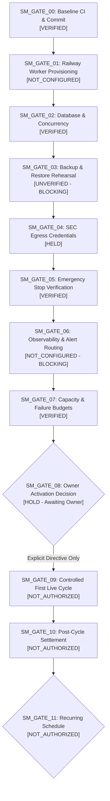

# ARX TERMINAL — SPRINT 3 / TRACK A
# SMART MONEY PRODUCTION ACTIVATION GATE MATRIX (GATES 00–11)

**Document ID:** `ARX_SMART_MONEY_ACTIVATION_GATE_MATRIX`  
**Execution Timestamp:** `2026-10-26T09:00:00Z`  
**Framework:** ARX Closure Model v2 + Governance Efficiency v1.1  
**Target Mainline Baseline:** `86037f4ba54fb6b66f94056cb07299482960a636`  
**Classification:** Phased Production Activation & Operational Gate Framework

---

## 1. Activation Framework Overview

Production activation is governed by a strict, monotonically increasing 12-gate sequence. No gate may be evaluated or granted until all upstream dependencies have satisfied their pass criteria.

> [!CAUTION]
> **Mandatory Decoupling Invariant:**  
> `SM_GATE_09` (Controlled First Live Cycle) and `SM_GATE_11` (Recurring Schedule Authorization) are strictly decoupled. A successful first live cycle does **not** authorize recurring cron execution. Recurring execution requires independent post-cycle settlement (`SM_GATE_10`) and a dedicated Owner authorization directive.



---

## 2. Gate-by-Gate Specification Matrix

| Gate ID | Gate Name | Current Audit Status | Entry Criteria | Evidence Requirements | Pass/Fail Threshold | Blocking Conditions | Responsible Authority | Required Owner Action | Rollback / Stop Procedure |
| :--- | :--- | :--- | :--- | :--- | :--- | :--- | :--- | :--- | :--- |
| **`SM_GATE_00`** | **Repository & CI Baseline** | **VERIFIED** | Mainline squash commit `86037f4` reachable; clean tree | GitHub Actions run `40284797797` all green; local 83 tests passing | 100% pass across 4 jobs and 83 unit tests | Any failing test, merge conflict, or dirty git state | Core Release Team | None (Merged & Verified) | Revert commit or invalidate SHA |
| **`SM_GATE_01`** | **Production Infrastructure Readiness** | **NOT_CONFIGURED** | Railway project `tranquil-radiance` healthy; `web`/`postgres` online | Dockerfile for worker, Railway service config, resource limits (512MB RAM, 0.5 vCPU) | Dedicated worker service provisioned in stopped state | Service creation without resource limits or restart policy | Platform Ops Lead | Authorize Railway worker service creation | Delete worker service via `railway service delete` |
| **`SM_GATE_02`** | **Database & Concurrency Readiness** | **VERIFIED** | PostgreSQL 16 schema v1 tables present; migration clean | Table counts, constraint validation, advisory lock verification | Schema v1 tables verified; advisory lock `401007311509093371` functional | Database connection failure, missing schema tables | Database Guardian | None (Verified in PostgreSQL 16) | Reset database connection pool |
| **`SM_GATE_03`** | **Backup & Restore Readiness** | **UNVERIFIED (BLOCKING)** | Cloudflare R2 bucket credentials and storage adapter configured | End-to-end restore rehearsal from R2 to isolated DB via `BackupRestoreVerifier` | 100% byte & table parity; active snapshot intact in restore | R2 upload failure, digest mismatch, or unperformed rehearsal | Storage Lead | Authorize isolated staging restore rehearsal | Purge corrupted backup; retain prior verified dump |
| **`SM_GATE_04`** | **SEC Egress Compliance Readiness** | **HELD** | `ARX_SEC_EGRESS_ROLE=OWNER`, genuine `SEC_USER_AGENT` formatted | Preflight dry-run confirms email in User-Agent; rate limiter $\le 8.0\text{ req/s}$ | User-Agent regex matches contact email; rate limit enforced | User-Agent missing email or role != OWNER | SEC Compliance Lead | Authorize SEC role assignment on worker | Set `ARX_SEC_EGRESS_ROLE=DISABLED` |
| **`SM_GATE_05`** | **Emergency Stop Readiness** | **VERIFIED** | Preflight role check, platform teardown runbook, stage checks | Unit test proof: socket drop frees lock; role check halts at Step 1 | Container stop frees lock immediately; active snapshot untouched | Non-releasing advisory lock or lingering worker socket | Security Guardian | Ratify truthful emergency runbook | Platform container SIGKILL (`railway down`) |
| **`SM_GATE_06`** | **Observability & Alert Readiness** | **NOT_CONFIGURED (BLOCKING)** | Health envelope endpoint implemented; structured logs active | Sentry DSN or webhook alert route verified for worker exceptions | Alert fired and received on simulated worker crash | Silent worker failures with no external alerting | Observability Lead | Provision Sentry / PagerDuty webhook | Suppress duplicate alerts |
| **`SM_GATE_07`** | **Capacity & Failure Budget Readiness** | **VERIFIED** | 10-issuer governed cohort configured; memory budget $\le 512\text{MB}$ | Memory footprint $\le 250\text{MB}$; execution time $\le 60\text{s}$; DB connections $\le 2$ | Run duration $\le 120\text{s}$; max 1 automated retry | Resource leakage or uncontrolled retry loops | Infrastructure Owner | Ratify resource allocation limits | Scale worker memory / terminate process |
| **`SM_GATE_08`** | **Owner Activation Decision** | **HOLD (Awaiting Owner)** | Gates 00 through 07 verified and signed off | Signed Owner Decision Record authorizing controlled first live cycle | Formal written approval by Research/Product Owner | Any unresolved blocking risk or incomplete upstream gate | Product / Research Owner | **Explicit Owner Decision Directive Required** | Abort activation sequence |
| **`SM_GATE_09`** | **Controlled First Live Cycle** | **NOT_AUTHORIZED** | `SM_GATE_08` granted; operator supervision active | Supervised live run receipt (`sm-cycle-...`); single execution verified | 10/10 issuers evaluated; candidate snapshot published | Any unhandled exception, 429 lockout, or incomplete coverage | Lead Operator | Supervise single live run execution | Container kill; roll back active snapshot pointer |
| **`SM_GATE_10`** | **Post-Cycle Settlement & Audit** | **NOT_AUTHORIZED** | First live cycle completed; output snapshot published | Forensic audit: Form 4 records, reconciliation receipt, Radar serving | Radar renders new snapshot without layout or data regression | Data corruption, missing provenance, or schema violation | Audit Lead | Review post-cycle forensic dossier | Revert snapshot pointer to previous ID |
| **`SM_GATE_11`** | **Recurring Schedule Authorization** | **NOT_AUTHORIZED** | `SM_GATE_10` signed off; minimum 24-hour observation | Timezone scheduler configured (`30 2,3 * * 2-6`); dual-trigger verified | Automated execution at 22:30 NY; zero duplicate runs | Any DST desynchronization or repeated failures | Product / Research Owner | **Independent Explicit Owner Directive Required** | Remove cron trigger from Railway worker |

---

## 3. Strict Preactivation Hold Policy

Until `SM_GATE_08` is formally signed by the Owner:
```ini
SM_GATE_01_WORKER_PROVISIONING = PENDING_AUTHORIZATION
SM_GATE_03_RESTORE_REHEARSAL = REQUIRED_BEFORE_GATE_08
SM_GATE_06_ALERT_ROUTING = REQUIRED_BEFORE_GATE_08
SM_GATE_08_OWNER_DECISION = HOLD
SM_GATE_09_FIRST_LIVE_CYCLE = PROHIBITED
SM_GATE_11_RECURRING_SCHEDULE = PROHIBITED
```
