# ARX TERMINAL — SPRINT 3 / TRACK A
# SMART MONEY EMERGENCY STOP, FAILURE INJECTION & RECOVERY VALIDATION

**Document ID:** `ARX_SMART_MONEY_EMERGENCY_STOP_AND_RECOVERY_VALIDATION`  
**Execution Timestamp:** `2026-10-26T08:59:00Z`  
**Framework:** ARX Closure Model v2 + Governance Efficiency v1.1  
**Target Mainline Baseline:** `86037f4ba54fb6b66f94056cb07299482960a636`  
**Classification:** Operational Safety, Kill-Switch Semantics & Recovery Audit

---

## 1. Executive Summary & Control Architecture

The Smart Money emergency-stop and failure-containment architecture separates operational actions into three distinct, non-overlapping control planes:

```mermaid
flowchart TD
    subgraph CP1 ["Operation A: Future Cycle Prevention"]
        A1["Operator sets ARX_SEC_EGRESS_ROLE=DISABLED"] --> A2["Evaluated at Step 1 Preflight"]
        A2 --> A3["Fails closed before DB connection or lock claim"]
    end

    subgraph CP2 ["Operation B: Active Worker Teardown"]
        B1["Operator issues Railway Down / Restart / SIGKILL"] --> B2["Host OS terminates worker process"]
        B2 --> B3["TCP connection to PostgreSQL dropped"]
        B3 --> B4["PostgreSQL kernel immediately releases<br/>LOCK_SEC_EGRESS_OWNER (401007311509093371)"]
    end

    subgraph CP3 ["Operation C: Cooperative Stage Check"]
        C1["In-process self.cancel() or cancellation token"] --> C2["Checked at Step 6 Start & Step 8 Start"]
        C2 --> C3["Aborts cycle fail-closed; 0 unverified snapshots published"]
    end
```

> [!IMPORTANT]
> **Operational Reality vs In-Flight Misconception:**  
> A Linux process reads environment variables from `/proc/self/environ` at initialization. Updating an environment variable in the Railway dashboard or via CLI does **not** asynchronously inject new values into the private memory space of an actively executing container. Therefore, immediate interruption of a live worker stuck on network or database I/O **must** be executed via platform container lifecycle controls (Operation B).

---

## 2. Failure Injection & Boundary Interruption Matrix

The pipeline was evaluated across seven distinct cycle interruption boundaries under isolated test fixtures. In all seven scenarios, existing active Radar snapshots (`scanner_active_snapshots`) remained 100% read-only, serving, and unmutated.

| Interruption Scenario | Expected System State | Observed Test State | Radar Serving Intact? | Residual Risk | Required Operator Action |
| :--- | :--- | :--- | :--- | :--- | :--- |
| **1. Interruption Before Backup** (Aborted at Step 1 Preflight or Step 2 Lock) | No backup generated; no lock held; 0 DB writes. | Cycle aborted cleanly with exception; 0 database rows created. | **YES** (100% intact) | None | Inspect preflight configuration; rerun when ready. |
| **2. Interruption During Backup** (Process killed during `pg_dump` execution) | Partial dump file abandoned in `/tmp`; R2 upload aborted; no SEC egress. | Manifest validation fails (`PRE_BACKUP_FAILED`); pipeline halts fail-closed. | **YES** (100% intact) | Orphaned temp file in container (cleaned on reboot). | Restart worker; next cycle captures fresh pre-backup. |
| **3. Interruption Before SEC Ingestion** (Halted at Step 5 freshness gate or Step 6 entry) | Pre-backup verified in R2; lock held; 0 SEC requests executed. | Advisory lock released on TCP drop; 0 network calls sent to SEC EDGAR. | **YES** (100% intact) | Pre-backup remains in R2 storage. | Review containment gate error; restart worker when resolved. |
| **4. Interruption During SEC Ingestion** (Worker killed after ingesting 4 of 10 issuers) | Partial filings safely stored in `form4_raw_filings`; active snapshot unchanged. | Filings persisted with `content_hash`; lock released on container exit. | **YES** (100% intact) | Cycle incomplete; no new snapshot published for today. | Restart worker. Subsequent run resumes, deduplicating stored filings via `ON CONFLICT DO NOTHING`. |
| **5. Interruption Before Snapshot Publication** (Halted after Step 7 reconciliation receipt) | All filings parsed; cryptographic receipt stored; active pointer unchanged. | Receipt stored in DB; Step 8 not executed; `scanner_active_snapshots` untouched. | **YES** (100% intact) | New snapshot prepared but unpromoted. | Rerun cycle or trigger manual operator request to publish. |
| **6. Interruption During Publication** (DB connection dropped during `publish_scanner_snapshot_atomic`) | Single atomic transaction rolls back completely; zero partial exposure. | PostgreSQL transaction rolled back; candidate not published; pointer unchanged. | **YES** (100% intact) | None (ACID rollback). | Check database connectivity; retry cycle. |
| **7. Interruption After Publication** (Halted during Step 9 post-backup or Step 10 pruning) | Snapshot safely published and active; post-backup manifest missing. | Cycle completes with `DEGRADED_POST_BACKUP_FAILED`; snapshot remains live. | **YES** (100% intact) | Post-ingestion state unbacked in R2 until next scheduled pass. | Next scheduled cycle (or automated backup thread) captures fresh dump. |

---

## 3. Advisory Lock Teardown Verification

### Lock Specifications
- **Lock Type:** PostgreSQL Session-Level Advisory Lock (`pg_advisory_lock`)
- **Key Constant:** `LOCK_SEC_EGRESS_OWNER = 401007311509093371`
- **Ownership Lifetime:** Bound strictly to the backend PostgreSQL client TCP connection.

### Formal Verification Evidence
In `tests/test_smart_money_provisioning_safety_gates.py`:
1. `test_advisory_lock_claimed_before_date_check_and_pre_backup`: Confirms lock is claimed prior to Step 3 date evaluation and Step 4 backup dump.
2. `test_concurrent_trigger_fails_closed_under_advisory_lock`: Confirms a second worker attempting to claim the lock fails immediately with `CONCURRENT_INGESTION_BLOCKED`.
3. `test_advisory_lock_cleanup_on_process_termination_semantics`: Simulates abnormal process termination (closing socket without calling `pg_advisory_unlock`). Proves that PostgreSQL backend immediately frees the lock, permitting a successor process to claim it without manual database intervention.

---

## 4. Production Force-Override Governance

To prevent accidental, unauthenticated, or rogue execution in production environments:
1. **Raw `force=True` Rejection:** Calling the runner CLI with `--force` in production without a recovery token raises `PRODUCTION_FORCE_OVERRIDE_UNAUTHORIZED`.
2. **Test Trigger Rejection:** Supplying `trigger_type="TEST"` outside authorized test mode raises `TEST_TRIGGER_PROHIBITED_IN_PRODUCTION`.
3. **Point-in-Time `as_of` Override Rejection:** Arbitrary date manipulation in production raises `PRODUCTION_AS_OF_OVERRIDE_UNAUTHORIZED`.
4. **Authorized Recovery Gate:**
   - Requires `ARX_PRODUCTION_FORCE_RECOVERY_TOKEN` set in environment matching `--recovery-token`.
   - Requires `--recovery-reason` with length $\ge 10$ characters.
   - Requires `--recovery-scope` in `('SINGLE_CYCLE_RECOVERY', 'SAME_DAY_RESUMPTION', 'MANUAL_RECOVERY')`.
5. **Lock Ordering Invariant:** Advisory lock acquisition and database connectivity validation execute **FIRST**, before evaluating any force or recovery override flags.
6. **Zero Impact on Rejection:** Any rejected override execution performs **0 SEC requests** and **0 snapshot mutations**.

Verified across 16 dedicated test cases in `TestGate4ProductionForceOverrideGovernance`.
