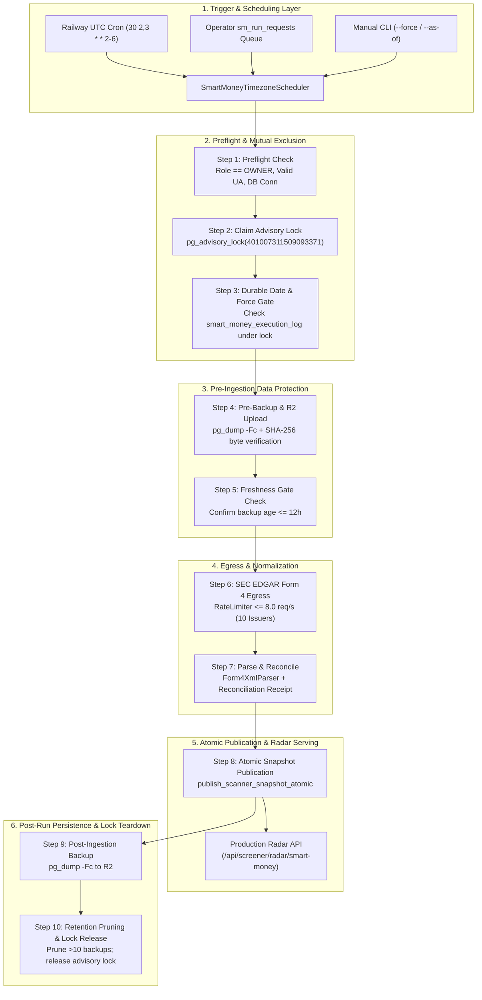

# ARX TERMINAL — SPRINT 3 / TRACK A
# SMART MONEY END-TO-END EXECUTION CONTRACT & ARCHITECTURE SPECIFICATION

**Document ID:** `ARX_SMART_MONEY_END_TO_END_EXECUTION_CONTRACT`  
**Execution Timestamp:** `2026-10-26T08:57:00Z`  
**Framework:** ARX Closure Model v2 + Governance Efficiency v1.1  
**Mainline Baseline SHA:** `86037f4ba54fb6b66f94056cb07299482960a636`  
**Status:** Canonical Engineering Specification

---

## 1. System Execution Topology

The Smart Money pipeline executes as a strictly sequential, fail-closed 10-step state machine encapsulated in `SmartMoneyContinuousPipeline`. It is driven by the Railway timezone-aware dual-trigger scheduler or operator queue, executes under an exclusive PostgreSQL session-level advisory lock, and interacts with Cloudflare R2 and SEC EDGAR before atomically publishing immutable candidate snapshots to production Radar.



---

## 2. Canonical Stage Contract Matrix

| Stage | Owner Component | Authoritative Input Contract | Produced Artifact / State | Required Upstream | Failure Mode | Fail-Closed Behavior | Safe Recovery Path | Authoritative Evidence |
| :--- | :--- | :--- | :--- | :--- | :--- | :--- | :--- | :--- |
| **0. Trigger & Schedule** | `SmartMoneyTimezoneScheduler` | America/New_York clock, last executed NY date from DB | Boolean `should_run`, scheduling rationale | None | UTC/NY DST shift, holiday schedule | Skips execution; logs `SCHEDULE_CHECK_DECLINED` | Next scheduled window (22:30 NY) | `smart_money_scheduler.py:75-120`<br/>`test_timezone_scheduler_dst_invariance` |
| **1. Preflight Check** | `SmartMoneyContinuousPipeline._step1_preflight` | `ARX_SEC_EGRESS_ROLE`, `SEC_USER_AGENT`, DB connection string | `STEP_1_PREFLIGHT_VERIFIED` | Trigger | Missing role, invalid email in User-Agent, DB down | Raises `RuntimeError`; 0 DB writes, 0 locks | Correct env config or restore DB connectivity | `continuous_pipeline.py:442-468`<br/>`test_worker_only_egress_enforcement` |
| **2. Exclusive Lock Claim** | `postgres_coordination.acquire_sec_owner_lock` | PostgreSQL connection, `LOCK_SEC_EGRESS_OWNER` | PostgreSQL session advisory lock `401007311509093371` | Step 1 | Concurrent worker execution, lock acquisition timeout | Raises `CONCURRENT_INGESTION_BLOCKED`; exits cleanly | Second worker waits or exits; prior run completes | `postgres_coordination.py:25-50`<br/>`test_concurrent_trigger_fails_closed_under_advisory_lock` |
| **3. Durable Date Eligibility** | `_step3_check_durable_date_eligibility_under_lock` | Lock connection, latest active snapshot `data_as_of` | Verification that NY trading day has not run | Step 2 | Database query failure, malformed `data_as_of` | Raises `DURABLE_EXECUTION_ELIGIBILITY_UNVERIFIED` | Releases lock; manual operator investigation | `continuous_pipeline.py:541-648`<br/>`test_step3_durable_date_check_fails_closed_on_repository_error` |
| **4. Pre-Ingestion Backup** | `SmartMoneyBackupEngine.create_backup` | Live PostgreSQL connection, `BackupStorageAdapter` | `.dump` file, R2 manifest with 64-hex SHA-256 | Step 3 | `pg_dump` failure, R2 upload error, SHA-256 mismatch | Aborts cycle with `PRE_BACKUP_FAILED`; 0 SEC egress | Fix storage credentials; re-run preflight | `continuous_pipeline.py:649-738`<br/>`test_r2_upload_verifies_streaming_sha256_content_and_metadata` |
| **5. Backup Freshness Gate** | `BackupAgeContainmentGate.check_ingestion_eligibility` | R2 backup timestamp, `max_age_hours=12` | `STEP_5_FRESHNESS_GATE_VERIFIED` | Step 4 | Backup timestamp older than 12 hours | Raises `BackupAgeContainmentViolationException` | Immediate fresh pre-backup in Step 4 resolves | `containment_gate.py:50-95`<br/>`test_backup_freshness_gate_compliance` |
| **6. SEC Form 4 Ingestion** | `SecEdgarFetcher` / `RateLimiter` | 10 governed US Equities (`UB-US-EQUITIES-20261025-001`) | Raw Form 4 XML filings in `form4_raw_filings` | Step 5 | HTTP 429 rate limit, 503 EDGAR downtime, network timeout | Aborts with exception; filings up to point saved | Deduplicated on rerun via `content_hash`; resumes | `continuous_pipeline.py:756-798`<br/>`test_sec_rate_limit_enforcement` |
| **7. Parse & Reconcile** | `Form4XmlParser` & `PostgresSmartMoneyRepository` | Raw XML filings, `cycle_id`, `as_of` | Normalized transactions, cryptographic receipt in DB | Step 6 | Malformed XML, schema parse error, missing fields | Records failure; aborts before snapshot creation | Fix parser mapping; rerun cycle | `continuous_pipeline.py:805-880`<br/>`test_published_results_preserve_provenance` |
| **8. Atomic Snapshot Publication** | `publish_scanner_snapshot_atomic` | Scored candidates, receipt hash, active lease | Immutable row in `scanner_snapshots`, pointer updated in `scanner_active_snapshots` | Step 7 | Incomplete issuer coverage (<100%), stale lease | Transaction rolls back completely; active snapshot intact | Address missing issuer filings; retry cycle | `postgres_repository.py:403-535`<br/>`test_snapshot_publication_atomicity` |
| **9. Post-Ingestion Backup** | `SmartMoneyBackupEngine.create_backup` | Updated PostgreSQL state, R2 storage adapter | Post-ingestion `.dump` file + R2 manifest | Step 8 | R2 network timeout, bucket capacity breach | Degrades status to `DEGRADED_POST_BACKUP_FAILED`; snapshot serves | Automated retry on next scheduled backup pass | `continuous_pipeline.py:1103-1125`<br/>`test_post_backup_failure_degrades_gracefully` |
| **10. Retention Pruning & Release** | `BackupRetentionManager.prune_backups` & `_cleanup_lock` | Retention policy (keep 10 backups / 7 days) | Older R2 artifacts deleted; advisory lock released | Step 9 | Pruning API failure, lock release failure | Warning logged; lock released in `finally` block | PostgreSQL kernel drops lock on connection close | `continuous_pipeline.py:1126-1148`<br/>`test_backup_retention_protects_latest_recovery_point` |
| **11. Radar Consumption** | `api/routes/screener.py` | Query `scanner_active_snapshots` (read-only) | JSON response with candidate rankings & evidence | Step 8 | PostgreSQL read connection timeout | Serves cached response / stale-while-revalidate | Next read re-connects | `api/routes/screener.py:980-1020`<br/>`test_output_compatible_with_radar_api_contract` |

---

## 3. Cross-Component Contract Compatibility Analysis

An exhaustive audit of the boundaries between `SmartMoneyContinuousPipeline`, `PostgresSmartMoneyRepository`, `SmartMoneyForm4Scanner`, and `api/routes/screener.py` was conducted.

### 3.1 Scanner Candidate Result to Radar API Contract
- `SmartMoneyForm4Scanner` evaluates issuer transactions and produces `SmartMoneyIssuerState`.
- `_step8_publish_snapshot` transforms `qualifying_states` into `ScannerCandidateResult` dictionaries containing:
  - `symbol`: Ticker string (e.g. `"NVDA"`).
  - `rank`: Integer 1-indexed ordering by `convictionScore` descending.
  - `score`: Conviction score rounded to 1 decimal place.
  - `scanner_evidence`: Full evidence envelope (`subsignal="INSIDER_FORM4"`, `reasons`, `openMarketPurchaseCount`, `grossPurchaseValueUsd`, `cSuiteBuying`, `provenance`).
- Compatibility verification: `test_output_compatible_with_radar_api_contract` confirms that the dictionary output matches the schema expected by `GET /api/screener/radar/smart-money`.

### 3.2 Truthful Zero-Match Handling
- When 10/10 governed issuers are scanned successfully but zero insiders executed open-market purchases during the lookback window, the scanner produces:
  - `coverage_status = "COMPLETE"`
  - `scanned_successfully_count = 10`
  - `matched_count = 0`
  - `results = []`
  - `publication_decision = "PUBLISH"`
- This cleanly distinguishes a **truthful zero match** (complete coverage, no transactions) from a **pipeline outage / failure** (`coverage_status = "PARTIAL"` or `"FAILED"`, which strictly halts publication). Verified in `test_legitimate_zero_match_produces_complete_coverage`.

### 3.3 Lease Fencing & Operator Run Requests
- In asynchronous worker processing (`worker.process_run_requests`):
  - Operator claims run requests with an atomic lease token and duration (`lease_duration_sec=300`).
  - Worker heartbeats the request periodically.
  - In `publish_scanner_snapshot_atomic`, the SQL query verifies `lease_token` under row-lock:
    ```sql
    UPDATE sm_run_requests
    SET status = 'COMPLETED', completed_at = NOW()
    WHERE request_id = %s AND lease_token = %s;
    ```
  - If a worker stalled and its lease expired, the update affects 0 rows, triggering `StaleLeaseOwnershipLostError` and rolling back the snapshot publication. This prevents zombie workers from publishing stale snapshots. Verified in `test_worker_lease_contention_and_loss`.

---

## 4. Invariant Boundaries & Failure Isolation

1. **Isolation from Radar Read Traffic:**  
   The web API runs with role `SMART_MONEY_READ_REPLICA`. It has `SELECT` privileges only on `scanner_snapshots`, `scanner_active_snapshots`, and `scanner_audit_log`. It cannot claim `LOCK_SEC_EGRESS_OWNER` or insert into `form4_raw_filings`.
2. **Snapshot Immutability:**  
   Snapshots inserted into `scanner_snapshots` are write-once, append-only. No `UPDATE` or `DELETE` statements exist for historical snapshots.
3. **Active Snapshot Atomic Pointer:**  
   `scanner_active_snapshots` contains exactly one row per `scan_type`. The pointer update occurs in the same database transaction as the snapshot insert. A failure anywhere before `COMMIT` leaves the existing active snapshot completely untouched.
