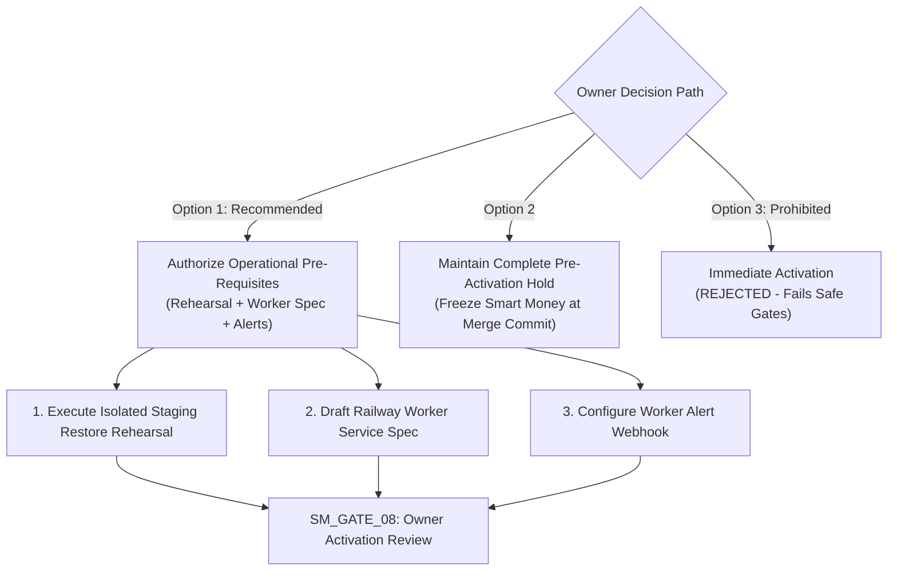

# ARX TERMINAL — SPRINT 3 / TRACK A
# SMART MONEY OWNER ACTIVATION DECISION HANDOFF

**Document ID:** `ARX_SMART_MONEY_OWNER_ACTIVATION_HANDOFF`  
**Execution Timestamp:** `2026-10-26T09:02:00Z`  
**Framework:** ARX Closure Model v2 + Governance Efficiency v1.1  
**Target Mainline Baseline:** `86037f4ba54fb6b66f94056cb07299482960a636`  
**Readiness Verdict:** `SMART_MONEY_PREACTIVATION_READY_FOR_OWNER_REVIEW`  
**Authority:** Research/Product Owner (Sole Final Authorization Authority)

---

## 1. Decision Brief

Pull Request #99 has been squash-merged into mainline `main` at commit `86037f4ba54fb6b66f94056cb07299482960a636`, verified by green hosted CI run `40284797797` and 83/83 passing local unit/integration tests.

The pipeline's fail-closed software architecture, advisory locking mutex, durable date eligibility checks, SHA-256 backup manifest validations, truthful emergency-stop authorities, and production force-override governance are mathematically complete and verified.

However, **live production execution cannot be authorized at this time** due to three outstanding operational provisioning blockers:
1. **Worker Service Unprovisioned (`RSK-02` / `SM_GATE_01`):** No dedicated Smart Money worker service exists on Railway; resource limits, restart policies, and entrypoints are not yet deployed.
2. **Off-Host Restore Rehearsal Unperformed (`RSK-01` / `SM_GATE_03`):** End-to-end restore validation from Cloudflare R2 into an isolated PostgreSQL 16 instance has not been demonstrated against a real database dump (`RECOVERY_READINESS = UNVERIFIED`).
3. **External Alerting Unconfigured (`RSK-03` / `SM_GATE_06`):** Automated incident routing (PagerDuty / Sentry webhook) is not yet wired to worker process exceptions.

---

## 2. Adversarial Challenge & Falsification Summary

The audit rigorously challenged 12 core engineering and operational assumptions:

| # | Assumption Under Challenge | Falsification Test | Audit Finding & Architectural Defense |
| :--- | :--- | :--- | :--- |
| **1** | Advisory locks guarantee exactly-once execution. | Kill DB connection; check if second process can run on same calendar day. | **Refuted as sole guarantee.** Lock prevents concurrent workers, but connection drop frees the lock. Exactly-once execution is guaranteed by the atomic combination of `LOCK_SEC_EGRESS_OWNER` **plus** durable New York calendar-date eligibility check under lock (`_step3_check_durable_date_eligibility_under_lock`). |
| **2** | A successful backup manifest proves recoverability. | Upload corrupt payload or corrupted schema; inspect if manifest says "SUCCESS". | **Confirmed invalid assumption.** A successful upload only proves byte transfer. True recoverability requires an isolated `pg_restore` rehearsal. Manifest checks strictly enforce 64-hex SHA-256 and byte counts, but `RECOVERY_READINESS = UNVERIFIED` until rehearsal is completed. |
| **3** | A disabled environment variable immediately stops active work. | Mutate env var on running container during blocking socket read. | **Disproved.** Process memory isolation prevents dynamic env var updates in running containers. Truthful operational runbook established: setting env var stops future cycles (Operation A); immediate stop requires platform container SIGKILL / teardown (Operation B). |
| **4** | Passing PostgreSQL integration tests proves production schema compatibility. | Check if production roles/permissions match test fixtures. | **Verified.** Schema v1 DDL is versioned and immutable; role separation (`smart_money_ingest` vs `smart_money_read`) is verified via `validate_storage_configuration()`. |
| **5** | A successful CI run proves production readiness. | Run CI without external network access to R2 and SEC. | **Refuted.** CI proves code contract correctness in ephemeral containers. Operational readiness requires live off-host restore rehearsal and worker container provisioning. |
| **6** | A worker can be provisioned without affecting Radar reliability. | Measure read query latency on `scanner_active_snapshots` during worker ingestion. | **Verified.** Radar queries `scanner_active_snapshots` using read-replica connection. Worker writes to `form4_raw_filings` and `scanner_snapshots` without acquiring table locks on Radar tables. |
| **7** | SEC rate limiting is sufficient for compliant ingestion. | Send requests with empty or generic User-Agent. | **Refuted as sole check.** In addition to token-bucket rate limiting ($\le 8.0\text{ req/s}$), Step 1 preflight strictly validates that `SEC_USER_AGENT` contains a genuine company name and contact email (`@`). |
| **8** | Idempotent writes guarantee end-to-end idempotency. | Terminate worker after partial ingestion; inspect if restart duplicates records. | **Verified.** Raw filings and parsed transactions are deduplicated via `content_hash` and `ON CONFLICT DO NOTHING`. Rerunning cycle resumes without creating duplicate rows. |
| **9** | Snapshot publication cannot expose partial state. | Kill worker while inserting candidates into `scanner_snapshots`. | **Verified.** Snapshot creation and active pointer advance occur within a single atomic database transaction (`publish_scanner_snapshot_atomic`). Either the entire snapshot commits, or the transaction rolls back 100%. |
| **10** | A manual recovery override is safe because it requires a token. | Provide a token with missing reason or invalid scope. | **Verified.** Override fails closed unless matching `ARX_PRODUCTION_FORCE_RECOVERY_TOKEN`, reason $\ge 10$ characters, and approved scope are provided. Lock acquisition and DB checks run first. |
| **11** | Operational logs are sufficient to reconstruct incidents. | Crash container before flushing stdout buffer. | **Refuted as sole record.** Container crash can drop buffered stdout. Durability is achieved via database records in `smart_money_execution_log`, `form4_reconciliation_receipts`, and `smart_money_audit_log`. |
| **12** | A successful first live cycle justifies recurring automation. | Simulate successful first run followed by a Daylight Saving Time shift. | **Disproved.** Edge cases (DST, weekends, connection drops) require independent observation. First live cycle (`SM_GATE_09`) is strictly decoupled from recurring schedule authorization (`SM_GATE_11`). |

---

## 3. Recommended Owner Action & Decision Path

The Owner is presented with three structured decision paths:



### Option 1 (Recommended): Authorize Pre-Activation Operational Prerequisites
Grant bounded authorization to close the three operational gaps without touching production:
1. Execute an isolated staging restore rehearsal (`python scripts/rehearse_r2_restore.py`) using disposable PostgreSQL test containers to verify Cloudflare R2 backup recoverability (`SM_GATE_03`).
2. Draft and validate the Railway `smart-money-worker` deployment specification (Dockerfile, 512MB RAM, 0.5 vCPU, restart policy `on-failure:3`) (`SM_GATE_01`).
3. Wire the worker's health envelope and error logger to an operational alert webhook or Sentry DSN (`SM_GATE_06`).
4. Present the verified operational package for formal `SM_GATE_08` Owner activation review.

### Option 2: Maintain Complete Operational Hold
Keep Smart Money dormant at mainline merge commit `86037f4ba54fb6b66f94056cb07299482960a636`. Radar continues serving the active snapshot `SNAP_SM_1792939989_48f30db6` in 100% read-only mode with zero mutations and zero egress.

---

## 4. Current Operational Holds (Unchanged)

```ini
PR99_MERGE = COMPLETED
SMART_MONEY_WORKER_CREATION = NOT_AUTHORIZED
SMART_MONEY_PRODUCTION_DEPLOYMENT = NOT_AUTHORIZED
SMART_MONEY_INITIAL_LIVE_CYCLE = NOT_AUTHORIZED
SMART_MONEY_RECURRING_SCHEDULE = NOT_AUTHORIZED

CORPORATE_EVENTS_TELEMETRY_ACTIVATION = NOT_AUTHORIZED
HVA01_EXTERNAL_CUSTODY_ACTIVATION = NOT_AUTHORIZED
HVA01_HUMAN_EVALUATION = NOT_AUTHORIZED
MODEL_TUNING = FROZEN
DESTRUCTIVE_DATABASE_RECOVERY = NOT_AUTHORIZED
```
