# ARX TERMINAL — SPRINT 3 / TRACK A
# SMART MONEY POST-PR99 PRODUCTION READINESS AUDIT

**Document ID:** `ARX_SMART_MONEY_PRODUCTION_READINESS_AUDIT`  
**Execution Timestamp:** `2026-10-26T08:55:00Z`  
**Governance:** ARX Closure Model v2 + Governance Efficiency v1.1  
**Classification:** Pre-Activation Operational Readiness Audit  
**Authority:** Research/Product Owner (Sole Final Authorization Authority)  
**Readiness Verdict:** `SMART_MONEY_PREACTIVATION_READY_FOR_OWNER_REVIEW`

---

## 1. Executive Summary

Following the authorized squash-merge of Pull Request #99 (`fix/smart-money-provisioning-safety-gates`), an exhaustive, independent, evidence-driven production readiness audit of the Smart Money continuous ingestion pipeline was conducted in an isolated audit worktree (`finance-smart-money-audit`) at verified mainline commit [`86037f4ba54fb6b66f94056cb07299482960a636`](https://github.com/daakara/finance/commit/86037f4ba54fb6b66f94056cb07299482960a636).

The audit confirms that the engineering core and fail-closed safety gates are mathematically sound, fully implemented, and regression-free (83/83 passing local tests, 4/4 green mainline CI jobs on run `40284797797`). All historical defects regarding durable execution-date eligibility lookups, SHA-256 backup manifest validations, truthful emergency-stop authorities, and production force-override governance have been remediated and verified.

However, from an operational provisioning perspective, several prerequisite infrastructure elements remain intentionally **NOT_CONFIGURED** or **UNVERIFIED**:
1. No dedicated Smart Money worker service has been created or deployed on Railway.
2. Production Cloudflare R2 backup credentials and restore verification rehearsals against live off-host infrastructure have not yet been executed.
3. Live production SEC EDGAR network egress has not been activated (egress role remains `DISABLED` across all active production services).
4. External alert routing (PagerDuty/Sentry) is not yet wired to worker failures.

Consequently, the pipeline is **NOT AUTHORIZED FOR LIVE OPERATION**. This audit package presents the verified evidence, identified operational gaps, adversarial challenge refutations, and a sequenced 12-gate activation framework (`SM_GATE_00` through `SM_GATE_11`) for explicit Owner review.

---

## 2. Verified Mainline Baseline

| Property | Authoritative Value | Evidence Source |
| :--- | :--- | :--- |
| **Target PR** | [PR #99](https://github.com/daakara/finance/pull/99) (`fix/smart-money-provisioning-safety-gates`) | GitHub REST API |
| **PR Status** | `closed`, `merged=True` | GitHub REST API |
| **PR Head SHA** | `a66c2a282957035beb8097d7b035b34b4291c0f8` | Git tree / GitHub API |
| **Mainline Merge SHA** | `86037f4ba54fb6b66f94056cb07299482960a636` | `origin/main` ref |
| **Mainline CI Run ID** | [`40284797797`](https://github.com/daakara/finance/actions/runs/40284797797) | GitHub Actions API |
| **Mainline CI Result** | `conclusion=success` (4/4 jobs passing) | GitHub Actions API |
| **Local Audit Worktree** | `C:\Users\akara\Documents\Projects\finance-smart-money-audit` | Detached HEAD `86037f4` |
| **Local Regression Suite** | `83 passed, 0 failed, 1 warning (17.27s)` | Pytest execution |

### Mainline CI Job Breakdown
1. **Code Quality & Security Linter:** `success` (Syntax & AST checks `E9,F63,F7,F82`, Bandit security analysis, bytecode compilation).
2. **Backend Test Suite (Python 3.12):** `success` (Tier 1 Core, Tier 2 Path-Filtered, Package B/C Governance, Smart Money & PostgreSQL 16 Gate, Tier 3 Pre-Flight).
3. **Backend Test Suite (Python 3.11):** `success` (Full Python 3.11 parity matrix).
4. **Static SSG Export & Integrity Gate:** `success` (145 static pages compiled, ARX UX Design Parity Gate V1, Opportunity Dossier Snapshot Integrity).

---

## 3. Production Infrastructure & Service Inventory (Railway)

An authorized read-only configuration audit of the Railway production project (`tranquil-radiance`, ID: `a339a92a-7236-4ac0-9a3a-d7ad440f9690`) was executed.

### Service Inventory Table
| Service Name | Service ID | Type | Image / Runtime | Volume / Mount | Status | Egress Role |
| :--- | :--- | :--- | :--- | :--- | :--- | :--- |
| **web** | `3406f9d3-5246-4ef5-b65c-6e2ee5e13835` | Service | Python 3.11 / FastAPI SSR | `web-volume` | Online | `DISABLED` |
| **postgres** | `467bc533-e76f-45b5-b4ce-117554ce2e3b` | Database | `postgres:16-alpine` | `postgres-volume` (`/var/lib/postgresql/data`) | Online | N/A |
| **smart-money-worker** | N/A | Worker | None | None | **NOT_CONFIGURED** | N/A |

### Environment Variable & Security Audit
- `ARX_PRODUCTION_FORCE_RECOVERY_TOKEN`: **Absent** (`False` across all services). Zero recovery tokens active.
- `ARX_SEC_EGRESS_ROLE`: **`DISABLED`** on `web`.
- `SMART_MONEY_DATABASE_ROLE`: **`SMART_MONEY_READ_REPLICA`** on `web`.
- `ARX_SMART_MONEY_POSTGRES_READ_ENABLED`: `true` (enables read-only Radar querying; prevents write mutations).
- Auto-Deploy Status: Verified that merging PR #99 to `main` triggered zero Railway service deployments or container restarts.

---

## 4. Audit Findings Summary Across Domains

```mermaid
flowchart TD
    subgraph S1 ["Audit A: Architecture"]
        A1["10-Step Pipeline Contract"] -->|VERIFIED| A2["Strict Fail-Closed Ordering"]
    end
    subgraph S2 ["Audit B: Infrastructure"]
        B1["Railway Topology"] -->|VERIFIED| B2["web + postgres only"]
        B3["Worker Provisioning"] -->|NOT_CONFIGURED| B4["Zero Worker Instances"]
    end
    subgraph S3 ["Audit C: Database Safety"]
        C1["Advisory Lock + Durable Date"] -->|VERIFIED| C2["Atomic Publication & Fencing"]
    end
    subgraph S4 ["Audit D: Backup & Recovery"]
        D1["SHA-256 Manifest Validation"] -->|VERIFIED| D2["Bytes Checked"]
        D3["Live R2 Restore Rehearsal"] -->|UNVERIFIED| D4["Staging Rehearsal Needed"]
    end
    subgraph S5 ["Audit E: SEC Compliance"]
        E1["Role OWNER Requirement"] -->|VERIFIED| E2["Rate Limit <= 8.0 req/s"]
        E3["Live SEC Network Egress"] -->|UNVERIFIED| E4["Held until Activation"]
    end
    subgraph S6 ["Audit F & G: Emergency & Override"]
        F1["Truthful Emergency Stop"] -->|VERIFIED| F2["Process Kill drops Lock"]
        G1["Force Override Governance"] -->|VERIFIED| G2["Fails Closed without Token"]
    end
```



| Audit Domain | Assessment Focus | Status | Key Evidence / Observations |
| :--- | :--- | :--- | :--- |
| **Audit A: Architecture** | 10-step continuous pipeline end-to-end | `VERIFIED` | Reconstructed execution graph; cross-component contracts verified in `test_smart_money_continuous_ingestion.py`. |
| **Audit B: Infrastructure** | Railway production topology | `VERIFIED` / `NOT_CONFIGURED` | Read-only inspection verified web/postgres online; Smart Money worker is **NOT_CONFIGURED**. |
| **Audit C: Database Safety** | Advisory locks, concurrency, date checks | `VERIFIED` | Exclusive lock `401007311509093371`, durable date lookup, and atomic publication verified in PostgreSQL 16. |
| **Audit D: Backup & Restore** | Pre/post backup, R2 validation | `UNVERIFIED` | Manifest validation and SHA-256 verification verified in code/tests; live off-host restore rehearsal is **UNVERIFIED**. |
| **Audit E: SEC Compliance** | Rate limits, User-Agent, role gating | `VERIFIED` / `HELD` | Rate limit $\le 8.0\text{ req/s}$, contact email enforced, role separation verified. Live egress held. |
| **Audit F: Emergency Stop** | Kill switch, lock drop, stage checks | `VERIFIED` | Truthful operational model: Operation A (preflight), Operation B (container teardown), Operation C (in-process). |
| **Audit G: Recovery Override** | `ARX_PRODUCTION_FORCE_RECOVERY_TOKEN` | `VERIFIED` | Fail-closed governance strictly rejects raw force, test triggers, or unauthorized as-of dates. |
| **Audit H: Observability** | Audit logs, receipts, alerting | `PARTIAL` | Comprehensive logs and cryptographic receipts implemented; PagerDuty/Sentry alert routing **NOT_CONFIGURED**. |
| **Audit I: Capacity & Budgets** | Memory, CPU, connection limits | `VERIFIED` | Bounded cohort (10 issuers), low resource footprint (~200MB RAM, 1-2 DB connections, ~20 SEC requests/day). |
| **Audit J: Activation Sequence**| Gate 00–11 dependency matrix | `READY_FOR_REVIEW` | 12-gate activation framework formulated; first live cycle strictly decoupled from recurring schedule. |

---

## 5. Identified Deficiencies & Evidence Gaps

1. **Gap 1 — Live Off-Host Restore Rehearsal (`RECOVERY_READINESS = UNVERIFIED`):**
   - *Description:* While `BackupRestoreVerifier` and SHA-256 digest checks are implemented and pass unit tests, an end-to-end restore rehearsal from Cloudflare R2 into an isolated PostgreSQL 16 instance has not been executed against a real production dump.
   - *Requirement:* Must be demonstrated on disposable infrastructure prior to authorizing recurring backups.

2. **Gap 2 — Worker Service Deployment Specification (`WORKER_PROVISIONING = NOT_CONFIGURED`):**
   - *Description:* Railway does not have a defined `smart-money-worker` service. Dockerfile, memory/CPU limits (recommended: 512MB RAM, 0.5 vCPU), restart policy (`on-failure`, max 3 retries), and network isolation need formal provisioning templates.

3. **Gap 3 — External Operational Alert Routing (`ALERTING = NOT_CONFIGURED`):**
   - *Description:* Ingestion failures log errors to stdout and mark execution records as `FAILED` or `DEGRADED_POST_BACKUP_FAILED`, but no webhook or incident-routing integration (e.g. Sentry or PagerDuty) is bound to the worker container.

---

## 6. Pre-Activation Safety Invariants Verified

The audit confirmed that the following five core safety invariants are strictly enforced in the codebase:

```ini
UNKNOWN_EXECUTION_STATE != ELIGIBLE_TO_RUN      # ENFORCED: Fail-closed on missing/unparseable durable date
BACKUP_SUCCESS != VERIFIED_RECOVERABLE_BACKUP   # ENFORCED: Strict 64-hex SHA-256 byte comparison
ACTIVE_SNAPSHOT_MUTATION = PROHIBITED           # ENFORCED: Active snapshot never mutated or deleted on failure
CONCURRENT_PUBLICATION = PROHIBITED             # ENFORCED: Session advisory lock 401007311509093371
UNAUTHORIZED_FORCE_OVERRIDE = REJECTED          # ENFORCED: Fails closed without recovery token + reason + scope
```

---

## 7. Audit Conclusion & Final Verdict

### Final Readiness Verdict
```text
SMART_MONEY_PREACTIVATION_READY_FOR_OWNER_REVIEW
```

**Verdict Meaning:**  
The engineering implementation, contract boundaries, database safety, and fail-closed gates are complete, verified, and free of blocking defects. The pipeline is in a valid state to be presented to the Owner for review. **It is NOT an authorization to deploy or activate production workers, schedules, or SEC egress.**

### Immediate Operational Constraints (Maintained)
```ini
SMART_MONEY_WORKER_CREATION = NOT_AUTHORIZED
SMART_MONEY_PRODUCTION_DEPLOYMENT = NOT_AUTHORIZED
SMART_MONEY_INITIAL_LIVE_CYCLE = NOT_AUTHORIZED
SMART_MONEY_RECURRING_SCHEDULE = NOT_AUTHORIZED
CORPORATE_EVENTS_TELEMETRY_ACTIVATION = NOT_AUTHORIZED
HVA01_EXTERNAL_CUSTODY_ACTIVATION = NOT_AUTHORIZED
MODEL_TUNING = FROZEN
DESTRUCTIVE_DATABASE_RECOVERY = NOT_AUTHORIZED
```
