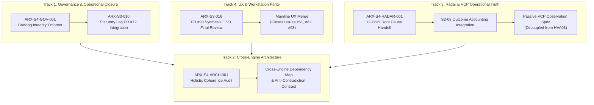

# ARX TERMINAL — SPRINT 4
## EXECUTION AND DEPENDENCY PLAN
### Prioritized Implementation Sequence, Critical Path, Workstream Parallelism and Owner Decision Gates

**Directive ID:** `ARX_SPRINT4_GOV001_BACKLOG_INTEGRITY_IMPLEMENTATION_001`  
**Canonical Task:** `ARX-S4-GOV-001`  
**Repository:** `daakara/finance`  
**Active Sprint:** `SPRINT_4`  
**Date:** 2026-10-26T13:55:00+01:00  
**Governance Framework:** ARX Closure Model v2 + Governance Efficiency v1.1  
**Decision Authority:** Research/Product Owner exclusively  

---

## 1. Sprint 4 Strategic Objective & Delivery Scope

Sprint 4 transitions ARX Terminal from isolated feature implementations to **system-wide decision coherence, operational truthfulness, and automated governance integrity**. 

Having formally closed Sprint 3 with controlled carry-forward, Sprint 4 focuses on:
1. **Closing Governance Blindspots (GOV-001):** Establishing an automated, machine-checkable backlog integrity validator (`tools/governance/validate_backlog_integrity.py`) that permanently eliminates cross-sprint task fragmentation and false completion claims.
2. **Harmonizing Cross-Engine Decisions (ARCH-001):** Auditing the interaction boundaries between all 5 financial engines (`confluence_engine`, `optimal_execution`, `gem_screener`, `corporate_events`, `smart_money`) to guarantee consistent price authority, risk boundaries, and non-contradictory recommendation vectors.
3. **Resolving Radar Truthfulness (RADAR-001):** Decoupling passive quantitative VCP observation from restricted human research (HVA01), explaining why Radar reports `Universe Scanner Pending`, and engineering an authentic screening pathway.
4. **Finalizing Workstation UX Parity:** Bringing the long-running Synthesis E V3 branch (PR #98) across the finish line into mainline production.

---

## 2. Workstream Topology & Team Parallelism

To maximize velocity without risking cross-worktree git collisions or invariant regressions, Sprint 4 organizes active work into **four parallel, decoupled tracks**:

---

## 3. Prioritized Implementation Increments

### Increment 1: Foundational Governance (Current Increment)
- **Target Tasks:** `ARX-S4-GOV-001`
- **Deliverables:**
  - `docs/planning/arx_canonical_backlog.schema.json`
  - `docs/planning/arx_canonical_backlog.json` (42 reconciled tasks)
  - `tools/governance/validate_backlog_integrity.py` (BI-001 to BI-012)
  - `tests/test_backlog_integrity_validator.py` (15/15 tests passing)
  - `ARX_SPRINT4_CANONICAL_BACKLOG_REGISTER.md`
- **Exit Condition:** Clean CI pass on non-activating PR targeting `main`.

### Increment 2: Workstation UX Mainline Finalization
- **Target Tasks:** `ARX-S3-016` (PR #98), `ARX-S3-004` (Issue #61), `ARX-S3-005` (Issue #62), `ARX-S3-006` (Issue #63)
- **Deliverables:**
  - Rebase/update PR #98 against fresh `main` (commit `4bf9f3b` post-PR #100).
  - Verify 147 SSG routes, Playwright e2e suites, and accessibility contracts.
  - Owner authorization for merge to `main`.
- **Exit Condition:** Issues #61, #62, #63 administratively closed; UX parity live on production.

### Increment 3: Pre-Flight Disclosures & Statutory Copy
- **Target Tasks:** `ARX-S3-010` (PR #72, Issue #67)
- **Deliverables:**
  - Cherry-pick / port statutory Form 4 reporting lag disclosures from PR #72 into `analyst_dashboard/smart_money/` and frontend components.
  - Reconcile copy with merged PR #100 dormant worker guarantees.
- **Exit Condition:** Issue #67 closed; truthful statutory lag badges live.

### Increment 4: Cross-Engine Coherence Audit
- **Target Tasks:** `ARX-S4-ARCH-001`
- **Deliverables:**
  - Comprehensive inspection of valuation discount vs technical confluence score semantics.
  - Verification of market session timestamps (EOD vs real-time quote propagation).
  - Production of `ARX_CROSS_ENGINE_DECISION_COHERENCE_REPORT.md`.
- **Exit Condition:** Architectural decision record (ADR) defining anti-contradiction invariants ratified by Owner.

### Increment 5: Minervini VCP / Radar Passive Observation Specification
- **Target Tasks:** `ARX-S4-RADAR-001`, `ARX-S3-013` (Issue #70), `ARX-S2-008` (PR #44)
- **Deliverables:**
  - Clean integration of S2-08 full-population accounting engine from PR #44 into mainline.
  - Passive observation execution specification (allowing market-wide EOD calculation without implying validated trading signals).
  - Presentation of Owner decision brief for scanner activation.
- **Exit Condition:** Research/Product Owner decision on VCP operational activation.

---

## 4. Critical Path & Dependency Graph

$$\mathbf{CRITICAL\_PATH:}\quad\text{ARX-S4-GOV-001}\longrightarrow\text{PR \#98 Merge}\longrightarrow\text{ARX-S4-ARCH-001}\longrightarrow\text{ARX-S4-RADAR-001}\longrightarrow\text{Sprint 4 Closure}$$

- **Dependency 1:** `ARX-S4-ARCH-001` depends on `PR #98 Merge` so that the architectural audit inspects the unified, final frontend state rather than deprecated intermediate layouts.
- **Dependency 2:** `ARX-S4-RADAR-001` depends on `ARX-S4-ARCH-001` to ensure scanner output contracts align with the platform-wide decision context model.
- **Non-Critical Path (Parallel):** Increment 3 (`ARX-S3-010` / PR #72) proceeds independently on an isolated branch without blocking Track 2 or Track 3.

---

## 5. Explicit Owner Decision Gates

The following capabilities are **OWNER-GATED** and strictly prohibited from autonomous activation:

| Gate ID | Capability | Current State | Required Prerequisite | Reopening Authority |
|:---:|---|:---:|---|:---:|
| **DG-01** | Synthesis E V3 PR #98 Production Merge | `DRAFT_PR_AWAITING_REVIEW` | Clean CI verification & review readback | Product Owner |
| **DG-02** | Minervini VCP Scanner Operational Activation | `ACTIVATION_DEFERRED (G-VCP-012)` | RADAR-001 passive spec & capacity audit | Product Owner |
| **DG-03** | Smart Money SEC Form 4 Production Ingestion | `NOT_AUTHORIZED` | Phase 1 post-release observation & Phase 2 spec | Product Owner |
| **DG-04** | Corporate Events Live Telemetry Ingestion | `NOT_AUTHORIZED` | Telemetry database scaling & rate-limit check | Product Owner |
| **DG-05** | HVA-00 V2.1 Formal Protocol Ratification | `NOT_GRANTED` | Stage P1 preparation package sign-off | Research Owner |
| **DG-06** | HVA-01 Human Formative Evaluation (Wave 4) | `NOT_AUTHORIZED` | Formal protocol ratification (DG-05) | Research Owner |
| **DG-07** | External Sigstore Evidence Custody | `NOT_AUTHORIZED` | Keyless signing pipeline certification | Security/Research Owner |

---

## 6. Sprint 4 Entry and Exit Criteria

### Entry Criteria (ALL MET):
1. Sprint 3 formally closed with accepted closeout attestation.
2. Comprehensive backlog reconciliation across Sprints 1, 2, and 3 complete.
3. Git working tree clean; dedicated isolated worktree created.
4. Smart Money Phase 1 merged to mainline (`4bf9f3b`).

### Exit Criteria (Required for Sprint 4 Certification):
1. `ARX-S4-GOV-001` implemented, passing all 15 automated test scenarios, and merged to `main`.
2. PR #98 reviewed, verified, and merged to `main`.
3. `ARX-S4-ARCH-001` cross-engine audit report completed and accepted.
4. `ARX-S4-RADAR-001` Minervini VCP root cause resolved with Owner decision rendered.
5. All 13 open GitHub issues resolved or assigned with active Sprint 4 / holding dispositions.
6. Closure-integrity validator passes with `VERDICT: PASS` across all tasks.
7. Zero regression in CI build gates, test suites, or frozen quantitative engine manifests.

---

## 7. Bounded Autonomous Execution Permissions

Under Directive `ARX_SPRINT4_GOV001_BACKLOG_INTEGRITY_IMPLEMENTATION_001`, the execution session is authorized to:
- Create and edit schema files, JSON backlogs, validators, tests, and documentation.
- Execute local Python and Node test suites.
- Create feature branches and commit isolated changes.
- Push feature branches to `origin` and open draft/non-activating PRs.
- Read GitHub API endpoints for issue and PR readback.

**Stop Rules (Autonomous Halts):**
- Any attempt or instruction to merge PRs into `main` without explicit Owner command.
- Any modification to production deployment configurations (`railway.json`, `wrangler.toml`).
- Any attempt to arm schedulers or initiate live network ingestion against external APIs (SEC, Alpaca, Sigstore).
- Any modification to frozen engine manifests (`FROZEN_ENGINE_MANIFEST_V2_5_1.json`).
