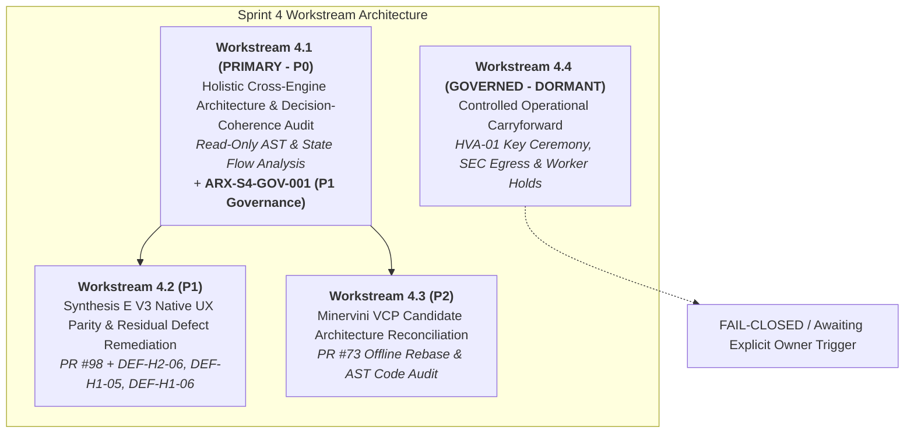

# ARX TERMINAL — SPRINT 4
## TASK PRIORITY & WORKSTREAM ARCHITECTURE MATRIX
### FORMAL SEQUENCING, DEPENDENCIES & WORKSTREAM ALLOCATION

**Document ID:** `ARX_SPRINT4_TASK_PRIORITY_AND_WORKSTREAM_MATRIX`  
**Directive ID:** `ARX_SPRINT4_BACKLOG_INTAKE_EVIDENCE_CORRECTION_001`  
**Governance Framework:** ARX Closure Model v2 + Governance Efficiency v1.1  
**Target Repository:** `daakara/finance`  
**Mainline Baseline HEAD:** [`4bf9f3b1b68bf7af8ca13b243c732afb909aa4e6`](https://github.com/daakara/finance/commit/4bf9f3b1b68bf7af8ca13b243c732afb909aa4e6)  
**Execution Timestamp:** 2026-10-26T13:58:00+01:00 (12:58:00 UTC)  
**Research Owner & Sole Authority:** David Akara (`daakara`)

---

## 1. Sprint 4 Workstream Architecture

Sprint 4 is organized into four sequential, non-interfering workstreams:

---

## 2. Workstream Breakdown & Task Allocation

### Workstream 4.1: Holistic Cross-Engine Architecture & Decision-Coherence Audit (PRIMARY / P0)
* **Objective:** Conduct an independent, end-to-end structural and AST dependency audit across all five ARX analytics and presentation engines.
* **Execution Posture:** Read-only inspection / AST call-graph mapping / Zero unratified mutations.
* **Tasks:**
  - `TSK-4.1-01`: AST dependency mapping of cross-engine imports across Radar, Minervini VCP, Corporate Events, Smart Money, and Valuation.
  - `TSK-4.1-02`: Server/Client component boundary audit (verifying React Server Components payload size, eliminating waterfall data fetches).
  - `TSK-4.1-03`: Data-flow coherence audit (verifying that backend PostgreSQL states map to UI badges with zero zero-substitution masking or unhandled errors).
  - `TSK-4.1-04`: Decision-first presentation contract verification across all 145 static export routes.
  - `ARX-S4-GOV-001`: Cross-Sprint Backlog Integrity and Closure Enforcement (P1 Governance).

---

### Workstream 4.2: Synthesis E V3 Native UX Parity & Residual Defect Remediation (P1)
* **Objective:** Verify and integrate the recovered clean draft PR #98 and resolve the 3 open residual UX defects.
* **Tasks:**
  - `TSK-4.2-01`: Reconcile and locally test PR #98 (`feat/synthesis-e-v3-ux-parity-clean`) against current mainline `4bf9f3b`.
  - `TSK-4.2-02`: Remediate `DEF-H2-06` (normalize orphaned `?tab=EXECUTION` deep-link to `"SMART_MONEY"`).
  - `TSK-4.2-03`: Remediate `DEF-H1-05` (enforce 44px coarse-pointer touch targets).
  - `TSK-4.2-04`: Remediate `DEF-H1-06` (harmonize `Inspect Telemetry →` navigation affordance).
  - `TSK-4.2-05`: Implement `ARCH-01` (Cloudflare edge cache invalidation purge trigger).

---

### Workstream 4.3: Minervini VCP Candidate Architecture Reconciliation & Clean Rebase (P2)
* **Objective:** Address merge conflicts on Draft PR #73 and perform offline code quality review without activating universe scanning.
* **Tasks:**
  - `TSK-4.3-01`: Create clean isolated worktree to resolve PR #73 merge conflicts against mainline `4bf9f3b`.
  - `TSK-4.3-02`: Verify bitemporal `VCPClassifier` 252-bar boundary enforcement and candle validation defenses against `test_vcp_activation.py` (481 tests).
  - `TSK-4.3-03`: Enforce 5-point operational distinction: (1) 35-symbol snapshot is internal diagnostic only, (2) production publication requires formal release, (3) full-market scanning remains disarmed (`VCP_NATURAL_SCHEDULER_ENABLED=0`), (4) Radar badge faithfully displays `'Universe Scanner Pending'`, and (5) scanner activation authority is exclusive to Research Owner. Preserves PR #73 as held candidate.

---

### Workstream 4.4: Controlled Operational Carryforward (GOVERNED / DORMANT)
* **Objective:** Safely track, hold, and preserve all unratified or high-risk operational items until explicit owner criteria are satisfied.
* **Tasks & Holdings:**
  - `CF-01`: HVA-01 V2.1 Protocol Ratification & Physical Key Ceremony (`GAP07`/`GAP08`).
  - `CF-02`: Smart Money continuous ingestion worker container creation (`SM_GATE_08`–`11`).
  - `CF-03`: Corporate Events live telemetry activation (`F-2BV-01`/`02`).
  - `CF-04`: Sigstore workload identity & external supply-chain attestation (PR #75).
  - `CF-05`: Statistical model tuning & weight changes (frozen).

---

## 3. Prioritized Task & Risk Classification Matrix

| Task Code | Priority | Workstream | Task Title | Risk Level | Target Surface | Prerequisite / Governance Gate |
| :--- | :---: | :---: | :--- | :---: | :--- | :--- |
| **TSK-4.1-01** | **P0** | **4.1** | Cross-Engine AST Dependency & Invariant Mapping | **LOW** | All 5 Core Engines | Baseline Mainline `4bf9f3b` |
| **TSK-4.1-02** | **P0** | **4.1** | RSC vs Client Decoupling & Payload Audit | **LOW** | `frontend/app/` | Baseline Mainline `4bf9f3b` |
| **TSK-4.1-03** | **P0** | **4.1** | State-Flow & Zero-Substitution Masking Audit | **LOW** | `analyst_dashboard/` & UI | Baseline Mainline `4bf9f3b` |
| **TSK-4.1-04** | **P0** | **4.1** | 145-Route Decision Affordance Verification | **LOW** | Static Export Pages | Baseline Mainline `4bf9f3b` |
| **ARX-S4-GOV-001**|**P1**| **4.1** | Cross-Sprint Backlog Integrity & Closure Enforcement | **LOW** | Governance Tooling | Implemented & CI-Verified (PR #101) |
| **TSK-4.2-01** | **P1** | **4.2** | PR #98 Synthesis E V3 Parity Local Verification | **MED** | `frontend/components/` | Workstream 4.1 Audit Output |
| **TSK-4.2-02** | **P1** | **4.2** | Remediate Orphaned `?tab=EXECUTION` (`DEF-H2-06`) | **LOW** | `frontend/app/page.tsx` | Pure Frontend State Test |
| **TSK-4.2-03** | **P2** | **4.2** | Enforce 44px Touch Targets (`DEF-H1-05`) | **LOW** | `PreFlightReadinessBar.tsx` | Playwright Touch Audit |
| **TSK-4.2-04** | **P3** | **4.2** | Harmonize Telemetry Affordance (`DEF-H1-06`) | **LOW** | `CompositeConvictionCard.tsx` | UI Click Handling Test |
| **TSK-4.2-05** | **P1** | **4.2** | Cloudflare Edge Cache Purge Trigger (`ARCH-01`) | **LOW** | `api/routes/screener.py` | Unit Contract Pass |
| **TSK-4.3-01** | **P2** | **4.3** | Rebase PR #73 VCP Screening Code vs `4bf9f3b` | **MED** | `analyst_dashboard/vcp/` | Worktree Isolation / No Deploy |
| **TSK-4.3-02** | **P2** | **4.3** | Validate 252-Bar Boundary Invariants | **LOW** | `tests/test_vcp_activation.py` | Isolated Pytest Pass |
| **TSK-4.4-01** | **HOLD**| **4.4** | HVA-01 V2.1 Physical Key Ceremony (`CF-01`) | **HIGH**| Airlock / Hardware Token | Owner Physical Presence Token |
| **TSK-4.4-02** | **HOLD**| **4.4** | Smart Money Dedicated Worker Provisioning (`CF-02`)| **HIGH**| Railway Worker Container | Owner Token `ARX_SM_ACTIVATE` |
| **TSK-4.4-03** | **HOLD**| **4.4** | Corporate Events Live Telemetry Rehearsal (`CF-03`)| **MED** | Railway Database Pool | `F-2BV-01`/`02` Pass Receipt |
