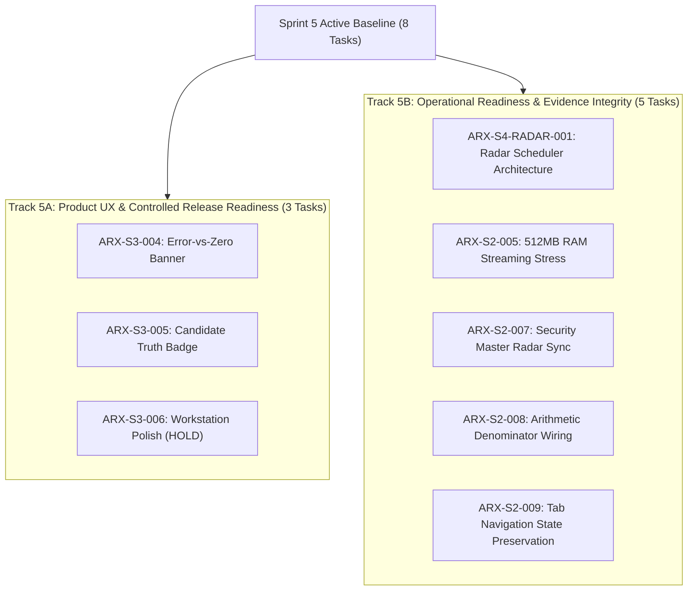

# ARX Terminal — Sprint 5 Formal Charter & Execution Baseline

**Directive:** `ARX_S4_FORMAL_CLOSURE_AND_S5_TRANSITION_032`  
**Active Sprint:** `SPRINT_5`  
**Governance Framework:** ARX Closure Model v2 + Governance Efficiency v1.1  
**Charter Baseline Commit:** `4e0979e9520b4cd8b58fd56ceecd47e842fb8028`  
**Charter Authority:** Product/Research Owner (`daakara`)  

---

## 1. Charter Objective & Operational Posture

Sprint 5 establishes the execution and discovery baseline following the administrative closure of Sprint 4.

The core objective of Sprint 5 is to decouple active user experience hardening and operational discovery from production release gates, while strictly preserving fail-closed security, evidence custody, and operational boundaries.

### Core Governance Boundaries:
1. **Administrative Assignment != Production Release**: Sprint 5 assignment does not grant production deployment authority.
2. **Discovery != Service Activation**: Track 5B operational discovery does not authorize natural scanner daemon activation or continuous SEC ingestion.
3. **Owner Holds Strictly Enforced**: Tasks bearing `HOLD` (e.g. `ARX-S3-006` and all 10 holding queue tasks) remain non-executable until explicit individual owner authorization.

---

## 2. Sprint 5 Scope Architecture

Sprint 5 comprises exactly **eight approved carryforward tasks** divided into two parallel, non-interfering tracks:



### Track 5A — Product UX and Controlled Release Readiness
Focuses on terminal usability, error state visibility, and candidate truth disclosure:
- **`ARX-S3-004`**: Error-vs-zero banner and retry affordance.
- **`ARX-S3-005`**: Candidate truth badge and visual suppression of stale metrics.
- **`ARX-S3-006`**: Research workstation layout polish (**Owner HOLD** preserved).
- *Associated Release Gate:* Separate qualification and owner review of PR #98 under Directive 031.

### Track 5B — Operational Readiness and Evidence Integrity
Focuses on bounded architectural discovery, benchmark verification, and state synchronization:
- **`ARX-S4-RADAR-001`**: Continuous scanner background daemon design (decoupled from HVA01).
- **`ARX-S2-005`**: Multi-asset stress testing under streaming quotes.
- **`ARX-S2-007`**: Dynamic Security Master to Radar scanner synchronization.
- **`ARX-S2-008`**: 6-outcome arithmetic denominator telemetry wiring.
- **`ARX-S2-009`**: Plain-English coverage disclosure and multi-tab state preservation.

---

## 3. Cross-Track Dependencies & External References

| Reference | Scope & Purpose | Current Status | Sprint 5 Action |
| :--- | :--- | :--- | :--- |
| **PR #98** | Synthesis E V3 Frontend UX Parity | **Merged Mainline** (`8b8eb58`) | Merged with 38 test suites; live production release decoupled |
| **PR #110** | Scanner status & coverage metadata integrity | **Merged Mainline** (`4e0979e`) | Merged; live production release decoupled |
| **PR #112** | Radar search intent stale asset invalidation | **Merged Mainline** (`7f27ae1`) | Merged; live production release decoupled |
| **PR #109** | Sprint Control System (SCS-v1) action engine | **Draft Published / CI Green** | Hosted CI verified (Run `40417319375`, 4/4 jobs PASS); awaiting owner merge |
| **PR #72** | Smart Money statutory disclosure remediation | Held unmerged | Complete independent disclosure qualification and owner merge decision |
| **PR #73** | Minervini VCP continuous scanner daemon | Held dormant | Maintain `VCP_NATURAL_SCHEDULER_ENABLED=0`; no activation |
| **OD-01** | Owner-pending corporate events catalyst policy | Architectural HOLD | Maintain current fail-closed mock/dormant boundaries |

---

## 4. Execution Priorities & Readiness Predicates

1. **Priority 1: Reconcile Sprint Control System (PR #109)**
   - Rebase PR #109 onto the new Sprint 5 authoritative baseline.
   - Regenerate action registers against the 43-task census.
2. **Priority 2: Smart Money Disclosure Qualification (PR #72)**
   - Audit reporting lag disclosures without activating background workers.
3. **Priority 3: Track 5B Operational Discovery**
   - Conduct offline benchmarks and synchronization tests in local testbeds.
4. **Priority 4: Track 5A UX Refinement**
   - Align frontend components with owner design feedback pending PR #98 disposition.

---

## 5. Formal Invariants & Restrictions

```ini
ACTIVE_SPRINT = SPRINT_5
APPROVED_CARRYFORWARDS = 8
TRACK_5A_TASKS = 3 (ARX-S3-004, ARX-S3-005, ARX-S3-006)
TRACK_5B_TASKS = 5 (ARX-S4-RADAR-001, ARX-S2-005, ARX-S2-007, ARX-S2-008, ARX-S2-009)
OWNER_HOLD_PRESERVED = ARX-S3-006 (HOLD)
HOLDING_QUEUE_PRESERVED = 10 TASKS (ALL HOLD)
NATURAL_SCANNER = DISABLED (VCP_NATURAL_SCHEDULER_ENABLED=0)
SEC_EGRESS = DISABLED (ARX_SEC_EGRESS_ROLE=DISABLED)
SMART_MONEY_INGESTION = DISABLED (ARX_SM_BACKUP_BUCKET=DISABLED)
PRODUCTION_DEPLOYMENT = NOT_AUTHORIZED
```
