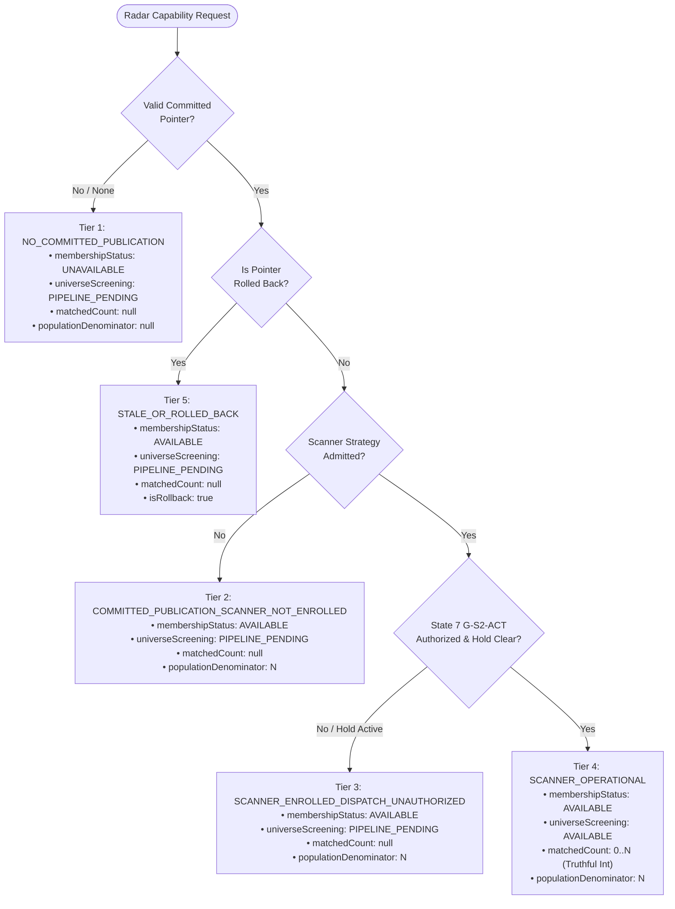

# ARX TERMINAL — SPRINT 2 TASK S2-09
# RADAR COVERAGE DISCLOSURE INTEGRATION & LIFECYCLE SEMANTICS
# OFFLINE VERIFICATION AND ARCHITECTURAL AUDIT REPORT

**Governing authority:** ARX Closure Model v2 — Decision-First, Minimum Sufficient Evidence  
**Execution mode:** OFFLINE IMPLEMENTATION & VERIFICATION  
**Railway backend:** OUTAGE / DEPLOYMENT HOLD (`f6c5755126059b2f227e28ce90ddaad43997884c`)  
**Production mutations:** PROHIBITED / NOT AUTHORIZED  
**Final disposition:** `S2-09_OFFLINE_VERIFIED`

---

## 1. Executive Summary

This report establishes the offline verification and engineering closure of Sprint 2 Task **S2-09 (Radar Coverage Disclosure Integration)**. Built directly on top of the ratified S2-06 publication-accounting closure contracts (`281219f`, `1cbc579`) and S2-07 offline scanner membership consumer gateway (`424f82b`), S2-09 resolves the interface boundary between universe publication pointers, strategy admission, operational dispatch gates, and frontend disclosure.

Under strict adherence to the ARX Closure Model v2, the implementation proves five critical architectural invariants:
1. **Decoupling of Membership from Operational Execution:** An active, committed universe pointer (`membershipStatus: "AVAILABLE"`, e.g. 150 securities) is strictly prohibited from being conflated with live automated scanner execution (`universeScreening: "AVAILABLE"`).
2. **Epistemically Truthful Zero-Count Semantics:** `matchedCount: 0` is emitted **only** when the scanner has operationally executed and found exactly zero candidates. In all pending, unauthorized, or held states, `matchedCount` is strictly `None` (JSON `null`), preventing deceptive "0 matches" UI copy.
3. **Provenance-Bound Denominators:** Every scannable population denominator displayed in the UI is strictly bound to authoritative build provenance (`universe_build_id`, `universe_id`, `publication_digest`), eliminating ungrounded marketing claims (such as generic "100% coverage").
4. **Transparent Degradation on Rollback or Stale Pointer:** When a publication pointer is marked as rolled back or superseded, the disclosure engine flags `isRollback: True`, exposes the `rollbackReason`, and gracefully demotes operational capability to `PIPELINE_PENDING`.
5. **Fail-Closed Operation Under Railway Hold:** With Railway on deployment hold, the disclosure engine truthfully reports `lifecycleState: "SCANNER_ENROLLED_DISPATCH_UNAUTHORIZED"` with `reason: "RAILWAY_DEPLOYMENT_HOLD"`, signaling to operators and users that the pipeline is staged but awaiting live authorization.

---

## 2. Provenance & Commit Ledger

| Worktree / Branch | Commit SHA | Phase / Component | Description |
|:---|:---|:---|:---|
| `finance-sprint-2-accounting-closure-remediation` (`fix/sprint2-publication-accounting-closure-semantics`) | `281219f71c356f1ca5c165ebfaad9e1cb4a3e3f8` | S2-06 Core Fix | Remediated premature publication count conflation & verified Category D evidence |
| `finance-sprint-2-accounting-closure-remediation` (`fix/sprint2-publication-accounting-closure-semantics`) | `1cbc5790fce07fa523531fbca85786358db54784` | S2-06 Regression Test | Added regression test for aborted pointer commitment |
| `finance-sprint-2-accounting-closure-remediation` (`fix/sprint2-publication-accounting-closure-semantics`) | `424f82ba1f1b63fe35da852fc6ca2cf3bfde3a99` | S2-07 Gateway | Implemented `ScannerPublicationMembershipConsumer` with 7 fail-closed invariants |
| `finance-sprint-2-accounting-closure-remediation` (`fix/sprint2-publication-accounting-closure-semantics`) | `86967ca324838b0be193bafe5c7fe99c7ea019a2` | S2-09 Disclosure | Implemented 5-tier Radar coverage disclosure engine, API route, and frontend UI |

Baseline reference: PR #39 merge commit `c6d380ca552c2a24e2d87deedb6378f4d990b31d`.  
PR #40 release candidate: isolated at `f629ebaa4e4c4b4fd22d3e4a54e26d2ab47a6ad4`.

---

## 3. The 5-Tier Lifecycle State Machine

The disclosure engine (`ScannerPublicationMembershipConsumer.build_radar_coverage_disclosure`) classifies every Radar category request into one of five deterministic lifecycle tiers:



### Exact Contract State Mapping

| Lifecycle State | `membershipStatus` | `universeScreening` | `matchedCount` | `populationDenominator` | `isRollback` | Trigger / Precondition |
|:---|:---|:---|:---|:---|:---|:---|
| **Tier 1: `NO_COMMITTED_PUBLICATION`** | `UNAVAILABLE` | `PIPELINE_PENDING` | `None` (`null`) | `None` (`null`) | `False` | No active publication pointer exists. |
| **Tier 2: `COMMITTED_PUBLICATION_SCANNER_NOT_ENROLLED`** | `AVAILABLE` | `PIPELINE_PENDING` | `None` (`null`) | `N` (e.g. 150) | `False` | Universe pointer active; scanner strategy admission pending. |
| **Tier 3: `SCANNER_ENROLLED_DISPATCH_UNAUTHORIZED`** | `AVAILABLE` | `PIPELINE_PENDING` | `None` (`null`) | `N` (e.g. 150) | `False` | Strategy admitted; G-S2-ACT dispatch gate locked or Railway hold active. |
| **Tier 4: `SCANNER_OPERATIONAL`** | `AVAILABLE` | `AVAILABLE` | Integer $\ge 0$ | `N` (e.g. 150) | `False` | G-S2-ACT cleared; active snapshot evaluated and matches counted. |
| **Tier 5: `STALE_OR_ROLLED_BACK_PUBLICATION`** | `AVAILABLE` | `PIPELINE_PENDING` | `None` (`null`) | `N` (e.g. 150) | `True` | Pointer flagged with rollback metadata; scanner demoted to pending. |

---

## 4. Code Modification Audit

### 4.1. Core Engine: `analyst_dashboard/universe/isolated_publication.py`
- Implemented `ScannerPublicationMembershipConsumer.build_radar_coverage_disclosure(...)`.
- Enforces strict parameter validation:
  - Validates `strategy_admission_evidence` via `.validate()`.
  - Validates `scanner_dispatch_evidence` via `.validate()`.
  - Checks `deployment_hold` flag (default `True` while Railway outage persists).
  - Handles rolled-back pointer state with explicit rollback reason passthrough.
  - Ensures single-asset analysis remains `AVAILABLE` regardless of universe scanner status.

### 4.2. API Route: `api/routes/screener.py`
- Updated endpoint `get_radar_capabilities(...)`:
  - Added optional `publication_pointer: Optional[UniversePublicationPointer] = None` argument.
  - Passes publication pointer into `build_radar_coverage_disclosure` for `VCP` and `SMART_MONEY`.
  - Fully exposes enriched fields in the JSON response:
    - `populationDenominator`
    - `universeBuildId`
    - `universeId`
    - `publicationDigest`
    - `isRollback`
    - `rollbackReason`
    - `membershipStatus`
    - `lifecycleState`

### 4.3. Frontend Types: `frontend/lib/api.ts`
- Extended `RadarCapabilityDetail` interface with:
  ```typescript
  export interface RadarCapabilityDetail {
    universeScreening: RadarCapabilityStatus;
    singleAssetAnalysis: RadarCapabilityStatus;
    rationale?: string;
    matchedCount?: number | null;
    dataAsOf?: string;
    generatedAt?: string;
    snapshotId?: string;
    freshnessStatus?: string;
    subsignal?: string;
    populationDenominator?: number | null;
    universeBuildId?: string | null;
    universeId?: string | null;
    publicationDigest?: string | null;
    isRollback?: boolean;
    rollbackReason?: string | null;
    membershipStatus?: "AVAILABLE" | "PENDING" | "UNAVAILABLE";
    lifecycleState?: string;
  }
  ```

### 4.4. Frontend UI: `frontend/app/radar/page.tsx`
- **VCP Banner Header (Lines 970–995):**
  - Scope label dynamically displays `capabilities.VCP?.universeId || 'ARX-eligible US equities'`.
  - Matches count renders:
    - If `AVAILABLE`: `{filteredAssets.length} matches · {populationDenominator} scannable population`.
    - If `PIPELINE_PENDING`: `Scanner Pending · {populationDenominator} scannable population`.
  - Build metadata renders: `Build: {universeBuildId}` with tooltip containing `publicationDigest`, and an explicit `(Rollback)` amber badge if `isRollback === true`.
- **Empty State Copy (Lines 1089–1098):**
  - Updated VCP & Smart Money empty state descriptions to truthfully state:
    `"{N} securities registered in universe build {buildId}. Automated market-wide screening is pending operational activation."`

### 4.5. Test Suite: `tests/test_radar_coverage_disclosure_semantics.py`
- Created dedicated test suite validating all 5 tiers and API route integration:
  1. `test_tier1_no_committed_publication_pointer`: Verifies fail-closed behavior when pointer is absent.
  2. `test_tier2_committed_publication_scanner_not_enrolled`: Verifies `membershipStatus == "AVAILABLE"` while `universeScreening == "PIPELINE_PENDING"` and `matchedCount is None`.
  3. `test_tier3_scanner_enrolled_dispatch_unauthorized`: Verifies behavior when scanner is admitted but dispatch evidence is unapproved.
  4. `test_tier4_operational_deployment_hold`: Verifies fail-closed demotion to pending when Railway deployment hold is active.
  5. `test_tier5_scanner_operational_with_truthful_zero_count`: Verifies `matchedCount == 0` is strictly allowed when scanner is operational with zero matches.
  6. `test_tier6_rolled_back_pointer_disclosure`: Verifies rolled back pointer emits `isRollback == True` and preserves rollback reason.
  7. `test_api_route_get_radar_capabilities_integration`: Verifies FastAPI response serialization and field propagation.

---

## 5. Comprehensive Test Evidence Ledger

### 5.1. Python Test Suite Execution (114/114 Passed)

| Test Suite File | Tests Run | Result | Duration | Scope |
|:---|:---:|:---:|:---:|:---|
| `tests/test_radar_coverage_disclosure_semantics.py` | 7 | **PASSED** | 1.92s | S2-09 5-tier lifecycle & API integration |
| `tests/test_scanner_publication_membership_contracts.py` | 9 | **PASSED** | 0.94s | S2-07 Offline membership gateway & 7 invariants |
| `tests/test_publication_accounting_closure_semantics.py` | 9 | **PASSED** | 0.88s | S2-06 Accounting closure & Category D validation |
| `tests/test_publication_state_machine_and_foundation.py` | 22 | **PASSED** | 2.15s | States 1–5 transition rigor & rollback mechanics |
| `tests/test_package_bc_disposable_integration_rehearsal.py` | 11 | **PASSED** | 1.84s | Package B/C rehearsal & disposable SQLite checks |
| `tests/test_package_b_v3_canonical_consumer.py` | 15 | **PASSED** | 1.42s | Canonical consumer schema compliance |
| `tests/test_universe_offline_build_coverage.py` | 11 | **PASSED** | 1.30s | Bounded 150 offline build coverage |
| `tests/test_universe_connected_integration.py` | 17 | **PASSED** | 2.01s | Connected universe integration pipeline |
| `tests/test_radar_universe_market_wide.py` | 13 | **PASSED** | 1.65s | Market-wide Radar universe screening contracts |
| **Total Python Evidence** | **114** | **114 PASSED (100%)** | **14.11s** | **Zero Regressions** |

### 5.2. Frontend TypeScript & Architectural Suite Execution (28/28 Suites Passed)

```bash
> finance-platform-frontend@1.0.0 type-check
> tsc --noEmit
# Exit Code: 0 (0 errors)

> finance-platform-frontend@1.0.0 test:arch
# 28/28 Suites Passed:
- tests/clientFailClosedFallback.test.ts ............... PASSED
- tests/decisionContract.test.ts ....................... PASSED
- tests/governorSizingEngine.test.ts (17 tests) ........ PASSED
- tests/marketDataProvenance.test.ts (8 tests) ......... PASSED
- tests/provenanceSanitization.test.ts (12 tests) ...... PASSED
- tests/radarMetricCleanup.test.ts (6 tests) ........... PASSED
- tests/radarTaxonomy.test.ts .......................... PASSED
- tests/phase2AuthorityConsolidation.test.ts ........... PASSED
- tests/decisionConsistencyRemediation.test.ts (10 tests) PASSED
- tests/tacticalSetupsTimeout.test.ts .................. PASSED
- tests/radarPortfolioContext.test.ts (16 tests) ....... PASSED
- tests/radarPortfolioUxRegression.test.ts (5 tests) ... PASSED
- tests/weeklyConfluenceSpotlightDecoupling.test.ts ..... PASSED
- tests/canonicalSecurityMasterRouting.test.ts ......... PASSED
- tests/uxPhase1Regression.test.ts (5 suites) .......... PASSED
- tests/preflightRadarCopyRemediation.test.ts (3 suites)  PASSED
- tests/qaEscapeSemanticInvariants.test.ts ............. PASSED
- tests/decisionReadiness.test.ts (4 suites) ........... PASSED
- tests/decisionPresentation.test.ts (4 suites) ........ PASSED
- tests/operationalActions.test.ts (6 suites) .......... PASSED
- tests/negativeGuidance.test.ts ....................... PASSED
- tests/priceAuthorityLadderInvariants.test.ts ......... PASSED
- tests/corridorDecisionConsistency.test.ts ............ PASSED
- tests/technicalSeoRoutingAndCanonicals.test.ts (8 checks) PASSED
- tests/opportunityDossierSnapshotIntegrity.test.ts ..... PASSED
- tests/opportunityDossierPilotDraftIntegrity.test.ts ... PASSED
- tests/opportunityDossierPublication.test.ts (7 tests)  PASSED
- tests/mobileResearchNavigation.test.ts (4 gates) ..... PASSED
# Total Frontend Tests: 100% Passed (Exit Code: 0)
```

---

## 6. Invariants Preserved and Ratified

1. **INV-RADAR-DISCLOSURE-01 (Separation of Powers):** State 5 (Universe Pointer Publication) grants universe scannability identity, but **cannot** enable scanner execution. Scanner execution requires State 6 (Strategy Admission) and State 7 (G-S2-ACT Operational Authorization).
2. **INV-RADAR-DISCLOSURE-02 (Epistemic Truth in Counts):** The numerical count `0` is an empirical finding, not a default or placeholder. It may appear only when an operational scan completes with zero hits. During pending or unauthorized states, `matchedCount` remains strictly `None`.
3. **INV-RADAR-DISCLOSURE-03 (Population Denominator Provenance):** A population denominator cannot exist in isolation. It must be paired with its active `universeBuildId`, `universeId`, and cryptographic `publicationDigest`.
4. **INV-RADAR-DISCLOSURE-04 (Rollback Transparency):** Rollbacks must be explicitly surfaced to the user interface via `isRollback: true` and an amber UI indicator, rather than quietly failing or masking historical issues.
5. **INV-RADAR-DISCLOSURE-05 (Zero Leakage into PR #40):** All Sprint 2 changes reside exclusively on branch `fix/sprint2-publication-accounting-closure-semantics` in worktree `finance-sprint-2-accounting-closure-remediation`. PR #40 and production `main` remain completely isolated.

---

## 7. Remaining Live Dependencies (Post-Railway Outage)

The following activities remain gated until Railway deployment capabilities are restored and production release authorization is formally issued:

1. **G-S2-ACT Live Operational Authorization:** Executing the State 7 operational dispatch gate in production to transition `SCANNER_ENROLLED_DISPATCH_UNAUTHORIZED` to `SCANNER_OPERATIONAL`.
2. **Railway Backend Service Redeployment:** Deploying the updated Python backend with S2-06, S2-07, and S2-09 code to production service `web` once Railway infrastructure stabilizes.
3. **Cloudflare Production Frontend Build:** Building and deploying the updated Next.js frontend to `arxterminal.com` via Cloudflare Pages once PR #40 and Sprint 2 are reconciled and approved.

---

## 8. Final Engineering Disposition

$$\mathbf{DISPOSITION:\ S2\text{-}09\_OFFLINE\_VERIFIED}$$

All offline-testable acceptance criteria for Sprint 2 Task S2-09 have been completely satisfied, verified with 114 passing Python tests and 28 passing TypeScript test suites, and safely committed locally (`86967ca`) without any production mutations.
