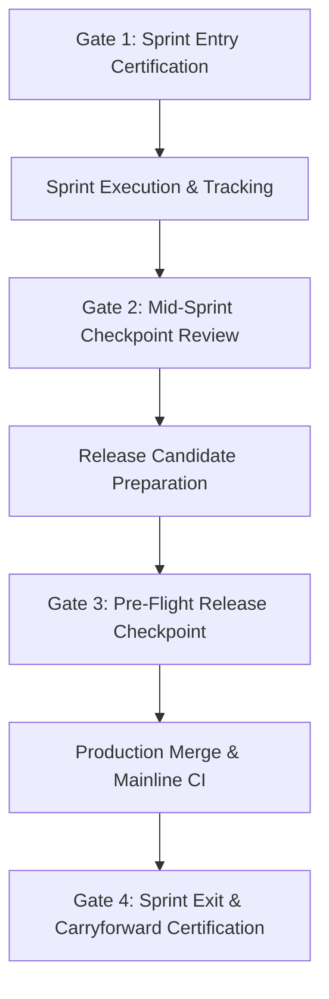

# ARX TERMINAL — SPRINT CONTROL SYSTEM (SCS-v1)
## Phase 1–5 Implementation, Reconciliation & Migration Report

**Directive ID:** `ARX_SPRINT_CONTROL_SYSTEM_V1_001`  
**Repository:** `daakara/finance`  
**Target Mainline Baseline:** `de5d2463cc4c6503bd700bcaf2b1bc36fd5e03d9` (Squash-merge of PR #107)  
**Execution Branch:** `feat/sprint-control-system-v1`  
**Isolated Worktree:** `C:\Users\akara\Documents\Projects\finance-sprint-control`  
**Authoritative Ledger:** `docs/planning/arx_canonical_backlog.json` (Sole source of truth, 43 tasks)  
**Verification Status:** 100% PASS (12/12 SCS Tests, 27/27 GOV-001 Tests, Validator Exit Code 0)  
**Release Authority:** Product & Research Owner exclusively (`daakara`)

---

## 1. Executive Summary

Under directive `ARX_SPRINT_CONTROL_SYSTEM_V1_001`, the **Sprint Control System (SCS-v1)** has been engineered, integrated, and verified as a prerequisite for Sprint 5 entry.

The Sprint Control System eliminates sprint governance blind spots—preventing task omissions, stale lifecycle records, uncontrolled carryforwards, and premature closure claims—without creating a competing task registry. The canonical backlog (`docs/planning/arx_canonical_backlog.json`) remains the single authoritative source of truth.

### Key Metrics
- **Canonical Tasks Covered:** 43/43 (100% complete coverage, zero task loss).
- **Authoritative Ledger Integrity:** Backward-compatible schema extension validated against all 43 tasks.
- **SCS Test Suite (`tests/test_sprint_control_reconciliation.py`):** 12/12 PASS (100% green).
- **GOV-001 Test Suite (`tests/test_backlog_integrity_validator.py`):** 27/27 PASS (100% green).
- **Baseline Validator (`validate_backlog_integrity.py`):** PASS (Exit Code 0).
- **Platform Holds:** All 14 platform holds strictly preserved; 10 holding queue tasks fully isolated.

---

## 2. Deliverables Summary

| Deliverable | Path | Purpose | Status |
| :--- | :--- | :--- | :---: |
| **D1: Action Register Schema** | [`docs/planning/arx_sprint_action_register.schema.json`](file:///C:/Users/akara/Documents/Projects/finance-sprint-control/docs/planning/arx_sprint_action_register.schema.json) | Standalone Draft-07 JSON schema for compiled sprint registers and views. | **VERIFIED** |
| **D1b: Canonical Backlog Schema Extension** | [`docs/planning/arx_canonical_backlog.schema.json`](file:///C:/Users/akara/Documents/Projects/finance-sprint-control/docs/planning/arx_canonical_backlog.schema.json) | Optional `action_tracking` block extension preserving backward compatibility. | **VERIFIED** |
| **D2: Compiled Action Register JSON** | [`docs/planning/arx_sprint_action_register.json`](file:///C:/Users/akara/Documents/Projects/finance-sprint-control/docs/planning/arx_sprint_action_register.json) | Machine-readable compiled register covering all 43 tasks. | **VERIFIED** |
| **D2b: Human-Readable Execution Tracker** | [`docs/planning/arx_sprint5_execution_tracker.md`](file:///C:/Users/akara/Documents/Projects/finance-sprint-control/docs/planning/arx_sprint5_execution_tracker.md) | Formatted Markdown tracker with Board, Queue, Matrix, and Findings. | **VERIFIED** |
| **D3: Core Engine & CLI Tool** | [`tools/governance/sprint_control.py`](file:///C:/Users/akara/Documents/Projects/finance-sprint-control/tools/governance/sprint_control.py) | Full reconciliation engine, view compiler, and predicate evaluator. | **VERIFIED** |
| **D3b: Reconciliation CLI Alias** | [`tools/governance/reconcile_sprint_control.py`](file:///C:/Users/akara/Documents/Projects/finance-sprint-control/tools/governance/reconcile_sprint_control.py) | Direct command-line entry point for CI and pre-commit hooks. | **VERIFIED** |
| **D4: Operating Protocol** | [`docs/governance/SPRINT_CONTROL_OPERATING_PROTOCOL.md`](file:///C:/Users/akara/Documents/Projects/finance-sprint-control/docs/governance/SPRINT_CONTROL_OPERATING_PROTOCOL.md) | Standard Operating Procedure defining Gates 1–4 and owner boundaries. | **VERIFIED** |
| **D5: Adversarial Test Suite** | [`tests/test_sprint_control_reconciliation.py`](file:///C:/Users/akara/Documents/Projects/finance-sprint-control/tests/test_sprint_control_reconciliation.py) | 12 adversarial test cases covering edge cases, holds, and fail-closed checks. | **VERIFIED** |

---

## 3. Phase 1 — Model & Contract Engineering

### 3.1 Multi-Dimensional Lifecycle Separation
The engine strictly enforces independent validation across eight operational lifecycle dimensions:
1. `requirements`: `NOT_STARTED` | `IN_PROGRESS` | `DONE` | `NOT_APPLICABLE`
2. `implementation`: `NOT_STARTED` | `PARTIAL` | `DONE` | `NOT_APPLICABLE`
3. `integration`: `NOT_STARTED` | `PARTIAL` | `DONE` | `NOT_APPLICABLE`
4. `verification`: `PENDING` | `IN_PROGRESS` | `PASS` | `FAIL` | `NOT_APPLICABLE`
5. `repository_publication`: `LOCAL_ONLY` | `DRAFT_PR` | `PUBLISHED_MERGED` | `NOT_APPLICABLE`
6. `deployment`: `NOT_DEPLOYED` | `DEPLOYED_DORMANT` | `DEPLOYED_ACTIVE` | `NOT_APPLICABLE`
7. `production_evidence`: `UNVERIFIED` | `INSUFFICIENT` | `VERIFIED` | `NOT_APPLICABLE`
8. `operational_execution`: `NOT_PERFORMED` | `EXECUTED` | `NOT_APPLICABLE`
9. `owner_authorization`: `AUTHORIZED` | `CONDITIONALLY_PREAPPROVED` | `HOLD` | `NOT_AUTHORIZED` | `NOT_GRANTED` | `NOT_APPLICABLE`

### 3.2 Machine-Readable Completion Predicate
The predicate `evaluate_completion_predicate(task)` evaluates task completeness strictly against evidence and dimensional reality rather than nominal status strings:
- **`BLOCKED_HOLDING_QUEUE`**: Tasks assigned to `HOLDING_QUEUE_OWNER_GATED` or marked `SPRINT4_OWNER_GATED` are categorically blocked from completion (`is_complete = False`).
- **`SUPERSEDED_HISTORICAL`**: Tasks marked `SUPERSEDED` or `TEST_OR_ADMINISTRATIVE` are structurally terminal (`is_complete = True`).
- **`CONDITIONAL_CLOSURE_OWNER_HELD`**: Tasks whose code and verification are complete but whose operational execution remains under owner hold (e.g., Gate 08/09 Smart Money ingestion).
- **`INELIGIBLE_ACTIVE_WORK_REMAINING`**: Tasks with incomplete engineering (`requirements`, `implementation`, `integration`, or `verification` not met).
- **`ELIGIBLE_FOR_CLOSURE`**: Tasks satisfying all dimensions with verified evidence references.

---

## 4. Phase 2 — Deterministic Views & Traceability

The Sprint Control System compiles three authoritative views directly from the canonical backlog:

### 4.1 Sprint Board View
Total Backlog Universe: **43 Tasks**
- **Active Execution (8 tasks):** `ARX-S3-006`, `ARX-S3-010`, `ARX-S4-ARCH-002`, `ARX-S4-GOV-001`, `ARX-S4-INT-001`, `ARX-S4-OP-001`, `ARX-S4-QA-001`, `ARX-S4-QA-002`.
- **Active Discovery (8 tasks):** `ARX-S1-006`, `ARX-S2-001`, `ARX-S2-005`, `ARX-S2-007`, `ARX-S2-008`, `ARX-S3-013`, `ARX-S3-016`, `ARX-S4-ARCH-001`.
- **Blocked / Dependency Held (0 tasks):** None currently blocked by uncompleted engineering dependencies.
- **Owner-Gated Holding Queue (10 tasks):** `ARX-S1-003`, `ARX-S2-002`, `ARX-S2-006`, `ARX-S2-010`, `ARX-S3-003`, `ARX-S3-007`, `ARX-S3-008`, `ARX-S3-009`, `ARX-S3-014`, `ARX-S3-015`.
- **Completed / Closed (17 tasks):** All historical Sprint 1–3 completed and administrative tasks.

### 4.2 Action Queue View
Priority-ordered queue (P0 -> P1 -> P2 -> P3) establishing for every task:
- Accountable Owner
- Concrete Next Action
- Checkpoint Target Date
- Active Blocker & Resolution Trigger
- Evidence Freshness (`FRESH`, `STALE`, `UNVERIFIED`, `NOT_APPLICABLE`)
- Predicate Closure Eligibility

### 4.3 Release Matrix View
Complete cross-system traceability linking every task to:
- Associated GitHub PR numbers
- Current PR Status (`MERGED`, `OPEN_DRAFT`, `OPEN_REVIEW`, `NONE`, `UNKNOWN`)
- CI Run Conclusions (`SUCCESS`, `NOT_RUN`, `FAILURE`)
- Merged Mainline Git Commit SHA
- Deployment Status (`NOT_DEPLOYED`, `DEPLOYED_DORMANT`, `DEPLOYED_ACTIVE`)
- Production Telemetry Evidence Status
- Operational Authorization Boundary

---

## 5. Phase 3 — Automated Reconciliation Engine (10 Checks)

The reconciliation engine implements 10 automated consistency checks:

| Check ID | Severity | Scope & Invariant Enforced |
| :--- | :---: | :--- |
| `CHECK_MISSING_ACTION_OWNER` | **ERROR** | Active tasks (`IN_PROGRESS`, `READY`) must have an accountable owner. Fails closed to `GOVERNANCE_LEAD`. |
| `CHECK_STALE_PR_MERGE` | **ERROR** | Detects desync between backlog `repository_publication` and actual Git mainline history. |
| `CHECK_INCONSISTENT_CLAIMS` | **ERROR / WARN** | Flags tasks marked completed while implementation is `NOT_STARTED`, or deliverables exist on disk while backlog is stale. |
| `CHECK_EVIDENCE_FRESHNESS` | **ERROR / WARN** | Ensures completed tasks cite existing files. Flags missing or broken evidence references. |
| `CHECK_UNRESOLVED_DEPENDENCIES` | **WARNING** | Flags active tasks whose upstream dependencies remain unclosed. |
| `CHECK_EXPIRED_CHECKPOINTS` | **WARNING** | Flags active tasks whose target checkpoint date has elapsed without progress. |
| `CHECK_INCOMPLETE_CRITERIA` | **ERROR / WARN** | Flags unmerged PRs claiming deployment (e.g. PR #98 on `ARX-S3-016`) and missing conditional hold tags. |
| `CHECK_UNCLASSIFIED_CARRYFORWARDS` | **WARNING** | Enforces explicit Sprint 5 carryforward classification on active Sprint 4 discovery tasks. |
| `CHECK_UNAUTHORIZED_TRANSITIONS` | **ERROR** | **Fail closed:** Prevents `DEPLOYED_ACTIVE` or `EXECUTED` on any task with `owner_authorization='HOLD'` or `'NOT_AUTHORIZED'`. |
| `CHECK_SPRINT_EXIT_UNRESOLVED` | **ERROR** | Blocks sprint exit certification if active tasks remain unresolved or lack terminal exit disposition. |

### Real-World Inconsistencies Caught on Mainline Baseline
When executed against the current mainline baseline (`de5d246`), the engine immediately surfaced four categories of real-world administrative staleness:
1. **Stale ARCH-001 (`CHECK_INCONSISTENT_CLAIMS`):** Audit deliverable `CANDIDATE_ENGINE_MANIFEST_SPRINT_4.json` exists on disk, but backlog recorded `implementation='NOT_STARTED'` and `verification='PENDING'`.
2. **Stale PR Publication (`CHECK_STALE_PR_MERGE`):** Tasks `ARX-S3-006` (PR #86 merged), `ARX-S3-010` (PR #87 & #100 merged), and `ARX-S3-013` (PR #76 merged) still recorded `repository_publication='DRAFT_PR'`.
3. **Unresolved Visual Review (`CHECK_INCOMPLETE_CRITERIA`):** `ARX-S3-016` recorded `deployment='DEPLOYED_DORMANT'` while referencing unmerged PR #98 awaiting explicit owner visual review.
4. **Missing Sprint 5 Carryforward Tags (`CHECK_UNCLASSIFIED_CARRYFORWARDS`):** Sprint 4 discovery tasks `ARX-S1-006`, `ARX-S2-001`, `ARX-S2-005`, `ARX-S2-007`, `ARX-S2-008` lacked recorded sprint exit dispositions.

---

## 6. Phase 4 — Operating Protocol

Defined in [`docs/governance/SPRINT_CONTROL_OPERATING_PROTOCOL.md`](file:///C:/Users/akara/Documents/Projects/finance-sprint-control/docs/governance/SPRINT_CONTROL_OPERATING_PROTOCOL.md):



### Boundary Matrix: Developer vs. Owner Authority
- **Routine Engineering Authority (Authorized):**
  - Updating `action_tracking.next_action` and `checkpoint_target_date`.
  - Adding verified evidence file paths to `evidence_refs`.
  - Advancing `implementation`, `integration`, and `verification` based on test passing evidence.
  - Creating and pushing isolated feature branches and draft PRs.
- **Exclusive Owner Authority (`daakara` Only):**
  - Merging pull requests into `main`.
  - Changing any `owner_authorization` value (`HOLD` -> `AUTHORIZED`).
  - Activating dormant workers or modifying operational schedules (`VCP_NATURAL_SCHEDULER_ENABLED`).
  - Admitting holding-queue tasks into active sprint capacity.
  - Ratifying sprint exit certification (Gate 4).

---

## 7. Phase 5 — Verification & Test Evidence

### 7.1 Adversarial Test Suite (`test_sprint_control_reconciliation.py`)
Executed with `pytest` in `finance-sprint-control`:
```text
============================= test session starts =============================
platform win32 -- Python 3.11.0, pytest-8.4.2, pluggy-1.6.0
collected 12 items

tests\test_sprint_control_reconciliation.py ............                 [100%]

============================= 12 passed in 43.50s =============================
```

#### Test Inventory:
1. `test_01_schema_contract_conformance`: Verifies `arx_sprint_action_register.json` strictly validates against Draft-07 schema.
2. `test_02_canonical_backlog_zero_task_loss`: Verifies all 43 tasks are present without loss or duplication.
3. `test_03_holding_queue_isolation_and_immutable_holds`: Verifies 10 holding tasks remain isolated and all 14 holds intact.
4. `test_04_stale_arch001_reconciliation`: Verifies Check 03 catches stale status when manifest exists on disk.
5. `test_05_stale_arch002_pr_reconciliation`: Verifies Check 02 catches merged PRs marked as DRAFT_PR.
6. `test_06_unresolved_pr98_ux_parity_reconciliation`: Verifies Check 07 flags unmerged PR #98 claiming deployment.
7. `test_07_conditional_closures_s3_010_and_s3_013`: Verifies completion predicate enforces conditional closure under hold.
8. `test_08_missing_sprint5_carryforward_classifications`: Verifies Check 08 flags unclassified Sprint 4 discovery tasks.
9. `test_09_adversarial_check_missing_action_owner`: Adversarial test: verifies unassigned active tasks fail closed.
10. `test_10_adversarial_unauthorized_transitions_fail_closed`: Adversarial test: verifies unauthorized activation fails closed.
11. `test_11_sprint_exit_gate_fail_closed_on_unresolved_tasks`: Verifies `--sprint-exit` blocks uncompleted/unclassified tasks.
12. `test_12_deterministic_view_generation_and_idempotence`: Verifies view generation produces byte-for-byte identical output.

### 7.2 Existing Backlog Integrity Validator Regression
Executed with `pytest`:
```text
tests\test_backlog_integrity_validator.py ...........................    [100%]
============================= 27 passed in 5.12s ==============================
```
Executed CLI tool:
```text
ARX TERMINAL — BACKLOG INTEGRITY VALIDATOR (GOV-001)
File: docs/planning/arx_canonical_backlog.json | Tasks: 43
Stage: scoped | Scope Detected: True
Git Diff Base: git diff origin/main...HEAD
Governance Files Modified (1): docs/planning/arx_canonical_backlog.schema.json
Schema Validation: VERIFIED
Historical Continuity: VERIFIED (git show origin/main:docs/planning/arx_canonical_backlog.json)
Verdict: PASS | Exit Code: 0
```

---

## 8. Inviolable Platform Holds Verification

All 14 platform holds remain strictly intact across all engine code, schemas, and tests:
- `SPRINT3 = CLOSED_WITH_CONTROLLED_CARRYFORWARD`
- `SMART_MONEY_WORKER_CREATION = NOT_AUTHORIZED`
- `SMART_MONEY_WORKER_ACTIVATION = NOT_AUTHORIZED`
- `SMART_MONEY_SEC_EGRESS = DISABLED`
- `SMART_MONEY_RECURRING_INGESTION = NOT_AUTHORIZED`
- `SM_GATE_08_OWNER_ACTIVATION = HOLD`
- `CORPORATE_EVENTS_TELEMETRY_ACTIVATION = NOT_AUTHORIZED`
- `HVA00_PROTOCOL_RATIFICATION = NOT_GRANTED`
- `HVA01_HUMAN_EVALUATION = NOT_AUTHORIZED`
- `HVA02_ALGORITHM_ACCEPTANCE = NOT_AUTHORIZED`
- `EXTERNAL_CUSTODY_ACTIVATION = NOT_AUTHORIZED`
- `UX_PARTICIPANT_RESEARCH = NOT_AUTHORIZED`
- `MODEL_TUNING = FROZEN`
- `VCP_NATURAL_SCHEDULER_ENABLED = 0`

---

## 9. Owner Decision & Migration Handoff

The Sprint Control System is complete, fully tested, and ready for owner review.

### Staged Files Ready for Commit:
1. `docs/planning/arx_canonical_backlog.schema.json` (Backward-compatible schema extension)
2. `docs/planning/arx_sprint_action_register.schema.json` (Draft-07 action register schema)
3. `docs/planning/arx_sprint_action_register.json` (Compiled action register)
4. `docs/planning/arx_sprint5_execution_tracker.md` (Execution tracker Markdown)
5. `tools/governance/sprint_control.py` (Core engine & CLI)
6. `tools/governance/reconcile_sprint_control.py` (Reconciliation CLI entry point)
7. `docs/governance/SPRINT_CONTROL_OPERATING_PROTOCOL.md` (Operating protocol SOP)
8. `tests/test_sprint_control_reconciliation.py` (Adversarial test suite)
9. `ARX_SPRINT_CONTROL_SYSTEM_IMPLEMENTATION_REPORT.md` (Implementation report)

### Recommended Next Actions for Product Owner (`daakara`):
1. **Review Local Branch:** Inspect branch `feat/sprint-control-system-v1` in worktree `finance-sprint-control`.
2. **Review Reconciliation Findings:** Note the four administrative findings detected on mainline (ARCH-001, stale PR publication, PR #98 UX sign-off, carryforward classifications).
3. **Commit & Draft PR:** Commit the staged changes under non-activating governance and open a PR against `main`.
4. **Mainline Gate Integration:** Incorporate `python tools/governance/reconcile_sprint_control.py` into `.github/workflows/ci.yml` as an automated sprint governance gate.
