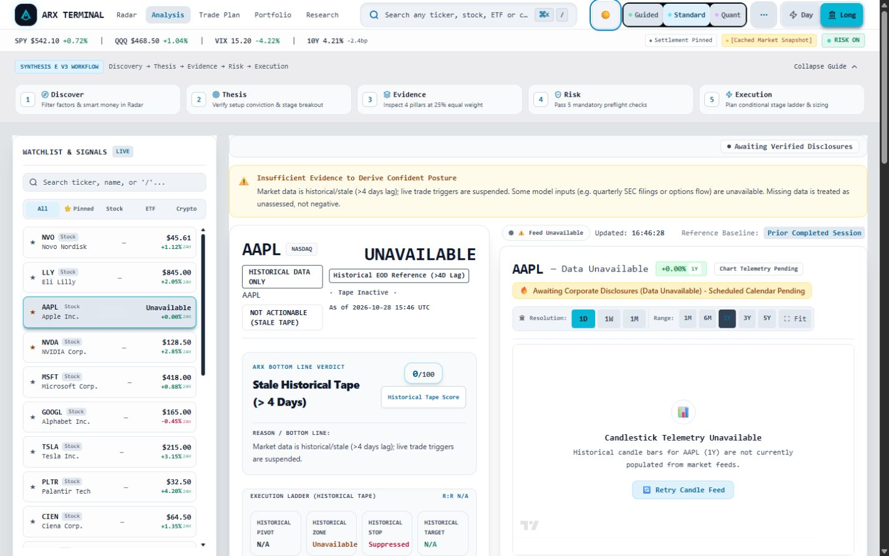

# Owner review package

Owner authorized bounded remote preview publication on 2026-10-28. Status: PUBLISHED FOR PREVIEW REVIEW; see the final verification update below. No merge or production promotion is authorized.

The theme source is `2a3a4f866da8b93dfc51690b72f05669cc3dfa22`, tree `a71a49a9fad690d20d9cb1df2636ad227478f0c1`, frontend tree `55166be100868ee2e8b8e2aafbc1889d9cc8c0a8`. Preview branch: `codex/paper-light-theme-preview-20261028`. An evidence-only follow-up commit packages this report and its allowlisted attachments. Its exact SHA is recorded in the local publication receipt and eventual PR description, avoiding a self-referential commit identifier.

## Source custody and bounded scope

Recorded base: `ea3cc13eeeb6d3e6c250ecfd3ed6aecb4ec44d6c`. Intended draft PR base: main, observed `2c900cd783af3ca135f1b9cfae30697253db078c`. Main is not an ancestor of the source candidate. Reconciliation was the conflict-free disposable integration `bdb3fc19d0f2591e6daa4360e64711b106649e0e`; its runtime subtrees match the candidate. No reset, cleanup, or rewrite of the existing UX branch was performed.

The complete application diff is 21 frontend files in one implementation commit; exact paths are in [theme-files.json](audit-output/post-audit-ux/review-public/theme-files.json). Existing Analysis mode cards, shared wells, readiness and inspection/configuration modals use semantic surface/text/border tokens. ThemeToggle, command palette, and SynthesisHeader share one helper and hook. Three regression suites and two non-route local fixture scripts accompany the correction. No backend, financial decision, paper-recording, deployment configuration, or legacy retirement changes are included. Eleven financial components differ only in className AST values.

## Qualification and applicability

Historical qualification: 504 tests / 46 suites, complete architecture gates, TypeScript, lint (8 existing warnings), verified static build (151 pages), and the separate mainline integration passed. Five intentional mutations were detected and restored. The sanitized [historical receipt](audit-output/post-audit-ux/review-public/historical-qualification.json) retains source identities and results; its manifest digest refers to the original local evidence, not this public subset. The original seal and raw evidence remain local and unchanged.

Fresh preparation checks: 45 focused tests / 4 suites passed; parity assertions passed; TypeScript passed. A verified build is rerun for the packaged preview. Prior source checks remain applicable because the evidence commit changes no frontend content. Hosted checks and deployed-browser acceptance remain pending.

Local browser evidence previously covered 72 explicitly synthetic fixture cases and 12 full-app captures. The two selected images below show real local application rendering with stale/unavailable data, not synthetic positive clearance or a remote deployment. They contain public market watchlists and no account credentials or private holdings. Only this report and the explicitly manifested public subset are prepared for upload; raw transcripts, logs, credential material, and unrelated workspace files are excluded.

[Local mobile Paper Light capture](audit-output/post-audit-ux/review-public/app-guided-AAPL-paper-390.jpg)

## Preview routing and production hold

Cloudflare readback: project finance; production branch release/production; automatic production deployments disabled; preview branches all; build root frontend, command npm run build, output out. Existing canonical deployment remains `32f8daa9-bb1f-4454-9aaa-2000bfd49038`, source `6d4020ca3fef3ae07ac01204b03e0629b6a7cc79`. No project settings or lock changes are proposed. Repository CI performs tests/builds; production release workflow is manual only and will not be invoked. Historical Railway records describe main-merge deployment; current Railway branch routing still needs read-only confirmation before push. No Railway operation or reauthentication is authorized here.

Required hosted checks for main: Python 3.11 and 3.12 backend suites, Code Quality & Security Linter, Static SSG Export & Integrity Gate. Production release-qualification checks retain their frozen manifest; it will not be altered to accommodate this preview. No required gate may be bypassed.

## Review checklist and limitations

- Inspect Analysis with `/?mode=guided&symbol=AAPL`, `/?mode=standard&symbol=AAPL`, and `/?mode=quant&symbol=NVDA` at desktop and mobile widths.
- Switch Paper Light and dark through supported controls; navigate, reload, and verify persistence and synchronized controls.
- Canonical storage is FINANCE_THEME; valid legacy ARX_THEME/theme preferences are read in priority order. Initial SSR/client markup is dark; stored choice applies after mount. System preference does not override the default. A transient dark first paint remains possible.
- Confirm PageIntro, IntentHero, WeeklyConfluenceSpotlight and other legacy sections remain; inspect blocked sizing without saving or executing actions.
- Verify the actual remote artifact SHA, required hosted checks, and unchanged production routing before declaring remote preview verified.

Broad IA closure remains BLOCKED_PENDING_APPROVAL_EVIDENCE. Existing financial safeguards, paper-recording behavior, research HOLD and backend restrictions remain. No universal visual parity, WCAG certification, live actionable-backend acceptance, merge, production promotion, backend deployment, or operational activation is claimed. The available full-app data was stale/unavailable and failed closed.

## Published preview verification — 2026-10-28

Preview: https://02754265.finance-xp8.pages.dev/?mode=standard&symbol=AAPL
Draft PR: https://github.com/daakara/finance/pull/123
Exact preview SHA: `8589b925ebe961ba640f4e2aedbf220d0dfffda1`.

Cloudflare deployment `02754265-9af7-493b-adc0-7035fd02b52d` succeeded in the preview environment from a clean GitHub push. Both provider trigger metadata and served arx-release-sha match the exact SHA. All four main-required hosted checks passed: Backend Test Suite Python 3.11, Backend Test Suite Python 3.12, Code Quality & Security Linter, and Static SSG Export & Integrity Gate (Actions run 40726703760). Fresh local verification passed 45 focused tests / 4 suites, parity, TypeScript, and verified build.

Actual remote Chrome checks passed 12 combinations: guided/standard/quant, Paper Light/dark, widths 1440/390. Sampled verdict backgrounds are white in Paper Light and rgb(15,21,35) in dark. No page-width overflow was measured. Header theme switching, command-palette switching, Paper/dark reload persistence, Portfolio navigation persistence, canonical/legacy storage restoration, invalid preference fallback, and system-light/default-dark behavior passed. PageIntro, IntentHero, and Weekly Spotlight controls remain present on the existing default Analysis route. Onboarding was marked completed only in the isolated palette test context; no backend responses were substituted.

Inspect `/?mode=guided&symbol=AAPL`, `/?mode=standard&symbol=AAPL`, `/?mode=quant&symbol=NVDA`, `/portfolio`, and `/?mode=standard` (legacy sections). Review readable surfaces, both themes, navigation/reload persistence, unchanged legacy sections, and prohibited/uncleared decision states. No paper-save, trading action, backend operation, merge or production promotion was performed.

Release Qualification Suite run 40726702649 failed RQ-02 (26 files outside the frozen production allowlist and PositionSizerModal hash mismatch), with RQ-12 reporting blocked qualification. This is separate from the four required CI checks. The production manifest, guards and holds were not changed or bypassed. This preview is not production qualified.

Main remains `2c900cd783af3ca135f1b9cfae30697253db078c`. Final release/production readback is `cdc47a2eee8a427aaa6cf3ab5d01cad7f35d71e1`, changed concurrently from the earlier `6d4020ca3fef3ae07ac01204b03e0629b6a7cc79`. Public commit metadata dates it 2026-10-28T16:35:03Z and identifies separate production-promotion PR #122; its authority claims were not independently audited here. Our 16:30 preview push specified only the exact preview ref and its immediate before/after production references matched. No release ref write or PR #122 action was performed by this task. The theme candidate remains separate. Canonical deployment remains `32f8daa9-bb1f-4454-9aaa-2000bfd49038`; automatic production deployment remains disabled.

Railway management API HTTP 403 remains an unresolved access limitation. No backend access-control change, reauthentication or deployment occurred. The remote app displayed unavailable/historical EOD and not-actionable/uncleared states; live labels were not independently validated. No live actionable-backend acceptance is claimed. Initial markup remains dark and persisted choice applies after mount; a dark first paint remains possible. SynthesisHeader is not mounted on sampled remote routes; its shared-helper regression coverage remains applicable. No universal visual parity, WCAG certification, physical-device acceptance, financial acceptance or broad IA closure is claimed.

The exact pushed SHA is retained. The six committed review files are a preparation-time snapshot, bound by their committed upload manifest. This local publication update and the PR description record later results without another source push. The original qualification seal remains historical and unchanged. Local remote-browser verification receipt and screenshot fingerprints: `scratch/theme-preview-publication/remote-browser/verification-receipt.json`.
