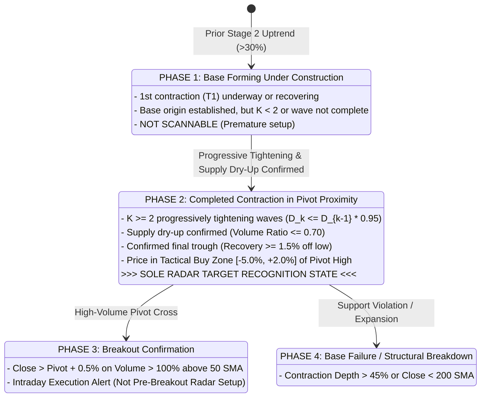

# ARX TERMINAL — SPRINT 3 MARKET OPPORTUNITY RADAR
## HVA-02 CONTRACTION-RECOGNITION SPECIFICATION (CANDIDATE 005)
### REVISION 2.0.0 — CORRECTED FORMAL SPECIFICATION PACKAGE

**Document Identifier:** `ARX_VCP_HVA02_CONTRACTION_RECOGNITION_SPECIFICATION`  
**Specification Revision:** `2.0.0` (Corrected Formal Package)  
**Predecessor Revision:** `1.0.0` (Superseded Draft — 2026-10-23T22:46:00+02:00)  
**Governance Framework:** ARX Closure Model v2 — Decision-First, Minimum Sufficient Evidence  
**Authorization Token:** `ARX_VCP_HVA02_BOUNDED_SPECIFICATION_CORRECTION_AUTHORIZED`  
**Execution Timestamp:** 2026-10-23T23:10:00+02:00  
**Parent Candidate PR:** [Draft PR #73](https://github.com/daakara/finance/pull/73) (`feat/radar-minervini-vcp-activation`)  
**Baseline Candidate:** `8398bec7ebedd717d950f8848c748e8fd60e9559` (`ARX_VCP_CLASSIFIER_V1_CANDIDATE_004`)  
**Proposed Successor:** `ARX_VCP_CLASSIFIER_V1_CANDIDATE_005` (Non-production Research Specification)  
**Execution Posture:** Formal Architecture & Mathematical Specification Only (Zero Code Mutations)  
**Sole Approval Authority:** David Akara (Product Owner & Chief Architect)

---

### Revision 2.0.0 Formal Correction Log

This revision directly resolves all five ambiguities and mathematical defects identified in Revision 1.0.0:

| Section | Defect / Ambiguity in Rev 1.0.0 | Specific Correction Applied in Rev 2.0.0 |
| :---: | :--- | :--- |
| **§ 4.4** | **Flawed Additive Tightening Formula:** $D_k \le D_{k-1} \times 0.95 + 0.0025$ permitted volatility expansion for $D < 0.05$ (e.g. at $D=0.04$, cap was $0.0405 > 0.04$). | **Clean Multiplicative Relative Tightening:** Enforces $D_k \le D_{k-1} \times (1 - \delta_{\text{rel}})$ with $\delta_{\text{rel}} = 0.05$. Decoupled substantive pattern tightening from numerical floating-point comparison tolerance ($\epsilon_{\text{float}} = 1\times 10^{-7}$) and display rounding (4 decimal places). Added synthetic boundary matrices for depths $2\%, 4\%, 8\%, 20\%$. |
| **§ 4.3** | **Flawed Disjunctive Noise Merging:** $\Delta < 0.04$ OR $\tau \le 3$ allowed large, violent counter-trend moves (e.g. $+15\%$ over 2 days) to be classified as "noise" and merged. | **Conjunctive Multi-Condition Noise Filter:** Requires $\Delta < \Theta_{\text{amp}}$ **AND** $\tau \le \Theta_{\text{dur}}$ to merge. Defined exact numerator, denominator, elapsed duration, cumulative anchor drift, and 6 synthetic boundary test cases. |
| **§ 3.2** | **Ambiguous Base Selection Language:** Phrases like "primary macro swing peak" and "ascending base rule" were qualitative and non-deterministic. | **Executable Algorithmic Base Selection:** Fully formalized candidate anchor identification, symmetric $k=3$ confirmation, descending-price/ascending-index sorting, deterministic 3% ceiling threshold for ascending bases vs trend continuation, and fail-closed reason codes. |
| **§ 5.2** | **Incomplete Final-Wave Confirmation:** Final wave was defined only via pivot resistance without defining how the final trough becomes confirmed at cutoff. | **Independent Trough Confirmation Protocol:** Defined trough event date, confirmation date, recovery requirement ($\ge 1.5\%$ or close above trough bar high), treatment of unfinished downswings, and non-circular pivot/trough relationships with 4 synthetic timelines. |
| **§ 9.1** | **Understated Implementation Scope:** Claimed only 3 files would change, omitting test suites, contract registries, and dual-run parity harnesses. | **Complete 6-File Scope & Parity Architecture:** Specified dual-candidate side-by-side execution harness, permanent synthetic conformance suite (`ACC-01` to `ACC-11`), bit-exact regression guard for Candidate 004, and grounded effort estimate (7.5–8.5 hours). |

---

### 1. Reconstructed Pattern Contract & Target Recognition State

#### 1.1 Four-Layer Rule Authority Hierarchy
To prevent conflation between canonical literature, tested implementations, and research proposals, the pattern contract enforces four distinct tiers:

```
+--------------------------------------------------------------------------------------------------+
| TIER 1: Canonical Literature (Minervini 2013, 2017; O'Neil 2009; Weinstein 1988)               |
| - Stage 2 advancing phase; multi-week structural consolidation; 2 to 4 contractions;             |
|   progressive supply exhaustion; drying volume at pivot handle.                                   |
+--------------------------------------------------------------------------------------------------+
                                               │
                                               ▼
+--------------------------------------------------------------------------------------------------+
| TIER 2: Approved Frozen Rules (Candidate 004: predicate_registry.py, numeric_contract.py)        |
| - 10 Normative Predicates: Trend Template (7 conditions), Stage 2 level/slope, History >= 200,   |
|   Contraction existence (K>=2), Sequence validity (K in [2,6], D1 <= 45%), Strict tightening,     |
|   Volume ratio <= 0.70, Pivot defined, Pivot proximity ([-5%, +2%]).                             |
+--------------------------------------------------------------------------------------------------+
                                               │
                                               ▼
+--------------------------------------------------------------------------------------------------+
| TIER 3: Reference Annotations (HVA-00 Benchmark Manifest Notes)                                  |
| - Qualitative chart selections. Proven to contain labeling defects (e.g. MEDP MA violation).      |
+--------------------------------------------------------------------------------------------------+
                                               │
                                               ▼
+--------------------------------------------------------------------------------------------------+
| TIER 4: Proposed Candidate 005 Specification (THIS DOCUMENT — PROVISIONAL)                       |
| - Deterministic base anchoring; conjunctive noise merging; clean relative tightening;             |
|   asymmetric point-in-time trough/pivot confirmation. Explicitly awaiting owner ratification.    |
+--------------------------------------------------------------------------------------------------+
```

#### 1.2 Target Recognition State for Market Opportunity Radar
A consolidation structure progresses through four discrete financial phases:



**Architectural Boundaries:**
- **Radar targets Phase 2 exclusively:** Identifying mature, tightening setups resting quietly at the pivot *prior to breakout*.
- Candidate 004 conflated Phase 1 and Phase 2 by evaluating unanchored raw rolling windows and failing to confirm final-wave completion.
- **Trend-Template and Volume Invariants Preserved:** Candidate 005 preserves `PRED_TREND_TEMPLATE` (7 conditions) and `PRED_VOLUME_DRY_UP` ($\le 0.70$) without alteration. As demonstrated in the recognition review, MEDP's trend failure (150 SMA < 200 SMA) and NVDA's volume failure (86.7% > 70%) were truthful enforcements of sound financial rules.

---

### 2. Specification: Corrected Progressive Tightening Contract

#### 2.1 The Mathematical Defect in Revision 1.0.0
Revision 1.0.0 proposed the formula:
$$D_{\text{next}} \le D_{\text{previous}} \times 0.95 + 0.0025$$
Adding a fixed $+0.25$ percentage-point constant inverted the contraction requirement for shallow bases:
- If $D_{\text{previous}} = 0.0400$ ($4.0\%$), then Allowed $D_{\text{next}} = (0.0400 \times 0.95) + 0.0025 = 0.0380 + 0.0025 = 0.0405$ ($4.05\%$).
- Because $4.05\% > 4.00\%$, this formula permitted an **expansion** of volatility while claiming to enforce a 5% reduction.

#### 2.2 Corrected Mathematical Contract
Candidate 005 strictly decouples the **substantive pattern rule** from **floating-point comparison tolerance** and **display rounding**:

1. **Substantive Pattern Rule (Relative Reduction):**
   Every successive contraction wave must be at least $\delta_{\text{rel}} = 5.0\%$ smaller than its immediate predecessor:
   $$D_{\text{next}} \le D_{\text{previous}} \times (1 - \delta_{\text{rel}}) \quad \text{where } \delta_{\text{rel}} = 0.0500$$
   - Units: Ratio in $[0.0, 1.0]$ (e.g., $0.08 = 8.0\%$).
   - Equality Behavior: Weak inequality ($\le$). A contraction exactly equal to $D_{\text{previous}} \times 0.95$ qualifies. Any value greater fails.

2. **Floating-Point Comparison Tolerance ($\epsilon_{\text{float}}$):**
   To prevent binary IEEE-754 representation artifacts (e.g., $0.08 \times 0.95 = 0.07600000000000001$) from rejecting mathematically valid cases, the comparison is implemented as:
   $$\text{is\_tightening} = \left(D_{\text{next}} - D_{\text{previous}} \times (1 - \delta_{\text{rel}})\right) \le \epsilon_{\text{float}} \quad \text{where } \epsilon_{\text{float}} = 1.0 \times 10^{-7}$$
   $\epsilon_{\text{float}}$ is strictly an epsilon comparison guard. It does not provide an economic percentage-point allowance.

3. **Display Rounding:**
   Depths are formatted for UI display and reports rounded to 4 decimal places ($XX.XX\%$).

#### 2.3 Synthetic Boundary Test Matrix
The table below exercises the corrected tightening contract across four benchmark depths ($2\%, 4\%, 8\%, 20\%$):

| Prior Depth ($D_{\text{previous}}$) | Exact 5% Reduction Threshold | Synthetic Test Depth ($D_{\text{next}}$) | Condition Tested | Clean Contract Result | Reason Code Emitted | Flawed Rev 1.0 Outcome (Comparison) |
| :---: | :---: | :---: | :---: | :---: | :--- | :---: |
| **$2.0000\%$** ($0.0200$) | **$1.9000\%$** ($0.019000$) | $0.018000$ ($1.80\%$) | Below Threshold | **PASS** | `PROGRESSIVE_TIGHTENING_CONFIRMED` | PASS ($0.0180 \le 0.0215$) |
| $2.0000\%$ ($0.0200$) | $1.9000\%$ ($0.019000$) | $0.019000$ ($1.90\%$) | Exactly At Threshold | **PASS** | `PROGRESSIVE_TIGHTENING_CONFIRMED` | PASS ($0.0190 \le 0.0215$) |
| $2.0000\%$ ($0.0200$) | $1.9000\%$ ($0.019000$) | $0.019500$ ($1.95\%$) | Above Threshold | **FAIL** | `VOLATILITY_EXPANSION_DETECTED` | **FALSE PASS** (Allowed $1.95\%$) |
| $2.0000\%$ ($0.0200$) | $1.9000\%$ ($0.019000$) | $0.020500$ ($2.05\%$) | Volatility Expansion | **FAIL** | `VOLATILITY_EXPANSION_DETECTED` | **FALSE PASS** (Allowed $+0.05\%$ expansion) |
| **$4.0000\%$** ($0.0400$) | **$3.8000\%$** ($0.038000$) | $0.037000$ ($3.70\%$) | Below Threshold | **PASS** | `PROGRESSIVE_TIGHTENING_CONFIRMED` | PASS ($0.0370 \le 0.0405$) |
| $4.0000\%$ ($0.0400$) | $3.8000\%$ ($0.038000$) | $0.038000$ ($3.80\%$) | Exactly At Threshold | **PASS** | `PROGRESSIVE_TIGHTENING_CONFIRMED` | PASS ($0.0380 \le 0.0405$) |
| $4.0000\%$ ($0.0400$) | $3.8000\%$ ($0.038000$) | $0.038500$ ($3.85\%$) | Above Threshold | **FAIL** | `VOLATILITY_EXPANSION_DETECTED` | **FALSE PASS** (Allowed $3.85\%$) |
| $4.0000\%$ ($0.0400$) | $3.8000\%$ ($0.038000$) | $0.040200$ ($4.02\%$) | Volatility Expansion | **FAIL** | `VOLATILITY_EXPANSION_DETECTED` | **FALSE PASS** (Allowed $+0.02\%$ expansion) |
| **$8.0000\%$** ($0.0800$) | **$7.6000\%$** ($0.076000$) | $0.075000$ ($7.50\%$) | Below Threshold | **PASS** | `PROGRESSIVE_TIGHTENING_CONFIRMED` | PASS ($0.0750 \le 0.0785$) |
| $8.0000\%$ ($0.0800$) | $7.6000\%$ ($0.076000$) | $0.076000$ ($7.60\%$) | Exactly At Threshold | **PASS** | `PROGRESSIVE_TIGHTENING_CONFIRMED` | PASS ($0.0760 \le 0.0785$) |
| $8.0000\%$ ($0.0800$) | $7.6000\%$ ($0.076000$) | $0.076500$ ($7.65\%$) | Above Threshold | **FAIL** | `VOLATILITY_EXPANSION_DETECTED` | **FALSE PASS** (Allowed $7.65\%$) |
| **$20.0000\%$** ($0.2000$) | **$19.0000\%$** ($0.190000$) | $0.189000$ ($18.90\%$) | Below Threshold | **PASS** | `PROGRESSIVE_TIGHTENING_CONFIRMED` | PASS ($0.1890 \le 0.1925$) |
| $20.0000\%$ ($0.2000$) | $19.0000\%$ ($0.190000$) | $0.190000$ ($19.00\%$) | Exactly At Threshold | **PASS** | `PROGRESSIVE_TIGHTENING_CONFIRMED` | PASS ($0.1900 \le 0.1925$) |
| $20.0000\%$ ($0.2000$) | $19.0000\%$ ($0.190000$) | $0.190500$ ($19.05\%$) | Above Threshold | **FAIL** | `VOLATILITY_EXPANSION_DETECTED` | **FALSE PASS** (Allowed $19.05\%$) |

#### 2.4 Substantive Relaxation Option (Owner Decision DEC-04)
If the Product Owner desires to accommodate minor rounding parity without permitting expansion, a separate rule may be selected:
$$\text{Option A (Strict 5% Relative Reduction):} \quad D_{\text{next}} \le D_{\text{previous}} \times 0.95$$
$$\text{Option B (Hybrid Relative-or-Absolute Reduction):} \quad D_{\text{next}} \le \min\left(D_{\text{previous}} \times 0.95, \, D_{\text{previous}} - 0.0050\right)$$
Option B requires *either* a 5% relative reduction or at least a 0.5 percentage-point drop, guaranteeing that $D_{\text{next}}$ is always strictly smaller than $D_{\text{previous}}$. **Option A is recommended.**

---

### 3. Specification: Corrected Noise-Merging Logic

#### 3.1 The Flaw in Revision 1.0.0
Revision 1.0.0 specified that counter-trend bounces were merged if:
$$\Delta_{\text{bounce}} < 0.04 \quad \mathbf{OR} \quad \tau \le 3 \text{ bars}$$
Using a logical `OR` produced a critical failure: a violent $+15.0\%$ spike occurring over 2 days satisfied $\tau \le 3$, causing a major structural impulse to be silently merged as "noise".

#### 3.2 Formal Definitions of Counter-Move Parameters
During an active downward contraction leg initiating from confirmed peak $P_k$ at index $t_{P_k}$:

1. **Running Trough Anchor ($L_{\text{running}}$):**
   The lowest price observed in the leg up to the current evaluation point:
   $$L_{\text{running}} = \min_{j \in [t_{P_k}, t]} b_j.\text{low}, \quad t_{\text{low}} = \arg\min_{j \in [t_{P_k}, t]} b_j.\text{low}$$

2. **Rebound Peak ($P_{\text{rebound}}$):**
   An interim high achieved at bar $t_{\text{rebound}} > t_{\text{low}}$.

3. **Rebound Amplitude ($\Delta_{\text{rebound}}$):**
   Measured strictly relative to the running trough anchor:
   $$\text{Numerator} = P_{\text{rebound}} - L_{\text{running}}$$
   $$\text{Denominator} = L_{\text{running}}$$
   $$\Delta_{\text{rebound}} = \frac{P_{\text{rebound}} - L_{\text{running}}}{L_{\text{running}}}$$

4. **Rebound Duration ($\tau_{\text{rebound}}$):**
   Elapsed trading sessions from the trough bar to the rebound peak bar:
   $$\tau_{\text{rebound}} = t_{\text{rebound}} - t_{\text{low}} \quad (\text{Elapsed sessions: } 0 \text{ if same bar, } 1 \text{ if next day})$$
   *Endpoint convention:* Non-zero elapsed transitions. A bounce peaking 2 sessions after the trough has $\tau_{\text{rebound}} = 2$.

#### 3.3 Conjunctive Noise-Merging Rule
To be classified as an **Intra-Wave Noise Oscillation** and merged into the ongoing downward leg, a counter-move must be **BOTH** small in amplitude **AND** short in duration:

$$\text{is\_noise} = \left(\Delta_{\text{rebound}} < \Theta_{\text{amp}}\right) \quad \mathbf{AND} \quad \left(\tau_{\text{rebound}} \le \Theta_{\text{dur}}\right)$$
$$\text{where } \Theta_{\text{amp}} = 0.0400 \text{ (4.0\%)} \quad \text{and} \quad \Theta_{\text{dur}} = 3 \text{ elapsed trading sessions}$$

- **Strict Inequality on Amplitude:** A rebound of exactly $4.0000\%$ fails the noise condition and is treated as a structural move.
- **Weak Inequality on Duration:** A rebound lasting exactly 3 sessions may qualify if amplitude is $< 4.0\%$.

#### 3.4 State Machine & State Transitions
The algorithm tracks the down-leg through a formal state machine:

```
                  [State: DOWNWARD_CONTRACTION_LEG]
                   Running Trough Anchor = L_running
                                │
                  Price advances to P_rebound
                                │
                                ▼
                 Is Delta < 4.0% AND tau <= 3?
                                │
               ┌────────────────┴────────────────┐
               │ YES                             │ NO (Delta >= 4.0% OR tau > 3)
               ▼                                 ▼
      [Action: MERGE_AS_NOISE]        [Action: CLOSE_CONTRACTION_LEG]
      - Down-leg remains active        - Leg closed at L_k = L_running
      - Retain L_running as anchor     - Contraction Depth D_k = (P_k - L_k)/P_k
      - Track subsequent price:        - Transition to [REBOUND_LEG_TRACKING]
        * If price makes lower low       toward next peak P_{k+1}
          L_new < L_running:
          Update L_running = L_new
        * If cumulative drift from
          L_running reaches >= 4.0%:
          Leg is closed.
```

#### 3.5 Cumulative Drift Protection (Chained Rebounds)
To prevent a series of tiny 1.5% bounces from creeping upward indefinitely without closing the wave:
$$\Delta_{\text{cumulative}} = \frac{b_t.\text{close} - L_{\text{running}}}{L_{\text{running}}}$$
If at any bar $t > t_{\text{low}}$, $\Delta_{\text{cumulative}} \ge \Theta_{\text{amp}}$ ($4.0\%$), the downward leg is **immediately terminated at $L_{\text{running}}$**, regardless of the duration of individual micro-swings.

#### 3.6 Synthetic Test Cases Matrix (Noise Merging)

| Scenario Name | Running Trough ($L_{\text{running}}$) | Rebound Peak ($P_{\text{rebound}}$) | Rebound Amplitude ($\Delta$) | Rebound Duration ($\tau$) | Condition Evaluation ($\Delta < 0.04 \land \tau \le 3$) | State Action | Economic / Physical Rationale |
| :--- | :---: | :---: | :---: | :---: | :---: | :---: | :--- |
| **Small & Short** | $\$100.00$ | $\$101.80$ | $+1.80\%$ | 2 sessions | $\text{True} \land \text{True} = \mathbf{True}$ | `MERGE_AS_NOISE` | Routine intraday noise; ongoing wave preserved. |
| **Small & Sustained** | $\$100.00$ | $\$102.50$ | $+2.50\%$ | 6 sessions | $\text{True} \land \text{False} = \mathbf{False}$ | `CLOSE_LEG` | Prolonged 6-day plateau indicates selling pressure halted. |
| **Large & Short** | $\$100.00$ | $\$106.00$ | $+6.00\%$ | 2 sessions | $\text{False} \land \text{True} = \mathbf{False}$ | `CLOSE_LEG` | Violent $+6\%$ impulse terminates downward momentum. *(Fixed from Rev 1.0)* |
| **Large & Sustained** | $\$100.00$ | $\$108.50$ | $+8.50\%$ | 5 sessions | $\text{False} \land \text{False} = \mathbf{False}$ | `CLOSE_LEG` | Unambiguous multi-day recovery leg toward next peak. |
| **Repeated Chained Bounces** | $\$100.00$ | B1: $\$101.50$, B2: $\$102.50$, B3: $\$104.20$ | $+4.20\%$ (cumulative) | 7 sessions | $\text{False} \land \text{False} = \mathbf{False}$ | `CLOSE_LEG` | Cumulative net drift reached $\ge 4.0\%$, halting infinite absorption. |
| **Exact Amp Tie ($4.00\%$)** | $\$100.00$ | $\$104.00$ | $+4.00\%$ | 2 sessions | $\text{False} \land \text{True} = \mathbf{False}$ | `CLOSE_LEG` | Strict inequality $\Delta < 0.04$ enforces leg closure on boundary tie. |
| **Exact Dur Tie (3 bars)** | $\$100.00$ | $\$103.50$ | $+3.50\%$ | 3 sessions | $\text{True} \land \text{True} = \mathbf{True}$ | `MERGE_AS_NOISE` | Permitted 3-day noise limit at sub-threshold amplitude. |

---

### 4. Specification: Deterministic Base-Origin Anchoring

#### 4.1 Problem Definition
In Candidate 004, qualitative phrases like "primary macro swing peak" led to non-deterministic selection. An executable, unambiguous algorithm is required that evaluates price geometry independently of whether subsequent contractions tighten.

#### 4.2 Executable Base Anchoring Specification

Let the admissible historical bars up to decision cutoff $T_{\text{cutoff}}$ be $\mathcal{B} = [b_0, b_1, \dots, b_{N-1}]$.

1. **Permitted Lookback Horizon:**
   - Search window: $W_{\max} = 90$ sessions, $W_{\min} = 15$ sessions.
   - Evaluation slice: $\mathcal{W}_{\text{base}} = \mathcal{B}[\max(0, N - 90) : N - 15]$.
   *(Note: The window explicitly stops at $N - 15$ to guarantee at least 15 bars remain for base construction).*

2. **Eligible Anchor Candidates ($\mathcal{C}_{\text{anchor}}$):**
   A bar $b_i \in \mathcal{W}_{\text{base}}$ is an **Eligible Anchor Candidate** if and only if it satisfies all three conditions:
   - **Condition 1 (Symmetric Swing High):**
     $$b_i.\text{high} \ge \max_{j \in [i-3, \, i+3]} b_j.\text{high} \quad (\text{Symmetric confirmation } k=3)$$
     *Temporal validity:* Since $i \le N - 15$, $i + 3 \le N - 12 \le N - 1$. Full symmetric confirmation is mathematically guaranteed prior to $T_{\text{cutoff}}$.
   - **Condition 2 (Primary Contraction Initiation):**
     There exists a confirmed subsequent trough $L_{\text{init}}$ in $[i+1, \, \min(N-1, i+35)]$ such that:
     $$D_{\text{init}} = \frac{b_i.\text{high} - L_{\text{init}}}{b_i.\text{high}} \ge \Theta_{D_1} \quad \text{where } \Theta_{D_1} = 0.0800 \text{ (8.0\% provisional hypothesis)}$$
   - **Condition 3 (Stage 2 Uptrend Precedence):**
     Price at $b_i$ was above the 200-day SMA ($b_i.\text{close} > b_i.\text{sma\_200}$).

3. **Deterministic Selection Policy (Sorting Order):**
   If $|\mathcal{C}_{\text{anchor}}| = 0$, base selection fails closed with reason code `INSUFFICIENT_BASE_ANCHOR_CANDIDATES`.
   If $|\mathcal{C}_{\text{anchor}}| \ge 1$, candidate anchors are deterministically ranked:
   $$\text{Primary Sort Key:} \quad b_i.\text{high} \quad (\text{Descending: highest peak price first})$$
   $$\text{Secondary Sort Key (Tie-Breaker):} \quad i \quad (\text{Ascending: earliest chronological date first})$$
   Let the top-ranked candidate be $A^* = (H^*, t^*)$.

4. **Treatment of Later Higher Highs (The Ascending Ceiling Rule):**
   Does any bar $t_{\text{later}} \in [t^* + 1, \, N - 15]$ produce a confirmed high $H_{\text{later}} > H^*$?
   - **Case 1 (Trend Continuation / Invalidation):**
     If $H_{\text{later}} > H^* \times 1.0300$ ($> 3.0\%$ higher):
     $A^*$ is classified as an intermediate peak in an ongoing advance. $A^*$ is rejected, and the base restarts with $H_{\text{later}}$ as the new candidate anchor.
   - **Case 2 (Ascending Consolidation Ceiling):**
     If $1.0000 < H_{\text{later}} / H^* \le 1.0300$ ($\le 3.0\%$ higher):
     $A^*$ is **retained** as the formal base origin anchor ($P_1 = H^*$). The subsequent peak $H_{\text{later}}$ is recognized as an ascending consolidation ceiling and forms the peak of wave $W_2$ ($P_2 = H_{\text{later}}$).

5. **Base Invalidation Criteria (Fail-Closed Rules):**
   The active base is rejected immediately if:
   - **Loose / Damaged Base:** Any trough in the base drops $> 45.0\%$ below $H^*$ (`BASE_TOO_DEEP_LOOSE`).
   - **Structural Trend Breakdown:** Price closes below 200-day SMA at any bar after $t^*$ (`BASE_STRUCTURAL_BREAKDOWN_BELOW_200_SMA`).
   - **Base Stale:** Base duration from $t^*$ to $N-1$ exceeds 130 sessions (`BASE_STALE_EXCEEDS_MAX_DURATION`).

6. **Hypothesis Status:**
   The $W_{\max} = 90$ session window and $\Theta_{D_1} = 8.0\%$ depth floor are **provisional research hypotheses awaiting David Akara's formal ratification (DEC-01 & DEC-02)**. They are not asserted as empirical truths.

---

### 5. Specification: Final-Wave Trough & Pivot Completion

#### 5.1 The Circularity Problem in Revision 1.0.0
Revision 1.0.0 required the pivot high $P_K$ to be confirmed by downward movement, but failed to define how the subsequent final trough $L_K$ is confirmed. If price is falling on cutoff day $N-1$, the contraction is unfinished, creating a circularity where pivot proximity was evaluated against an unconfirmed, still-dropping handle.

#### 5.2 Independent Final Trough Confirmation Protocol
For the final contraction wave $W_K$ to be declared **COMPLETED**, its trough $L_K$ must be independently confirmed using only data available on or before $T_{\text{cutoff}}$ ($N-1$):

```
Final Wave Anatomy & Timeline:
      Pivot High P_K (Date t_{P_K})
           /\
          /  \  <-- Downward Leg
         /    \
        /      \/ <-- Trough L_K (Event Date t_{L_K})
                 \
                  \-- Price Rebounds to Close_{N-1} (Confirmation Zone)
```

1. **Trough Event Date ($t_{L_K}$):**
   The bar of the minimum low price in wave $W_K$:
   $$L_K = \min_{j \in [t_{P_K}, \, N-1]} b_j.\text{low}, \quad t_{L_K} = \arg\min_{j \in [t_{P_K}, \, N-1]} b_j.\text{low}$$

2. **Independent Trough Confirmation Rule:**
   $L_K$ is confirmed as a completed contraction trough if and only if **Condition A** OR **Condition B** is satisfied on or before bar $N-1$:
   - **Condition A (Percentage Recovery Floor):**
     Price has rebounded from $L_K$ by at least $\Theta_{\text{recovery}} = 1.5\%$ ($0.0150$):
     $$\Delta_{\text{recovery}} = \frac{b_{N-1}.\text{close} - L_K}{L_K} \ge 0.0150$$
   - **Condition B (Bar-High Breakout):**
     Current close exceeds the high of the trough bar:
     $$b_{N-1}.\text{close} > b_{t_{L_K}}.\text{high}$$

3. **Treatment of Unfinished Downswings:**
   If neither Condition A nor Condition B is satisfied at bar $N-1$ (e.g. price closed near the daily low at $t_{L_K} = N - 1$, or $\Delta_{\text{recovery}} < 1.5\%$):
   - The final wave is classified as **UNFINISHED**.
   - Predicate `PRED_CONTRACTION_SEQUENCE_VALID` evaluates to `FAIL` with reason code `FINAL_CONTRACTION_UNFINISHED_AT_CUTOFF`.
   - The setup fails closed. It is NOT eligible for Radar Phase 2 screening.

4. **Non-Circular Pivot / Trough Relationship:**
   - **Pivot High $P_K$ Confirmation:** Confirmed independently by downward price movement ($b_t.\text{close} \le P_K \times 0.985$).
   - **Trough $L_K$ Confirmation:** Confirmed independently by upward price recovery ($\Delta_{\text{recovery}} \ge 1.5\%$ or close above trough high).
   - **Tactical Proximity Evaluation:** Evaluated ONLY after both $P_K$ and $L_K$ are confirmed:
     $$-0.0500 \le \frac{b_{N-1}.\text{close} - P_K}{P_K} \le +0.0200$$

#### 5.3 Synthetic Timelines (Final Wave Completion)

```
Timeline A: COMPLETED Final Wave (Textbook Phase 2 Radar Setup)
Day t_0:  Pivot Peak P_K = $100.00 (Confirmed resistance)
Day t_1:  Pullback continues, Low = $97.00
Day t_2:  Trough Bar t_{L_K}: Low = $95.00, High = $96.00, Close = $95.50 (Depth = 5.0%)
Day t_3:  Rebound Bar: Low = $96.00, High = $98.50, Close = $98.50 (Evaluation Cutoff N-1)
Evaluation:
- Recovery: ($98.50 - $95.00)/$95.00 = +3.68% >= 1.5% -> TROUGH CONFIRMED.
- Pivot Distance: ($98.50 - $100.00)/$100.00 = -1.50% in [-5%, +2%] -> IN TACTICAL ZONE.
Result: QUALIFIED PHASE 2 SETUP (PASS).
----------------------------------------------------------------------------------------
Timeline B: INCOMPLETE Final Wave (Still Dropping on Cutoff Day)
Day t_0:  Pivot Peak P_K = $100.00
Day t_1:  Pullback continues, Low = $97.00
Day t_2:  Trough Bar t_{L_K}: Low = $95.00, High = $97.00, Close = $95.20 (Evaluation Cutoff N-1)
Evaluation:
- Recovery: ($95.20 - $95.00)/$95.00 = +0.21% < 1.5% -> UNCONFIRMED.
- Close $95.20 < Trough High $97.00 -> UNCONFIRMED.
Result: FINAL_CONTRACTION_UNFINISHED_AT_CUTOFF (FAIL-CLOSED).
----------------------------------------------------------------------------------------
Timeline C: EXTENDED PAST PIVOT (Breakout Already Occurred)
Day t_0:  Pivot Peak P_K = $100.00
Day t_1:  Trough Bar t_{L_K}: Low = $95.00, High = $96.00
Day t_2:  Strong Gap Rebound: Close = $103.50 (Evaluation Cutoff N-1)
Evaluation:
- Recovery: ($103.50 - $95.00)/$95.00 = +8.95% >= 1.5% -> TROUGH CONFIRMED.
- Pivot Distance: ($103.50 - $100.00)/$100.00 = +3.50% > +2.00% -> EXTENDED.
Result: PRICE_EXTENDED_PAST_PIVOT (FAIL).
----------------------------------------------------------------------------------------
Timeline D: RECOVERED BUT LAGGING (Below Tactical Buy Zone)
Day t_0:  Pivot Peak P_K = $100.00
Day t_1:  Trough Bar t_{L_K}: Low = $90.00, High = $91.00 (Depth = 10.0%)
Day t_2:  Weak Rebound: Close = $92.00 (Evaluation Cutoff N-1)
Evaluation:
- Recovery: ($92.00 - $90.00)/$90.00 = +2.22% >= 1.5% -> TROUGH CONFIRMED.
- Pivot Distance: ($92.00 - $100.00)/$100.00 = -8.00% < -5.00% -> LAGGING.
Result: PRICE_LAGGING_BELOW_PIVOT (FAIL).
```

---

### 6. Implementation Architecture, Reproducibility & File Scope

#### 6.1 True Implementation Scope (6 Files)
Replacing the inaccurate "3-file" claim in Rev 1.0.0, the minimum concrete implementation surface comprises 6 files across backend, contracts, and tests:

1. **`analyst_dashboard/vcp/classifier.py`**:
   - Implement `_detect_macro_contractions()` replacing `_detect_contractions()`.
   - Implement base anchoring, conjunctive noise merging, and final-wave completion verification.
   - Version constant: `VCPClassifier.VERSION = "ARX_VCP_CLASSIFIER_V1_CANDIDATE_005"`.
2. **`analyst_dashboard/vcp/numeric_contract.py`**:
   - Update `verify_progressive_tightening()` to implement clean multiplicative relative tightening:
     `D_next <= D_previous * (1.0 - delta_rel) + eps_float` where `delta_rel=0.05` and `eps_float=1e-7`.
3. **`analyst_dashboard/vcp/predicate_registry.py`**:
   - Register new reason codes: `PRE_BASE_ADVANCE_TRUNCATED`, `INTRA_WAVE_NOISE_MERGED`, `VOLATILITY_EXPANSION_DETECTED`, `FINAL_CONTRACTION_UNFINISHED_AT_CUTOFF`, `INSUFFICIENT_BASE_ANCHOR_CANDIDATES`, `AMBIGUOUS_BASE_ORIGIN`.
4. **`analyst_dashboard/analyzers/scanner_contract.py`**:
   - Register Candidate 005 canonical fingerprint definitions (`CANONICAL_VCP_RULESET_HASH_V1_1_0`).
5. **`tests/test_vcp_candidate_005_conformance.py`** *(New File)*:
   - Permanent synthetic unit test suite executing all 11 acceptance scenarios (`ACC-01` through `ACC-11`).
   - Boundary matrices for $2\%, 4\%, 8\%, 20\%$ depths.
   - Noise merging edge cases and final-wave timelines A–D.
6. **`tests/test_vcp_candidate_reproducibility.py`** *(New File)*:
   - Dual-candidate regression guard.
   - Executes Candidate 004 and Candidate 005 side-by-side against identical inputs.
   - Proves Candidate 004 produces 100% bit-exact outputs matching `vcp_hva00_frozen_algorithm_results.json`.

#### 6.2 Dual-Candidate Side-by-Side Execution Harness
To guarantee absolute reproducibility without mutating frozen research artifacts:
- The classifier architecture will support explicit version selection:
  ```python
  class VCPClassifier:
      def __init__(self, algorithm_version: str = "ARX_VCP_CLASSIFIER_V1_CANDIDATE_005"):
          self.algorithm_version = algorithm_version
          # Dispatches to _detect_contractions (Candidate 004) or _detect_macro_contractions (Candidate 005)
  ```
- **Frozen Artifact Protection:** Frozen baseline records in `data/research/vcp_hva00_frozen_algorithm_results.json` remain permanently immutable. When Candidate 005 is evaluated, results write to a distinct, non-conflicting path (`data/research/vcp_hva02_candidate_005_results.json`).

#### 6.3 Grounded Engineering Effort Breakdown
- **Task 1: Conformance Test Suite (`test_vcp_candidate_005_conformance.py`):** 2.0 hours.
- **Task 2: Core Algorithm Implementation (`classifier.py`, `numeric_contract.py`):** 2.5 hours.
- **Task 3: Dual-Candidate Reproducibility Harness & Regression Suite:** 1.5 hours.
- **Task 4: Isolated Non-Mutating Evaluation on 60 HVA-00 Cases:** 1.5 hours.
- **Total Grounded Estimate:** **7.5 to 8.5 engineering hours**.

---

### 7. Frozen Evaluation Design & Evidence Separation

#### 7.1 Parameter Ledger (Provisional vs Approved Status)

| Parameter Identifier | Mathematical Symbol | Proposed Default | Provisional Hypothesis? | Approved Canonical Rule? | Authority & Rationale |
| :--- | :---: | :---: | :---: | :---: | :--- |
| **Base Lookback Window** | $W_{\max}$ | **90 sessions** | **YES (Provisional)** | NO | Standard 18-week base horizon (DEC-01). |
| **Minimum Base Duration** | $W_{\min}$ | **15 sessions** | **YES (Provisional)** | NO | Ensures at least 3 weeks of consolidation. |
| **Anchor Confirmation Window** | $k_{\text{anchor}}$ | **3 sessions** | **YES (Provisional)** | NO | Symmetric confirmation before cutoff zone. |
| **Primary Wave Depth Floor** | $\Theta_{D_1}$ | **$8.0\%$** ($0.0800$) | **YES (Provisional)** | NO | Separates base inception from noise (DEC-02). |
| **Intermediate Depth Floor** | $\Theta_{D_k}$ | **$4.0\%$** ($0.0400$) | **YES (Provisional)** | NO | Intermediate contraction prominence floor. |
| **Final Handle Depth Floor** | $\Theta_{D_K}$ | **$2.0\%$** ($0.0200$) | **YES (Provisional)** | NO | Tight pivot handle floor. |
| **Noise Merging Amplitude** | $\Theta_{\text{amp}}$ | **$4.0\%$** ($0.0400$) | **YES (Provisional)** | NO | Rebounds $<4\%$ are intra-wave noise (DEC-03). |
| **Noise Merging Duration** | $\Theta_{\text{dur}}$ | **3 sessions** | **YES (Provisional)** | NO | 3-day bounce duration limit for noise. |
| **Tightening Relative Reduction** | $\delta_{\text{rel}}$ | **$5.0\%$** ($0.0500$) | **YES (Provisional)** | NO | Enforces genuine tightening (DEC-04). |
| **Floating-Point Comparison Guard** | $\epsilon_{\text{float}}$ | **$1.0\times 10^{-7}$** | NO (Numerical Guard) | NO | IEEE-754 precision representation guard. |
| **Final Trough Recovery Floor** | $\Theta_{\text{recovery}}$ | **$1.5\%$** ($0.0150$) | **YES (Provisional)** | NO | Independent trough confirmation floor. |
| **Tactical Pivot Proximity** | $\Delta_{\text{pivot}}$ | **$[-5.0\%, +2.0\%]$** | NO | **YES (Frozen)** | Normative contract in `predicate_registry.py`. |
| **Volume Dry-Up Threshold** | $\text{Ratio}_{\text{vol}}$ | **$\le 0.70$** ($70\%$) | NO | **YES (Frozen)** | Normative contract in `predicate_registry.py`. |
| **Stage 2 Trend Template** | — | **7 conditions** | NO | **YES (Frozen)** | Normative contract in `predicate_registry.py`. |

#### 7.2 Four-Tier Evidence Separation Architecture

```
+--------------------------------------------------------------------------------------------------+
| TIER A: Synthetic Conformance Suite (Unit Level)                                                 |
| - 11 Synthetic Acceptance Scenarios (ACC-01 through ACC-11).                                     |
| - Boundary matrices for depths 2%, 4%, 8%, 20%; noise merging; final-wave timelines.             |
| - Zero market data dependency. 100% deterministic mathematical verification.                     |
+--------------------------------------------------------------------------------------------------+
                                               │
                                               ▼
+--------------------------------------------------------------------------------------------------+
| TIER B: Exposed Historical Development Corpus (Diagnostic Level)                                 |
| - 15 Historical Positive Cases (HVA00-POS-01 to POS-15).                                         |
| - 45 Historical Negative / Near-Miss Control Cases (Strata 2 to 6).                              |
| - STATUS: PERMANENTLY EXPOSED DEVELOPMENT EVIDENCE. Cannot serve as untouched validation.        |
+--------------------------------------------------------------------------------------------------+
                                               │
                                               ▼
+--------------------------------------------------------------------------------------------------+
| TIER C: Untouched Holdout Custody (Release Gate HVA-03)                                          |
| - 8 Cases in Holdout Epoch 002 (HLD-001 to HLD-008).                                             |
| - Cryptographically sealed in docs/domain/vcp/ARX_VCP_HOLDOUT_COMMITMENT.json.                   |
| - STRICT PROHIBITION: Zero access, inspection, or evaluation during HVA-02.                      |
+--------------------------------------------------------------------------------------------------+
                                               │
                                               ▼
+--------------------------------------------------------------------------------------------------+
| TIER D: Prospective Forward Observation (Post-Release)                                           |
| - Forward shadow telemetry tracking via Sprint3ShadowGovernanceSuite.                            |
| - Pure out-of-sample forward paper tracking.                                                     |
+--------------------------------------------------------------------------------------------------+
```

#### 7.3 Explicit Falsification Criteria
Candidate 005 shall be declared **FALSIFIED** and rejected if any of the following occur during future evaluation:
1. **Stage 3/4 Leakage:** $\ge 1$ case in Stratum 5 (`STAGE_4_REJECTION`) or Stratum 6 (`STAGE_3_REJECTION`) qualifies as VCP.
2. **False Positive Inflation:** False alarm rate exceeds $10.0\%$ on Stratum 3 (`STAGE_2_NON_VCP`) or Stratum 4 (`FAILED_CONSOLIDATION`).
3. **Monotonic Failure on Canonical Setups:** Fails to recognize textbook 3T setups where each contraction wave contracts by $\ge 10\%$ and volume is $< 50\%$ of 50-day SMA.

---

### 8. Explicit Owner Decisions Requested (David Akara)

The Product Owner is formally requested to review and ratify the following specification decisions:

| Decision ID | Specification Item | Proposed Recommendation | Alternative Option | Impact & Trade-Off |
| :---: | :--- | :--- | :--- | :--- |
| **DEC-01** | **Base Lookback Window ($W_{\max}$)** | **90 sessions** (~18 weeks) | 70 sessions (~14 weeks) | 70 sessions excludes deeper 4-to-5 month consolidations; 90 sessions captures standard macro bases. |
| **DEC-02** | **Primary Wave Depth Floor ($\Theta_{D_1}$)** | **$\ge 8.0\%$** depth | $\ge 10.0\%$ depth | 10% floor rejects low-beta large-cap leaders (e.g. RTX 6.8%); 8% floor provides robust noise separation. |
| **DEC-03** | **Noise Merging Ceiling ($\Theta_{\text{amp}}$)** | **$< 4.0\%$ AND $\le 3$ bars** | $< 3.0\%$ AND $\le 3$ bars | 3% ceiling may retain minor counter-trend ripples; 4% ensures clean multi-week contraction boundaries. |
| **DEC-04** | **Tightening Contract ($\delta_{\text{rel}}$)** | **Option A (Strict 5% Relative Reduction):** $D_k \le D_{k-1} \times 0.95$ | Option B (Hybrid): $\min(D_{k-1} \times 0.95, D_{k-1} - 0.005)$ | Option A is pure relative tightening; Option B guarantees at least 0.5 percentage-point reduction on small depths. |
| **DEC-05** | **Draft PR #73 Release Alignment** | **Maintain activation hold on PR #73**; integrate Candidate 005 after validation | Release Candidate 004 descriptive screening now; release Candidate 005 in separate PR | Holding PR #73 ensures pattern recognition fidelity before initial production exposure. |

---

### 9. Final Specification Sign-Off

**Verdict:** `ARX_VCP_HVA02_CORRECTED_SPECIFICATION_READY_FOR_OWNER_REVIEW`

PR #73 remains in **Draft** on GitHub. Production auto-deploy and scan activation remain on **Hold** pending David Akara's review and ratification of decisions DEC-01 through DEC-05.
