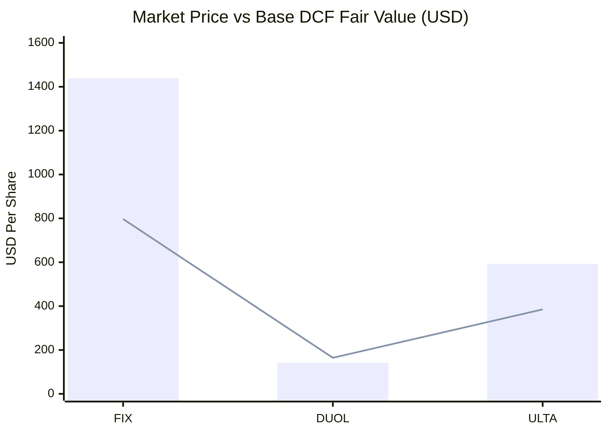

# ARX TERMINAL — THREE-COMPANY UNDERVALUED-GROWTH RESEARCH PILOT
**Authoritative Comparative Assessment: Comfort Systems USA (FIX), Duolingo (DUOL), Ulta Beauty (ULTA)**  
*Evaluation Date: October 19, 2026 | Analysis Baseline: FY2023–FY2025/FY2026 Audited 10-K Filings & Real-Time Market Data*

---

## Executive Summary & Core Epistemic Finding

This research pilot evaluates three contrasting companies drawn from active and recent ARX coverage to test whether current market prices offer an attractive margin of safety relative to defensible future shareholder cash flows:
1. **Comfort Systems USA, Inc. (`FIX`)**: High-reinvestment industrial compounder riding the hyperscaler data center buildout.
2. **Duolingo, Inc. (`DUOL`)**: Capital-light digital subscription compounder with AI monetization.
3. **Ulta Beauty, Inc. (`ULTA`)**: Mature retail specialty compounder navigating post-pandemic normalization and retail competition.

### Core Evaluative Verdict
> [!IMPORTANT]
> **Is any of the three currently undervalued with an adequate margin of safety?**  
> **No.** Under rigorous DCF and reverse-valuation stress tests, **none of the three companies qualifies as definitively undervalued with an adequate margin of safety (>25–30% discount to base intrinsic value)**:
> - **`FIX` ($1,439.07)** trades at an aggressive **80.5% premium to its Base intrinsic value ($797.06)** and a 19.8% premium even to its Optimistic scenario ($1,201.31). The market is pricing in a 28.0% constant 5-year FCF CAGR on a normalized base, mistaking cyclical peak modular backlog and customer advance billings for perpetual baseline run-rates.
> - **`ULTA` ($592.94)** trades at a **53.9% premium to Base intrinsic value ($385.19)** and exceeds its Optimistic value ($523.12). The market prices in a 13.2% FCF CAGR despite contracting operating margins and 1–2% comparable store sales growth.
> - **`DUOL` ($141.76)** is the closest to fair value, trading at a **13.7% discount to Base intrinsic value ($164.27)** and a 39.6% discount to Optimistic value ($234.83). However, because Stock-Based Compensation consumes 35.4% of operating cash flow ($137.4M in 2025) and reported GAAP net income is distorted by a non-recurring ~$280M tax valuation allowance release, it lacks the requisite wide margin of safety (>25%) demanded for volatile growth assets.

---

## Standardized Comparative Matrix

| Metric / Dimension | Comfort Systems USA (`FIX`) | Duolingo (`DUOL`) | Ulta Beauty (`ULTA`) |
| :--- | :--- | :--- | :--- |
| **Primary Industry** | Specialty Electrical / HVAC Contracting | Educational Software / Digital Subscriptions | Specialty Retail (Beauty & Cosmetics) |
| **Market Identity** | NYSE: FIX (CIK: 0001035983) | NASDAQ: DUOL (CIK: 0001562088) | NASDAQ: ULTA (CIK: 0001403568) |
| **Market Price (USD)** | **$1,439.07** | **$141.76** | **$592.94** |
| **Diluted Shares (Current)** | 35.19M | 46.63M (diluted) / 40.39M (basic) | 42.76M (44.99M FY26 avg) |
| **Market Capitalization** | $50.65B | $6.63B | $25.35B |
| **Net Cash / (Net Debt)** | +$1.54B ($1.91B cash vs $0.37B debt) | +$1.23B ($1.31B cash vs $0.09B lease debt) | ($2.31B) ($0.21B cash vs $2.52B lease/debt) |
| **Enterprise Value (EV)** | **$49.03B** | **$5.40B** | **$27.66B** |
| **FY2025 Revenue** | $9,101.6M (+29.5% YoY; TTM $9.10B) | $1,037.6M (+38.7% YoY) | $12,392.8M (+9.7% YoY) |
| **3-Year Revenue CAGR** | **32.2%** | **39.7%** | **5.1%** |
| **FY2025 Gross Margin** | 24.13% (TTM 25.66%) | 72.23% (TTM 72.72%) | 39.10% (TTM 43.10%) |
| **FY2025 Operating Margin**| 14.42% (TTM 17.06%) | 13.07% (TTM 11.68%) | 12.50% (TTM 12.51%) |
| **Reported GAAP Net Income**| $1,022.6M | $414.1M (*distorted by tax asset*) | $1,153.5M |
| **Normalized Net Income** | $1,014.0M | **~$113.4M** (*post-tax normalization*) | $1,180.2M |
| **FY2025 Operating Cash Flow**| $1,186.4M (TTM $2,550.1M) | $387.8M (TTM $430.5M) | $1,502.8M (TTM $1,567.8M) |
| **FY2025 Capex** | ($154.9M) | ($27.4M) | ($434.8M) |
| **FY2025 GAAP FCF** | $1,031.5M (TTM $1,841.9M) | $360.4M (TTM $300.2M) | $1,068.0M (TTM $914.1M) |
| **FY2025 Stock-Based Comp** | **$21.8M** (0.2% rev / 1.8% OCF) | **$137.4M** (13.2% rev / 35.4% OCF) | **$37.4M** (0.3% rev / 2.5% OCF) |
| **Normalized FCF (Post-SBC)**| **$1,009.7M** | **$223.0M** | **$1,030.6M** |
| **Invested Capital (FY2025)**| $1,950.2M (Equity + Debt - Cash) | $404.4M (Tangible: ~$124.4M) | $4,561.3M (includes store leases) |
| **ROIC (FY2025 NOPAT / IC)** | **52.0%** (Average IC: **59.4%**) | **26.5%** (Tangible IC: **86.1%**) | **25.9%** (Average IC: **28.5%**) |
| **Incremental ROIC (ROIIC)** | **111.1%** (2-yr delta) | **49.4%** (normalized delta) | **Negative (-9.2%)** (NOPAT down, IC up) |
| **3-Year Share Dilution** | **-1.4%** (35.9M to 35.4M net retired) | **+1.6%** (45.9M to 46.6M diluted) | **-9.3%** (49.6M to 45.0M net retired) |
| **Trailing GAAP P/E** | 35.4x | 16.8x (*accounting artifact*) | 21.6x |
| **Normalized P/E** | 49.5x | **58.5x** ($6.63B / $113.4M) | 21.5x |
| **Base DCF Fair Value** | **$797.06** | **$164.27** | **$385.19** |
| **Current Price vs Base DCF**| **+80.5% (Overvalued)** | **-13.7% (Fair / Modest Discount)** | **+53.9% (Overvalued)** |
| **Market-Implied 5-Yr CAGR** | **28.0%** on normalized FCF | **13.2%** on post-SBC FCF | **13.2%** on FCF |

---

## Detailed Company Evaluations

```mermaid
graph TD
    subgraph FIX_Profile["Comfort Systems USA (FIX)"]
        F1["52% ROIC / 111% ROIIC"] --> F2["Modular Off-Site Fabrication"]
        F2 --> F3["Hyperscaler AI Capex Concentration"]
        F3 --> F4["Working Capital Reversal Risk ($2.5B OCF vs $1.3B EBIT)"]
    end

    subgraph DUOL_Profile["Duolingo (DUOL)"]
        D1["39% Revenue CAGR"] --> D2["High Gross Margins (72%)"]
        D2 --> D3["Distortion: $280M Tax Asset Release"]
        D3 --> D4["Dilution Drag: SBC = 35% of OCF ($137M)"]
    end

    subgraph ULTA_Profile["Ulta Beauty (ULTA)"]
        U1["Massive Capital Return ($1B/yr Buybacks)"] --> U2["Share Count Down 9.3%"]
        U2 --> U3["Decelerating Comps (1-2%)"]
        U3 --> U4["Operating Margins Peaked (12.5% vs 15.0%)"]
    end
```

---

### 1. Comfort Systems USA, Inc. (`FIX`)

#### 1.1 Business Growth and Revenue Quality
- **Growth Profile**: Revenue surged from $5,206.8M in FY2023 to $7,027.5M in FY2024 (+35.0%) and $9,101.6M in FY2025 (+29.5%), delivering a 3-year CAGR of 32.2%. TTM revenue stands at $9,101.6M (+50.3% YoY over earlier rolling periods).
- **Organic vs. Acquired**: Primary growth is organic volume expansion driven by modular off-site prefabrication for hyperscale data centers, semiconductor fabs, and advanced pharmaceutical facilities, supplemented by tuck-in acquisitions (e.g., Summit Industrial, J&S Mechanical).
- **Revenue Visibility & Backlog**: Backlog reached an all-time high of $5.9B+ with multi-quarter visibility. Fixed-price contracts represent approximately 60–65% of mix, while guaranteed maximum price (GMP) and time-and-materials represent the remainder.
- **Customer Concentration & Pricing Power**: Top customers include major cloud hyperscalers (Microsoft, Meta, AWS, Google contractors). Pricing power has been exceptionally strong due to severe skilled labor shortages in industrial electrical and mechanical trades.
- **Deceleration & Cyclicality Evidence**: The current cycle is near a multi-decade peak. Industrial and tech construction is inherently lumpy. A pause or digestion period in hyperscaler capex would cause immediate contraction in order intake and margin compression.

#### 1.2 Profitability, Reinvestment & Returns on Capital
- **Margin Trajectory**:
  - Gross Margin: 19.02% (2023) $\rightarrow$ 21.01% (2024) $\rightarrow$ 24.13% (2025) (TTM 25.66%).
  - Operating Margin: 7.99% (2023) $\rightarrow$ 10.62% (2024) $\rightarrow$ 14.42% (2025) (TTM 17.06%).
  - Net Margin: 6.21% (2023) $\rightarrow$ 7.43% (2024) $\rightarrow$ 11.23% (2025).
- **Reinvestment Dynamics**: Capital expenditure was $94.8M (2023), $111.1M (2024), and $154.9M (2025), representing only 1.7% of revenue. Off-site modular facilities require minimal incremental physical capital relative to field contractor capacity.
- **ROIC Calculation**:
  $$\text{NOPAT}_{2025} = \text{EBIT} \times (1 - t) = \$1,312.6\text{M} \times (1 - 0.2275) = \$1,014.0\text{M}$$
  $$\text{Invested Capital}_{2025} = \text{Equity} + \text{Debt} - \text{Cash} = \$2,448.8\text{M} + \$483.4\text{M} - \$981.9\text{M} = \$1,950.2\text{M}$$
  $$\text{ROIC}_{2025} = \frac{\$1,014.0\text{M}}{\$1,950.2\text{M}} = \mathbf{52.0\%} \quad (\text{Average IC: } \mathbf{59.4\%})$$
- **Incremental ROIC (ROIIC)**:
  $$\Delta \text{NOPAT}_{(23 \rightarrow 25)} = \$1,014.0\text{M} - \$324.6\text{M} = \$689.4\text{M}$$
  $$\Delta \text{IC}_{(23 \rightarrow 25)} = \$1,950.2\text{M} - \$1,329.5\text{M} = \$620.7\text{M}$$
  $$\text{ROIIC} = \frac{\$689.4\text{M}}{\$620.7\text{M}} = \mathbf{111.1\%}$$
  *Interpretation*: Every dollar of incremental net capital generated $1.11 of incremental after-tax profit, driven by working-capital-funded modular expansion.

#### 1.3 Shareholder Economics & Dilution Bridge
- **Diluted Shares**: 35.90M (2023) $\rightarrow$ 35.78M (2024) $\rightarrow$ 35.41M (2025) $\rightarrow$ 35.19M (Current). Net share reduction of 1.4% over 3 years.
- **Stock-Based Compensation**: $12.9M (2023) $\rightarrow$ $16.6M (2024) $\rightarrow$ $21.8M (2025). SBC is negligible: **0.24% of revenue** and **1.84% of OCF**.
- **Share Repurchases**: $21.2M (2023) $\rightarrow$ $57.9M (2024) $\rightarrow$ $216.0M (2025). Repurchases genuinely retired shares rather than merely offsetting dilution.
- **Normalized FCF per Diluted Share**:
  $$\text{GAAP FCF/share} = \frac{\$1,031.5\text{M}}{35.41\text{M}} = \$29.13 \quad | \quad \text{FCF less SBC/share} = \frac{\$1,009.7\text{M}}{35.41\text{M}} = \mathbf{\$28.51}$$

#### 1.4 Accounting & Financial Distortions
- **Billings in Excess of Costs (Customer Float)**: FIX's TTM operating cash flow ($2,550.1M) massively exceeds its operating income ($1,312.6M). This divergence is driven by working capital swings: **billings in excess of costs on uncompleted contracts (customer advances) surged to over $1.2B**, providing interest-free customer financing. When project completions occur and cash outflows for subcontracts/materials mature, this working capital benefit reverses. Baseline normalized FCF is **$1,050M**, not the peak trailing $1.84B FCF.
- **Fixed-Price Contract Execution Risk**: Cost inflation or schedule overruns in modular delivery can impair gross margins across multi-hundred-million-dollar commitments.

#### 1.5 Valuation & Margin of Safety
- **Current Baseline**: Price **$1,439.07**, Shares 35.19M, Net Cash $1,536.0M, Enterprise Value $49.03B.
- **Valuation Scenarios (5-Year DCF, Base FCF $1,050M)**:
  - *Conservative* (8%, 7%, 6%, 5%, 4% growth; 9.0% WACC; 2.5% terminal g):
    - PV FCF: $4,924.4M | PV Terminal: $14,394.7M | Implied EV: $19,319.1M
    - **Fair Value: $592.64** (Downside: -58.8%)
  - *Base* (16%, 14%, 12%, 10%, 8% growth; 9.0% WACC; 3.0% terminal g):
    - PV FCF: $5,899.6M | PV Terminal: $20,612.9M | Implied EV: $26,512.5M
    - **Fair Value: $797.06** (Downside: -44.6%)
  - *Optimistic* (25%, 22%, 18%, 15%, 12% growth; 8.5% WACC; 3.5% terminal g):
    - PV FCF: $7,235.5M | PV Terminal: $33,502.6M | Implied EV: $40,738.2M
    - **Fair Value: $1,201.31** (Downside: -16.5%)
- **Reverse DCF / Market-Implied Test**:
  - To justify $1,439.07 at 9.0% WACC and 3.0% terminal g, FIX must compound normalized FCF at **28.03% CAGR continuously for 5 years**.
  - Even under an aggressive 8.5% WACC and 3.5% terminal growth, the required CAGR is **23.30%**.
  - *Verdict*: The market price prices in prolonged peak conditions without any cycle normalization. Demanding and vulnerable to multiple contraction.

#### 1.6 Thesis, Counterarguments & Catalysts
- **Long Rationale**: Irreplaceable national scale in modular electrical/mechanical solutions; preferred partner for hyperscaler AI data centers; pristine balance sheet ($1.5B+ net cash).
- **Short Rationale / Counterargument**: Peak cycle earnings priced as perpetual secular growth; customer advance billings will normalize; cyclical downturn in construction spending will compress multiple from 35x P/E to historical 15–18x.
- **Invalidation Condition**: Modular backlog drops >15% QoQ or gross margins slip below 21.0%.
- **Next Reporting Catalyst**: Q3/Q4 Earnings Release — watch modular backlog intake, operating cash flow working capital reversal, and gross margins.

---

### 2. Duolingo, Inc. (`DUOL`)

#### 2.1 Business Growth and Revenue Quality
- **Growth Profile**: Revenue expanded from $531.1M in FY2023 to $748.0M in FY2024 (+40.8%) and $1,037.6M in FY2025 (+38.7%), achieving a 3-year CAGR of 39.7%. TTM revenue is $1,037.6M (+18.3% YoY over recent quarters).
- **Organic vs. Acquired**: 100% organic product-led growth driven by gamification, social virality, freemium conversion, and AI-driven curriculum tiers (Duolingo Max).
- **Revenue Visibility**: High visibility via digital recurring subscriptions (~80% of revenue) billed predominantly on an annual upfront basis. In-app advertising and English test fees account for remaining ~20%.
- **Retention & Pricing Power**: Paid subscriber count exceeds 8.5M+. Introduction of higher-priced Duolingo Max (powered by GPT-4) demonstrated willingness-to-pay for conversational roleplay and personalized mistake explanations.
- **Deceleration Signals**: Revenue growth has slowed from 44% in early 2024 to 38.7% in FY2025, and forward quarterly guidance indicates further deceleration toward 25–30% as mature Western smartphone penetration peaks.

#### 2.2 Profitability, Reinvestment & Returns on Capital
- **Margin Trajectory**:
  - Gross Margin: 73.24% (2023) $\rightarrow$ 72.78% (2024) $\rightarrow$ 72.23% (2025).
  - Operating Margin: -2.50% (2023) $\rightarrow$ 8.37% (2024) $\rightarrow$ 13.07% (2025).
  - Reported Net Margin: 3.03% (2023) $\rightarrow$ 11.84% (2024) $\rightarrow$ 39.91% (2025) (*heavily distorted*).
- **Reinvestment Dynamics**: Capital expenditure was $13.7M (2023), $21.1M (2024), and $27.4M (2025). Minimal physical capex (2.6% of revenue); internal capitalized software costs represent the primary physical commitment.
- **ROIC Calculation**:
  $$\text{Normalized NOPAT}_{2025} = \text{EBIT} \times (1 - 0.21) = \$135.57\text{M} \times 0.79 = \$107.10\text{M}$$
  $$\text{Invested Capital}_{2025} = \text{Equity} + \text{Debt} - \text{Cash} = \$1,347.0\text{M} + \$93.8\text{M} - \$1,036.4\text{M} = \$404.4\text{M}$$
  $$\text{Reported ROIC}_{2025} = \frac{\$107.10\text{M}}{\$404.4\text{M}} = \mathbf{26.5\%}$$
  *Tangible ROIC Adjustment*: Stockholders' equity was inflated by ~$280M from the non-cash deferred tax asset valuation allowance release. Backing out this non-cash asset:
  $$\text{Tangible Invested Capital} = \$404.4\text{M} - \$280.0\text{M} = \$124.4\text{M} \implies \text{Tangible ROIC} = \mathbf{86.1\%}$$
- **Incremental ROIC (ROIIC)**:
  $$\Delta \text{Normalized NOPAT}_{(23 \rightarrow 25)} = \$107.1\text{M} - (-\$10.5\text{M}) = \$117.6\text{M}$$
  $$\Delta \text{IC}_{(23 \rightarrow 25)} = \$404.4\text{M} - (-\$71.0\text{M}) = \$475.4\text{M} \implies \text{ROIIC} = \mathbf{24.7\%} \quad (\text{Tangible ROIIC: } \mathbf{60.2\%})$$

#### 2.3 Shareholder Economics & Dilution Bridge
- **Diluted Shares**: 45.91M (2023) $\rightarrow$ 44.94M (2024) $\rightarrow$ 46.63M (2025). Net dilution of +1.6% in 2 years.
- **Stock-Based Compensation**: $95.2M (2023) $\rightarrow$ $110.5M (2024) $\rightarrow$ $137.4M (2025).
  - **SBC as % of Revenue**: 17.9% (2023) $\rightarrow$ 14.8% (2024) $\rightarrow$ **13.2% (2025)**.
  - **SBC as % of Operating Cash Flow**: 62.0% (2023) $\rightarrow$ 38.7% (2024) $\rightarrow$ **35.4% (2025)**.
- **SBC Treatment & Free Cash Flow Discipline**:
  - In standard GAAP cash flow, SBC is added back to net income as a non-cash expense, inflating GAAP FCF to $360.4M.
  - However, SBC represents real economic employee compensation that permanently dilutes common shareholders. To avoid double-counting while preserving economic reality:
  $$\text{Normalized FCF (Post-SBC)} = \text{GAAP OCF} - \text{Capex} - \text{SBC} = \$387.8\text{M} - \$27.4\text{M} - \$137.4\text{M} = \mathbf{\$223.0\text{M}}$$
  $$\text{Normalized FCF per Diluted Share} = \frac{\$223.0\text{M}}{46.63\text{M}} = \mathbf{\$4.78} \quad (\text{vs. GAAP FCF/share of } \$7.73)$$
- **Share Repurchases**: $0M. Zero share repurchase activity.

#### 2.4 Accounting & Financial Distortions
- **Valuation Allowance Tax Benefit Distorting Net Income**: In FY2025, DUOL reported **GAAP Net Income of $414.1M**, compared to Operating Income of $135.6M and Pretax Income of $143.5M. This occurred because DUOL recognized a **massive non-cash income tax benefit (~$270M+)** resulting from the release of valuation allowances against its US deferred tax assets.
  - *Impact*: Trailing P/E of **16.8x is an accounting mirage**. On normalized net income of $113.4M ($143.5M $\times$ 0.79), the true normalized trailing P/E is **58.5x**.
- **Deferred Revenue Float**: Annual subscriptions create working capital float (~$80M annual inflow in deferred revenue). While sustainable during user growth, this float moderates when subscriber growth matures.

#### 2.5 Valuation & Margin of Safety
- **Current Baseline**: Price **$141.76**, Shares 46.63M, Net Cash $1,228.0M, Enterprise Value $5.40B.
- **Valuation Scenarios (5-Year DCF, Post-SBC Base FCF $223.0M)**:
  - *Conservative* (12%, 10%, 8%, 6%, 5% growth; 10.0% WACC; 2.5% terminal g):
    - PV FCF: $1,096.9M | PV Terminal: $2,802.4M | Implied EV: $3,899.3M
    - **Fair Value: $109.96** (Downside: -22.4%)
  - *Base* (22%, 20%, 18%, 15%, 12% growth; 9.5% WACC; 3.0% terminal g):
    - PV FCF: $1,437.5M | PV Terminal: $4,994.6M | Implied EV: $6,432.1M
    - **Fair Value: $164.27** (Upside: **+15.9%**)
  - *Optimistic* (32%, 28%, 24%, 20%, 16% growth; 9.0% WACC; 3.5% terminal g):
    - PV FCF: $1,767.8M | PV Terminal: $7,954.2M | Implied EV: $9,722.0M
    - **Fair Value: $234.83** (Upside: **+65.7%**)
- **Reverse DCF / Market-Implied Test**:
  - To justify $141.76 at 9.5% WACC and 3.0% terminal g, DUOL must compound Post-SBC FCF at **13.20% CAGR for 5 years**.
  - If measured against unadjusted GAAP FCF ($360M), the required CAGR is only **1.75%**.
  - *Verdict*: Market expectations are reasonable to moderately conservative relative to DUOL's top-line capabilities. However, the margin of safety (14% discount to Base) falls short of the 25–30% threshold required to protect against high SBC dilution and mobile app churn.

#### 2.6 Thesis, Counterarguments & Catalysts
- **Long Rationale**: Unchallenged global consumer brand in digital education; expanding into Math and Music; high gross margins (72%); net cash of $1.2B provides strategic fortress.
- **Short Rationale / Counterargument**: Extreme SBC ($137M/yr) dilutes shareholders; commoditization of generative AI language models (ChatGPT voice modes) poses direct competition to Duolingo Max; mature Western smartphone saturation.
- **Invalidation Condition**: Monthly Active Users (MAU) turn negative sequentially or Duolingo Max paid subscriber conversion stagnates under 7%.
- **Next Reporting Catalyst**: Q3/Q4 Earnings Release — monitor MAU/DAU ratio, Duolingo Max paid conversion rate, and SBC as % of revenue.

---

### 3. Ulta Beauty, Inc. (`ULTA`)

#### 3.1 Business Growth and Revenue Quality
- **Growth Profile**: Revenue increased from $11,207.3M in FY2024 to $11,295.7M in FY2025 (+0.8%) and $12,392.8M in FY2026 (+9.7%), delivering a 3-year CAGR of 5.1%. TTM revenue is $12,392.8M (+8.9% YoY).
- **Organic vs. Acquired**: Organic brick-and-mortar retail and e-commerce expansion, with shop-in-shop partnerships (Target partnership expanding to 500+ locations).
- **Revenue Visibility**: Low forward visibility; transactional retail foot traffic. Mitigated by the Ultamate Rewards loyalty program (44M+ active members accounting for >95% of total sales).
- **Pricing Power & Competition**: Intense competitive pressure from Sephora (accelerated by Kohl's partnership) and Amazon Luxury Beauty. Promotional discounting has pressured merchandise margins.
- **Deceleration Signals**: Comparable store sales growth decelerated sharply from double digits post-pandemic to 1.5–2.5% in recent quarters.

#### 3.2 Profitability, Reinvestment & Returns on Capital
- **Margin Trajectory**:
  - Gross Margin: 39.09% (2024) $\rightarrow$ 38.84% (2025) $\rightarrow$ 39.10% (2026).
  - Operating Margin: 15.05% (2024) $\rightarrow$ 13.98% (2025) $\rightarrow$ **12.50% (2026)**.
  - Net Margin: 11.52% (2024) $\rightarrow$ 10.63% (2025) $\rightarrow$ **9.31% (2026)**.
- **Reinvestment Dynamics**: Capital expenditure was $435.3M (2024), $374.5M (2025), and $434.8M (2026), primarily devoted to new store buildouts, remodels, and supply chain automation.
- **ROIC Calculation**:
  $$\text{NOPAT}_{2026} = \text{EBIT} \times (1 - 0.238) = \$1,548.8\text{M} \times 0.762 = \$1,180.2\text{M}$$
  $$\text{Invested Capital}_{2026} = \text{Equity} + \text{Lease Debt} - \text{Cash} = \$2,803.5\text{M} + \$2,182.1\text{M} - \$424.2\text{M} = \$4,561.3\text{M}$$
  $$\text{ROIC}_{2026} = \frac{\$1,180.2\text{M}}{\$4,561.3\text{M}} = \mathbf{25.9\%} \quad (\text{Average IC: } \mathbf{28.5\%})$$
- **Incremental ROIC (ROIIC)**:
  $$\Delta \text{NOPAT}_{(24 \rightarrow 26)} = \$1,180.2\text{M} - \$1,285.2\text{M} = -\$105.0\text{M}$$
  $$\Delta \text{IC}_{(24 \rightarrow 26)} = \$4,561.3\text{M} - \$3,423.8\text{M} = +\$1,137.5\text{M} \implies \text{ROIIC} = \mathbf{-9.2\%}$$
  *Critical Finding*: Invested capital grew by $1.14B while NOPAT contracted by $105M. Additional capital deployed into stores and lease obligations generated negative incremental returns, demonstrating specialty retail saturation.

#### 3.3 Shareholder Economics & Dilution Bridge
- **Diluted Shares**: 49.60M (2024) $\rightarrow$ 47.40M (2025) $\rightarrow$ 44.99M (2026) $\rightarrow$ 42.76M (Current). **Share count shrank by 9.3% in two years**.
- **Stock-Based Compensation**: $48.2M (2024) $\rightarrow$ $42.8M (2025) $\rightarrow$ $37.4M (2026). Very modest: **0.30% of revenue** and **2.49% of OCF**.
- **Share Repurchases**: $1,018.3M (2024) $\rightarrow$ $1,027.1M (2025) $\rightarrow$ $915.0M (2026). Management returned ~100% of FCF to shareholders via repurchases.
- **FCF per Diluted Share**:
  $$\text{FY2024 FCF/share} = \frac{\$1,041.0\text{M}}{49.60\text{M}} = \$20.99 \quad \longrightarrow \quad \text{FY2026 FCF/share} = \frac{\$1,068.0\text{M}}{44.99\text{M}} = \mathbf{\$23.74}$$
  *Takeaway*: FCF per share grew by +13.1% over two years solely due to aggressive buybacks, masking flat company-wide cash flow.

#### 3.4 Accounting & Financial Distortions
- **Operating Lease Capitalization (ASC 842)**: ULTA carries **$2.18B in operating lease liabilities** across its 1,350+ stores. While ULTA has zero funded long-term debt, these lease liabilities are contractual debt equivalents. Treating leases as debt expands Enterprise Value to $27.66B.
- **Inventory Shrink & Promotional Discounting**: Gross margins stabilized, but SG&A de-leveraged as store wages and promotional beauty events increased to defend traffic against Sephora.

#### 3.5 Valuation & Margin of Safety
- **Current Baseline**: Price **$592.94**, Shares 42.76M, Net Debt $2,310.0M (with lease debt), Enterprise Value $27.66B.
- **Valuation Scenarios (5-Year DCF, Base FCF $1,030M)**:
  - *Conservative* (1%, 1%, 2%, 2%, 2% growth; 8.5% WACC; 2.0% terminal g):
    - PV FCF: $4,220.7M | PV Terminal: $11,636.4M | Implied EV: $15,857.1M
    - **Fair Value: $316.82** (Downside: -46.6%)
  - *Base* (4%, 4%, 4%, 4%, 4% growth; 8.5% WACC; 2.5% terminal g):
    - PV FCF: $4,543.6M | PV Terminal: $14,237.3M | Implied EV: $18,780.9M
    - **Fair Value: $385.19** (Downside: -35.0%)
  - *Optimistic* (8%, 7%, 6%, 6%, 5% growth; 8.0% WACC; 3.0% terminal g):
    - PV FCF: $4,990.8M | PV Terminal: $19,687.7M | Implied EV: $24,678.4M
    - **Fair Value: $523.12** (Downside: -11.8%)
- **Reverse DCF / Market-Implied Test**:
  - To justify $592.94 at 8.5% WACC and 2.5% terminal g, ULTA must grow FCF at **13.24% CAGR for 5 years**.
  - On an equity-only DCF (excluding lease debt from EV), the required growth rate is still **11.11% CAGR**.
  - *Verdict*: Given comp store sales of 1–2% and contracting operating margins, a 13.2% sustained cash flow growth expectation is highly demanding. ULTA is significantly overvalued.

#### 3.6 Thesis, Counterarguments & Catalysts
- **Long Rationale**: High return on capital (26% ROIC); dominant loyalty program with 44M+ members; massive share repurchase engine reducing float by ~4% annually.
- **Short Rationale / Counterargument**: Domestic specialty beauty retail saturation; Sephora-at-Kohl's opening 1,000+ locations in suburban power centers directly adjacent to Ulta stores; operating margins permanently lower than pandemic peak.
- **Invalidation Condition**: Comparable store sales fall negative for two consecutive quarters or operating margin drops below 11.5%.
- **Next Reporting Catalyst**: Q3/Q4 Earnings Release — monitor comparable store sales, loyalty active member growth, and SG&A deleveraging.

---

## Synthesis & Risk-Adjusted Undervaluation Ranking

### Risk-Adjusted Rank Order (Closest to Margin of Safety)

1. **Rank 1: `DUOL` (Duolingo, Inc.) — Neutral / Modest Valuation Discount**
   - *Current Price*: $141.76 | *Base Fair Value*: $164.27 (+15.9% upside) | *Optimistic*: $234.83 (+65.7% upside).
   - *Assessment*: DUOL is the only asset in the pilot trading below its Base intrinsic value. It possesses extraordinary product virality and 72% gross margins. However, because Stock-Based Compensation absorbs $137.4M (35.4% of operating cash flow) and the stock trades at 58.5x normalized earnings, it does not offer a sufficient safety margin (>25%) to justify an immediate capital commitment.
   - *Actionable Posture*: Place on high-priority watch. Accumulate if market volatility pushes shares below $110.00 (the Conservative fair value floor).

2. **Rank 2: `FIX` (Comfort Systems USA, Inc.) — High Quality, Substantially Overvalued**
   - *Current Price*: $1,439.07 | *Base Fair Value*: $797.06 (-44.6% downside) | *Conservative*: $592.64 (-58.8% downside).
   - *Assessment*: Exceptional industrial execution, pristine capital allocation, minimal dilution, and 52% ROIC. However, the market has extrapolated peak AI/hyperscaler data center construction capex into infinity. An implied 28% FCF CAGR requirement leaves zero room for project execution delays or capex pauses.
   - *Actionable Posture*: Avoid new purchases. Consider trimming or reallocating capital. Re-evaluate if valuation resets toward $800.

3. **Rank 3: `ULTA` (Ulta Beauty, Inc.) — Mature Retail Compounding Decelerating, Overvalued**
   - *Current Price*: $592.94 | *Base Fair Value*: $385.19 (-35.0% downside) | *Conservative*: $316.82 (-46.6% downside).
   - *Assessment*: High ROIC (26%) and disciplined share retirement cannot overcome the fundamental law of retail saturation. Negative incremental ROIC (-9.2%) over 2024–2026 demonstrates that physical reinvestment is no longer expanding earning power. The market price demands 13.2% FCF growth from a business producing 1–2% comp growth.
   - *Actionable Posture*: Avoid. Multiple contraction risk is severe if comp sales turn negative.

---

*Report prepared strictly in accordance with ARX Financial Epistemic Invariants. No forward projections equate past momentum with intrinsic margin of safety.*
