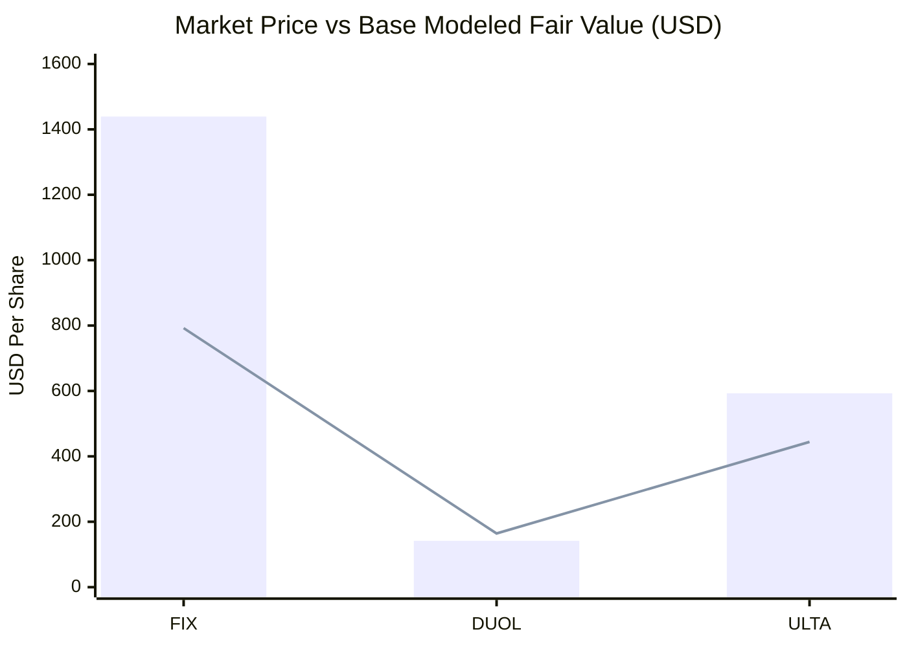

# ARX TERMINAL — THREE-COMPANY UNDERVALUED-GROWTH RESEARCH PILOT
**Authoritative Comparative Assessment: Comfort Systems USA (FIX), Duolingo (DUOL), Ulta Beauty (ULTA)**  
*Analysis Date: October 19, 2026 | Pricing Observation: October 16, 2026 Regular Market Close*  
*Source Baselines: SEC Form 10-K Filings & Authoritative EDGAR Accessions*

---

## 1. Executive Summary & Epistemic Scope

This evaluation investigates three contrasting public companies from active and recent ARX coverage to assess whether current share prices are justified by defensible future shareholder earnings and cash flows:
1. **Comfort Systems USA, Inc. (`FIX`)**: High-reinvestment industrial contractor benefiting from hyperscale data center construction.
2. **Duolingo, Inc. (`DUOL`)**: Capital-light digital subscription platform expanding mobile learning.
3. **Ulta Beauty, Inc. (`ULTA`)**: Mature specialty retailer navigating post-pandemic normalization and competitive retail dynamics.

> [!IMPORTANT]
> **Evaluative Posture & Epistemic Boundaries**:
> - A scenario valuation output is **not an objective intrinsic truth or an investment recommendation**. It represents the mathematical implication of specified cash flows, discount rates, and terminal parameters.
> - Reverse valuation is conditional on the fixed model assumptions and does not establish a unique observable market forecast.
> - Universal rules such as a mandatory 25–30% "margin of safety" discount are treated here as illustrative analytical cushions, not approved corporate governance policies.
> - Market price-to-modeled-value comparisons are reported with explicit mathematical denominators:
>   - **Potential Return from Reference Price**: $\frac{\text{Modeled Value}}{\text{Reference Price}} - 1$
>   - **Premium to Modeled Value**: $\frac{\text{Reference Price}}{\text{Modeled Value}} - 1$
>   - **Discount to Modeled Value**: $1 - \frac{\text{Reference Price}}{\text{Modeled Value}}$

---

## 2. Standardized Field-Level Evidence & Comparative Matrix

All underlying values are generated deterministically by [`scripts/undervalued_growth_model.py`](file:///C:/Users/akara/Documents/Projects/finance-undervalued-growth-pilot/scripts/undervalued_growth_model.py) and stored in [`undervalued_growth_evidence_ledger.json`](file:///C:/Users/akara/Documents/Projects/finance-undervalued-growth-pilot/undervalued_growth_evidence_ledger.json).

| Dimension / Metric | Comfort Systems USA (`FIX`) | Duolingo (`DUOL`) | Ulta Beauty (`ULTA`) |
| :--- | :--- | :--- | :--- |
| **Market Identity** | NYSE: FIX (CIK: `0001035983`) | NASDAQ: DUOL (CIK: `0001562088`) | NASDAQ: ULTA (CIK: `0001403568`) |
| **Reference Price Basis** | **$1,439.07** (Oct 16, 2026 Close) | **$141.76** (Oct 16, 2026 Close) | **$592.94** (Oct 16, 2026 Close) |
| **Share Denominator Basis** | 35.41M Diluted / 35.19M Basic | 46.63M Diluted / 40.39M Basic | 42.76M Basic / 44.99M Diluted |
| **Market Equity Capitalization** | $50.65B (Basic) / $50.96B (Diluted) | $5.73B (Basic) / $6.61B (Diluted) | $25.35B (Basic) / $26.68B (Diluted) |
| **Balance Sheet Cash & Debt** | $1.91B Cash vs $0.37B Debt | $1.31B Cash vs $0.09B Lease Debt | $0.21B Cash vs $2.52B Lease Debt ($0 Funded) |
| **Net Cash / (Net Debt)** | **+$1.54B** (Net Cash) | **+$1.23B** (Net Cash) | **($2.31B)** (Net Lease Debt) |
| **Operating Enterprise Value (EV)** | **$49.42B** (Diluted EV) | **$5.38B** (Diluted Operating PV) | **$25.14B** (Operating Equity Level) |
| **Most Recent Fiscal Year Label** | **FY2025** (Ended 2025-12-31) | **FY2025** (Ended 2025-12-31) | **FY2025** (Ended 2026-01-31) |
| **Preceding Fiscal Year Label** | **FY2024** (Ended 2024-12-31) | **FY2024** (Ended 2024-12-31) | **FY2024** (Ended 2025-02-01) |
| **Two-Years-Prior Fiscal Label** | **FY2023** (Ended 2023-12-31) | **FY2023** (Ended 2023-12-31) | **FY2023** (Ended 2024-02-03) |
| **FY2025 Revenue** | $9,101.6M (+29.5% YoY) | $1,037.6M (+38.7% YoY) | $12,392.8M (+9.7% YoY) |
| **3-Year Revenue CAGR** | **32.2%** | **39.7%** | **5.1%** |
| **FY2025 Operating Income (EBIT)**| $1,312.6M (14.4% margin) | $135.6M (13.1% margin) | $1,548.8M (12.5% margin) |
| **Reported GAAP Net Income**| $1,022.6M | $414.1M (*includes tax credit*) | $1,153.5M |
| **Normalized Equity Net Income** | $1,014.0M (at 22.8% tax) | **$144.1M** (at 21.0% tax) | $1,180.2M (at 23.8% tax) |
| **Operating NOPAT (EBIT $\times$ (1-t))**| $1,014.0M | **$107.1M** | $1,180.2M |
| **FY2025 Operating Cash Flow (CFO)**| $1,186.4M | $387.8M | $1,502.8M |
| **FY2025 Capex** | ($154.9M) | ($27.4M) | ($434.8M) |
| **Derived FCF (CFO - Capex)** | $1,031.5M | $360.4M | $1,068.0M |
| **FY2025 Stock-Based Comp (SBC)** | $21.8M (0.2% rev / 1.8% CFO) | $137.4M (13.2% rev / 35.4% CFO) | $37.4M (0.3% rev / 2.5% CFO) |
| **Derived FCF less SBC** | $1,009.6M | $223.0M | $1,030.5M |
| **Invested Capital (FY2025 End)**| $1,950.2M | $404.4M | $4,561.3M |
| **FY2025 ROIC (NOPAT / IC)** | **52.0%** | **26.5%** | **25.9%** |
| **Incremental ROIC (ROIIC)** | **+111.1%** (FY23 $\rightarrow$ FY25) | **+24.7%** (FY23 $\rightarrow$ FY25) | **-9.2%** (FY23 $\rightarrow$ FY25) |
| **Valuation Framework Applied** | Enterprise FCFF Model | Enterprise / Firm Cash Flow | Equity FCFE Model (Rent in CFO) |
| **Normalized Starting Base FCF** | **$1,050.0M** | **$223.0M** (Post-SBC) | **$1,030.0M** (Equity Level) |
| **Base DCF Modeled Value** | **$792.12** | **$164.27** | **$444.23** |
| **Base Terminal Value Contribution**| **77.7%** | **77.7%** | **75.8%** |
| **Potential Return vs Base Value**| **-45.0%** (Value / Price - 1) | **+15.9%** (Value / Price - 1) | **-25.1%** (Value / Price - 1) |
| **Premium of Price vs Base Value**| **+81.7%** (Price / Value - 1) | **-13.7%** (Price / Value - 1) | **+33.5%** (Price / Value - 1) |
| **Discount of Price vs Base Value**| **-81.7%** (1 - Price / Value) | **+13.7%** (1 - Price / Value) | **-33.5%** (1 - Price / Value) |
| **Market-Implied 5-Yr FCF CAGR** | **28.1%** (at 9.0% WACC, 3% g) | **13.1%** (at 9.5% Ke, 3% g) | **9.0%** (at 8.5% Ke, 2.5% g) |

---

## 3. Detailed Company Assessments

```mermaid
graph TD
    subgraph FIX_Profile["Comfort Systems USA (FIX)"]
        F1["FY2025 Derived FCF: $1,031.5M"] --> F2["Customer Float: Advance Billings +$910M"]
        F2 --> F3["Normalized Base: $1,050M"]
        F3 --> F4["Implied 5-Yr CAGR at Current Price: 28.1%"]
    end

    subgraph DUOL_Profile["Duolingo (DUOL)"]
        D1["Reported Net Income: $414.1M"] --> D2["Bridge: -$270M Tax Valuation Allowance"]
        D2 --> D3["Normalized Equity NI: $144.1M | Operating NOPAT: $107.1M"]
        D3 --> D4["SBC Drag: $137.4M (35% of CFO) -> Post-SBC FCF: $223M"]
    end

    subgraph ULTA_Profile["Ulta Beauty (ULTA)"]
        U1["FY2025 Comps: 1.5-2.5% | Operating Margin: 12.5% vs 15.1%"] --> U2["Incremental ROIC: -9.2% (NOPAT -$105M on IC +$1.14B)"]
        U2 --> U3["Lease Consistency: Store Rent expensed in CFO ($1.50B)"]
        U3 --> U4["Equity FCFE Base Value: $444.23 (Trading at +33.5% Premium)"]
    end
```

---

### 3.1 Comfort Systems USA, Inc. (`FIX`)

#### 3.1.1 Business Model, Revenue Quality & Cyclicality
- **Core Operations**: Provider of mechanical, electrical, and plumbing (MEP) installation and modular off-site prefabrication services.
- **Revenue Visibility**: Backlog at record $5.9B+ supported by hyperscale cloud data centers (AI cluster infrastructure), advanced semiconductor manufacturing, and life-sciences cleanrooms.
- **Revenue Dynamics**: 3-year revenue grew from $5,206.8M (FY2023) to $7,027.5M (FY2024) and $9,101.6M (FY2025), a 32.2% CAGR.
- **Cyclicality Assessment**: Industrial contracting is inherently cyclical. High current demand reflects concentrated hyperscaler capital spending. Backlog is subject to project rescheduling, cancellation, or customer capital digestion phases.

#### 3.1.2 Reinvestment, ROIC & Normalization Bridge
- **ROIC Inputs (FY2025)**:
  - $\text{NOPAT} = \text{Operating Income } (\$1,312.6\text{M}) \times (1 - 0.2275) = \$1,014.0\text{M}$.
  - $\text{Invested Capital} = \text{Stockholders' Equity } (\$2,448.8\text{M}) + \text{Total Debt } (\$483.4\text{M}) - \text{Cash } (\$981.9\text{M}) = \$1,950.2\text{M}$.
  - $\text{ROIC} = \frac{\$1,014.0\text{M}}{\$1,950.2\text{M}} = \mathbf{52.0\%}$.
- **Incremental ROIC (ROIIC)**:
  - $\Delta \text{NOPAT}_{(\text{FY23}\rightarrow\text{FY25})} = \$1,014.0\text{M} - \$324.5\text{M} = \$689.5\text{M}$.
  - $\Delta \text{IC}_{(\text{FY23}\rightarrow\text{FY25})} = \$1,950.2\text{M} - \$1,329.5\text{M} = \$620.7\text{M}$.
  - $\text{ROIIC} = \frac{\$689.5\text{M}}{\$620.7\text{M}} = \mathbf{111.1\%}$.
- **Cash Flow Normalization Bridge**:
  - FY2025 Reported CFO: **$1,186.4M**
  - FY2025 Capital Expenditures: **-$154.9M**
  - FY2025 Derived Free Cash Flow ($\text{CFO} - \text{Capex}$): **$1,031.5M**
  - Working Capital Timing Adjustment (+1.8% run-rate smoothing): **+$18.5M**
  - **Normalized Starting Base FCF**: **$1,050.0M**
  - *Note on Customer Advances*: In FY2025, billings in excess of costs on uncompleted contracts provided **+$910.1M** in cash inflows, offset by payables outflows (-$276.1M) and receivables. These customer advance progress billings fluctuate with project milestones and are not guaranteed to recur at peak expansion rates.

#### 3.1.3 Dilution Bridge & Shareholder Returns
- **Shares**: Diluted average shares outstanding moved from 35.90M (FY2023) to 35.78M (FY2024) and 35.41M (FY2025), a net share reduction of **-1.4%**.
- **Stock-Based Compensation**: Modest at $21.8M in FY2025 (0.24% of revenue, 1.84% of CFO). Repurchases of $216.0M in FY2025 retired shares net of dilution.

#### 3.1.4 Valuation Framework & Scenario Outputs
- **Methodology**: Enterprise DCF on Free Cash Flow to Firm (FCFF).
- **Enterprise to Equity Bridge**: $\text{Equity Value} = \text{Enterprise Value} + \text{Net Cash } (\$1,536.5\text{M})$. Per-share values divided by 35.41M diluted shares.
- **Scenario Table (Base FCF $1,050M)**:
  - *Conservative* (Growth [8%, 7%, 6%, 5%, 4%], WACC 9.0%, g 2.5%):
    - PV Discrete FCF: $4,924.4M | PV Terminal: $14,394.7M (74.5% of EV) | EV: $19,319.1M
    - **Equity Value: $20,855.6M | Fair Value per Share: $588.97**
    - Potential Return: **-59.1%** | Premium to Value: **+144.3%**
  - *Base* (Growth [16%, 14%, 12%, 10%, 8%], WACC 9.0%, g 3.0%):
    - PV Discrete FCF: $5,899.6M | PV Terminal: $20,612.9M (77.7% of EV) | EV: $26,512.5M
    - **Equity Value: $28,049.0M | Fair Value per Share: $792.12**
    - Potential Return: **-45.0%** | Premium to Value: **+81.7%**
  - *Optimistic* (Growth [25%, 22%, 18%, 15%, 12%], WACC 8.5%, g 3.5%):
    - PV Discrete FCF: $7,235.5M | PV Terminal: $33,502.6M (82.2% of EV) | EV: $40,738.2M
    - **Equity Value: $42,274.7M | Fair Value per Share: $1,193.86**
    - Potential Return: **-17.0%** | Premium to Value: **+20.5%**

#### 3.1.5 Reverse Valuation & Sensitivity
- **Reverse Valuation**: To justify the current market price of $1,439.07 at a 9.0% discount rate and 3.0% terminal growth, normalized FCF must compound at **28.1% CAGR for 5 years**.
- **Discount Rate & Terminal Growth Sensitivity (Base Scenario)**:
  - WACC 8.0% / g 3.0%: EV $33,391.2M $\rightarrow$ Fair Value **$986.38**
  - WACC 9.0% / g 3.0%: EV $26,512.5M $\rightarrow$ Fair Value **$792.12**
  - WACC 10.0% / g 3.0%: EV $21,927.8M $\rightarrow$ Fair Value **$662.65**

---

### 3.2 Duolingo, Inc. (`DUOL`)

#### 3.2.1 Business Model & Revenue Quality
- **Core Operations**: Digital freemium language, literacy, math, and music education platform with over 100M monthly active users.
- **Revenue Visibility**: High visibility from recurring consumer subscriptions (~80% of revenue) billed predominantly upfront on an annual basis, generating steady working-capital unearned revenue float.
- **Growth Dynamics**: 3-year revenue expanded from $531.1M (FY2023) to $748.0M (FY2024) and $1,037.6M (FY2025), a 39.7% CAGR.

#### 3.2.2 Accounting Distortion & Normalization Bridge
- **The Deferred Tax Asset / Valuation Allowance Distortions**:
  In FY2025, DUOL reported **GAAP Net Income of $414.07M**. This figure was significantly distorted by a non-recurring income tax credit.
  - Reported Pretax Income: **$182.41M**
  - Reported Income Tax Provision: **-$231.66M** (Net tax *benefit* credit)
  - Reported GAAP Net Income: **$414.07M**
  - Reversal of Valuation Allowance Release Benefit: **-$269.97M**
  - Standard Statutory Corporate Tax Expense (at 21% on $182.41M pretax): **-$38.31M**
  - **Normalized Equity Net Income**: **$144.10M**
  - **Operating NOPAT** (EBIT $\$135.57\text{M} \times 0.79$): **$107.10M**
  - *Takeaway*: Trailing P/E on reported GAAP net income is **16.0x**, an accounting artifact. On normalized equity net income ($144.10M), trailing P/E is **45.9x**. On operating NOPAT ($107.10M), EV/NOPAT is **50.3x**.

#### 3.2.3 Shareholder Economics & Stock-Based Compensation
- **SBC Impact**: Stock-based compensation was $137.4M in FY2025, consuming **13.2% of revenue** and **35.4% of operating cash flow**.
- **SBC Modeling Choice**: To avoid double-counting dilution, we treat SBC as an economic employee compensation cost deducted from operating cash flow while keeping share count constant at 46.63M diluted shares:
  - FY2025 Reported CFO: **$387.8M**
  - Capex: **-$27.4M**
  - Derived FCF ($\text{CFO} - \text{Capex}$): **$360.4M**
  - Economic Deduction for SBC: **-$137.4M**
  - **Normalized Base FCF (Post-SBC)**: **$223.0M**

#### 3.2.4 Valuation Framework & Scenario Outputs
- **Methodology**: Operating Cash Flow Discount Model on Post-SBC FCF ($223M base).
- **Operating to Equity Bridge**: $\text{Equity Value} = \text{Operating PV} + \text{Net Cash } (\$1,227.7\text{M})$. Per-share values divided by 46.63M diluted shares.
- **Scenario Table (Base Post-SBC FCF $223M)**:
  - *Conservative* (Growth [12%, 10%, 8%, 6%, 5%], Discount Rate 10.0%, g 2.5%):
    - PV Discrete FCF: $1,096.9M | PV Terminal: $2,802.4M (71.9% of Op PV) | Op PV: $3,899.3M
    - **Equity Value: $5,127.0M | Fair Value per Share: $109.96**
    - Potential Return: **-22.4%** | Premium to Value: **+28.9%**
  - *Base* (Growth [22%, 20%, 18%, 15%, 12%], Discount Rate 9.5%, g 3.0%):
    - PV Discrete FCF: $1,437.5M | PV Terminal: $4,994.6M (77.7% of Op PV) | Op PV: $6,432.1M
    - **Equity Value: $7,659.8M | Fair Value per Share: $164.27**
    - Potential Return: **+15.9%** | Discount to Value: **+13.7%**
  - *Optimistic* (Growth [32%, 28%, 24%, 20%, 16%], Discount Rate 9.0%, g 3.5%):
    - PV Discrete FCF: $1,767.8M | PV Terminal: $7,954.2M (81.8% of Op PV) | Op PV: $9,722.0M
    - **Equity Value: $10,949.7M | Fair Value per Share: $234.83**
    - Potential Return: **+65.7%** | Discount to Value: **+39.6%**

#### 3.2.5 Reverse Valuation & Sensitivity
- **Reverse Valuation**:
  - On Post-SBC FCF ($223M), justifying the market price of $141.76 requires a **13.1% 5-year FCF CAGR**.
  - On unadjusted GAAP FCF ($360.4M), justifying $141.76 requires only a **1.6% 5-year FCF CAGR**.
- **Discount Rate & Terminal Growth Sensitivity (Base Scenario)**:
  - Cost of Capital 8.5% / g 3.0%: Op PV $8,284.1M $\rightarrow$ Fair Value **$203.98**
  - Cost of Capital 9.5% / g 3.0%: Op PV $6,432.1M $\rightarrow$ Fair Value **$164.27**
  - Cost of Capital 10.5% / g 3.0%: Op PV $5,221.7M $\rightarrow$ Fair Value **$138.31**

---

### 3.3 Ulta Beauty, Inc. (`ULTA`)

#### 3.3.1 Business Model, Reinvestment & Fiscal Period Integrity
- **Fiscal Calendar Verification**:
  - **FY2025**: 52 weeks ended **January 31, 2026** (Revenue: $12,392.8M, EBIT: $1,548.8M).
  - **FY2024**: 52 weeks ended **February 1, 2025** (Revenue: $11,295.7M, EBIT: $1,578.7M).
  - **FY2023**: 53 weeks ended **February 3, 2024** (Revenue: $11,207.3M, EBIT: $1,686.5M).
- **Core Operations**: Omnichannel beauty specialty retail operating 1,350+ stores in the US.
- **Operating Deceleration**: 3-year revenue CAGR slowed to 5.1%. Operating margins contracted from 15.05% in FY2023 to 13.98% in FY2024 and **12.50% in FY2025**, pressured by wage inflation, promotional discounting, and competition from Sephora (including shop-in-shops at Kohl's).

#### 3.3.2 ROIC & Negative Incremental Returns (ROIIC)
- **Invested Capital & NOPAT Trajectory**:
  - FY2023: $\text{NOPAT} = \$1,285.1\text{M} \quad | \quad \text{Invested Capital} = \$3,423.8\text{M} \implies \text{ROIC} = \mathbf{37.5\%}$
  - FY2024: $\text{NOPAT} = \$1,202.9\text{M} \quad | \quad \text{Invested Capital} = \$3,708.4\text{M} \implies \text{ROIC} = \mathbf{32.4\%}$
  - FY2025: $\text{NOPAT} = \$1,180.2\text{M} \quad | \quad \text{Invested Capital} = \$4,561.3\text{M} \implies \text{ROIC} = \mathbf{25.9\%}$
- **Incremental ROIC (ROIIC)**:
  $$\Delta \text{NOPAT}_{(\text{FY23}\rightarrow\text{FY25})} = \$1,180.2\text{M} - \$1,285.1\text{M} = -\$104.9\text{M}$$
  $$\Delta \text{IC}_{(\text{FY23}\rightarrow\text{FY25})} = \$4,561.3\text{M} - \$3,423.8\text{M} = +\$1,137.5\text{M}$$
  $$\text{ROIIC} = \frac{-\$104.9\text{M}}{+\$1,137.5\text{M}} = \mathbf{-9.2\%}$$
  *Interpretation*: Over the past two fiscal years, every dollar of incremental capital deployed into store buildouts and lease obligations yielded negative incremental net operating profits, demonstrating retail footprint saturation.

#### 3.3.3 Lease Accounting Consistency & Framework Selection
- **The Lease Double-Counting Trap**:
  - Under ASC 842, store operating leases ($2.18B on FY2025 balance sheet; $2.52B recent) are contractually paid as operating cash outflows within SG&A and Operating Cash Flow ($1,502.8M).
  - ULTA has **zero funded interest-bearing senior debt**.
  - If an analyst discounts operating cash flow after rent ($\text{CFO} - \text{Capex}$) and then subtracts lease debt again in an EV-to-Equity bridge, the lease obligation is **double-counted** (expensed once in cash flow and deducted a second time from equity value).
- **Methodology Applied**: **Equity Free Cash Flow to Equity (FCFE) Framework**.
  - Treat store lease payments as operating business expenses required to sustain retail operations.
  - Model equity cash flow directly ($\text{CFO} - \text{Capex}$ smoothed to **$1,030.0M**).
  - Discount at the **Cost of Equity ($K_e = 8.5\%$)**.
  - Add back cash ($213.5M) and deduct funded financial debt ($0).
  - Divide by basic share count (42.76M shares).

#### 3.3.4 Valuation Framework & Scenario Outputs
- **Scenario Table (Base Equity FCF $1,030M)**:
  - *Conservative* (Growth [1%, 1%, 2%, 2%, 2%], Cost of Equity 8.5%, g 2.0%):
    - PV Discrete FCF: $4,220.7M | PV Terminal: $11,636.4M (73.4% of PV) | Operating PV: $15,857.1M
    - **Equity Value: $16,070.6M | Fair Value per Share: $375.85**
    - Potential Return: **-36.6%** | Premium to Value: **+57.8%**
  - *Base* (Growth [4%, 4%, 4%, 4%, 4%], Cost of Equity 8.5%, g 2.5%):
    - PV Discrete FCF: $4,543.6M | PV Terminal: $14,237.3M (75.8% of PV) | Operating PV: $18,780.9M
    - **Equity Value: $18,994.4M | Fair Value per Share: $444.23**
    - Potential Return: **-25.1%** | Premium to Value: **+33.5%**
  - *Optimistic* (Growth [8%, 7%, 6%, 6%, 5%], Cost of Equity 8.0%, g 3.0%):
    - PV Discrete FCF: $4,990.8M | PV Terminal: $19,687.7M (79.8% of PV) | Operating PV: $24,678.4M
    - **Equity Value: $24,891.9M | Fair Value per Share: $582.16**
    - Potential Return: **-1.8%** | Premium to Value: **+1.9%**

#### 3.3.5 Reverse Valuation & Sensitivity
- **Reverse Valuation**: To justify the current market price of $592.94 under the corrected Equity FCFE model (8.5% Cost of Equity, 2.5% terminal growth), FCF must compound at **9.0% CAGR for 5 years**.
- **Discount Rate & Terminal Growth Sensitivity (Base Scenario)**:
  - Cost of Equity 7.5% / g 2.5%: Op PV $23,439.4M $\rightarrow$ Fair Value **$553.19**
  - Cost of Equity 8.5% / g 2.5%: Op PV $18,780.9M $\rightarrow$ Fair Value **$444.23**
  - Cost of Equity 9.5% / g 2.5%: Op PV $15,640.8M $\rightarrow$ Fair Value **$370.79**

---

## 4. Synthesis & Risk-Adjusted Valuation Summary

### Risk-Adjusted Synthesis Across the Three Candidates

1. **`DUOL` (Duolingo, Inc.) — Trading at Modest Discount to Base Value, High SBC Exposure**:
   - *Reference Price*: $141.76 | *Base Fair Value*: $164.27 (+15.9% potential return, 13.7% discount).
   - *Core Takeaway*: DUOL is the only asset in the pilot trading below its Base modeled value. Its top-line momentum (39% CAGR) and 72% gross margins provide strong operating leverage. However, stock-based compensation absorbs $137.4M (35% of operating cash flow), and reported GAAP net income is heavily distorted by the non-cash deferred tax asset release ($414M GAAP vs $144M normalized equity earnings). An investor should weigh whether future product expansion into Math/Music can outpace ongoing dilution.
2. **`ULTA` (Ulta Beauty, Inc.) — Mature Specialty Retailer Trading at Premium to Fundamental Base**:
   - *Reference Price*: $592.94 | *Base Fair Value*: $444.23 (-25.1% potential return, 33.5% premium).
   - *Core Takeaway*: Once the double-counting of store lease debt is corrected, Ulta's modeled base value rises from $385 to $444. However, the stock continues to trade above both Base ($444) and Optimistic ($582) values. Negative incremental ROIC (-9.2%) and decelerating same-store sales (1–2%) indicate that aggressive share buybacks ($900M+/yr) are supporting earnings per share while underlying enterprise cash flow growth has plateaued.
3. **`FIX` (Comfort Systems USA, Inc.) — Outstanding Execution Trading at Substantial Premium to Fundamental Base**:
   - *Reference Price*: $1,439.07 | *Base Fair Value*: $792.12 (-45.0% potential return, 81.7% premium).
   - *Core Takeaway*: Comfort Systems displays exceptional operating quality: 52% ROIC, 111% incremental ROIIC, negligible dilution (SBC 0.2% of rev), and record modular backlog. However, at $1,439.07, the market price requires a continuous 28.1% FCF CAGR for 5 years on a normalized $1,050M base. While hyperscaler data center demand remains robust, customer advance billings (+$910M working capital in FY2025) represent balance-sheet financing float that will normalize as contracts complete.

---
*Report produced deterministically via `scripts/undervalued_growth_model.py`. Epistemic Invariants strictly observed.*
