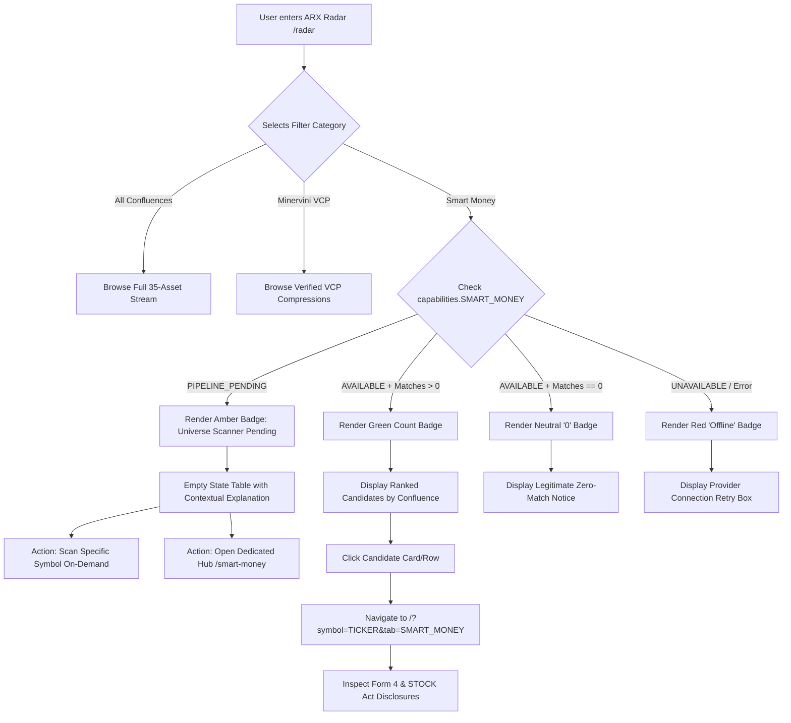

# ARX Terminal — Smart Money Application Flow & User Journeys

**Document Version**: 1.0.0  
**Status**: APPROVED  
**Target Milestone**: Smart Money UX & Architecture  

---

## 1. Primary User Journey & State Transitions



---

## 2. Detailed Journey Walkthroughs

### Journey 1: Radar Discovery Flow (Current Production State: `PIPELINE_PENDING`)
1. **Entry**: User lands on `/radar`.
2. **Category Selection**: User clicks on tab `🐋 Smart Money`.
3. **Readiness Evaluation**:
   - `capabilities.SMART_MONEY.universeScreening` is evaluated as `"PIPELINE_PENDING"`.
   - Tab badge indicates `"Universe Scanner Pending"` (no numerical zero).
4. **Toolbar Presentation**:
   - Toolbar presents `"Pending · 35 Universe Candidates"` (no misleading `"0 of 35"`).
5. **Empty State Display**:
   - Icon: 🔍
   - Heading: `"Smart Money — Universe Scanner Pending"`
   - Explanation: `"Automated market-wide institutional-flow screening is pending deployment. Single-asset SEC Form 4 regulatory filings remain active."`
6. **Suggested Actions**:
   - Quick jump: User can click `"⚡ Scan Ticker On-Demand"` for any recognized symbol (e.g. `NVDA`).
   - Deep dive: Link to `"Open Smart Money Hub →"` (`/smart-money`).

### Journey 2: Dedicated Smart Money Hub Flow (`/smart-money`)
1. **Entry**: User navigates to `/smart-money`.
2. **Provenance Disclosure**:
   - Top banner declares data source via `DataSourceBadge`: `"📚 Curated Research Archive (Aug 2026)"`.
3. **Exploration Paths**:
   - **Path A (Divergence Radar)**: User reviews 6-asset divergence grid (`PLTR`, `CPRX`, `NVDA`, `TSLA`, `NVO`, `SMCI`) detecting stealth accumulation vs distribution traps.
   - **Path B (Capitol Hill Disclosures)**: User filters trades by sector or STOCK Act latency (`Fresh <15d`, `Late Filer >45d`, `High Alignment ≥80`).
   - **Path C (Forensic Detail Drawer)**: User clicks a trade row to open `SmartMoneyDetailModal`, reviewing committee assignments and conflict theses.
4. **Handoff**:
   - Clicking `"Analyze →"` routes user to Terminal workspace (`/?symbol=PLTR&tab=SMART_MONEY`).

### Journey 3: Single-Asset Analysis Flow (`/?symbol=NVDA`)
1. **Entry**: User loads symbol in Analysis workspace.
2. **Tab Selection**: User selects `"Smart Money"` workspace tab.
3. **Component Evaluation (`CongressionalTradesCard`)**:
   - Component inspects `smartMoney.status`.
   - **Case A (Live Feed Connected)**: Displays real-time Form 4 transactions and verified Capitol Hill trades.
   - **Case B (Live Feed Disconnected / `PIPELINE_PENDING`)**:
     - Header badge shows `"Capitol Hill Feed Disconnected"`.
     - Card body informs: `"Live Congressional disclosure synchronization feed is currently offline. Curated historical filings can be reviewed on /smart-money."`
     - Avoids claiming "zero transactions reported within statutory window".
   - **Case C (Crypto Asset `BTC`/`ETH`/`SOL`)**:
     - Automatically switches to Institutional & Spot ETF proxy view (IBIT, FBTC, MSTR, COIN, legislative bills FIT21/BITCOIN Act).

---

## 3. Compact State Machine

```
┌─────────────────────────────────────────────────────────────────────────────┐
│                       SMART MONEY UX STATE MACHINE                          │
├───────────────────┬───────────────────┬──────────────────┬──────────────────┤
│ State             │ Badge Label       │ Numerical Count  │ Table Display    │
├───────────────────┼───────────────────┼──────────────────┼──────────────────┤
│ PIPELINE_PENDING  │ Scanner Pending   │ null (hidden)    │ Pending Notice   │
│ DATA_INCOMPLETE   │ Partial (Form 4)  │ null / marked *  │ Available Rows*  │
│ AVAILABLE_MATCHES │ Integer (e.g. 12) │ 12               │ Ranked Stream    │
│ AVAILABLE_ZERO    │ 0                 │ 0                │ Zero Match State │
│ UNAVAILABLE       │ Feed Offline      │ null (hidden)    │ Retry Error Box  │
└───────────────────┴───────────────────┴──────────────────┴──────────────────┘
```
