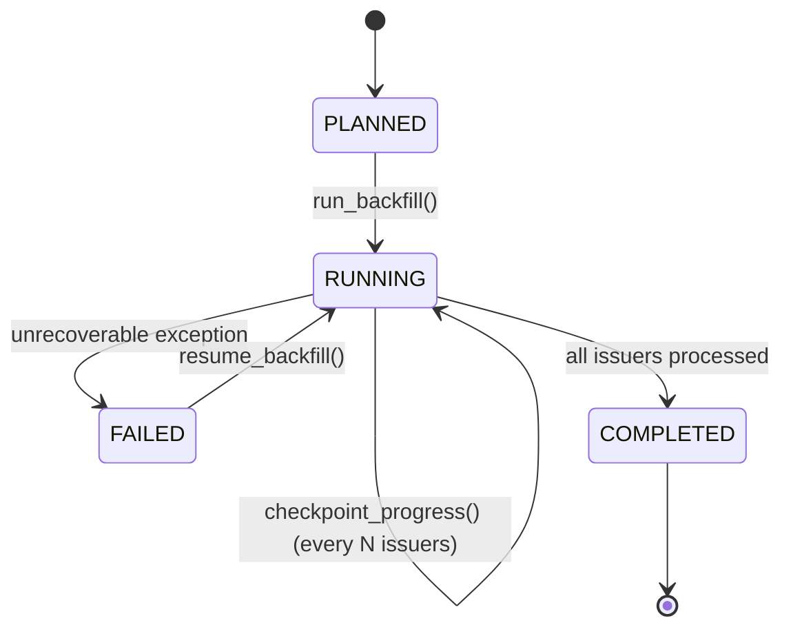

# SMART MONEY BACKFILL CONTRACT
**Wave 2B — Historical Ingestion & Backfill Governance**
**Document ID**: `SM-DOC-WAVE2B-BACKFILL-CONTRACT`
**Authority**: Independent Smart Money Historical Data Authority

---

## 1. Executive Summary & Purpose

This contract defines the architecture, execution rules, lifecycle states, idempotency guarantees, and bias controls for SEC Form 4 historical data backfills across the ARX Terminal Smart Money universe.

---

## 2. Backfill Modes & Survivorship Bias Governance

Historical ingestion operates strictly under one of two mutually exclusive modes:

```
+-----------------------------------------------------------------------------------------+
|                                    BACKFILL MODES                                       |
+-----------------------------------------------------------------------------------------+
| Mode A: CURRENT_UNIVERSE_HISTORICAL_BACKFILL                                            |
|   - Definition: Ingests historical Form 4 filings for issuers in the CURRENT universe.   |
|   - Status: PERMITTED FOR LOCAL RESEARCH / SIGNAL DEVELOPMENT.                          |
|   - Governance Invariant: MUST carry explicit `SURVIVORSHIP_BIAS_WARNING = YES`.        |
|   - Deliberate Limitation: Fails to capture companies that were public historically but |
|     subsequently delisted, merged, or went bankrupt before the current universe build.  |
+-----------------------------------------------------------------------------------------+
| Mode B: PIT_HISTORICAL_UNIVERSE_BACKFILL                                                |
|   - Definition: Ingests historical Form 4 filings for issuers active at each point in   |
|     time historically, reconstructed from survivorship-free historical constituents.    |
|   - Status: STRICTLY BLOCKED (`BLOCKED_PENDING_HISTORICAL_UNIVERSE_AUTHORITY`).         |
|   - Enforcement: `create_backfill_plan()` raises `ValueError` if invoked with Mode B    |
|     until authoritative historical point-in-time universe rosters are constructed.     |
+-----------------------------------------------------------------------------------------+
```

### 2.1 Mandatory Survivorship Bias Warning
Any manifest, query result, dataset export, or analytic snapshot generated under Mode A must include:
```json
"survivorship_bias_warning": true,
"survivorship_bias_attestation": "WARNING: Current-universe backfill exhibits survivorship bias. Historical signals must not be evaluated without adjusting for delisted/merged issuers."
```

---

## 3. Specification Hash Determinism

Every backfill job is configured via a immutable specification (`SmartMoneyBackfillSpec`). To ensure mathematical determinism and cross-environment reproducibility, the specification identity hash (`spec_hash`) is derived exclusively from canonical configuration parameters, **excluding wall-clock execution time**:

```python
hash_fields = {
    "universe_build_id": spec.universe_build_id,
    "backfill_mode": spec.backfill_mode.value,
    "start_date": spec.start_date,
    "end_date": spec.end_date,
    "issuer_ciks": sorted(spec.issuer_ciks),
    "max_issuers": spec.max_issuers,
}
spec_hash = hashlib.sha256(json.dumps(hash_fields, sort_keys=True).encode()).hexdigest()[:16]
```

Identical configuration across runs yields the exact same `spec_hash`.

---

## 4. Staged Execution & Checkpointing Lifecycle

Backfills execute in discrete batches with durable SQLite checkpointing to support safe interruption, crash recovery, and incremental progress.



### 4.1 Checkpoint Record Schema (`sm_backfill_checkpoints`)
Each checkpoint records:
- `spec_hash`: Foreign key linking to the backfill spec.
- `last_processed_cik`: CIK of the last issuer successfully committed.
- `processed_ciks_json`: JSON set of all processed CIKs.
- `completed_issuers`: Counter of completed issuers.
- `total_filings_discovered`: Cumulative count of filings found in SEC submissions.
- `total_filings_fetched`: Cumulative count of filings fetched or read from cache.
- `total_transactions_parsed`: Cumulative count of transactions extracted.
- `updated_at`: ISO timestamp of checkpoint commit.

Upon interruption, `run_backfill(resume=True)` queries the latest checkpoint and skips already-processed CIKs without redundant computation.

---

## 5. Idempotency Guarantees

The ingestion engine guarantees complete operational idempotency:
1. **Network Bypass**: If an accession number already exists in `form4_raw_filings`, the SEC network call is bypassed, retrieving local XML directly.
2. **Deterministic Manifest**: Running the backfill engine twice over identical inputs produces identical file counts, transaction counts, and SHA-256 manifests.
3. **No Duplicate Rows**: SQLite tables (`form4_raw_filings`, `form4_transactions`, `sm_source_availability_ledger`) use primary key constraints on `accession_number` and `tx_id` with `INSERT OR REPLACE` / `INSERT OR IGNORE` semantics.

---

## 6. Closed-Set Filing Disposition Accounting

Every SEC Form 4 filing processed is classified into an immutable, closed-set disposition:

| Disposition | Semantic Definition |
|-------------|---------------------|
| `FETCHED_AND_PARSED` | XML retrieved and >=1 transactions successfully parsed and stored. |
| `FETCHED_NO_RELEVANT_TRANSACTIONS` | XML retrieved, but contains 0 non-derivative transaction records (e.g., pure derivative table 2 or empty table). |
| `PARSE_FAILED` | XML could not be parsed due to schema defect or corrupt content. |
| `UNSUPPORTED_DOCUMENT` | Accession points to non-Form-4 document (e.g., Form 3, 5, or HTML-only filing). |
| `CACHED` | Filing already present in local raw storage; fetched without network request. |
| `FETCH_FAILED` | Network or rate-limit failure during XML download. |

Unclassified or ambiguous dispositions are strictly prohibited.
