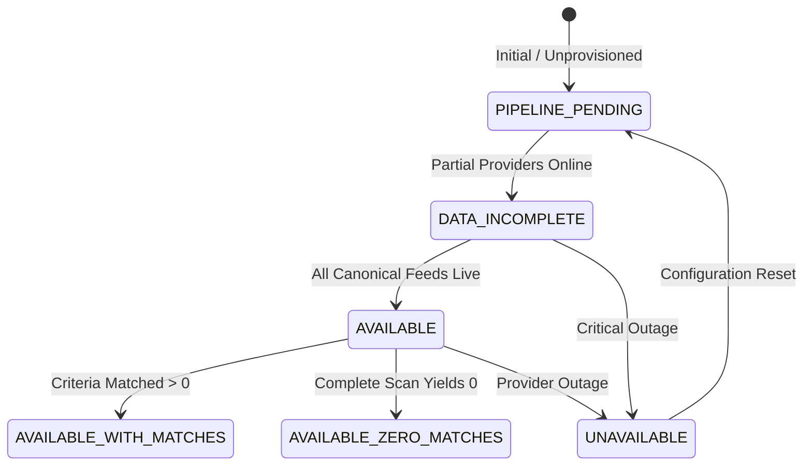

# ARX Terminal — Smart Money Product Requirements Document (PRD)

**Document Version**: 1.0.0  
**Status**: APPROVED FOR SPRINT PLANNING  
**Target Milestone**: Smart Money Pipeline & Semantic Alignment  
**Domain**: ARX Terminal / Radar & Regulatory Forensics  

---

## 1. Problem Statement
Investors and quantitative analysts need visibility into institutional positioning, C-suite insider commitments (SEC Form 4), and legislative personal portfolio transactions (STOCK Act). However:
1. In the primary Radar discovery interface (`/radar`), Smart Money universe screening is currently unprovisioned (`PIPELINE_PENDING`), yet system interfaces inadvertently coerce pending states into numerical zeroes (`gemsFound: 0`, `"0 of 35"`).
2. In single-asset inspection, the absence of real-time feeds produces misleading "zero transactions reported" notices rather than honest pipeline readiness notifications.
3. Users cannot easily discern whether a zero indicates an executed scan with zero qualifying candidates versus an unprovisioned data pipeline.

---

## 2. User Need & Personas
- **Institutional Equity Analyst / Swing Trader**: Needs to verify whether a technical consolidation pattern (e.g. Minervini VCP) is accompanied by executive insider buying or institutional accumulation.
- **Regulatory / Forensic Auditor**: Needs to audit STOCK Act statutory compliance latency (tracking late disclosures past the 45-day window) and legislative committee oversight alignment.
- **Epistemic Invariant**: Users must trust that ARX Terminal never fabricates data or collapses an unconfigured pipeline into a "zero matches" result.

---

## 3. Product Definition & Boundaries
- **Definition**: Smart Money is an evidence-backed quantitative aggregation of publicly verifiable regulatory disclosures and off-exchange market structures:
  1. SEC Form 4 insider open-market purchases and option exercises.
  2. US Congressional STOCK Act Periodic Transaction Reports (House Clerk and Senate EFD).
  3. FINRA ATS off-exchange dark pool volume share and short sale volumes.
  4. Institutional options flow (unusual call/put sweep activity).
- **Scope**: Canonical 35-asset liquid US equity universe (`CANONICAL_VCP_UNIVERSE`).
- **Non-Goals**:
  - **No Predictive Return Claims**: Smart Money does NOT claim to predict stock returns or guarantee alpha. Regulatory filings frequently reflect executive 10b5-1 predetermined schedules or statutory disclosure delays.
  - **No Imputed Data**: ARX Terminal will never synthetically generate fake insider transactions when live feeds are unprovisioned.
  - **No Execution Triggers**: Smart Money is an informational discovery and confluence input; trade execution requires formal `DecisionTrace` validation.

---

## 4. Signal & Data Contract

### 4.1 Signal Families
1. `SEC_FORM_4_INSIDER_BUY`:
   - Source: SEC EDGAR Submissions API.
   - Criteria: Code P (Open market purchase) by Officer, Director, or 10% Owner. Excludes stock grants, option vests, or gifts.
2. `STOCK_ACT_CONGRESS_BUY`:
   - Source: Clerk of the House / Senate EFD portals.
   - Fields: Politician, chamber, ticker, transaction date, filing date, amount range.
   - Derived Metric: `days_to_filing` = $\text{filing\_date} - \text{transaction\_date}$.
   - Compliance Threshold: $\le 45$ days (Compliant), $> 45$ days (Non-Compliant Late Filer).
3. `FINRA_ATS_DARKPOOL`:
   - Source: FINRA Rule 4552 weekly ATS aggregation.
   - Fields: Weekly dark pool volume share percentage, dominant ATS venue.
4. `UNUSUAL_OPTIONS_FLOW`:
   - Source: OPRA consolidated tape via authorized market data provider.
   - Criteria: Sweep order with premium $\ge \$250,000$ and $\text{Volume} / \text{OI} \ge 2.0$.

---

## 5. System Readiness & State Machine



### State Specifications:
1. **`PIPELINE_PENDING`**:
   - Condition: Market-wide automated pipeline runner is unprovisioned or awaiting live provider binding.
   - Match Count: **`NOT_APPLICABLE` (`null`)** — NEVER `0`.
   - UI Badge: `"Universe Scanner Pending"` (Amber).
   - User Action: Direct user to single-asset Form 4 lookup on `/` or curated archive on `/smart-money`.
2. **`DATA_INCOMPLETE`**:
   - Condition: Some providers connected (e.g. Form 4 live, but Congress disconnected).
   - Match Count: Rendered with warning flag (`"Partial (Form 4 only)"`).
   - Claim: Explicitly disclaims completeness.
3. **`AVAILABLE` + `MATCHES`**:
   - Condition: Complete scan executed against governed denominator with qualifying assets.
   - Match Count: Numerical integer $\ge 1$.
   - Evidence: Candidate card displays specific matching criteria.
4. **`AVAILABLE` + `NO_MATCHES`**:
   - Condition: Complete scan executed against governed denominator with zero assets meeting criteria.
   - Match Count: Numerical `0`.
   - User Message: `"0 candidates qualified under current Smart Money criteria today."`
5. **`UNAVAILABLE` (Temporary Failure)**:
   - Condition: Provider rate limit or transient network failure.
   - Match Count: **`NOT_APPLICABLE` (`null`)**.
   - UI Badge: `"Feed Offline"` with retry button.

---

## 6. API & Transport Contracts

### 6.1 `GET /api/v1/screener/run?filter_type=smart_money`
```json
{
  "totalCandidates": 35,
  "gemsFound": null,
  "activeFilter": "smart_money",
  "capabilities": {
    "SMART_MONEY": {
      "status": "PIPELINE_PENDING",
      "universeScreening": "PIPELINE_PENDING",
      "singleAssetAnalysis": "AVAILABLE",
      "rationale": "Single-asset SEC Form 4 active; market-wide accumulation pipeline pending deployment."
    }
  },
  "candidates": []
}
```
*Requirement*: `gemsFound` MUST be `null` (not `0`) when `capabilities.SMART_MONEY.universeScreening !== 'AVAILABLE'`.

### 6.2 `GET /api/v1/analytics/{symbol}`
```json
{
  "smartMoney": {
    "status": "PIPELINE_PENDING",
    "providerState": "DISCONNECTED",
    "congressTrades": [],
    "optionsFlow": [],
    "secFilings": {
      "available": true,
      "cik": "0001045810",
      "recentCount": 12
    }
  }
}
```

---

## 7. Frontend & UX Requirements
1. **Radar Table Toolbar**:
   - When filter is `SMART_MONEY` and capability is `PIPELINE_PENDING`:
   - Replace `{filteredAssets.length} of {allAssets.length}` with `"Pending · 35 Universe Candidates"`.
2. **Empty State Component**:
   - Render informative explanation:
     - Heading: `"Smart Money — Universe Scanner Pending"`
     - Body: `"Automated market-wide institutional-flow screening is currently pending deployment. Single-asset Form 4 regulatory filings remain available for individual tickers."`
     - Action: One-click jump to inspect specific ticker in Terminal.
3. **Single-Asset `CongressionalTradesCard`**:
   - Must consume `smartMoney.status`.
   - When trades are empty and status is `PIPELINE_PENDING`:
     - Render `"Live Capitol Hill disclosure sync feed is currently disconnected. Archived filings can be reviewed on /smart-money."`
     - Do NOT display `"No transactions reported within statutory filing window."`

---

## 8. Non-Functional Requirements
- **Accessibility (a11y)**: All status badges must meet WCAG AA contrast (4.5:1). Screen-reader announcements must declare `"Universe Scanner Pending"` rather than reading empty tables.
- **Telemetry**: Track user interactions on Smart Money filter tab with Matomo event `Category: Radar, Action: FilterSelect, Name: SMART_MONEY`.
- **Performance**: Zero overhead added to Radar page load. Payload size remains identical.

---

## 9. Acceptance Criteria
- [ ] **AC-SM-01**: `GET /api/v1/screener/run?filter_type=smart_money` returns `gemsFound: null` (never `0`) while universe screening is `PIPELINE_PENDING`.
- [ ] **AC-SM-02**: Radar UI tab badge renders `"Universe Scanner Pending"` and never renders numerical `0`.
- [ ] **AC-SM-03**: Radar search toolbar does NOT render `"0 of 35"` when Smart Money filter is selected while pipeline is pending.
- [ ] **AC-SM-04**: `CongressionalTradesCard` differentiates between a verified zero-trade result and a disconnected feed.
- [ ] **AC-SM-05**: Zero interference with Candidate 004 production shadow evidence epoch or protected paths.
