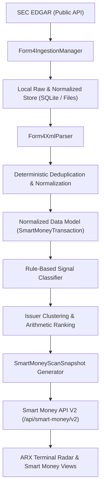

# SMART MONEY WAVE 1 — ARCHITECTURE & INGESTION DESIGN

## 1. System Architecture Overview

The Smart Money Wave 1 subsystem implements an end-to-end, deterministic pipeline for ingesting, parsing, filtering, and scoring SEC Form 4 insider transactions across a scannable universe.

---

## 2. Ingestion Engine (`form4_ingestion.py`)

### Requirements
- **Rate-Limiting**: Token bucket rate limiter enforcing max 5.0 requests/second to SEC EDGAR (well below the 10.0 req/sec limit).
- **User-Agent Compliance**: Header: `FinanceTerminalResearchApp admin@financeterminal.internal`.
- **Exponential Backoff**: Jittered exponential backoff on HTTP 429 or 5xx (initial delay 1.0s, max 16.0s, max 3 retries).
- **Two-Tier Retrieval**:
  1. `company_submissions` index (`/submissions/CIK{cik}.json`): Identifies filings where `form == "4"` or `"4/A"`.
  2. `ownershipDocument` XML retrieval (`/Archives/edgar/data/{cik}/{acc_no_clean}/{doc_name}.xml`): Retrieves raw XML transaction payload.
- **Local Persistence & Caching**: Raw XML cached to disk/SQLite to prevent redundant network downloads on subsequent scanner runs.

---

## 3. Form 4 XML Parser (`form4_parser.py`)

### Requirements
- Extracts `<periodOfReport>` (filing period).
- Extracts `<issuerCik>`, `<issuerName>`, `<issuerTradingSymbol>`.
- Extracts `<reportingOwner>` list:
  - `<rptOwnerCik>`, `<rptOwnerName>`.
  - Officer status, title, director status, 10% owner status.
- Extracts `<nonDerivativeTransaction>` list:
  - `<securityTitle>`
  - `<transactionDate>`
  - `<transactionCode>` (e.g. `P`, `S`, `M`, `A`, `G`, `F`)
  - `<transactionShares>`
  - `<transactionPricePerShare>`
  - `<transactionAcquiredDisposedCode>` (`A` / `D`)
  - `<directOrIndirectOwnership>` (`D` / `I`)
  - Footnote explanations if referenced.
- Extracts `<derivativeTransaction>` list (if present) to detect option exercises (Code `M`).

### False-Positive Controls & Fail-Closed Guards
1. Zero/Null Price: Any purchase transaction with `price <= 0` or missing price is excluded from cash conviction.
2. Grant/Award: Code `A` is explicitly classified as `EQUITY_GRANT`, excluded from open-market purchase.
3. Option Exercise: Code `M` is classified as `OPTION_EXERCISE`, excluded from open-market purchase.
4. Gifts: Code `G` is classified as `GIFT`, excluded.
5. Tax Withholding: Code `F` is classified as `TAX_WITHHOLDING`, excluded from voluntary selling.
6. Malformed XML: Any malformed XML returns an empty transaction list and logs a warning with fail-closed behavior.

---

## 4. Scanner & Ranking Engine (`form4_scanner.py`)

### Requirements
- Filters transactions by recency window (default: 30 days, configurable to 90 days).
- Evaluates qualifying open market purchases (`transaction_code == "P"` and `acquired_disposed == "A"` and `price > 0`).
- Groups transactions by issuer symbol.
- Aggregates metrics: total purchase value, total shares, distinct insider buyers, role titles, cluster buy flag.
- Computes deterministic linear score (0-100) and human-readable explanation strings.
- Produces immutable `SmartMoneyScanSnapshot`.
