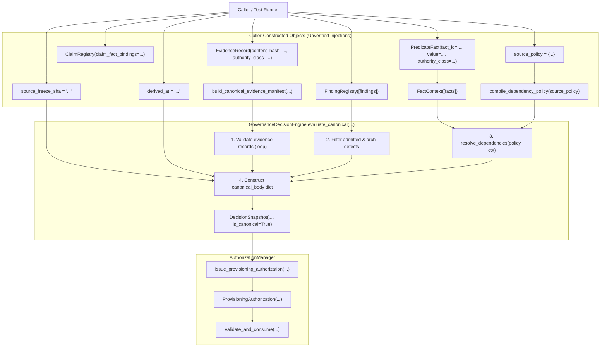

# Current Canonical Decision Call Graph & Injection Analysis

**Repository:** `finance`  
**Domain:** `analyst_dashboard/smart_money/governance_control_plane`  
**Gate:** `CANONICAL INPUT AUTHORITY, REGISTRY COMPLETENESS & DECISION-CHAIN CLOSURE V1`  
**Timestamp:** `2026-10-12T10:17:00Z`

---

## 1. Invocation Flow Prior to Remediation

---

## 2. Enumeration of Caller Injection Points

Prior to this gate, the canonical decision pathway allows a caller to inject the following authority-bearing attributes directly without cryptographic or repository grounding:

| # | Injection Target | Injected Value / Attribute | Current Permissive Entrypoint | Security & Authority Vulnerability |
|---|------------------|---------------------------|--------------------------------|-------------------------------------|
| 1 | `EvidenceRecord` | `authority_class` | `EvidenceRecord(..., authority_class="AUTHORITATIVE")` | Caller self-asserts authority without proving source ledger or repository binding. |
| 2 | `EvidenceRecord` | `content_hash` | `EvidenceRecord(..., content_hash="...")` | Caller supplies arbitrary digest without recomputation from actual Git tree blobs. |
| 3 | `source_freeze_sha` | Git commit SHA | `evaluate_canonical(..., source_freeze_sha="...")` | Unchecked string; commit might not exist in repository, or tree might not be verified. |
| 4 | `ClaimRegistry` | Claim identity & state | `ClaimRegistry(claim_fact_bindings={...})` | Caller arbitrarily defines or omits claims; empty claim registry produces `is_canonical: True`. |
| 5 | `FindingRegistry` | Finding population & status | `FindingRegistry([Finding(...)])` | Caller can exclude open architecture defects or alter admission statuses arbitrarily. |
| 6 | `CompiledDependencyPolicy` | Dependency rules & DAG edges | `compile_dependency_policy(source_policy)` | Caller supplies inline Python dictionary; rules are not repository-grounded or version-controlled. |
| 7 | `PredicateFact` | Fact values & authority | `PredicateFact(fact_id=..., value=...)` | Caller invents facts that did not originate from governed claim derivation. |
| 8 | `evaluation_clock` | Evaluation timestamp | `evaluate_canonical(..., derived_at="...")` | Caller can supply arbitrary future or past timestamps without clock authority or skew bounds. |

---

## 3. Required Remediation Architecture

The open parameter surface of `GovernanceDecisionEngine.evaluate_canonical(...)` must be decommissioned for canonical mode. It must be replaced by a single, fail-closed `CanonicalDecisionContextBuilder` that:
1. Recomputes repository evidence directly from the Git object database at `SOURCE_FREEZE_SHA`.
2. Verifies `SOURCE_FREEZE_SHA` exists as a valid commit and binds `source_tree_hash`.
3. Derives claims strictly through `CANONICAL_CLAIM_DERIVATION_POLICY.json`.
4. Derives facts strictly through `CANONICAL_FACT_DERIVATION_POLICY.json`.
5. Loads findings from the immutable finding registry with authoritative admission statuses.
6. Loads the dependency policy from `CANONICAL_DEPENDENCY_POLICY.json` stored in the repository.
7. Validates DAG completeness against `CANONICAL_DECISION_SURFACE.json` and `FINDING_DECISION_MAPPING.json`.
8. Enforces a bounded evaluation clock.
9. Produces an immutable `CanonicalDecisionContext` carrying a unique `decision_context_hash`.
10. `GovernanceDecisionEngine.evaluate_canonical(context)` consumes only this validated context object.
