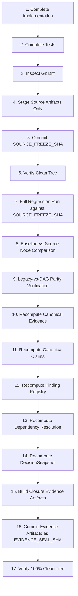

# ARX Terminal — Smart Money
## Source Freeze vs Evidence Seal Governance Model V1

### 1. The Circular Reference Paradox & Two-SHA Resolution

In cryptographic governance pipelines, a document that records test outcomes, verification receipts, and closure manifests cannot contain the Git commit SHA that commits those receipts without creating a circular dependency:
$$\text{SHA}(\text{Commit containing Seal}) \ne \text{SHA embedded inside Seal prior to commit}$$

To eliminate this ambiguity, ARX Terminal Smart Money formalizes a strict **Two-SHA Commit Discipline**:

1. **`SOURCE_FREEZE_SHA`**:
   - The authoritative Git commit SHA containing the frozen source code, contracts, schemas, dependency policies, and test suites.
   - At this commit, the tree is clean, reproducible, and ready for regression execution.
   - All tests, DAG evaluations, and parity checks are executed against this exact commit.

2. **`EVIDENCE_SEAL_SHA`**:
   - The subsequent Git commit containing the generated verification artifacts, closure manifest, legacy-DAG parity report, and test execution logs.
   - Every evidence artifact explicitly references `source_freeze_sha`.
   - No evidence artifact attempts to self-reference `EVIDENCE_SEAL_SHA` before it exists.

---

### 2. Normative 17-Step Source Freeze Sequence

The transition from code modification to canonical seal must strictly adhere to the following sequence:

1. **Complete Implementation**: Finalize all code changes in `analyst_dashboard/smart_money/governance_control_plane/`.
2. **Complete Tests**: Finalize test matrix in `tests/test_smart_money_canonical_decision_integration.py`.
3. **Inspect Diff**: Verify `git diff --stat` contains zero Candidate 004 mutations and zero unintended modifications.
4. **Stage Source Artifacts Only**: Stage application code, tests, schemas, and architecture contracts.
5. **Commit `SOURCE_FREEZE_SHA`**: Commit with conventional prefix `feat(smart-money): ...`.
6. **Verify Clean Tree**: Ensure `git status --short` is clean.
7. **Full Regression Run**: Execute all relevant governance test suites against `SOURCE_FREEZE_SHA`.
8. **Baseline-vs-Source Node Comparison**: Run pytest collection against baseline SHA vs source freeze SHA.
9. **Legacy-vs-DAG Parity**: Confirm 0 mismatches between legacy imperative derivation and DAG derivation.
10. **Recompute Canonical Evidence**: Materialize `CanonicalEvidenceManifest`.
11. **Recompute Canonical Claims**: Update `ClaimRegistry` and claim-fact bindings.
12. **Recompute Finding Registry**: Project 15 findings (13 admitted, 2 duplicate).
13. **Recompute Dependency Resolution**: Resolve DAG into `dependency_resolution_hash`.
14. **Recompute DecisionSnapshot**: Materialize canonical `DecisionSnapshot` binding all roots.
15. **Build Closure Evidence Artifacts**: Generate manifests and reports referencing `source_freeze_sha`.
16. **Commit `EVIDENCE_SEAL_SHA`**: Commit evidence artifacts with conventional prefix `chore(smart-money): seal ...`.
17. **Verify 100% Clean Tree**: Final audit confirms clean worktree, zero unstaged changes, and zero untracked files.
