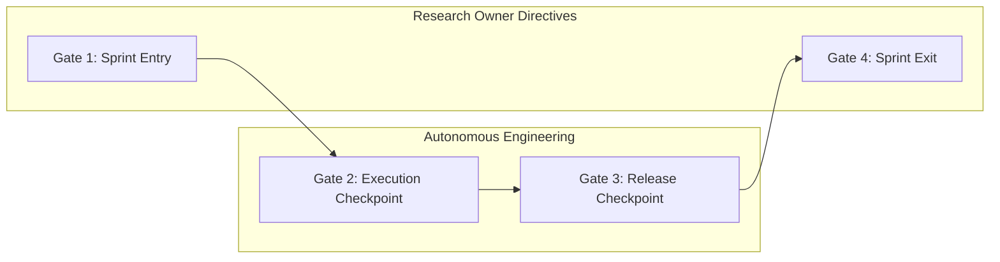

# ARX TERMINAL — GOVERNANCE FRAMEWORK
## SPRINT CONTROL & CHECKPOINT GATE OPERATING PROTOCOL (SCS-OP-01)

**Document ID:** `SPRINT_CONTROL_OPERATING_PROTOCOL`  
**Directive ID:** `ARX_SPRINT_CONTROL_SYSTEM_V1_001`  
**Framework:** ARX Closure Model v2 + Governance Efficiency v1.1  
**Target Repository:** [`daakara/finance`](https://github.com/daakara/finance)  
**Effective Date:** 2026-10-26T23:50:00+01:00  
**Research Owner & Sole Authorization Authority:** David Akara (`daakara`)

---

## 1. Purpose & Core Principles

The Sprint Control System (SCS) establishes an automated, evidence-backed operational protocol that enforces continuous backlog reconciliation, transparent execution velocity, and binary release gates.

### Core Governance Principles:
1. **Single Authoritative Register:** [`docs/planning/arx_canonical_backlog.json`](file:///docs/planning/arx_canonical_backlog.json) is the sole machine-readable source of truth. No competing or unsynchronized task registries are permitted.
2. **Dimension Independence:** Requirements, Implementation, Integration, Verification, Publication, Deployment, Operational Execution, and Production Evidence are tracked as independent, non-fungible dimensions.
3. **Green CI != Production Release:** A passing CI suite verifies code syntax, static exports, and isolated unit tests; it never constitutes proof of production deployment or operational activation.
4. **Owner Gate Escalation:** Routine updates (adding next actions, linking commits/PRs, refreshing evidence) proceed autonomously under standing engineering preapproval. Formal owner authorization is required **only** for materially gated transitions (sprint entry ratification, release to production, operational hold relief, and sprint closure certification).

---

## 2. The Four Checkpoint Lifecycle Gates

### Gate 1: Sprint Entry Gate
- **When Executed:** At sprint kickoff prior to active development.
- **Automated Verification:**
  1. `100%` of planned tasks have unique IDs matching `^ARX-S[1-9][0-9]?-[A-Z0-9\-]+$`.
  2. `100%` of active tasks have valid `assigned_sprint`, explicit `workstream`, priority (`P0`–`P3`), and designated owner.
  3. All task dependencies are mapped; zero dependency cycles exist.
  4. All authorization boundaries (`BOUNDED_ENGINEERING`, `OWNER_GATE_REQUIRED`, `READ_ONLY_AUDIT`) are declared.
  5. Schema validation passes with zero errors: `python tools/governance/validate_backlog_integrity.py`.
- **Owner Authority:** Requires explicit Research Owner sprint intake ratification directive (e.g., `ARX_S5_SPRINT_INTAKE_RATIFICATION_001`).

---

### Gate 2: Execution Checkpoint Gate
- **When Executed:** Continuously / weekly during sprint execution.
- **Automated Verification:**
  1. Every `IN_PROGRESS` or `READY` task has a documented `next_action`, accountable owner, and non-expired `checkpoint_target_date`.
  2. Tasks blocked by dependencies or operational holds have documented `active_blocker` and `resolution_trigger`.
  3. `evidence_refs` point to fresh, existing files in the repository.
  4. Run `python tools/governance/sprint_control.py` to regenerate the Sprint Board and Action Queue.
- **Owner Authority:** Autonomous engineering; no owner approval required for routine progress tracking.

---

### Gate 3: Release Checkpoint Gate
- **When Executed:** Prior to PR publication, candidate branch promotion, or deployment.
- **Automated Verification:**
  1. **Code & PR:** PR opened with non-activating posture, linked to canonical task ID, targeting `main`.
  2. **CI Pipeline:** 100% green across all GitHub Actions jobs (Python 3.11, Python 3.12, Linter, Static SSG Export).
  3. **Mainline Integration:** PR merged via squash-merge or merge commit; merged mainline commit SHA recorded in `release_matrix`.
  4. **Deployment Verification:** Cloudflare Pages / Railway preview or production bundle verified with live route readback.
  5. **Operational Holds:** If task touches invariant boundaries (`SMART_MONEY_WORKER_ACTIVATION`, `VCP_NATURAL_SCHEDULER_ENABLED=0`, `CORPORATE_EVENTS_TELEMETRY_ACTIVATION`), operational execution remains disarmed (`NOT_PERFORMED`) regardless of code merge.
- **Owner Authority:** Autonomous draft PR creation; **Owner directive required** for PR merge and production activation.

---

### Gate 4: Sprint Exit & Closure Gate
- **When Executed:** At sprint completion prior to handoff.
- **Automated Verification:**
  1. `100%` of tasks assigned to the closing sprint have an evidence-backed terminal disposition:
     - `CLOSED_VERIFIED`: All acceptance criteria met, PR merged, production evidence verified.
     - `CARRYFORWARD_SPRINT[N+1]`: Documented carryforward destination and non-empty `carryforward_reason`.
     - `HOLDING_QUEUE_OWNER_GATED`: Reassigned to holding queue under explicit platform hold.
     - `SUPERSEDED`: Explicit `superseded_by` pointer.
  2. Zero tasks remaining in `status: IN_PROGRESS` or `assigned_sprint: SPRINT_UNASSIGNED`.
  3. External GitHub inventory fetcher (`tools/governance/fetch_github_inventory.py`) binds live API snapshot.
  4. Backlog integrity validator passes in strict closure mode:
     `python tools/governance/validate_backlog_integrity.py --closure-certification`
- **Owner Authority:** Requires formal Research Owner sprint closure certification directive.

---

## 3. Routine Updates vs. Materially Gated Transitions

| Action Type | Routine (Autonomous Engineering) | Materially Gated (Owner Directive Required) |
| :--- | :---: | :---: |
| **Updating Next Action & Checkpoint Date** | **YES** | No |
| **Refreshing Evidence File References** | **YES** | No |
| **Running Reconciliation & Tracker Views** | **YES** | No |
| **Creating Isolated Branches & Draft PRs** | **YES** | No |
| **Adding New Tasks to Active Sprint** | No | **YES** (Owner Scope Addition) |
| **Relieving Immutable Platform Holds** | No | **YES** (Explicit Owner Ratification) |
| **Merging Pull Requests to `main`** | No | **YES** (Owner Merge Authorization) |
| **Deploying / Activating Live Services** | No | **YES** (Production Deployment Directive) |
| **Certifying Sprint Closure** | No | **YES** (Owner Closure Directive) |

---

## 4. Reconciliation Exception Remediation Protocol

When `reconcile_sprint_control.py` reports findings:
- **`[ERROR]`**: Execution or release halts immediately (Fail-Closed). The accountable owner must remediate the root-cause discrepancy (e.g. updating stale PR merge state, reverting unauthorized execution claims) before any release progression.
- **`[WARNING]`**: Tracked in the Action Queue for resolution during the next scheduled checkpoint. Does not block non-activating PR preparation.
