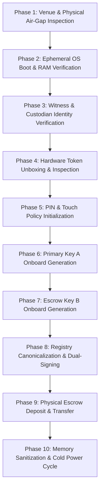

# ARX TERMINAL — HVA-01 V2.1 / SPRINT 3
# AIR-GAPPED KEY CEREMONY OPERATOR RUNBOOK & PHYSICAL CHECKLIST

**Document Identifier:** `docs/hva01/AIR_GAPPED_KEY_CEREMONY_RUNBOOK.md`  
**Architecture Reference:** `HVA01_WAVE4C2_SCOPE_LOCK_AND_KEY_CEREMONY_SPECIFICATION_V3.md` (Gate V3-01 / CTRL-4C2-08)  
**Governing Model:** ARX Closure Model v2 + Governance Efficiency v1.0  
**Risk Classification:** TIER 3 — Cryptographic Evidence Integrity & Hardware Custody  
**Execution Context:** PHYSICAL AIR-GAPPED STATION / DISCONNECTED VENUE  
**Sole Final Authority:** Research Owner exclusively (David Akara)  

---

## 1. Ceremony Objectives & Cryptographic Model

This runbook guides the physical execution of the operational key generation ceremony for HVA-01 V2.1.
- **Hardware-Native Multi-Key Model:** Private keys are born directly inside Common Criteria EAL5+ / FIPS 140-3 Level 3 silicon (Token A and Token B).
- **Non-Exportability Invariant:** Keys are bound to immutable hardware attributes: `CKA_EXTRACTABLE=FALSE` and `CKA_NEVER_EXTRACTABLE=TRUE`. Private keys never touch host RAM or magnetic/solid-state disks.
- **Dual-Control Attestation:** The resulting public key registry (`WITNESS_KEY_REGISTRY.json`) is canonicalized per RFC 8785 and co-signed by the Research Owner and the Independent Witness.
- **Physical Escrow (GAP-08):** Backup Token B is deposited inside serialized tamper-evident security packaging with the Institutional Escrow Custodian.

---

## 2. Ceremony Roles & Separation of Duties

| Role | Required Identity / Qualification | Permitted Ceremonial Actions |
| :--- | :--- | :--- |
| **Ceremony Administrator** | Authorized Systems Engineer | Executes CLI commands; attaches hardware tokens; initializes slots. |
| **Independent Witness** | Independent Legal / Audit Witness | Inspects packaging; observes terminal flags; co-signs canonical registry. |
| **Institutional Custodian** | University / Institutional Legal Officer | Inspects Token B packaging; takes physical custody of `BAG-ESCROW-B`. |
| **Research Owner** | Principal Investigator (David Akara) | Authorizes ceremony execution; co-signs canonical registry and rollover policies. |

---

## 3. Ten-Phase Chronological Execution Protocol



### Phase 1: Physical Venue & Air-Gap Verification
1. Inspect the physical ceremony room. Confirm absence of unauthorized cameras, microphones, or eavesdropping equipment.
2. Verify demonstrable physical network severance: physically disconnect all Ethernet cables.
3. Physically disable or remove Wi-Fi and Bluetooth daughterboards or disable them in workstation BIOS/UEFI.
4. Verify mobile devices, smart watches, and external radios are deposited outside the ceremony perimeter.
*Verification Evidence:* All participants sign the Physical Air-Gap Verification Sheet.

### Phase 2: Ephemeral OS Boot & Environment Verification
1. Insert write-blocked, read-only live Linux media (Debian Live / Tails) into air-gapped workstation.
2. Cold boot workstation into live RAM environment.
3. Execute `lsblk` and `mount` to confirm that all internal hard drives (SATA / NVMe) are unmounted and inaccessible.
4. Verify root filesystem runs completely in memory (`tmpfs`).
*Verification Evidence:* Terminal log of `lsblk` and `mount` captured in ceremony transcript.

### Phase 3: Witness & Custodian Reception
1. Verify government-issued photo identification for Ceremony Administrator, Independent Witness, and Escrow Custodian.
2. Initialize continuous, uninterrupted 4K video recording covering the workstation screen, operator hands, and hardware tokens.
3. State the date, UTC time, ceremony identifier, and role attendance aloud for the video record.
*Verification Evidence:* Recorded video timestamp and participant roll-call transcript.

### Phase 4: Hardware Token Unboxing & Physical Inspection
1. Present sealed manufacturer packaging for Token A and Token B to the Independent Witness.
2. Inspect holographic tamper-evident seals under magnification. Confirm zero breaches.
3. Log manufacturer factory serial numbers in the Ceremony Record Book.
*Verification Evidence:* High-resolution photographs of token serials and tamper seals.

### Phase 5: PIN Policy Initialization
1. Insert Token A into air-gapped workstation USB port.
2. Execute initialization command:
   ```bash
   pkcs11-tool --module /usr/lib/libykcs11.so --init-token --label "HVA01-W4C2-PRIMARY-KEY-A" --so-pin "REDACTED_SO_PIN"
   pkcs11-tool --module /usr/lib/libykcs11.so --init-pin --so-pin "REDACTED_SO_PIN" --pin "REDACTED_USER_PIN"
   ```
3. Disconnect Token A. Insert Token B. Repeat initialization with distinct SO-PIN and User PIN.
*Verification Evidence:* Console output showing successful token initialization.

### Phase 6: Primary Key A Onboard Generation
1. Connect Token A. Execute ceremony driver:
   ```bash
   python3 scripts/ceremony/run_ceremony.py --slot-a 0 --label-a "HVA01-W4C2-PRIMARY-KEY-A"
   ```
2. Verify terminal logs indicate onboard silicon key generation (`CKA_EXTRACTABLE=FALSE`, `CKA_NEVER_EXTRACTABLE=TRUE`).
3. Confirm private key bytes are never written to disk or console. Extract 32-byte public key hex and SHA-256 fingerprint.
*Verification Evidence:* Ceremonial transcript containing Primary public key hex and fingerprint.

### Phase 7: Escrow Key B Onboard Generation
1. Disconnect Token A. Connect Token B.
2. Execute ceremony driver for slot B:
   ```bash
   python3 scripts/ceremony/run_ceremony.py --slot-b 1 --label-b "HVA01-W4C2-BACKUP-KEY-B"
   ```
3. Verify independent onboard generation inside Token B silicon.
4. Extract 32-byte Escrow public key hex and SHA-256 fingerprint.
*Verification Evidence:* Ceremonial transcript containing Escrow public key hex and fingerprint.

### Phase 8: Registry Canonicalization & Ceremonial Dual-Signing
1. Assemble canonical registry containing public keys for Token A (ACTIVE_PRIMARY) and Token B (COLD_BACKUP_ESCROW).
2. Canonicalize registry payload per RFC 8785 (JSON Canonicalization Scheme) and compute SHA-256 digest.
3. Research Owner inspects canonical digest and executes detached Ed25519 signature.
4. Independent Witness inspects canonical digest and executes detached Ed25519 signature.
5. Combine signatures into canonical `WITNESS_KEY_REGISTRY.json`.
6. Run verification tool:
   ```bash
   python3 scripts/ceremony/verify_registry.py --registry WITNESS_KEY_REGISTRY.json --owner-pubkey <HEX> --witness-pubkey <HEX>
   ```
*Verification Evidence:* Complete, valid `WITNESS_KEY_REGISTRY.json` artifact written to read-only transfer media.

### Phase 9: Physical Escrow Deposit & Transfer
1. Place Token B inside serialized, tamper-evident security bag (`BAG-ESCROW-B-001`).
2. Independent Witness verifies placement and seals tamper closure.
3. Record bag serial number on the Physical Custody Deposit Receipt.
4. Ceremony Administrator formally transfers sealed `BAG-ESCROW-B-001` to the Institutional Escrow Custodian.
5. Custodian signs custody receipt certifying receipt of sealed bag for deposit in institutional safe.
*Verification Evidence:* Co-signed Physical Custody Deposit Receipt.

### Phase 10: Memory Sanitization & Cold Power Cycle
1. Run cryptographic memory zeroization on all temporary working directories:
   ```bash
   rm -rf /tmp/ceremony-airlock/
   ```
2. Unmount transfer media.
3. Cold power cycle the workstation: disconnect AC power cord and battery for at least 60 seconds to discharge DRAM capacitor memory.
4. Archive ceremony video recording to optical write-once media (M-DISC / DVD-R).
*Verification Evidence:* Signed Memory Sanitization & Ceremony Completion Attestation.

---

## 4. Emergency Key Rollover & Quarantine Procedures

If Primary Token A is lost, destroyed, or compromised:
1. Research Owner and Institutional Custodian convene (remotely or in person).
2. Institutional Custodian verifies sealed condition of `BAG-ESCROW-B-001` in institutional safe.
3. Research Owner and Institutional Custodian draft and co-sign `KEY_ROLLOVER_ATTESTATION.json`:
   - Increment sequence number.
   - Designate Token A as `REVOKED_COMPROMISED` or `DECOMMISSIONED_DEVICE_FAULT`.
   - Set `compromise_suspected_timestamp_utc`.
   - Designate Token B as `ACTIVE_PRIMARY`.
4. Publish co-signed attestation to verification runners.
5. Verifiers automatically apply Gate V3-02 quarantine rules: all records timestamped between $T_{\text{compromise\_suspected}}$ and $T_{\text{revocation}}$ are assigned state `INDETERMINATE / QUARANTINED` and excluded from research admissibility.

---

## 5. Non-Negotiable Governance Holds

```ini
PR78 = DRAFT_HOLD
PR83 = DRAFT_HOLD
PR83_MERGE = NOT_AUTHORIZED

GAP07 = OPERATIONALLY_INCOMPLETE
GAP08 = OPERATIONALLY_INCOMPLETE
C1_C4 = NOT_SATISFIED
C5 = NOT_PASSED

OPERATIONAL_KEY_GENERATION = PROHIBITED_WITHOUT_OWNER_TOKEN
PHYSICAL_CEREMONY_EXECUTION = PROHIBITED_WITHOUT_OWNER_TOKEN
PRODUCTION_DEPLOYMENT = NOT_AUTHORIZED
```
