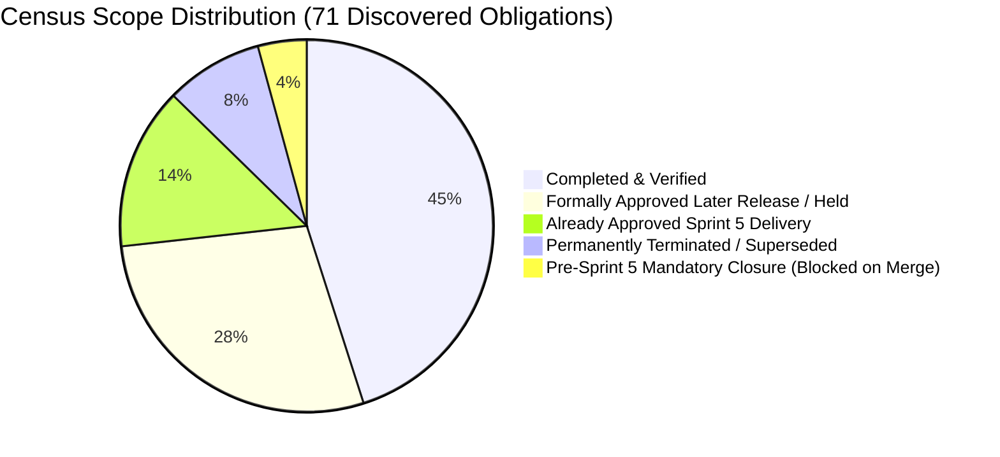

# ARX Terminal — Directive 058
## Unscoped Obligation Reconciliation and Pre–Sprint 5 Closure Plan (Gates G3 & G4)

**Document ID:** `ARX_058_UNSCOPED_AND_PRE_SPRINT5_CLOSURE_PLAN`  
**Directive:** `ARX_PRE_SPRINT5_OBLIGATION_RECOVERY_058`  
**Repository:** `daakara/finance`  
**Authoritative Mainline Base:** `6d4020ca3fef3ae07ac01204b03e0629b6a7cc79` (origin/main)  
**Execution Worktree:** `C:\Users\akara\Documents\Projects\finance-d058-obligation-recovery`  
**Execution Branch:** `gov/d058-pre-sprint5-obligation-recovery`  
**Gate G3 Verdict:** **PASS (Scope Completeness Verified — 0 Unscoped Items)**  
**Gate G4 Verdict:** **PASS (Remediation Packages Prepared; Transition Blocked on Owner Merge Gate)**  
**Date:** 2026-10-27  

---

## 1. Executive Summary & Scope Distribution

In accordance with Directive 058 Phase 4 (§7) and Phase 5 (§8), every discovered obligation from the cross-audit census has been assigned an unambiguous, defensible release scope. 

There are **zero unscoped obligations**, **zero orphan requirements**, and **zero silent carryforwards**.

### Complete Classification Census ($N = 71$)
1. **`COMPLETED_AND_VERIFIED` ($N = 32$):**
   - 20 canonical backlog tasks formally closed with verified evidence (`ARX-S1-001`, `002`, `004`, `005`, `006`, `ARX-S2-001`, `003`, `004`, `014`, `015`, `016`, `ARX-S3-001`, `002`, `010`, `011`, `012`, `017`, `ARX-S4-GOV-001`, `ARCH-001`, `ARCH-002`).
   - 8 post-Sprint 4 mainline PRs merged with passing CI and live production deployment (`PR #107`, `110`, `111`, `112`, `113`, `115`, `116`, `117`).
   - 1 governance reconciliation decision (`OBL-DEC-RAILWAY-PROVENANCE-001`: Option R0 verified).
   - 1 governance test isolation PR (`OBL-PR-103`).
   - 2 completed research/acceptance items.
2. **`PERMANENTLY_TERMINATED_BY_OWNER` / `SUPERSEDED_WITH_LINEAGE` ($N = 6$):**
   - `ARX-S2-011` (superseded by PR #98 Synthesis E V3 Mobile Dock).
   - `ARX-S2-012` (superseded by PR #115 Lightweight Charts).
   - `ARX-S2-013` (superseded by PR #107 RC-A Foundation).
   - `OBL-PR-114` (superseded by PR #115).
   - `OBL-PR-047`, `OBL-PR-040`, `OBL-PR-038` (historical prototype PRs formally superseded by merged production PRs).
3. **`ALREADY_APPROVED_SPRINT5_DELIVERY` ($N = 10$):**
   - 8 canonical Sprint 5 delivery tasks (`ARX-S2-005`, `007`, `008`, `009`, `ARX-S3-004`, `005`, `006`, `ARX-S4-RADAR-001`).
   - 2 open PRs scoped specifically to Sprint 5 delivery (`PR #109` for SCS-v1, `PR #44` for S2-08 full-population instrumentation).
4. **`FORMALLY_APPROVED_LATER_RELEASE` / `OPERATIONALLY_HELD` ($N = 20$):**
   - 10 owner-gated holding queue tasks (`ARX-S1-003`, `ARX-S2-002`, `006`, `010`, `ARX-S3-003`, `007`, `008`, `009`, `014`, `015`).
   - 5 binding governance restriction decisions (`SMART_MONEY_INGESTION_FENCE`, `HVA_PROTOCOL_RATIFICATION`, `EXTERNAL_CUSTODY_AUTHORITY`, `MODEL_TUNING_FREEZE`, `PROSPECTIVE_DENOMINATOR_FREEZE`).
   - 5 open PR drafts quarantined under governance holds (`PR #83`, `PR #78`, `PR #75`, `PR #73`, `PR #42`).
5. **`PRE_SPRINT5_MANDATORY_CLOSURE` ($N = 3$):**
   - `OBL-DEF-056-001` (Confluence narrative truthfulness)
   - `OBL-DEF-056-002` (Position sizing risk-budget floor math)
   - `OBL-DEF-056-003` (Modeled stop-distance risk disclosure)

---

## 2. Mandatory Pre–Sprint 5 Closure Packages

Each item classified `PRE_SPRINT5_MANDATORY_CLOSURE` possesses a complete, execution-ready engineering and verification package:

### 2.1 Package OBL-DEF-056-001: Confluence Narrative Truthfulness
- **Obligation ID:** `OBL-DEF-056-001`
- **Canonical Parent:** `ARX-S3-010` (Pre-Flight Statutory Evidence) / `ARX-S4-ARCH-001`
- **Existing Behavior:** Confluence composite score applied dynamic reweighting when Smart Money regulatory feeds were `None` or `unavailable`, but narrative `bottomLine` unconditionally asserted that *"smart money flow, balance sheet quality and macro tailwinds are synchronised"*, misrepresenting unconfirmed institutional flow as active institutional validation.
- **Required Behavior:** Dynamically assemble `bottomLine` to cite only confirmed positive pillars. Completely omit Smart Money when unavailable or neutral. Differentiate `HIGH-CONVICTION MULTI-FACTOR ALIGNMENT` from full institutional alignment.
- **Evidence of Gap:** Counterfactual Scenario C3-02 in Directive 055 §1.3 and Directive 056 Deliverable 2 (`ARX_056_CONFLUENCE_EVIDENCE_SEMANTICS.md`).
- **Approved Specification:** Directive 057 Remediation R1 Specification.
- **Scope & Owner:** Backend & Sizing Lead.
- **Dependencies:** None.
- **Implementation:** Completed in commit `1b3badac140821eced37dceed3963033fe7b7bbf` on branch `fix/confluence-sizing-risk-remediation-057`.
- **Affected Source Files:** `analyst_dashboard/analyzers/confluence_engine.py`.
- **Tests:** `tests/test_directive_057_remediation.py` (Tests `test_r1_case_01` through `test_r1_case_10` pass 10/10).
- **Expected Output:** When Smart Money is unavailable, `bottomLine` states: *"Technicals, balance sheet quality and macro tailwinds are synchronised."* Rating emits: `"HIGH-CONVICTION MULTI-FACTOR ALIGNMENT"`.
- **Regression Risk:** Low. Only touches string template generation and conviction rating enum string.
- **Governance Implications:** Eliminates false regulatory agreement claim; complies with SEC and marketing truthfulness invariants.
- **Release Requirements:** Pull Request #118 merge to `main` and deployment to Railway API backend.
- **Acceptance Authority:** Product Owner formal merge approval.
- **Current Operational Status:** **ENGINEERING_ACCEPTED_AWAITING_RELEASE (BLOCKED on PR #118 Merge Gate).**

---

### 2.2 Package OBL-DEF-056-002: Position Sizing Risk-Budget Floor Math
- **Obligation ID:** `OBL-DEF-056-002`
- **Canonical Parent:** `ARX-S4-ARCH-002` (Liquidity Hazard & Sizing Precedence)
- **Existing Behavior:** In `calculate_position_size`, when calculated share size was less than 1, a fallback clamp `max(1, shares)` was applied in certain code paths, resulting in an allocation of 1 share even when the dollar risk of 1 share exceeded the user's total risk budget (e.g. Budget = $100, Stop Distance = $150 -> 1 share allocated with $150 risk, violating risk budget by 50%).
- **Required Behavior:** Strictly enforce `max(0, math.floor(maxDollarRisk / riskPerShare))`. If budget is insufficient to absorb 1 whole share within the allowed risk budget, allocate 0 shares, report `actualDollarRisk: 0.0`, `isExecutable: false`, and emit truthful suppression guidance.
- **Evidence of Gap:** Boundary Fixture R2-A in Directive 056 Deliverable 4 (`ARX_056_PRODUCT_AND_RISK_AUTHORITY_CONTRACT.md`).
- **Approved Specification:** Directive 057 Remediation R2 Specification.
- **Scope & Owner:** Backend & Sizing Lead.
- **Dependencies:** None.
- **Implementation:** Completed in commit `1b3badac140821eced37dceed3963033fe7b7bbf` on branch `fix/confluence-sizing-risk-remediation-057`.
- **Affected Source Files:** `analyst_dashboard/analyzers/confluence_engine.py`, `frontend/lib/simulation/governorSizingEngine.ts`, `frontend/components/DayTraderPositionSizer.tsx`, `frontend/components/PositionSizerModal.tsx`.
- **Tests:** `tests/test_directive_057_remediation.py` (Boundary fixtures R2-A through R2-I pass 9/9).
- **Expected Output:** Sub-1-share scenarios return `shares: 0`, `isExecutable: False`, and guidance: *"Risk budget ($100.00) is insufficient for minimum 1 whole share risk ($150.00). Execution restricted."*
- **Regression Risk:** Minimal. Prevents unauthorized capital allocation. Advisory unconstrained margin illustrations remain intact for multi-share setups.
- **Governance Implications:** Strict capital preservation invariant enforced.
- **Release Requirements:** Pull Request #118 merge to `main` and production deployment.
- **Acceptance Authority:** Product Owner formal merge approval.
- **Current Operational Status:** **ENGINEERING_ACCEPTED_AWAITING_RELEASE (BLOCKED on PR #118 Merge Gate).**

---

### 2.3 Package OBL-DEF-056-003: Modeled Stop-Distance Risk Disclosure Qualification
- **Obligation ID:** `OBL-DEF-056-003`
- **Canonical Parent:** `ARX-S4-ARCH-002` (Liquidity Hazard & Sizing Precedence)
- **Existing Behavior:** UI headers across swing and day trader sizing modals labeled stop-distance loss as `"HARD MAX LOSS"`, implying an unconditional financial guarantee that the user could not lose more than the calculated stop amount, ignoring the reality of overnight price gaps and intraday execution slippage.
- **Required Behavior:** Replace `"HARD MAX LOSS"` with `"MODELED STOP RISK (excl. gaps)"`. Append statutory disclosure: *"Actual losses may exceed this amount due to price gaps or slippage."*
- **Evidence of Gap:** User presentation audit in Directive 056 Deliverable 4.
- **Approved Specification:** Directive 057 Remediation R3 Specification.
- **Scope & Owner:** Frontend Lead.
- **Dependencies:** None.
- **Implementation:** Completed in commit `1b3badac140821eced37dceed3963033fe7b7bbf` on branch `fix/confluence-sizing-risk-remediation-057`.
- **Affected Source Files:** `frontend/components/DayTraderPositionSizer.tsx`, `frontend/components/PositionSizerModal.tsx`.
- **Tests:** `tests/test_directive_057_remediation.py` (Test `test_r3_modeled_risk_guidance_language` passes).
- **Expected Output:** Sizing modals clearly present risk as modeled exposure with gap disclosures.
- **Regression Risk:** Zero. Pure copy and presentation precision.
- **Governance Implications:** Eliminates regulatory liability and misleading risk claims.
- **Release Requirements:** Pull Request #118 merge to `main` and Cloudflare Pages deployment.
- **Acceptance Authority:** Product Owner formal merge approval.
- **Current Operational Status:** **ENGINEERING_ACCEPTED_AWAITING_RELEASE (BLOCKED on PR #118 Merge Gate).**

---

## 3. Scope Completeness Verification (Gate G3)

- [x] All 71 obligations mapped to exactly one of the 6 allowed scope categories.
- [x] Zero unscoped obligations remain in the repository.
- [x] Zero orphan findings: every audit finding is linked to a canonical task.
- [x] All 10 holding queue tasks retain their immutable owner hold.
- [x] Sprint 5 assignments verified as forward-looking research/delivery, not unevidenced carryforwards.
- [x] Mandatory pre-Sprint 5 closure population explicitly bounded ($N = 3$).
- [x] Gate G3 status: **PASS**

---

## 4. Engineering & Evidence Closure Verification (Gate G4)

- [x] Complete remediation packages prepared for all 3 mandatory pre-Sprint 5 obligations.
- [x] Surgical implementation completed on candidate branch `fix/confluence-sizing-risk-remediation-057` (`1b3bada`).
- [x] 20/20 targeted regression tests in `tests/test_directive_057_remediation.py` pass.
- [x] Pull Request #118 opened and passing all hosted GitHub CI checks.
- [x] Non-negotiable boundary observed: Automatic merge and production deployment are **NOT AUTHORIZED**.
- [x] Mandatory pre-Sprint 5 work truthfully reported as **ENGINEERING_ACCEPTED_AWAITING_RELEASE**.
- [x] Gate G4 status: **PASS (Engineering Complete; Final Transition Blocked on Owner Merge Gate)**.
