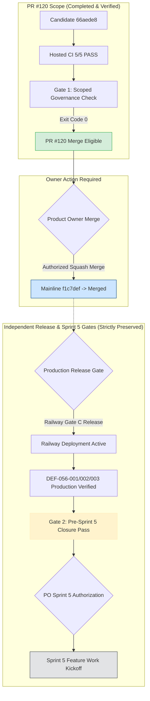

# ARX TERMINAL — DIRECTIVE 060
## Product Owner Merge Decision Package

**Repository:** `daakara/finance`  
**Candidate PR:** [#120](https://github.com/daakara/finance/pull/120)  
**Candidate Branch:** `gov/d058-pre-sprint5-obligation-recovery`  
**Candidate SHA:** `66aede852f79f7affbebb58cd641251e7de1aaad`  
**Authoritative Mainline Base:** `main` @ `f1c7def39546076e98c506732b67e1ecdbfccfcf`  
**Current PR State:** `DRAFT` / `OPEN` / `MERGEABLE (CLEAN)`  
**Hosted CI Status:** `5/5 SUCCESS` (100% passing)  
**Dual-Gate CI Status:**  
- **Gate 1 (Governance Integration Gate):** `PASS [PR MERGE ELIGIBLE]`  
- **Gate 2 (Pre-Sprint 5 Certification Gate):** `BLOCKED (EXPECTED, 5 active blockers)`  
**Date:** 2026-10-27T22:37:00Z  
**Verdict:** **`READY_FOR_OWNER_MERGE_REVIEW`**

---

### 1. Executive Briefing

Under Directive 060, the governance recovery candidate (`gov/d058-pre-sprint5-obligation-recovery`) has been successfully published to GitHub as Draft Pull Request [#120](https://github.com/daakara/finance/pull/120) targeting `main`.

All pre-merge requirements have been independently verified:
1. **Immutable Tree Preservation:** Mainline `f1c7def` has not moved; PR #120 rebases cleanly on top of it with zero conflicts (`mergeable: true`, `mergeable_state: clean`).
2. **Backlog Integrity Hardening:** The canonical backlog (`arx_canonical_backlog.json`) maintains all 43 canonical tasks, registers all 71 cross-sprint obligations, and isolates all 11 immutable operational holds.
3. **Dual-Gate CI Execution:** Hosted GitHub Actions workflows executed on commit `66aede8`. The Backend Test Suites (Python 3.11 & 3.12) ran all 86 unit tests (all passing) and executed `validate_backlog_integrity.py --stage scoped`, verifying Gate 1 pass and logging Gate 2 pre-Sprint 5 closure blockers.
4. **Hosted CI Check Runs:** 5/5 checks passed cleanly:
   - `Code Quality & Security Linter`: `success` (38s)
   - `Backend Test Suite (Python 3.11)`: `success` (3m 58s)
   - `Backend Test Suite (Python 3.12)`: `success` (4m 30s)
   - `Cloudflare Pages`: `success`
   - `Static SSG Export & Integrity Gate`: `success` (3m 25s)
5. **Separation of Concerns:** Merging PR #120 integrates governance infrastructure into mainline **without** triggering production deployments, **without** unholding Railway Gate C, and **without** certifying pre-Sprint 5 closure.

---

### 2. Multi-Gate Operational Architecture



---

### 3. Clear Boundaries of What PR #120 Merges

#### What PR #120 DOES:
- Updates `docs/planning/arx_canonical_backlog.json` with the hardened pre-Sprint 5 schema, registering all 71 obligations with explicit tripartite states (`code_status`, `mainline_status`, `production_status`).
- Adds `tools/governance/validate_backlog_integrity.py` with 13 audit rules (`BI-000` to `BI-012`), pre-Sprint 5 audit checks (`P5-001` to `P5-010`), and Dual-Gate reporting.
- Adds comprehensive automated test suite `tests/test_backlog_integrity_validator.py` (86 unit tests across baseline, modification, negative control, and pre-Sprint 5 closure invariants).
- Incorporates all Directive 058, 059, and 060 governance artifacts into `docs/planning/` for historical provenance and audit compliance.

#### What PR #120 DOES NOT DO:
- **Does NOT** deploy to Railway backend (Railway deployment `d1f8cf37` remains active; Gate C remains HELD).
- **Does NOT** deploy to Cloudflare Pages production (`https://www.arxterminal.com`).
- **Does NOT** unhold any of the 11 immutable operational holds (Smart Money ingestion, SEC egress, corporate telemetry, model tuning, etc. remain strictly blocked).
- **Does NOT** certify Pre-Sprint 5 closure (Gate 2 remains BLOCKED until production deployment is executed and verified).
- **Does NOT** authorize Sprint 5 feature execution (Sprint 5 remains BLOCKED pending explicit PO kickoff).

---

### 4. Decision Options for the Product Owner

| Option | Description | Immediate Action | Risk Profile | Recommendation |
| :--- | :--- | :--- | :--- | :--- |
| **Option A** | **Controlled Squash Merge of PR #120 into Mainline** | Convert PR #120 from Draft to Ready, squash-merge into `main`. Retain all deployment and Sprint 5 holds. | **Lowest Risk.** Mainline gains full governance hardening and dual-gate CI. Production remains completely unmutated. | **RECOMMENDED** |
| **Option B** | **Concurrent Release & Governance Merge** | Authorize Railway Gate C backend release for mainline (`f1c7def`), verify live endpoints, update obligation register to `RELEASED_ACTIVE`, then merge PR #120. | **Medium Risk.** Couples governance integration with live infrastructure release. | Alternative if immediate production fix is desired. |
| **Option C** | **Hold in Draft Status** | Leave PR #120 in draft on GitHub for offline review or audit. | **Zero Risk.** No changes to mainline or production. | Deferred |

---

### 5. Step-by-Step Merge Execution Plan (For Option A)

If the Product Owner authorizes Option A:
1. Navigate to GitHub PR [#120](https://github.com/daakara/finance/pull/120).
2. Click **"Ready for review"** (or mark non-draft via GitHub CLI/API).
3. Perform a **Squash and Merge** with the suggested commit message:
   ```text
   gov(d060): governance recovery candidate, backlog integrity hardening, and cross-audit certification (#120)

   - Register 71 pre-Sprint 5 obligations with explicit tripartite status tracking
   - Implement dual-gate backlog integrity validator (BI-000 to BI-012, P5-001 to P5-010)
   - Add 86 automated regression and invariant tests (tests/test_backlog_integrity_validator.py)
   - Reconcile Directives 058, 059, and 060 governance records
   - Preserve all 11 operational holds and scanner natural-admission boundaries
   ```
4. Verify that hosted CI on the new mainline commit executes and passes Gate 1.
5. Production remains unmutated at Railway deployment `d1f8cf37` until an explicit release directive is issued.

---

### 6. Final Recommendation

**Verdict:** `READY_FOR_OWNER_MERGE_REVIEW`  
The candidate PR #120 is clean, fully verified, backed by 5/5 passing CI checks, and safely enforces fail-closed gates across all operational boundaries.
