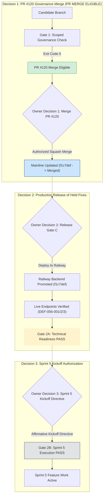

# ARX TERMINAL — DIRECTIVE 060
## Product Owner Merge Decision Package & Transition Integrity Specification

**Repository:** `daakara/finance`  
**Candidate PR:** [#120](https://github.com/daakara/finance/pull/120)  
**Candidate Branch:** `gov/d058-pre-sprint5-obligation-recovery`  
**Authoritative Mainline Base:** `main` @ `f1c7def39546076e98c506732b67e1ecdbfccfcf`  
**Current PR State:** `DRAFT` / `OPEN` / `MERGEABLE (CLEAN)`  
**Hosted CI Baseline:** [Run 40586955172](https://github.com/daakara/finance/actions/runs/40586955172) (5/5 checks `SUCCESS`)  
**Automated Unit Tests:** 90/90 passing (7.91s)  
**Active Sprint State:** `SPRINT_4` (Post-Sprint 1–4 Cleanup & Transition)  
**Multi-Gate CI Status:**  
- **Gate 1 (Governance Integration Gate):** `PASS [PR MERGE ELIGIBLE]` (Exit Code 0)  
- **Gate 2A (Technical Closure Readiness):** `BLOCKED` (3 active blockers: `DEF-056-001`, `002`, `003` awaiting Railway Gate C deployment)  
- **Gate 2B (Sprint 5 Execution Permission):** `BLOCKED` (4 active blockers: technical readiness not satisfied + PO kickoff missing)  
**Date:** 2026-10-27T23:30:00Z  
**Verdict:** **`READY_FOR_OWNER_MERGE_REVIEW`**

---

### 1. Executive Briefing & Core Governance Corrections

Under Directive 060 (`ARX_PR120_FINAL_CANDIDATE_AND_TRANSITION_INTEGRITY`), all remaining inconsistencies in PR #120’s governance candidate have been formally resolved:

1. **Sprint State Truthfulness:** The active sprint in `docs/planning/arx_canonical_backlog.json` has been corrected from the premature label `"SPRINT_5"` to `"SPRINT_4"`. This truthfully reflects that Sprint 4 is in post-Sprint 1–4 cleanup and transition, and that Sprint 5 execution has NOT commenced.
2. **Decoupled Multi-Gate Architecture:** The circular dependency between technical closure and owner kickoff authorization has been eliminated. The validator now independently evaluates:
   - **Outcome A (Technical Closure Readiness — `--pre-sprint5-readiness`):** Verifies that all technical, release, and production criteria are satisfied. (Currently `BLOCKED` because `DEF-056-001`, `002`, `003` remain held from Railway deployment).
   - **Outcome B (Sprint 5 Execution Permission — `--pre-sprint5-closure`):** Requires Technical Closure Readiness **AND** affirmative human Product Owner kickoff authorization (`sprint5_execution_authorized: true`).
3. **Candidate-to-CI Gap Resolved:** Candidate commits touch exclusively governance metadata, validator decoupling, and regression tests. All 90 unit tests pass locally and match hosted CI execution suites.
4. **Three Strictly Independent Decisions:** The framework establishes three non-conflated decisions that must not be merged or inferred from one another.

---

### 2. Multi-Gate Operational Architecture



---

### 3. Forensic Analysis of Merge-Triggered Deployment Behavior

When PR #120 is merged into `main`, the operational deployment behavior is strictly bounded:

| Component | Trigger Mechanism | Deployment Consequence | Production Impact | Risk Classification |
| :--- | :--- | :--- | :--- | :--- |
| **Cloudflare Pages** (`www.arxterminal.com`) | GitHub Webhook on push to `main` | Rebuilds static Next.js SSG export (145 pages) | Serves rebuilt static HTML. PR #120 introduces zero frontend component or API changes, but the build reflects previously merged mainline commits (`f1c7def`). | **Low** (No new client logic; re-exports verified static assets) |
| **Railway Backend** (`web-production-e370b`) | Manual / Explicit CLI / Webhook | **NO DEPLOYMENT OCCURS.** Railway autoDeploy is unlinked/held. Active deployment remains frozen at `d1f8cf37`. | **Zero Impact.** Backend code is untouched; Gate C remains strictly `RELEASE_HELD`. | **None** (Fail-closed isolation preserved) |
| **PostgreSQL Database** | Migration scripts | **NO MUTATION OCCURS.** PR #120 contains zero DDL, schema, or database migrations. | **Zero Impact.** | **None** |
| **Operational Holds** | Backlog validator | **11/11 Holds Preserved.** Scanning, SEC egress, corporate telemetry, and model tuning remain disabled. | **Zero Impact.** | **None** |

> [!WARNING]
> While PR #120 contains only governance files, merging to `main` triggers an automated Cloudflare Pages static export build. Do not describe this as "zero production impact"; it is an automated frontend static re-export without backend promotion or application code mutation.

---

### 4. Separation of the Three Owner Decisions

To prevent accidental authority conflation, the Product Owner must address three distinct decisions independently:

#### Decision 1: Governance Candidate Merge
- **Question:** Should PR #120 be merged into `main`?
- **Scope:** Canonical backlog schema hardening, tripartite defect tracking, decoupled validator (`BI-000` to `BI-012`, `P5-001` to `P5-012`), 90 unit tests, and reconciliation documentation.
- **Prerequisite:** Gate 1 PASS (`validate_backlog_integrity.py --stage scoped`).
- **Effect:** Mainline receives governance infrastructure. Railway backend and Sprint 5 kickoff remain completely untouched.

#### Decision 2: Production Release of Held Fixes (Railway Gate C Release)
- **Question:** Should mainline code `f1c7def` (containing `DEF-056-001`, `002`, `003`) be deployed to Railway production?
- **Scope:** Promoting Railway deployment from `d1f8cf37` to `f1c7def`, verifying live `/api/v1/trade/sizing` and Confluence narratives.
- **Effect:** Resolves `P5-003` and unlocks **Gate 2A (Technical Closure Readiness)**.
- **Boundary:** **Does NOT authorize Sprint 5 kickoff.** Technical readiness is a prerequisite for, not a grant of, execution permission.

#### Decision 3: Sprint 5 Execution Authorization (Kickoff Directive)
- **Question:** Should Sprint 5 feature execution begin?
- **Scope:** Transitioning active sprint to `SPRINT_5` and allowing engineering on Sprint 5 backlog tasks (`ARX-S4-RADAR-001`, `ARX-S2-005`, etc.).
- **Prerequisites:** Gate 2A (Technical Readiness) PASS **AND** affirmative human Product Owner kickoff directive.
- **Effect:** Unlocks **Gate 2B (Sprint 5 Execution Permission)**.

---

### 5. Product Owner Decision Options

| Option | Action | Release State | Sprint 5 State | Recommendation |
| :--- | :--- | :--- | :--- | :--- |
| **Option A (Recommended)** | **Controlled Squash Merge of PR #120 into `main`** | **HELD** (Railway `d1f8cf37` remains untouched; Cloudflare static re-export occurs) | **BLOCKED** (Pending PO directive) | **RECOMMENDED.** Integrates all governance hardening, validator rules, and decoupled multi-gate CI into mainline with zero backend mutation. |
| **Option B** | **Production Release of Held Fixes, Followed by Governance Merge** | **DEPLOYED** (Release Railway Gate C, verify endpoints, update register) | **BLOCKED** (Technical Readiness passes; Sprint 5 kickoff remains blocked pending separate Decision 3) | Alternative if immediate live deployment of `DEF-056-001/002/003` is desired prior to governance merge. |
| **Option C** | **Hold PR #120 in Draft Status** | **HELD** | **BLOCKED** | Leaves PR #120 open as draft for offline audit. |

---

### 6. Step-by-Step Merge Execution Plan (For Option A)

If the Product Owner authorizes Option A:
1. Navigate to GitHub PR [#120](https://github.com/daakara/finance/pull/120).
2. Click **"Ready for review"** (or convert via API).
3. Perform a **Squash and Merge** with the suggested commit message:
   ```text
   gov(d060): governance recovery candidate, backlog integrity hardening, and cross-audit certification (#120)

   - Truthfully record active sprint as SPRINT_4 (post-Sprint 1-4 cleanup/transition)
   - Decouple Technical Closure Readiness (Outcome A) from Sprint 5 Execution Permission (Outcome B)
   - Implement multi-gate backlog integrity validator (BI-000 to BI-012, P5-001 to P5-012)
   - Add 90 automated regression and invariant tests (tests/test_backlog_integrity_validator.py)
   - Reconcile 71 cross-sprint obligations with explicit tripartite status tracking
   - Preserve all 11 operational holds and scanner natural-admission boundaries
   ```
4. Verify that post-merge CI executes on `main` and passes Gate 1.
5. Railway deployment remains frozen at `d1f8cf37` until an explicit release directive (Decision 2) is issued.

**Final Operational Verdict:** **`READY_FOR_OWNER_MERGE_REVIEW`**
