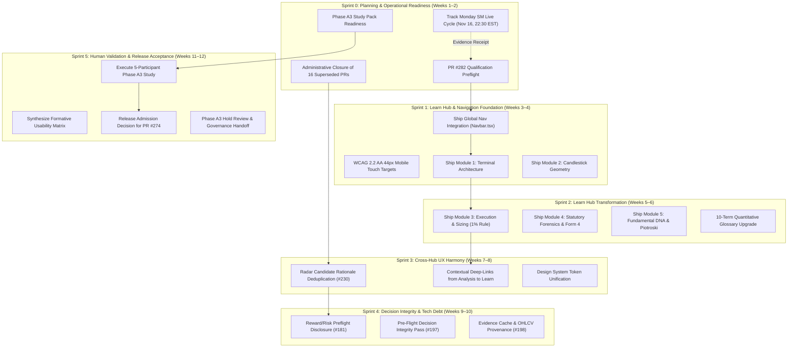

# ARX Terminal — Canonical Sprint Roadmap, Backlog Prioritization & Execution Architecture

**Document ID:** `PLN-ROADMAP-2026-11-14`  
**Effective Date:** 2026-11-14  
**Authoritative Production Baseline:** `release/production` @ SHA [`41bd702462db24c8856613861ee0b938ff5fffe7`](https://github.com/daakara/finance/commit/41bd702462db24c8856613861ee0b938ff5fffe7)  
**Governance Directive:** `ARX-BRAIN-SPRINT-PLANNING-026`  
**Classification:** Canonical Project Brain Sprint Roadmap & Execution Architecture  
**Supersedes:** Historical sprint planning drafts and ad-hoc sprint containers  

---

## 1. Executive Summary & Governance Authority

This document defines the single authoritative execution system for the ARX Terminal platform across a six-sprint planning horizon (Sprint 0 through Sprint 5). Engineered by Project Brain through multi-perspective architectural coordination, it transforms the reconciled backlog into an actionable, dependency-aware delivery roadmap.

### Core Planning Mandates
1. **Outcome-Driven Prioritization:** Optimize for high-leverage completed outcomes rather than task volume or PR count.
2. **Three-Lane Capacity Isolation:** Maintain strict separation between Operational, Product/Engineering, and Research/Validation capacity to prevent silent resource contention.
3. **Uncompromising Governance Preservation:** All six operational holds (`HOLD_SEC_001`, `HOLD_SCAN_001`, `HOLD_EXEC_001`, `PHASE_3_HOLD`, `ARX_CONFLUENCE_INTEGRITY_HOLD`, `PHASE_A3_UX_HOLD`) remain active until explicit, audited exit criteria are fulfilled.
4. **Decoupled Verification Lifecycle:** Strictly enforce institutional state separation:  
   $$\text{CODE COMPLETE} \neq \text{DEPLOYED} \neq \text{PRODUCTION VERIFIED} \neq \text{OPERATIONALLY AUTHORIZED}$$

---

## 2. Project Brain Multi-Perspective Strategic Analysis

To ensure architectural coherence and eliminate cognitive blind spots, Project Brain evaluated the backlog across seven independent analytical perspectives:

```
┌────────────────────────────────────────────────────────────────────────┐
│               PROJECT BRAIN MULTI-PERSPECTIVE PANEL                    │
├──────────────────────────┬─────────────────────────────────────────────┤
│ Perspective              │ Core Evaluation & Strategic Recommendation  │
├──────────────────────────┼─────────────────────────────────────────────┤
│ 1. Product Strategy      │ Prioritize Learn Hub & contextual guidance. │
│ 2. Engineering Arch      │ Decouple content from analytical engines.   │
│ 3. UX / Content Design   │ Enforce WCAG 2.2 AA and human editorial tone│
│ 4. Reliability/Security  │ Contain Monday SEC cycle; preserve holds.   │
│ 5. Quality Assurance     │ Enforce RQ-01..12 and authentic Phase A3.   │
│ 6. Delivery Management   │ Model 2-week sprints with 1-owner capacity. │
│ 7. Adversarial Reviewer  │ Reject premature PR #274 merge & micro-tasks│
└──────────────────────────┴─────────────────────────────────────────────┘
```

### Perspective 1: Product Strategy
- **Evaluation:** ARX Terminal's core market differentiation is its mathematical transparency, capital preservation discipline, and evidence-grounded research. However, the current separation of the Learn Hub (`/guide`, `/glossary`) creates an intimidating "black box" perception.
- **Recommendation:** Elevating Learn Hub into the primary navigation and transforming its curriculum delivers the highest user value and adoption impact with zero risk to financial calculation engines.

### Perspective 2: Engineering Architecture
- **Evaluation:** Analytical engines (`analyst_dashboard/`) and worker routines are strictly decoupled from client presentation routes. Learn Hub components (`GuideContent.tsx`, `glossaryCatalog.ts`) have zero import coupling with core calculations or databases.
- **Recommendation:** Sequence presentation and educational enhancements in early sprints. Consolidate backend technical debt (#181, #197, #198) into a unified refactor pass to minimize blast radius.

### Perspective 3: UX & Content Design
- **Evaluation:** Legacy documentation suffered from AI-generated writing defects (patronizing "No-BS" phrasing, artificial binary "Plain English vs Pro Quant" toggles, and missing concrete numerical examples).
- **Recommendation:** Establish a unified, authoritative, layered human curriculum following the 5-module taxonomy. Enforce strict WCAG 2.2 AA touch target compliance ($\ge 44\times 44\text{px}$) across all interactive controls.

### Perspective 4: Reliability & Security
- **Evaluation:** The scheduled Monday, November 16, 2026 qualification cycle for Smart Money (#165) operates under tight constraints (max 40 requests, 1 attempt, 5 req/s).
- **Recommendation:** The Monday qualification must remain an isolated operational event. The worker must return immediately to fail-closed `STANDBY` (`ARX_SEC_EGRESS_ROLE=DISABLED`). Under no circumstances should automated cron or continuous polling be activated.

### Perspective 5: Quality Assurance
- **Evaluation:** The Release Qualification Suite (`run_release_ci_suite.py`) enforces 12 non-bypassable quality gates (RQ-01..12).
- **Recommendation:** Maintain the mandatory gate requiring authentic qualitative/quantitative worksheets for Phase A3 before releasing PR #274. Zero synthetic observations are permitted.

### Perspective 6: Delivery Management
- **Evaluation:** The project operates under a single primary maintainer (`daakara`). Assuming multiple parallel human feature streams is a recognized failure mode.
- **Recommendation:** Establish a 2-week sprint cadence with explicit capacity budgets: 20% Operational Lane, 60% Product/Engineering Lane, 20% Research/Validation Lane. Enforce a Work-In-Progress (WIP) limit of 1 active deliverable per lane.

### Perspective 7: Adversarial Reviewer (Challenge & Rebuttal)
- **Challenge A:** *"Why not immediately merge PR #274 since the code is already written?"*  
  **Rebuttal:** Merging PR #274 without empirical validation violates institutional UX governance and risks introducing decision friction in live execution workflows. It must remain held under `PHASE_A3_UX_HOLD`.
- **Challenge B:** *"Why not break Learn Hub into 20 granular tickets for each section?"*  
  **Rebuttal:** Granular microtickets introduce administrative overhead and review fatigue. Content is batched into two coherent, independently verifiable releases: Foundations (Sprint 1) and Advanced Curriculum & Glossary (Sprint 2).
- **Challenge C:** *"Should backend preflight debt precede frontend educational work?"*  
  **Rebuttal:** No. Backend preflight memory caching (#197, #198) is operating safely within bounds; Learn Hub educational quality directly resolves user adoption barriers.

---

## 3. Canonical 6-Sprint Roadmap (Sprint 0 – Sprint 5)



---

### Sprint 0 — Planning & Operational Readiness (Weeks 1–2: Nov 14 – Nov 28, 2026)
- **Primary Outcome:** Establish execution discipline, supervise Monday SEC Form 4 qualification cycle, execute administrative closure of 16 superseded PRs, and prepare Phase A3 testing dependencies.
- **Operational Lane:** Supervise single live SEC Form 4 qualification cycle on Monday, Nov 16 at 22:30 EST (`ARX Smart Money Monday Pilot`, Issue #165). Verify immediate return to `STANDBY` (`ARX_SEC_EGRESS_ROLE=DISABLED`).
- **Product & Engineering Lane:** Audit PR #282 (`feat/ux-brain-redesign-025`) against Release Qualification criteria. Complete local verification across viewports (390px, 768px, 1440px).
- **Research & Validation Lane:** Review Phase A3 study pack (`a3_study_environment_guide.md`, `a3_formative_evaluation_matrix.md`) and confirm testing environment readiness.
- **Governance Gate:** Administrative closure of 16 superseded PRs recorded in Issue #228. Zero production operational holds lifted.

### Sprint 1 — Learn Hub & Global Navigation Foundation (Weeks 3–4: Nov 29 – Dec 12, 2026)
- **Primary Outcome:** Deliver the first user-visible navigation and educational foundation.
- **Operational Lane:** Monitor post-cycle SEC telemetry and backup verification stability in Railway/R2.
- **Product & Engineering Lane:**
  - Merge and deploy global navigation integration in `Navbar.tsx` (elevating Learn `/guide` to primary desktop navigation and mobile utilities).
  - Enforce WCAG 2.2 AA interactive target sizing ($\ge 44\times 44\text{px}$) across utility menus (`UI-0`).
  - Ship human curriculum rewrites for **Module 1 (Terminal Architecture & 4 Workspaces)** and **Module 2 (Candlestick Geometry & Dual-Horizon VWAP/EMA Regimes)**.
- **Research & Validation Lane:** Recruit 5 real human participants for Phase A3 formative evaluation.
- **Governance Gate:** Release Qualification Suite (RQ-01..12) passing on PR #282; Cloudflare Pages preview bundle verified.

### Sprint 2 — Learn Hub Editorial Transformation & Glossary Completion (Weeks 5–6: Dec 13 – Dec 26, 2026)
- **Primary Outcome:** Complete the institutional transformation of the ARX Learn Hub and Quantitative Glossary.
- **Operational Lane:** Routine infrastructure health and PostgreSQL 16 WAL archiving verification.
- **Product & Engineering Lane:**
  - Ship human curriculum rewrites for **Module 3 (Execution Corridors & 1% Position Sizing)** with concrete $50k portfolio illustrations.
  - Ship **Module 4 (Statutory Disclosures & Form 4 Forensics)** explaining the 45-day lag decay penalty.
  - Ship **Module 5 (Fundamental DNA & Piotroski Scoring)** detailing accounting statement quality.
  - Deploy complete 10-term Quantitative Glossary upgrade (`glossaryCatalog.ts`) with LaTeX math formulas and deep terminal links.
- **Research & Validation Lane:** Finalize scheduling and logistics for 5 real-human evaluation sessions.
- **Governance Gate:** Editorial readability audit score $\ge 90/100$; zero broken internal links; zero mathematical contradictions with `governorSizingEngine.ts`.

### Sprint 3 — ARX Cross-Hub Contextual Harmony & Rationale Quality (Weeks 7–8: Dec 27, 2026 – Jan 9, 2027)
- **Primary Outcome:** Improve discovery-to-decision comprehension and eliminate repetitive rationale copy without modifying engine contracts.
- **Operational Lane:** Quarterly operational hold review and access credential verification.
- **Product & Engineering Lane:**
  - Resolve Issue #230: Deduplicate repetitive candidate rationale copy in Radar cards (`radarPresentation.ts`) using dynamic contextual templating.
  - Add contextual deep-links from analytical scorecards to corresponding Learn Hub chapters.
  - Harmonize semantic color tokens (emerald for valid accumulation, rose for defensive stops, cyan for focus, amber for caution).
- **Research & Validation Lane:** Conduct pilot dry-run of the Phase A3 study environment with participant #1.
- **Governance Gate:** Radar recommendation integrity contracts preserved; `isActionable: false` barrier maintained; zero regression in Vitest suite.

### Sprint 4 — Decision Integrity & Evidence Provenance (Weeks 9–10: Jan 10 – Jan 23, 2027)
- **Primary Outcome:** Consolidate pre-flight decision integrity, Reward vs. Risk copy, and evidence caching boundaries into a clean, unified release.
- **Operational Lane:** Sentry exception tracking and API latency SLA audit (<150ms).
- **Product & Engineering Lane:**
  - Consolidate Issue #181 (Reward vs. Risk disclosure copy), Issue #197 (Pre-flight decision integrity), and Issue #198 (Evidence cache & OHLCV provenance) under Sprint P1 container (#229).
  - Clarify 2:1 Reward-to-Risk decision threshold copy without altering mathematical sizing contracts.
  - Audit OHLCV cache fencing to eliminate stale price ingestion hazards.
- **Research & Validation Lane:** Execute Phase A3 evaluation sessions with participants #2 and #3.
- **Governance Gate:** Cross-engine invariant tests passing; zero schema drift; single consolidated PR.

### Sprint 5 — Human Validation & Release Acceptance (Weeks 11–12: Jan 24 – Feb 6, 2027)
- **Primary Outcome:** Complete Phase A3 real-human evaluation, synthesize findings, and execute formal release admission review for PR #274.
- **Operational Lane:** Review operational status of `PHASE_A3_UX_HOLD` based on empirical study findings.
- **Product & Engineering Lane:** Apply any targeted usability remediations identified during the formative study.
- **Research & Validation Lane:**
  - Complete study sessions with participants #4 and #5.
  - Compile completed qualitative worksheets (`a3_worksheet_p01..p05.md`) and quantitative score matrix.
  - Author the authoritative Phase A3 Usability Acceptance Report.
- **Governance Gate:** Formal Owner sign-off on usability acceptance. If accepted, execute standard release qualification and merge workflow for PR #274; if rejected, retain `PHASE_A3_UX_HOLD` and log actionable remediation backlog.

---

## 4. Comprehensive Sprint Backlog

| Sprint | Tracking Ref | Workstream | Priority | Effort (Band) | Dependencies | Primary Deliverable | Acceptance Criteria | Operational Status |
| :--- | :--- | :--- | :--- | :--- | :--- | :--- | :--- | :--- |
| **S0** | **#165** | Smart Money | **P0** | **Small** (Low) | Dissemination Cal | Live SEC qualification receipt | 1 attempt, max 40 req, 0 egress during standby, receipt in #165 | **READY (Scheduled)** |
| **S0** | **#228** | Governance | **P0** | **Small** (Low) | None | Close 16 superseded PRs | 16 PRs closed with supersede links; branches preserved | **READY** |
| **S0** | **#282** | UX / Learn | **P1** | **Medium** (Low) | Baseline 41bd702 | PR #282 qualification preflight | `tsc --noEmit` PASS, `test:arch` PASS, bundle verified | **READY** |
| **S0** | **#66** | Research | **P1** | **Small** (Low) | Study Pack | Phase A3 readiness audit | Staging environment verified; worksheets staged | **READY** |
| **S1** | **#282** | UX / Shell | **P1** | **Medium** (Low) | S0-PR#282 Preflight| Ship global nav & touch targets | Learn link in Navbar; 44px min touch targets (`UI-0`) | **PLANNED** |
| **S1** | **#282** | Learn Hub | **P1** | **Medium** (Med) | S1-Nav Integration | Ship Modules 1 & 2 curriculum | AI slop removed; 8-part lesson structure; responsive | **PLANNED** |
| **S1** | **#66** | Research | **P2** | **Small** (Med) | S0-Study Pack | Participant recruitment (5) | 5 committed institutional/intermediate users | **PLANNED** |
| **S2** | **#282** | Learn Hub | **P1** | **Medium** (Med) | S1-Curriculum | Ship Modules 3, 4, 5 | Sizing math illustrated; Form 4 lag explained; Piotroski | **PLANNED** |
| **S2** | **#282** | Learn Hub | **P1** | **Small** (Low) | S2-Modules | 10-term Glossary upgrade | LaTeX KaTeX math; concrete numbers; terminal deep-links | **PLANNED** |
| **S3** | **#230** | Radar | **P2** | **Small** (Med) | PR #279 Baseline | Candidate rationale deduplication| Contextual dynamic copy; 0 recommendation regressions | **PLANNED** |
| **S3** | **#282** | UX / Harmony | **P2** | **Small** (Low) | S2-Learn Hub | Contextual card deep-links | Cards link to Field Manual; 0 calculation mutations | **PLANNED** |
| **S4** | **#181** | Decision Int | **P2** | **Small** (Low) | S3-Harmony | Reward/Risk disclosure copy | 2:1 threshold copy clarified; sizing contract intact | **PLANNED** |
| **S4** | **#197** | Decision Int | **P2** | **Medium** (Med) | S4-#181 | Pre-flight decision integrity | Stale-price classification verified; gate protected | **PLANNED** |
| **S4** | **#198** | Architecture | **P2** | **Medium** (Med) | S4-#197 | OHLCV provenance & cache fence | Provenance boundary enforced; zero stale cache poisoning | **PLANNED** |
| **S5** | **#66** | Research | **P0** | **Large** (High)| S1-Recruitment | Phase A3 study execution (5) | 5 completed worksheets; 0 synthetic data; usability matrix | **PLANNED (Gated)** |
| **S5** | **#274** | Governance | **P0** | **Small** (Med) | S5-Phase A3 | PR #274 release admission review| Formal Owner verdict; merge or remediate under hold | **PLANNED (Gated)** |

---

## 5. Capacity & Risk Assessment

### 5.1 Three-Lane Capacity Model
To prevent delivery bottlenecks and unmanaged capacity contention, engineering effort is allocated across three distinct, non-overlapping lanes:

```
┌────────────────────────────────────────────────────────────────────────┐
│                      THREE-LANE CAPACITY ALLOCATION                    │
├──────────────────────────┬──────────┬──────────────────────────────────┤
│ Lane                     │ Capacity │ Governing Responsibilities       │
├──────────────────────────┼──────────┼──────────────────────────────────┤
│ 1. Operational Lane      │   20%    │ Qualification, telemetry, deploy.│
│ 2. Product & Engineering │   60%    │ Code changes, UX, Learn Hub, doc.│
│ 3. Research & Validation │   20%    │ Human studies, editorial audits. │
└──────────────────────────┴──────────┴──────────────────────────────────┘
```

- **Single Maintainer Assumption:** Assumes one primary maintainer (`daakara`). Subagents provide analytical and drafting leverage but do not eliminate human review requirements.
- **Work-In-Progress (WIP) Limits:** Exactly **one (1)** active candidate PR per lane at any time. No lane may begin new feature implementation while a PR is awaiting review or release qualification.

### 5.2 Critical Risks & Governance Mitigations

| Risk ID | Risk Description | Probability | Impact | Mitigation Strategy |
| :--- | :--- | :--- | :--- | :--- |
| **RSK-01** | **SEC Fair-Access Violation:** Unbounded polling or rate limit overrun during Monday live cycle. | Low | Critical | Hard limits enforced in code: max 40 req, 5 req/s, 1 attempt, 2h window. Automatic fallback to `STANDBY`. |
| **RSK-02** | **Premature PR #274 Release:** Merging progressive disclosure without real-human validation. | Low | High | Enforced by `PHASE_A3_UX_HOLD`. RQ-01/02 gate blocks release qualification until study report is staged. |
| **RSK-03** | **Learn Hub Scope Creep:** Over-engineering educational tools with interactive simulations. | Med | Med | Strict boundary: Markdown, structured HTML, and Lucide icons only. Zero new state machines or client dependencies. |
| **RSK-04** | **Participant Attrition in Phase A3:** Inability to secure 5 real human participants on schedule. | Med | High | Staged study pack enables asynchronous completion. Sprint 5 gates PR #274 independently; other work proceeds. |
| **RSK-05** | **Pre-Flight Refactor Blast Radius:** Touching sizing math while clarifying Reward/Risk copy. | Low | Critical | Strict isolation: #181 copy changes are UI-only; mathematical logic in `governorSizingEngine.ts` is invariant-locked. |

---

## 6. Sprint Definition of Ready (DoR) & Definition of Done (DoD)

### Definition of Ready (DoR)
A backlog work-item may enter an active implementation sprint only when:
1. **Clear Problem Statement:** User or operational need is documented without ambiguous buzzwords.
2. **Canonical Issue Reference:** Item is tracked under an active GitHub Issue or approved Sprint container.
3. **Bounded Scope:** Changed files, components, and boundaries are explicitly listed.
4. **Dependencies Satisfied:** All upstream prerequisite deliverables are merged and verified.
5. **Plausible Effort Estimate:** Sized in Small, Medium, or Large with explicit uncertainty.
6. **Testable Acceptance Criteria:** Verifiable pass/fail criteria are defined in advance.
7. **Governance Clearance:** Known operational holds or security invariants are identified.

### Definition of Done (DoD)
A sprint deliverable is complete and acceptable only when:
1. **Deliverable Built:** Code or documentation artifact is complete and clean.
2. **Automated Verification:**
   - Frontend: `npx tsc --noEmit` passes with 0 errors; `npm run test:arch` passes 100%.
   - Backend (if applicable): `pytest` passes 100% with zero warnings.
3. **Accessibility Conformance:** Interactive controls satisfy WCAG 2.2 AA ($\ge 44\times 44\text{px}$ touch targets).
4. **Decision-Integrity Check:** Zero modifications to capital allocation formulas, 2:1 risk thresholds, or actionability flags.
5. **Release Qualification:** Release Qualification Suite (RQ-01..12) passes with 100% clean receipts.
6. **Documentation Parity:** Active work register, status addendum, and README reflect updated state.
7. **Traceable Receipt:** Cryptographic commit SHA, PR link, and test summary posted to owning GitHub tracker.

---

## 7. Sprint 0 Execution Packet (Immediate Action Plan)

**Sprint 0 Horizon:** Weeks 1–2 (November 14 – November 28, 2026)  
**Execution Objective:** Establish operational stability, supervise Monday SEC qualification, execute backlog hygiene, and preflight PR #282.

```
┌────────────────────────────────────────────────────────────────────────┐
│                        SPRINT 0 TASK PACKET                            │
├──────┬──────────────────────┬─────────────────┬────────────────────────┤
│ Task │ Directive Scope      │ Owning Ref      │ Target Completion Date │
├──────┼──────────────────────┼─────────────────┼────────────────────────┤
│ 0.1  │ Monday SEC Live Gate │ Issue #165      │ Mon Nov 16 @ 23:30 EST │
│ 0.2  │ 16 Superseded PRs    │ Issue #228      │ Wed Nov 18 @ 18:00 EST │
│ 0.3  │ PR #282 Preflight    │ PR #282         │ Fri Nov 20 @ 18:00 EST │
│ 0.4  │ Phase A3 Study Prep  │ Issue #66       │ Tue Nov 24 @ 18:00 EST │
└──────┴──────────────────────┴─────────────────┴────────────────────────┘
```

### Task 0.1: Supervise Monday SEC Form 4 Qualification Cycle
- **Pre-Conditions:**
  - Verify worker is in `STANDBY` mode (`ARX_SEC_EGRESS_ROLE=DISABLED`).
  - Verify exactly 0 advisory locks in `pg_locks`.
  - Verify fresh PostgreSQL backup in R2.
- **Execution:** Monitor external execution window starting Monday, Nov 16 at 22:30 EST.
- **Stop Conditions:** Immediately abort if request count exceeds 40, rate exceeds 5 req/s, or worker fails to demote to `STANDBY` within 2 hours.
- **Deliverable:** Post execution telemetry receipt to GitHub Issue #165.

### Task 0.2: Administrative Closure of 16 Superseded PRs
- **Scope:** Administratively close PRs #38, #40, #42, #44, #47, #73, #103, #109, #124, #128, #141, #142, #193, #235, #260, #262.
- **Execution:** Comment on each PR citing modern canonical replacements (dynamic universe, Phase 5, release qualification suite). Preserve branches and commit history.
- **Deliverable:** Update Issue #228 with closure receipt.

### Task 0.3: PR #282 Qualification Preflight
- **Scope:** Audit PR #282 (`feat/ux-brain-redesign-025`) against RQ-01..12.
- **Verification Commands:**
  ```bash
  npx tsc --noEmit
  npm run test:arch
  python3 scripts/release/rq01_candidate_identity.py
  python3 scripts/release/rq02_diff_integrity.py
  ```
- **Deliverable:** Staged qualification readiness report for Sprint 1 release.

### Task 0.4: Phase A3 Study Environment Readiness
- **Scope:** Verify staging deployment and test worksheets for Phase A3 formative evaluation.
- **Deliverable:** Verified staging URL and staged worksheet templates in `docs/research/phase_a3/`.

---

## 8. GitHub Sprint Infrastructure Reconciliation

### 8.1 Reconciled Pull Request Portfolio (22 Open PRs Total)
The previously reported classification discrepancy is fully resolved:
- **Active UX Candidates (2 PRs):**
  - PR [#282](https://github.com/daakara/finance/pull/282): `feat(ux): ARX-UX-BRAIN-REDESIGN-025 institutional UX redesign` (Candidate for Sprint 1).
  - PR [#274](https://github.com/daakara/finance/pull/274): `feat(ux): ARX-UX-R3-001 progressive jargon management` (DRAFT / HELD under `PHASE_A3_UX_HOLD`).
- **Superseded PRs Marked for Closure (16 PRs):** #38, #40, #42, #44, #47, #73, #103, #109, #124, #128, #141, #142, #193, #235, #260, #262.
- **Research Drafts Preserved as Evidence (3 PRs):** #75, #78, #83.
- **Observability Reference Draft (1 PR):** #146.

### 8.2 Sprint Planning Containers Alignment
The six GitHub issue-based sprint planning containers (#228–#233) are mapped directly to this roadmap:
- **[#228](https://github.com/daakara/finance/issues/228) (Sprint P0):** Governs Sprint 0 backlog hygiene and historical PR closure.
- **[#229](https://github.com/daakara/finance/issues/229) (Sprint P1):** Governs Sprint 4 decision integrity (#181, #197, #198).
- **[#230](https://github.com/daakara/finance/issues/230) (Sprint P2):** Governs Sprint 3 Radar candidate rationale deduplication.
- **[#231](https://github.com/daakara/finance/issues/231) (Sprint P3):** Governs post-qualification prospective cohort monitoring.
- **[#232](https://github.com/daakara/finance/issues/232) (Sprint P4):** Governs future security/architectural hardening (#203, #204).
- **[#233](https://github.com/daakara/finance/issues/233) (Sprint HOLD):** Maintains operational lock on unapproved Sprint 5 autonomous trading initiatives.
