# ARX Terminal — Canonical Sprint Roadmap, Backlog Prioritization & Execution Architecture

**Document ID:** `PLN-ROADMAP-2026-11-17`  
**Effective Date:** 2026-11-17  
**Authoritative Production Baseline:** `release/production` @ SHA [`c6e3c03b88a0729d18284fbf9786135d2a7d4a81`](https://github.com/daakara/finance/commit/c6e3c03b88a0729d18284fbf9786135d2a7d4a81)
**Classification:** Canonical Project Brain Sprint Roadmap & Execution Architecture  
**Supersedes:** `docs/planning/ARX_CANONICAL_SPRINT_ROADMAP_2026_11_14.md`

---

## 1. Executive Summary & Governance Authority

This document defines the single authoritative execution system for the ARX Terminal platform across a six-sprint planning horizon (Sprint 0 through Sprint 5). Engineered by Project Brain through multi-perspective architectural coordination, it transforms the reconciled backlog into an actionable, dependency-aware delivery roadmap.

### Core Planning Mandates
1. **Outcome-Driven Prioritization:** Optimize for high-leverage completed outcomes rather than task volume or PR count.
2. **Three-Lane Capacity Isolation:** Maintain strict separation between Operational, Product/Engineering, and Research/Validation capacity to prevent silent resource contention.
3. **Uncompromising Governance Preservation:** All six operational holds (`HOLD_SEC_001`, `HOLD_SCAN_001`, `HOLD_EXEC_001`, `PHASE_3_HOLD`, `ARX_CONFLUENCE_INTEGRITY_HOLD`, `PHASE_A3_UX_HOLD`) remain active until explicit, audited exit criteria are fulfilled.
4. **Decoupled Verification Lifecycle:** Strictly enforce institutional state separation:  
   $$\text{CODE COMPLETE} \neq \text{DEPLOYED} \neq \text{PRODUCTION VERIFIED} \neq \text{OPERATIONALLY AUTHORIZED}$$

---

## 2. Project Brain Multi-Perspective Strategic Analysis

To ensure architectural coherence and eliminate cognitive blind spots, Project Brain evaluated the backlog across seven independent analytical perspectives updated to November 17, 2026:

```
┌────────────────────────────────────────────────────────────────────────┐
│               PROJECT BRAIN MULTI-PERSPECTIVE PANEL                    │
├──────────────────────────┬─────────────────────────────────────────────┤
│ Perspective              │ Core Evaluation & Strategic Recommendation  │
├──────────────────────────┼─────────────────────────────────────────────┤
│ 1. Product Strategy      │ Prioritize decision truth & clearance safety│
│ 2. Engineering Arch      │ Bind client presentation directly to backend│
│ 3. UX / Content Design   │ Enforce honest empty-states & no slop labels│
│ 4. Reliability/Security  │ Contain Smart Money; enforce fail-closed    │
│ 5. Quality Assurance     │ Enforce RQ-01..13 and authentic Phase A3.   │
│ 6. Delivery Management   │ Model 2-week sprints with 1-owner capacity. │
│ 7. Adversarial Reviewer  │ Reject synthetic fallbacks (Target 2 1.12x) │
└──────────────────────────┴─────────────────────────────────────────────┘
```

### Perspective 1: Product Strategy
- **Evaluation:** Recent releases (PR #281 through #298) successfully stabilized the Learn Hub, Radar recommendation integrity, and Pre-Flight decision authority. PR #300 deployed the Pre-Flight safeguards, and PR #299 deployed the Confluence drawer update. Both passed production smoke checks.
- **Recommendation:** Complete the three remaining presentation fixes in Sprint 1 (DEF-TP2-001, DEF-CAT-001, DEF-CAT-002) before opening broader architectural refactors.

### Perspective 2: Engineering Architecture
- **Evaluation:** Analysis of `preflightEvaluator.ts` uncovered that Target 2 was synthetically approximated (`safeTarget * 1.12`) because `PreFlightChecklistInputs` omitted `takeProfit2`. Backend `optimal_execution.py` already computes an ATR-anchored `take_profit_2`.
- **Recommendation:** Eliminate synthetic client-side markup calculations. Formally bind `take_profit_2` from the execution ladder into `PreFlightChecklistInputs`.

### Perspective 3: UX & Content Design
- **Evaluation:** The "5-Year Revenue & Earnings Simulation" table renders 0 rows in production because `multi_year_forecast` is intentionally stripped in live mode. Without an empty state, users perceive a broken UI.
- **Recommendation:** Implement an explicit institutional empty-state message in `CatalystForecastCard.tsx` explaining that static multi-year projections are withheld under live-only governance.

### Perspective 4: Reliability & Security
- **Evaluation:** The supervised one-shot SEC Form 4 pilot and NVDA production backfill under Issue #165 are complete. Production database holds 16 of 16 accessions in the frozen August 18 – November 16, 2026 baseline (100% coverage of the frozen evaluation interval).
- **Recommendation:** Maintain the SEC worker strictly in `STANDBY` mode (`ARX_SEC_EGRESS_ROLE=DISABLED`). Reaffirm that recurring ingestion is held under `HOLD_SEC_001`.

### Perspective 5: Quality Assurance
- **Evaluation:** The Release Qualification Suite (`run_release_ci_suite.py`) enforces 12 non-bypassable quality gates (RQ-01..12) plus RQ-13 financial evidence verification.
- **Recommendation:** Maintain the mandatory gate requiring authentic qualitative/quantitative worksheets for Phase A3 before releasing PR #274. Zero synthetic observations are permitted.

### Perspective 6: Delivery Management
- **Evaluation:** The project operates under a single primary maintainer (`daakara`).
- **Recommendation:** Establish a 2-week sprint cadence with explicit capacity budgets: 20% Operational Lane, 60% Product/Engineering Lane, 20% Research/Validation Lane. Enforce a Work-In-Progress (WIP) limit of 1 active deliverable per lane.

### Perspective 7: Adversarial Reviewer (Challenge & Rebuttal)
- **Challenge A:** *"Why didn't we catch the Target 2 12% calculation earlier?"*  
  **Rebuttal:** The client fallback was introduced as a visual placeholder during early prototype steppers. Because backend `optimal_execution.py` calculates Target 2 independently, the divergence went unnoticed until the pre-flight copied markdown audit compared the modal text with the chart ladder. It is now explicitly logged as DEF-TP2-001.
- **Challenge B:** *"Should we lift HOLD_SEC_001 now that NVDA has 16 accessions?"*  
  **Rebuttal:** Absolutely not. The NVDA backfill was a bounded, supervised operation. Automated continuous polling poses severe rate-limiting and learning-set pollution risks. `HOLD_SEC_001` must remain strictly active.

---

## 3. Canonical 6-Sprint Roadmap (Sprint 0 – Sprint 5)

```mermaid
flowchart TD
    subgraph S0["Sprint 0: Completed & Verified (Nov 14–17)"]
        S0_1["SM Pilot & Supervised Backfill (#165) — 16/16 Accessions in Frozen Baseline"]
        S0_2["Pre-Flight Freshness & R:R (#181, #197, #198) — Merged #286/#287/#288"]
        S0_3["Radar Narrative & Evidence Adapter (#230) — Merged #285/#294"]
        S0_4["Engine Manifest v2.5.3 & Macro Contract — Merged #291/#296"]
        S0_5["Deployed & Verified Live on arxterminal.com (ee8ceab7)"]
    end

    subgraph S1["Sprint 1: Defect Remediation & Verification (Active)"]
        S1_1["PR #299 Deployed and Verified (Confluence Drawer Presentation)"]
        S1_2["PR #300 Deployed and Verified (Pre-Flight Quote Provenance & Sizing)"]
        S1_3["PR #302 Deployed and Verified (Canonical take_profit_2 / DEF-TP2-001)"]
        S1_4["PR #303 Deployed and Verified (NVDA Primary IR 16:20/17:00 Schedule / DEF-CAT-001)"]
        S1_5["PR #304 Deployed and Verified (SEC Atomic Evidence & Historical PIT Snapshots)"]
        S1_6["Resolve DEF-CAT-002 (Empty 5-Year Forecast State)"]
        S1_7["PR #305 Qualified Offline (Issuer-Bound Coverage & Amendment-Effect Classification)"]
    end

    subgraph S2["Sprint 2: Architecture & Security Hardening (Weeks 3–4)"]
        S2_1["ARX-SEC-001: Risk-Ranked Security Debt & Trust Boundaries (#203)"]
        S2_2["ARX-ARCH-001: Project-Wide Boundary Mapping & Storage Authority (#204)"]
    end

    subgraph S3["Sprint 3: Prospective Smart Money Cohort Maturation (Weeks 5–6)"]
        S3_1["SM Cohort Telemetry Monitoring & Canary Provenance (#231)"]
        S3_2["Prospective Signal Maturation Without Live SEC Polling"]
    end

    subgraph S4["Sprint 4: Empirical Formative Usability Study (Weeks 7–8)"]
        S4_1["5-Participant Formative Human Usability Study (#66)"]
        S4_2["Phase A3 Progressive Disclosure Gate Admission (PR #274)"]
    end

    subgraph S5["Sprint 5: Long-Horizon Quantitative Research (Held)"]
        S5_Hold["Autonomous Trading & Retraining (HELD under PHASE_3_HOLD)"]
    end

    S0 --> S1 --> S2 --> S3 --> S4 -.-> S5
```



---

### Detailed Sprint 1 Specification (Active Sprint)

- **Objective:** Build on the verified production releases of PR #299, PR #300, PR #302, PR #303, and PR #304 to establish 100% decision and presentation truth across the terminal while resolving remaining activation blockers for SEC Form 4 offline qualification.
- **Ordered Task Deliverables:**
  1. **Task 1.1 — Confluence Drawer Presentation Truth (PR #299):** **Deployed and verified.** See the [production verification record](../ARX_STATUS_ADDENDUM_2026_11_17.md).
  2. **Task 1.2 — Pre-Flight Quote Provenance & Sizing Safeguards (PR #300):** **Deployed and verified.** See the [production verification record](../ARX_STATUS_ADDENDUM_2026_11_17.md).
  3. **Task 1.3 — Target 2 Mismatch Remediation (DEF-TP2-001):** **Deployed and verified in production (PR #302, SHA `7a0f7676`).** Bound canonical `take_profit_2` from execution ladder into `PreFlightChecklistInputs` and eliminated synthetic 12% calculation.
  4. **Task 1.4 — NVDA Corporate Schedule Disentanglement (DEF-CAT-001):** **Deployed and verified in production (PR #303, Cloudflare frontend SHA `933295cc`).** Added primary-source schedule for NVDA in `corporate_events.py` separating 16:20 results release from 17:00 conference call; disentangled results release from conference call in Catalyst card and Pre-Flight earnings warning.
  5. **Task 1.5 — SEC Ingestion Evidence Integrity (PR #304):** **Deployed and verified on Railway backend (`c6e3c03b`).** Guarded Step 6 SEC fetcher, atomic Step 7 commit of raw XML, availability ledger, parsed transactions, amendment links and receipts, and repeatable-read historical point-in-time snapshot retrieval.
  6. **Task 1.6 — Issuer-Bound Historical Coverage & Amendment Classification (PR #305 Candidate):** **Qualified offline on disposable PostgreSQL (67/67 evidence integrity tests pass across Gates 1–4).** Solved both PR #304 activation blockers without DDL schema migrations: binds issuer CIK/interval/accession inventory to receipts via JSONB envelope, implements statutory XML remarks/footnotes amendment classification (`FULL_REPLACEMENT`, `PARTIAL_CORRECTION`, `ADDITIONAL_TRANSACTION`), authoritative catalog evidence validation & zero-activity proof (rejecting empty recent catalogs with unread overlapping files, requiring pinned 64-char lowercase SHA-256 digests for all historical pages, rejecting unhashed substitute pages or changed bytes, binding historical artifact manifests into canonical receipts, and revalidating on read), evidence-backed partial correction mapping with 0-DDL audit event ledger (resolving contextual source ordinals against source row sequence independently of database result order and ignoring unrelated ordinals), canonical receipt payload hashing, and preserves 0-DDL compliance. Deployment held pending hosted CI pipeline qualification; operational activation HELD under `HOLD_SEC_001` (worker in `STANDBY`, egress `DISABLED`).
  7. **Task 1.7 — 5-Year Simulation Empty State (DEF-CAT-002):** Add informative institutional disclosure in `CatalystForecastCard.tsx` when `multi_year_forecast` is empty.
- **Dependencies:** PR #299, PR #300, PR #302, PR #303, PR #304, `optimal_execution.py`, `corporate_events.py`, `CatalystForecastCard.tsx`.
- **Measurable Exit Criteria:**
  - 100% pass across TypeScript (`tsc --noEmit`), unit tests (`vitest run`), and parity tests (`test:parity`).
  - Zero false live clearance under unverified/delayed quotes or missing sizing authorization.
  - Zero synthetic 12% Target 2 markup in copied trade plans.
  - Verification in live production DOM on `https://www.arxterminal.com`.
  - Zero unverified issuer historical coverage or ambiguous amendment replacements admitted to snapshots.
