# ARX Terminal — Canonical Sprint Roadmap, Backlog Prioritization & Execution Architecture

**Document ID:** `PLN-ROADMAP-2026-11-20`  
**Effective Date:** 2026-11-20  
**Authoritative Production Baseline:** `release/production` @ SHA [`868d7afcd528006c2323e6b79b5a17f2f20f677c`](https://github.com/daakara/finance/commit/868d7afcd528006c2323e6b79b5a17f2f20f677c)  
**Classification:** Canonical Project Brain Sprint Roadmap & Execution Architecture  
**Supersedes:** `docs/planning/ARX_CANONICAL_SPRINT_ROADMAP_2026_11_17.md`

---

## 1. Executive Summary & Governance Authority

This document defines the single authoritative execution system for the ARX Terminal platform across a six-sprint planning horizon (Sprint 0 through Sprint 5). Engineered by Project Brain through multi-perspective architectural coordination, it transforms the reconciled backlog into an actionable, dependency-aware delivery roadmap.

### Core Planning Mandates
1. **Outcome-Driven Prioritization:** Optimize for high-leverage completed outcomes rather than task volume or PR count.
2. **Three-Lane Capacity Isolation:** Maintain strict separation between Operational, Product/Engineering, and Research/Validation capacity to prevent silent resource contention.
3. **Uncompromising Governance Preservation:** All six operational holds (`HOLD_SEC_001`, `HOLD_SCAN_001`, `HOLD_EXEC_001`, `PHASE_3_HOLD`, `ARX_CONFLUENCE_INTEGRITY_HOLD`, `PHASE_A3_UX_HOLD`) remain active until explicit, audited exit criteria are fulfilled.
4. **Decoupled Verification Lifecycle:** Strictly enforce institutional state separation:  
   $$\text{CODE COMPLETE} \neq \text{DEPLOYED} \neq \text{PRODUCTION VERIFIED} \neq \text{OPERATIONALLY AUTHORIZED}$$

---

## 2. Project Brain Multi-Perspective Strategic Analysis

To ensure architectural coherence and eliminate cognitive blind spots, Project Brain evaluated the backlog across seven independent analytical perspectives updated to November 20, 2026:

```
┌────────────────────────────────────────────────────────────────────────┐
│               PROJECT BRAIN MULTI-PERSPECTIVE PANEL                    │
├──────────────────────────┬─────────────────────────────────────────────┤
│ Perspective              │ Core Evaluation & Strategic Recommendation  │
├──────────────────────────┼─────────────────────────────────────────────┤
│ 1. Product Strategy      │ Prioritize decision truth & clearance safety│
│ 2. Engineering Arch      │ Bind client presentation directly to backend│
│ 3. UX / Content Design   │ Enforce honest empty-states & no slop labels│
│ 4. Reliability/Security  │ Contain Smart Money; enforce fail-closed    │
│ 5. Quality Assurance     │ Enforce RQ-01..13 and authentic Phase A3.   │
│ 6. Delivery Management   │ Model 2-week sprints with 1-owner capacity. │
│ 7. Adversarial Reviewer  │ Reject synthetic fallbacks (Target 2 1.12x) │
└──────────────────────────┴─────────────────────────────────────────────┘
```

### Perspective 1: Product Strategy
- **Evaluation:** Recent releases through PR #312 stabilized the Learn Hub, Radar recommendation integrity, Confluence drawer presentation truth, Pre-Flight decision authority, and qualified the two-issuer (AAPL/NVDA) recurring SEC Form 4 ingestion trial pipeline with durable slot dispatch and provenance correction v2. Market Opportunity Radar operates under `HOLD_SCAN_001` serving a static published single universe, with historical readiness blockers (439/500 stale symbols, 67 unprovenanced symbols, and published snapshot release lineage divergence) recorded as historical findings pending revalidation.
- **Recommendation:** Maintain the strict bounded trial boundary ($\le 4$ cycles/day, $\le 8$ requests/cycle, $\le 32$ requests/day, ingestion-only, zero snapshot publication) for SEC ingestion and close DEF-CAT-002 before advancing to Sprint 2 security hardening.

### Perspective 2: Engineering Architecture
- **Evaluation:** The sequential canary wrapper (`scripts/execute_sequential_canary_pair.py`) was unified under a canonical CLI parser with deterministic cryptographic content preservation across all 12 protected PostgreSQL tables (`postgres_preservation.py`). The trial dispatcher integration (`dispatch_trial_slot`) enqueues due slots directly in the worker poll loop under lease fencing and duplicate prevention.
- **Recommendation:** Preserve the decoupled architecture where wrapper scripts and workers use standard library components and database coordination without polluting core FastAPI runtime code.

### Perspective 3: UX & Content Design
- **Evaluation:** The "5-Year Revenue & Earnings Simulation" panel renders empty rows in live production mode because `multi_year_forecast` is intentionally stripped.
- **Recommendation:** Implement an explicit institutional empty-state message in `CatalystForecastCard.tsx` (DEF-CAT-002).

### Perspective 4: Reliability & Security
- **Evaluation:** Supervised one-shot NVDA (PR #306) and AAPL (PR #307) canaries, as well as candidate accession `0001140361-26-044952`, executed cleanly under strict authorization and are complete. Two-issuer recurring trial was qualified for crash safety (PR #311) and durable slot dispatch (PR #312), and provenance correction v2 (`6c7bf075...`) was recorded. Day 1 is armed under single-reading 23h55m grant `dc58b294...` with session advisory lock `401007311509093371` awaiting natural scheduled execution in Slot 1 (zero recurring cycles completed).
- **Recommendation:** Maintain the hard runtime grant expiry gate (`ARX_CONTINUOUS_AUTH_EXPIRES_AT`) capped at `2026-11-25T02:35:00Z` for teardown. `HOLD_SEC_001` remains strictly in force for market-wide scanning and snapshot publication. Defer PR #310 documentation merge until a controlled release window to prevent worker container restart and grant invalidation.

### Perspective 5: Quality Assurance
- **Evaluation:** The Release Qualification Suite (`run_release_ci_suite.py`) enforces 12 non-bypassable quality gates (RQ-01..12) plus RQ-13 financial evidence verification. PRs #309, #311, and #312 passed all 13 gates with 0 skipped.
- **Recommendation:** Maintain the mandatory gate requiring authentic qualitative/quantitative worksheets for Phase A3 before releasing PR #274. Zero synthetic observations permitted.

### Perspective 6: Delivery Management
- **Evaluation:** The project operates under a single primary maintainer (`daakara`).
- **Recommendation:** Maintain 2-week sprint cadence with explicit capacity budgets: 20% Operational Lane, 60% Product/Engineering Lane, 20% Research/Validation Lane. WIP limit of 1 deliverable per lane.

### Perspective 7: Adversarial Reviewer (Challenge & Rebuttal)
- **Challenge:** *"Why shouldn't we activate continuous background SEC polling across all 10 issuers now that two issuers are qualified?"*  
  **Rebuttal:** Continuous background polling without operator supervision creates severe fair-access rate violation risks (SEC 10 req/s ceiling), database unmonitored write risks, and prospective learning set pollution. Bounded, supervised trial execution under strict daily slot quotas ($\le 4$ cycles/day, $\le 32$ req/day) with zero snapshot publication remains the only permitted operational paradigm. Cutting off the trial at 00:00Z on Nov 25 would prematurely truncate Day 3 before Slot 4 opens at 20:30 EST; shutdown is mathematically derived as `2026-11-25T02:35:00Z`.

---

## 3. Canonical 6-Sprint Roadmap (Sprint 0 – Sprint 5)

```mermaid
flowchart TD
    subgraph S0["Sprint 0: Completed & Verified (Nov 14–17)"]
        S0_1["SM Pilot & Supervised Backfill (#165) — 16/16 Accessions in Frozen Baseline"]
        S0_2["Pre-Flight Freshness & R:R (#181, #197, #198) — Merged #286/#287/#288"]
        S0_3["Radar Narrative & Evidence Adapter (#230) — Merged #285/#294"]
        S0_4["Engine Manifest v2.5.3 & Macro Contract — Merged #291/#296"]
        S0_5["Deployed & Verified Live on arxterminal.com (ee8ceab7)"]
    end

    subgraph S1["Sprint 1: Defect Remediation & Canary Qualification (Active)"]
        S1_1["PR #299 Deployed and Verified (Confluence Drawer Presentation)"]
        S1_2["PR #300 Deployed and Verified (Pre-Flight Quote Provenance & Sizing)"]
        S1_3["PR #302 Deployed and Verified (Canonical take_profit_2 / DEF-TP2-001)"]
        S1_4["PR #303 Deployed and Verified (NVDA Primary IR 16:20/17:00 Schedule / DEF-CAT-001)"]
        S1_5["PR #304 Deployed and Verified (SEC Atomic Evidence & Historical PIT Snapshots)"]
        S1_6["PR #305 Deployed and Verified (Issuer-Bound Coverage & Amendment-Effect Classification)"]
        S1_7["PR #306 Deployed and Verified (Bounded One-Shot NVDA Ingestion Executor)"]
        S1_8["PR #307 Deployed and Verified (Allowlisted AAPL One-Shot Canary)"]
        S1_9["PR #308 Deployed and Verified (Offline Sequential AAPL/NVDA Canaries)"]
        S1_10["PR #309 Deployed and Verified (Fail-Closed Sequential Canary Wrapper & Preservation)"]
        S1_11["Resolve DEF-CAT-002 (Empty 5-Year Forecast State)"]
    end

    subgraph S2["Sprint 2: Architecture & Security Hardening (Weeks 3–4)"]
        S2_1["ARX-SEC-001: Risk-Ranked Security Debt & Trust Boundaries (#203)"]
        S2_2["ARX-ARCH-001: Project-Wide Boundary Mapping & Storage Authority (#204)"]
    end

    subgraph S3["Sprint 3: Prospective Smart Money Cohort Maturation (Weeks 5–6)"]
        S3_1["SM Cohort Telemetry Monitoring & Canary Provenance (#231)"]
        S3_2["Prospective Signal Maturation Without Live SEC Polling"]
    end

    subgraph S4["Sprint 4: Empirical Formative Usability Study (Weeks 7–8)"]
        S4_1["5-Participant Formative Human Usability Study (#66)"]
        S4_2["Phase A3 Progressive Disclosure Gate Admission (PR #274)"]
    end

    subgraph S5["Sprint 5: Long-Horizon Quantitative Research (Held)"]
        S5_Hold["Autonomous Trading & Retraining (HELD under PHASE_3_HOLD)"]
    end

    S0 --> S1 --> S2 --> S3 --> S4 -.-> S5
```



---

### Detailed Sprint 1 Specification (Active Sprint)

- **Objective:** Establish 100% decision and presentation truth across the terminal and complete the qualification of bounded, one-shot sequential multi-issuer SEC canaries under strict fail-closed safeguards.
- **Ordered Task Deliverables:**
  1. **Task 1.1 — Confluence Drawer Presentation Truth (PR #299):** **Deployed & verified.**
  2. **Task 1.2 — Pre-Flight Quote Provenance & Sizing Safeguards (PR #300):** **Deployed & verified.**
  3. **Task 1.3 — Target 2 Mismatch Remediation (DEF-TP2-001):** **Deployed & verified in production (PR #302, SHA `7a0f7676`).**
  4. **Task 1.4 — NVDA Corporate Schedule Disentanglement (DEF-CAT-001):** **Deployed & verified in production (PR #303, SHA `933295cc`).**
  5. **Task 1.5 — SEC Ingestion Evidence Integrity (PR #304):** **Deployed & verified (SHA `c6e3c03b`).**
  6. **Task 1.6 — Issuer-Bound Coverage & Amendment Classification (PR #305):** **Deployed & verified (SHA `308f5392`).**
  7. **Task 1.7 — Bounded One-Shot NVDA Executor (PR #306):** **Deployed & verified (SHA `8b3a40fc`).** Non-overridable ceilings and preflight dry-run checks.
  8. **Task 1.8 — Allowlisted AAPL One-Shot Canary (PR #307):** **Deployed & verified (SHA `06f1ffdf`).** Single alternative-issuer accession (`0001140361-26-044773`).
  9. **Task 1.9 — Offline Sequential AAPL/NVDA Canaries (PR #308):** **Deployed & verified (SHA `540075c8`).** Disposable PostgreSQL isolation across 4 scenarios.
  10. **Task 1.10 — Fail-Closed Sequential Canary Wrapper & Preservation (PR #309):** **Deployed & verified (SHA `16549be1`).** Upgraded `scripts/execute_sequential_canary_pair.py` (v1.1.0) with canonical CLI, deterministic cryptographic content preservation across 12 tables (`postgres_preservation.py`), recovery assurance matrix, 8 new regressions (125 total runner tests passed).
  11. **Task 1.11 — Crash-Safe Two-Issuer Ingestion-Only Trial (PR #311):** **Deployed & verified (SHA `b937706e`).** Qualified trial pipeline (`ARX-TRIAL-2026-NVDA-AAPL-001`) with lease fencing (`pg_advisory_xact_lock`), durable pre-reservation of request budget before egress, distinct attempted slot counting, and snapshot publication isolation.
  12. **Task 1.12 — Bounded Trial Slot Dispatch Integration (PR #312):** **Deployed & verified (SHA `868d7afc`).** Added due-slot trial delivery to worker poll (`dispatch_trial_slot`), deduplicating terminal/restarted deliveries without DDL, binding processing to original slot, and rejecting slot rollover under pipeline lock. Preserved legacy operator execution path.
  13. **Task 1.13 — Historical Provenance Correction (v2) & Day 1 Arming:** **Verified in production.** Recorded superseding receipt v2 (`6c7bf075...`, canonical hash `4c3a5960...`) attributing canary to `16549be1`. Armed Day 1 under grant `dc58b294...` with worker in `OWNER` role holding session advisory lock `401007311509093371`. Operational status: `ARMED`.
  14. **Task 1.14 — 5-Year Simulation Empty State (DEF-CAT-002):** Add informative institutional disclosure in `CatalystForecastCard.tsx` when `multi_year_forecast` is empty.
- **Dependencies:** PR #299–#312, `optimal_execution.py`, `corporate_events.py`, `CatalystForecastCard.tsx`.
- **Measurable Exit Criteria:**
  - 100% pass across TypeScript (`tsc --noEmit`), unit tests (`pytest`), and release qualification (`run_release_ci_suite.py`).
  - Zero false live clearance under unverified/delayed quotes or missing sizing authorization.
  - Zero synthetic 12% Target 2 markup in copied trade plans.
  - Zero content mutations across 12 protected PostgreSQL tables during no-work cycles.
  - SEC worker operates in `OWNER` role strictly under bounded two-issuer trial authorization with snapshot publication and market-wide ingestion held under `HOLD_SEC_001`.
