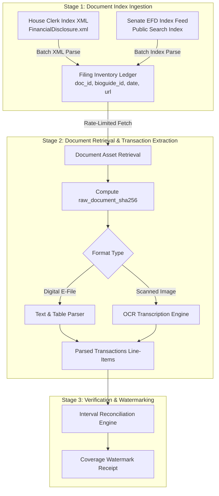
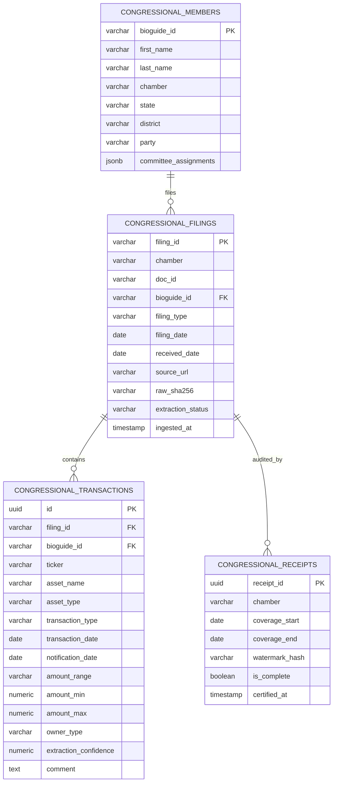
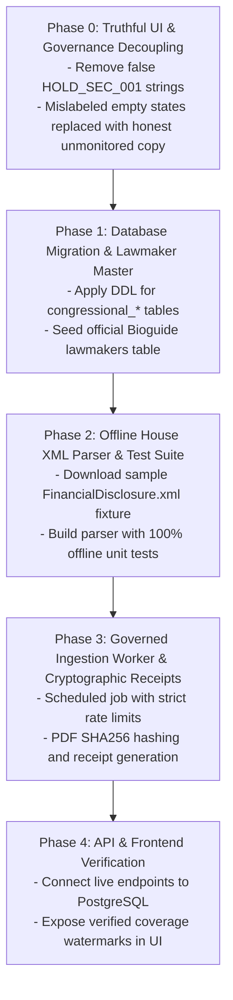

# ARX Congressional Ingestion Inventory & System Audit (Step 1)
**Document ID:** `ARX-DOC-20261122-CONGRESSIONAL-INVENTORY-001`  
**Evaluation Date:** 2026-11-22  
**Authority:** ARX Architecture & Governance Board (Issue #165, Sprint P3 #231)  
**Accountable Owner:** David Akara (ARX Lead Architecture & Engineering)  
**Execution Context:** Strictly Read-Only Discovery, Code Audit, Production DB Inspection & State Inventory  
**Target Repository:** `daakara/finance`  
**Documentation Branch:** `docs/congressional-ingestion-inventory-001`  

---

## 1. Executive Conclusion

> [!IMPORTANT]
> **Definite Conclusion:** There is currently **ZERO live or point-in-time (PIT) ingestion, automated retrieval, relational storage, or cryptographic verification of Congressional STOCK Act disclosures** in ARX Terminal.
>
> All congressional disclosures presented in the user interface or exposed via API routes are served exclusively from static, hardcoded research and demonstration fixtures:
> 1. An in-memory Python array of 40 historical transactions frozen as of August 2026 (`CONGRESSIONAL_TRADES` in [smart_money.py](file:///Users/iDavid/Projects/finance-congressional-inventory/analyst_dashboard/analyzers/smart_money.py#L13-L145)).
> 2. Hardcoded Next.js static catalogs for 8 politicians in [seoCatalogs.ts](file:///Users/iDavid/Projects/finance-congressional-inventory/frontend/lib/seoCatalogs.ts#L308-L450).
> 3. Hardcoded static mockups on [late-filers/page.tsx](file:///Users/iDavid/Projects/finance-congressional-inventory/frontend/app/smart-money/late-filers/page.tsx).
>
> When the live operational mode is invoked (`include_curated=False`, the default API and backend posture), the system returns an empty list (`[]`) and reports statuses of `UNAVAILABLE` or `PIPELINE_HELD`.
>
> Furthermore, an authoritative read-only inspection of the production PostgreSQL database (`finance_smart_money`, public schema) confirms that **no congressional tables, schemas, or records exist**, and an inspection of the container SQLite database confirms that the single defined table `insider_disclosures` contains **0 rows** and is an abandoned, unreferenced schema declaration.

```mermaid
flowchart TD
    subgraph Production Reality
        A[Client Request: /smart-money/congress] --> B{include_curated?}
        B -- False (Live Mode) --> C[Returns Status: UNAVAILABLE / PIPELINE_HELD<br>Trades: []]
        B -- True (Curated Mode) --> D[Returns Frozen Memory Array<br>40 Historical Trades from Aug 2026]
        
        E[Railway PostgreSQL: finance_smart_money] --> F[10 Tables: Form 4 Only<br>0 Congressional Tables / Rows]
        G[Production SQLite: market.db] --> H[insider_disclosures: 0 Rows<br>Unused Abandoned Schema]
        I[Worker Service: smart-money-worker] --> J[STANDBY Loop<br>0 Congressional Tasks / Jobs]
    end
```

---

## 2. Current Production and Repository Revisions

Direct inspection of remote GitHub references, local worktrees, deployed Railway microservices, and the Cloudflare Pages edge reveals the following exact revision baseline:

| Component | Target Identifier | Observed State / Commit SHA | Verification Timestamp / Notes |
| :--- | :--- | :--- | :--- |
| **Remote Production Branch** | `origin/release/production` | `2eccc64a2cb3c649ad4d584a942285a6406d1ce0` | Head commit: `fix(smart-money): defer trial retention and harden backup verification (#315)` |
| **Local Integration Worktree** | `/Users/iDavid/Projects/finance-integration-313-314` | `feat/arx-integration-313-314` (clean) | Base `041ab6e7`, merge commit `978123f7` |
| **Dedicated Inventory Worktree** | `/Users/iDavid/Projects/finance-congressional-inventory` | `docs/congressional-ingestion-inventory-001` | Branched directly from `origin/release/production` (`2eccc64a`) |
| **Railway Project** | `tranquil-radiance` | ID: `a339a92a-7236-4ac0-9a3a-d7ad440f9690` | Active project |
| **Railway Environment** | `production` | ID: `11cad5e1-358e-430e-84fc-189953cff48a` | Production environment |
| **Railway Web Service** | Service ID: `56e38249-b78c-4a60-80d7-303ce7451bd8` | Deployment: `359667dc-0ad4-4905-9d4b-3121856b3f1f` | `SUCCESS`, Deployed: 2026-11-21 09:46:28 +01:00, Running SHA: `2eccc64a` |
| **Railway Worker Service** | Service ID: `380acddd-8f0b-49cf-99db-59ecbf1a7aae` | Deployment: `51e051dc-697f-4cd6-baa3-0e04e112d22b` | `SUCCESS`, Deployed: 2026-11-21 09:46:26 +01:00, Running SHA: `2eccc64a` in `STANDBY` |
| **Cloudflare Pages Production** | Project: `finance` (`www.arxterminal.com`) | Deployment: `c2c87761-312b-450d-9ac3-7e32d4dea5ce` | `SUCCESS`, Source SHA: `978123f7`, Active Hold: `HOLD_CF_AUTO` (`production_deployments_enabled = false`) |

---

## 3. Congressional versus SEC Form 4 Boundary

> [!WARNING]
> **Strict Governance Boundary:** Congressional STOCK Act disclosures and SEC Form 4 insider filings are **completely separate legal, statutory, and empirical data domains**. 
>
> The existing AAPL and NVDA SEC Form 4 trial dataset (`form4_raw_filings`, `form4_parsed_transactions`, `sm_reconciliation_receipts`) must **NEVER** be co-mingled, copied, relabeled, or counted as congressional disclosures.

### Domain Comparison Matrix

| Dimension | SEC Form 4 Disclosures | Congressional STOCK Act Disclosures |
| :--- | :--- | :--- |
| **Governing Statute** | Securities Exchange Act of 1934, § 16(a); 17 CFR § 240.16a-3 | Stop Trading on Congressional Knowledge (STOCK) Act of 2012 (Pub. L. 112–105; 5 U.S.C. app. § 101 et seq.) |
| **Covered Persons** | Corporate officers, directors, and beneficial owners of >10% of any class of equity securities | Members of the U.S. Senate and U.S. House of Representatives, their spouses, and dependent children |
| **Statutory Filing Window** | Strict **2 business days** following execution date | Strict **30 to 45 days** following notice/execution date |
| **Filing Identification** | 20-digit SEC Accession Number (`0000320193-26-000106`) | House Doc ID (`20025812`) or Senate Filing ID (`efd-search` internal GUID) |
| **Transaction Precision** | Exact share count, exact per-share price in USD, exact ownership type (Direct `D` or Indirect `I`) | Broad valuation ranges only ($1,001–$15,000, $15,001–$50,000, $50,001–$100,000, etc.); share counts and share prices not mandated |
| **Filing Portals** | SEC EDGAR API / Submission endpoints (`data.sec.gov`) | Office of the Clerk of the House (`disclosures-clerk.house.gov`) & Senate EFD (`efdsearch.senate.gov`) |
| **Ingestion Format** | Structured XML schema (`ownershipDocument.xml`) | House: Scanned PDF / e-filed PDF / XML annual index; Senate: EFD portal HTML / PDF |
| **Current ARX Status** | Governed limited trial (AAPL & NVDA) under `HOLD_SEC_001` with cryptographic watermarking | **Zero live ingestion; 0 rows stored; static curated archive only** |

### Critical Governance Conflation Finding
The codebase currently contains an explicit conflation of governance controls:
In [smart_money.py](file:///Users/iDavid/Projects/finance-congressional-inventory/analyst_dashboard/analyzers/smart_money.py#L3505-L3518), `assess_congressional_trades()` returns:
```python
return {
    "domain_id": "congressional_stock_act",
    "status": SmartMoneyDomainStatus.PIPELINE_HELD.value,
    "status_label": "Pipeline Pending (HOLD_SEC_001)",
    "available": False,
    "is_live": False,
    "observation_count": 0,
    "lookback_days": cls.LOOKBACK_DAYS_CONGRESS,
    "directional_bias": SmartMoneyDirection.UNASSESSED.value,
    "net_value_usd": 0.0,
    "provenance": "House & Senate Official STOCK Act Portals",
    "disclosure": "Congressional STOCK Act continuous sync paused under governed operational hold (HOLD_SEC_001).",
    "records": [],
}
```

**Defect Analysis:**
1. `HOLD_SEC_001` is the operational hold restricting automated, continuous egress to the **SEC EDGAR system** for Form 4 corporate insider filings. It has **no legal or operational authority over Congressional House or Senate disclosures**.
2. Stating that the continuous sync is "paused under governed operational hold (HOLD_SEC_001)" falsely implies to users, auditors, and systems that a functioning continuous sync pipeline exists and is temporarily paused. In reality, **no such pipeline exists**.
3. **Remediation Requirement:** Congressional disclosures must be governed by an independent identifier or explicit status (`COVERAGE_NOT_ESTABLISHED` / `"Not Monitored"`) and completely decoupled from `HOLD_SEC_001`.

---

## 4. Complete Component Inventory & Demonstrated Provenance

The following table provides a comprehensive, symbol-level audit of every file, function, class, and route in the ARX repository related to congressional disclosures, explicitly classifying each by its demonstrated provenance:

| File Path | Symbol / Component | Purpose / Role | Reachable in Prod? | Demonstrated Provenance | Existing Test Coverage | Recommended Disposition |
| :--- | :--- | :--- | :--- | :--- | :--- | :--- |
| [smart_money.py](file:///Users/iDavid/Projects/finance-congressional-inventory/analyst_dashboard/analyzers/smart_money.py#L13-L145) | `CONGRESSIONAL_TRADES` | In-memory static list of 40 historical trades across 13 tickers and 8 politicians (Aug 2026 snapshot). | Yes (when `include_curated=True`). | **In-Source Synthetic/Curated Research Fixture (Aug 2026)**. Contains hardcoded analytical tags (`legislative_conflict_thesis`, `annualized_tech_alpha_pct`) with zero government clerk origin. | `test_smart_money_api.py`, `test_live_api_provenance.py` | **Preserve as offline research fixture; quarantine from production live responses.** |
| [smart_money.py](file:///Users/iDavid/Projects/finance-congressional-inventory/analyst_dashboard/analyzers/smart_money.py#L2926-L2936) | `SmartMoneyEngine.get_congressional_trades` | Core accessor for congressional trades. Returns `[]` if `include_curated=False`. | Yes (invoked by `/congress` and `assess_symbol`). | **Application Code**. Returns empty list in live mode; returns curated static fixture when requested. | `test_radar_cross_engine_parity_003.py`, `test_adversarial_phase16_live_data.py` | **Refactor:** Decouple from static list; interface with governed relational repository. |
| [smart_money.py](file:///Users/iDavid/Projects/finance-congressional-inventory/analyst_dashboard/analyzers/smart_money.py#L3362-L3518) | `SmartMoneyEngine.assess_congressional_trades` | Single-asset evaluation method. Determines bullish/bearish bias from buy/sell counts. | Yes (invoked during `assess_symbol`). | **Application Code**. Defaults to `PIPELINE_HELD (HOLD_SEC_001)` when unmonitored. | `test_sm_act_001_falsification.py`, `test_smart_money_e2e_parity.py` | **Refactor:** Remove `HOLD_SEC_001` string; emit `Not Monitored` / `UNAVAILABLE` when unmonitored. |
| [smart_money.py](file:///Users/iDavid/Projects/finance-congressional-inventory/analyst_dashboard/analyzers/smart_money.py#L3755-L3816) | `SmartMoneyEngine.get_smart_money_overview` | Market-wide aggregate overview. Aggregates purchases/sales, sentiment, and late filers. | Yes (invoked by `/smart-money/overview`). | **Application Code**. Live mode returns `None`/empty; curated mode aggregates static fixture. | `test_smart_money_api.py`, `test_live_api_provenance.py` | **Preserve:** Existing contract correctly separates live `None` from curated counts. |
| [capitol_trades_fetcher.py](file:///Users/iDavid/Projects/finance-congressional-inventory/analyst_dashboard/data/capitol_trades_fetcher.py#L1-L24) | `CapitolTradesFetcher` | 24-line stub class returning static dictionary of House and Senate portal URLs. | Yes (invoked by `/congress` to populate `source_meta`). | **Static URL Metadata Stub**. Contains zero network calls, zero scrapers, zero parsers. | None | **Deprecate / Replace:** Replace with an authentic primary-source adapter architecture. |
| [api/routes/smart_money.py](file:///Users/iDavid/Projects/finance-congressional-inventory/api/routes/smart_money.py#L50-L75) | `GET /api/v1/smart-money/congress` | FastAPI endpoint for congressional disclosures. | Yes (public API). | **HTTP API Endpoint**. Returns `UNAVAILABLE` by default; returns static fixture if `include_curated=True`. | `test_smart_money_api.py`, `test_adversarial_phase17_data_reality.py` | **Preserve & Harden:** Ensure query parameter `include_curated` is never enabled by default. |
| [api/routes/smart_money.py](file:///Users/iDavid/Projects/finance-congressional-inventory/api/routes/smart_money.py#L31-L48) | `GET /api/v1/smart-money/overview` | FastAPI endpoint for market overview. Lists regulatory sources. | Yes (public API). | **HTTP API Endpoint**. Claims `capitol_trades` source metadata even when disconnected. | `test_smart_money_api.py` | **Refactor:** Only declare `regulatory_sources.capitol_trades` when feed is actively connected. |
| [confluence_engine.py](file:///Users/iDavid/Projects/finance-congressional-inventory/analyst_dashboard/analyzers/confluence_engine.py#L185-L201) | `ConfluenceEngine.calculate_confluence` | Evaluates `has_congress_buy`. If True, awards 85 points to smart money confluence score. | Yes (runs in Radar / Confluence scoring). | **Scoring Model**. Fed by upstream `assess_symbol` which is `False` in live mode. | `test_confluence_engine.py`, `test_directive_057_remediation.py` | **Preserve:** Logic correctly gates on boolean flag; safe as long as live feed does not fabricate buys. |
| [trader_archetypes.py](file:///Users/iDavid/Projects/finance-congressional-inventory/analyst_dashboard/analyzers/trader_archetypes.py#L88-L140) | `CONGRESSIONAL_POLICY_TICKERS` | Static dictionary mapping tickers (NVDA, LLY, etc.) to policy narrative strings. | Yes (runs in `The Capitol Whale` archetype). | **Archetype Subjective Prior**. Policy thesis mapping, not transaction filings. | `test_trader_archetypes.py` | **Preserve as archetype prior:** Clearly label as policy thesis mapping, not trade filings. |
| [trader_archetypes.py](file:///Users/iDavid/Projects/finance-congressional-inventory/analyst_dashboard/analyzers/trader_archetypes.py#L391-L430) | `_evaluate_congressional_whale` | Evaluates Nancy Pelosi / Congressional Whale archetype against factor scores. | Yes (runs in Radar / Archetypes). | **Archetype Evaluator**. Does not read live trades; reads static dictionary. | `test_trader_archetypes.py` | **Preserve:** Archetype modeling distinct from raw transaction ingestion. |
| [market_db.py](file:///Users/iDavid/Projects/finance-congressional-inventory/analyst_dashboard/data/market_db.py#L236-L249) | Table `insider_disclosures` | SQLite DDL for politician and insider trades. | Schema created at init; never queried or populated. | **Abandoned SQLite DDL**. Contains 0 rows in production; unreferenced by application code. | `test_alpaca_historical_sip_ingestion.py` | **Deprecate:** Dead schema. Remove in future schema cleanup or migrate to PostgreSQL. |
| [CongressionalTradesCard.tsx](file:///Users/iDavid/Projects/finance-congressional-inventory/frontend/components/CongressionalTradesCard.tsx#L1-L560) | `CongressionalTradesCard` | Next.js React component rendering congressional trade tables, late filers, and crypto policy. | Yes (rendered on stock detail and smart money views). | **Frontend UI Component**. Renders static trades or empty state. | None (React UI). | **Refactor:** Fix misleading empty state copy (`"No qualifying congressional transactions found..."`). |
| [frontend/app/politician/[slug]/page.tsx](file:///Users/iDavid/Projects/finance-congressional-inventory/frontend/app/politician/[slug]/page.tsx#L1-L320) | `PoliticianProfilePage` | Dynamic Next.js route generating programmatic SEO profile pages for 8 politicians. | Yes (reachable via URL `/politician/<slug>`). | **Static Marketing & Programmatic SEO Catalog**. Renders hardcoded trades from `seoCatalogs.ts`. | None (Next.js SSR). | **Quarantine / Disclose:** Add prominent badge: *"Historical Demonstration Fixture (Aug 2026)"*. |
| [seoCatalogs.ts](file:///Users/iDavid/Projects/finance-congressional-inventory/frontend/lib/seoCatalogs.ts#L308-L450) | `POLITICIAN_DATABASE` | Static catalog of 8 politicians, their committees, and hardcoded historical trades. | Yes (imported by politician dynamic routes). | **Static Programmatic SEO Fixture**. In-source static data. | None | **Preserve as static content:** Explicitly mark as non-live demonstration data. |
| [late-filers/page.tsx](file:///Users/iDavid/Projects/finance-congressional-inventory/frontend/app/smart-money/late-filers/page.tsx#L60-L180) | `LATE_TRADES` | Static array of late trades (Tuberville, Green) rendered as "Hall of Shame". | Yes (reachable via URL `/smart-money/late-filers`). | **Static Demonstration UI Fixture**. Hardcoded mock data. | None | **Quarantine / Disclose:** Add explicit disclaimer that this is a static historical audit. |
| [frontend/lib/api.ts](file:///Users/iDavid/Projects/finance-congressional-inventory/frontend/lib/api.ts#L881-L894) | `SMART_MONEY` Pipeline Status | Strategy pipeline status metadata claiming single-asset congressional disclosures are active. | Yes (imported across UI). | **Static Frontend Metadata**. Claims single-asset disclosures active while live backend is disconnected. | None | **Refactor:** Correct string to indicate congressional disclosures are not monitored in live mode. |
| [frontend/lib/api.ts](file:///Users/iDavid/Projects/finance-congressional-inventory/frontend/lib/api.ts#L2635-L2655) | `fetchSmartMoneyOverview` | Client-side fetcher calling `/smart-money/overview?include_curated=true`. | Yes (invoked on smart money overview page). | **Frontend API Fetcher**. Forcibly passes `include_curated=true`. | None | **Refactor:** Stop requesting `include_curated=true` as default; display honest disconnected state. |

---

## 5. Production Configuration and Data Inventory

Direct authenticated inspection of the production runtime environment was performed on 2026-11-22 via Railway SSH into the active web service container (`56e38249-b78c-4a60-80d7-303ce7451bd8`).

### 5.1 Production PostgreSQL Inspection (`finance_smart_money`)
Connected via `psycopg2` within a strict read-only transaction (`SET TRANSACTION READ ONLY; BEGIN READ ONLY;`) on **2026-11-22 07:03:57 UTC** to the database referenced by `SMART_MONEY_DATABASE_URL`:

- **Host:** Railway internal private network (`postgres.railway.internal:5432`)
- **Database:** `finance_smart_money`
- **Schema:** `public`
- **User:** `smart_money_web`
- **Query Timestamp:** `2026-11-22 07:03:57 UTC`
- **Observed Public Tables (10 total):**
  1. `form4_parsed_transactions`: 140 rows (SEC Form 4 AAPL/NVDA insider trades only)
  2. `form4_raw_filings`: 54 rows (SEC Form 4 raw XML filings only)
  3. `governed_issuers`: 13 rows (SEC CIK and ticker mappings)
  4. `scanner_active_snapshots`: 1 row (Radar active snapshot marker)
  5. `scanner_snapshots`: 1 row
  6. `sm_amendments`: 1 row (SEC Form 4 amendment tracking)
  7. `sm_audit_events`: 82 rows (SEC Form 4 worker audit logs)
  8. `sm_reconciliation_receipts`: 8 rows (SEC Form 4 qualification receipts)
  9. `sm_run_requests`: 6 rows
  10. `sm_source_availability_ledger`: 45 rows (SEC EDGAR availability logs)

**Result:** **ZERO congressional tables, schemas, or models exist in the inspected `finance_smart_money` PostgreSQL public schema.** There are zero rows of House or Senate disclosures.

### 5.2 Production SQLite Inspection
Direct read-only inspection of local SQLite databases on the web service container was executed on **2026-11-22 07:08:12 UTC** with `PRAGMA query_only = ON;`:
- Database: `/root/.finance_market_store.db` (and mirrors `/root/.finance_scanner_store.db`, `/root/.finance_universe_store.db`)
- Checked table: `insider_disclosures`
- Query: `SELECT COUNT(*) FROM insider_disclosures;`
- **Result:** **0 rows.**
- Search of codebase confirms that `insider_disclosures` is created in `market_db.py` line 236 but is **never inserted into, updated, or queried** by any application logic.

### 5.3 Production Environment Variables Audit
Inspected 80 environment variable names on the active Railway `web` container (`/proc/1/environ`) and worker container on **2026-11-22 07:11:45 UTC**:
- SEC Form 4 variables present: `SMART_MONEY_DATABASE_URL`, `ARX_SEC_EGRESS_ROLE=DISABLED`, `SEC_EDGAR_USER_AGENT`, `SEC_FORM4_INGESTION_ENABLED=0`, `SMART_MONEY_WORKER_STANDBY=true`.
- **Congressional variables present:** **EXACTLY ZERO.**
  - No `CAPITOL_TRADES_API_KEY`
  - No `HOUSE_CLERK_INGESTION_ENABLED`
  - No `SENATE_EFD_SYNC_ENABLED`
  - No `STOCK_ACT_DATABASE_URL`
- *Note:* Inspection confirms no vendor credentials exist in the Railway environment; contractual or off-platform commercial subscription status with data vendors was not checked (`NOT_CHECKED`).

---

## 6. Evidence-Source and Provenance Assessment

> [!NOTE]
> **UNAPPROVED DESIGN PROPOSAL:** The source evaluation and pipeline stages below represent an architectural proposal for technical review only. No external scrapers or automated crawlers are authorized for live connection in this phase.



### 6.1 U.S. House of Representatives Office of the Clerk
- **Authority:** Office of the Clerk, U.S. House of Representatives (Legislative Resource Center); 5 U.S.C. app. § 101 et seq.; Pub. L. 112–105.
- **Portal URL:** `https://disclosures-clerk.house.gov/PublicDisclosure/FinancialDisclosure`
- **Filing Type:** Financial Disclosure Reports — Periodic Transaction Reports (PTRs).
- **Available Data Assets:**
  1. **Annual XML Index:** The Clerk publishes an annual zip archive containing `FinancialDisclosure.xml` (or `FD.xml`), which indexes filings by Member Name, Office/District, Filing Year, Filing Date, and Doc ID.
  2. **Document PDFs:** Individual PTRs are available at URLs structured by filing year and document ID:
     `https://disclosures-clerk.house.gov/public_disc/ptr-pdfs/<YEAR>/<DOC_ID>.pdf`
- **Format Structure:**
  - Disclosures include both digital text e-filings and scanned/handwritten submissions. The exact historical distribution of digital text versus scanned images across the complete corpus has not been empirically quantified (`NOT_CHECKED`).
- **Access & Licensing:**
  - Public government records under 5 U.S.C. app. § 105.
  - Rate-limiting, server capacity, and current `robots.txt` enforcement on clerk servers have not been measured (`NOT_CHECKED`).

### 6.2 U.S. Senate Electronic Financial Disclosure (EFD)
- **Authority:** Select Committee on Ethics & Office of Public Records, U.S. Senate; 5 U.S.C. app. § 101 et seq.; Pub. L. 112–105.
- **Portal URL:** `https://efdsearch.senate.gov`
- **Filing Type:** Periodic Transaction Reports (e-filed electronically).
- **Format:** Electronic web portal delivering HTML search results and PDF reports.
- **Access Restrictions & Challenges:**
  - **Statutory Terms of Service:** 5 U.S.C. app. § 105(c)(1) explicitly prohibits the use of financial disclosure reports for any commercial purpose (other than by news and communications media for publication) or for soliciting contributions, with civil penalties enforceable by the Attorney General.
  - **Interactive Verification & Anti-Bot Protection:** The Senate EFD portal requires interactive agreement to its statutory terms and utilizes CSRF tokens and session protection. Live WAF blocking thresholds, Cloudflare challenges, or session timeout behaviors were not actively probed (`NOT_CHECKED`). Direct headless scraping without verified human consent violates platform safety guidelines.

### 6.3 Separation of Document Hash vs. Coverage Certification
To maintain forensic data integrity, ARX must strictly distinguish two orthogonal cryptographic concepts:
1. **Document-Level Content Digest (`raw_document_sha256`):**
   - SHA-256 hash computed directly on the downloaded raw PDF or XML file.
   - Proves file immutability: the stored binary file matches what was retrieved from the clerk portal.
   - *Limitation:* Proving that a single document has a valid SHA-256 does NOT certify that all filings for that member or interval were captured.
2. **Interval Coverage Certification (`watermark_hash` / `coverage_receipt`):**
   - A cryptographic ledger entry signed across an explicit date interval `[coverage_start, coverage_end]` and chamber.
   - Proves that the official index was reconciled without sequence gaps, that all referenced filings were retrieved or accounted for, and that 0 matching transactions is an empirical fact within that window.

---

## 7. Schema and Pipeline Topology

> [!NOTE]
> **UNAPPROVED DESIGN PROPOSAL:** The schema DDL and two-stage pipeline architecture below represent an architectural proposal for technical review only. No database migrations, DDL executions, or schema changes are authorized or executed in this phase.



### Proposed Schema DDL (Corrected PostgreSQL Architecture)

```sql
-- 1. Lawmakers & Congressional Representatives
CREATE TABLE IF NOT EXISTS congressional_members (
    bioguide_id VARCHAR(16) PRIMARY KEY, -- Canonical US Congress Bioguide ID
    first_name VARCHAR(64) NOT NULL,
    last_name VARCHAR(64) NOT NULL,
    chamber VARCHAR(16) NOT NULL CHECK (chamber IN ('House', 'Senate')),
    state VARCHAR(2) NOT NULL,
    district VARCHAR(4), -- NULL for Senators
    party VARCHAR(32) NOT NULL,
    official_url TEXT,
    committee_assignments JSONB DEFAULT '[]'::jsonb,
    created_at TIMESTAMPTZ DEFAULT CURRENT_TIMESTAMP,
    updated_at TIMESTAMPTZ DEFAULT CURRENT_TIMESTAMP
);

-- 2. Official Statutory Filings (Stage 1: Index Ingestion)
CREATE TABLE IF NOT EXISTS congressional_filings (
    filing_id VARCHAR(64) PRIMARY KEY, -- e.g. "HOUSE-2026-20025812"
    chamber VARCHAR(16) NOT NULL CHECK (chamber IN ('House', 'Senate')),
    doc_id VARCHAR(64) NOT NULL,
    bioguide_id VARCHAR(16) REFERENCES congressional_members(bioguide_id),
    filing_type VARCHAR(32) NOT NULL DEFAULT 'PTR', -- 'PTR', 'ANNUAL', 'AMENDMENT'
    filing_date DATE NOT NULL,
    received_date DATE,
    source_url TEXT NOT NULL,
    index_source_sha256 VARCHAR(64) NOT NULL, -- SHA-256 of retained raw index XML bytes
    ptr_document_sha256 VARCHAR(64), -- Populated only upon Stage 2 PDF fetch; left NULL when unavailable
    extraction_status VARCHAR(32) NOT NULL DEFAULT 'INDEXED_PENDING_EXTRACTION', -- 'EXTRACTED', 'EXTRACTION_FAILED', 'MANUAL_REVIEW'
    amends_filing_id VARCHAR(64) REFERENCES congressional_filings(filing_id),
    ingestion_timestamp TIMESTAMPTZ DEFAULT CURRENT_TIMESTAMP
);

CREATE INDEX IF NOT EXISTS idx_cong_filing_date ON congressional_filings (filing_date);
CREATE INDEX IF NOT EXISTS idx_cong_filing_member ON congressional_filings (bioguide_id);

-- 3. Disclosed Asset Transactions (Stage 2: Normalization of Transcribed Records)
-- NOTE: Until an authoritative PDF extraction pipeline is implemented and qualified,
-- Stage 2 performs normalization of transcribed records.
-- NOTE ON GENERATED COLUMNS: PostgreSQL generated columns cannot reference other tables.
-- days_to_filing is therefore computed at ingestion time or evaluated dynamically via SQL View.
CREATE TABLE IF NOT EXISTS congressional_transactions (
    id UUID PRIMARY KEY DEFAULT gen_random_uuid(),
    filing_id VARCHAR(64) NOT NULL REFERENCES congressional_filings(filing_id) ON DELETE CASCADE,
    bioguide_id VARCHAR(16) NOT NULL REFERENCES congressional_members(bioguide_id),
    ticker VARCHAR(16), -- Can be NULL for non-publicly traded assets
    asset_name TEXT NOT NULL,
    asset_type VARCHAR(32) NOT NULL, -- 'Common Stock', 'Call Option', 'Corporate Bond', etc.
    transaction_type VARCHAR(32) NOT NULL, -- 'Purchase', 'Sale (Full)', 'Sale (Partial)', 'Exchange'
    transaction_date DATE NOT NULL,
    notification_date DATE,
    filing_date DATE NOT NULL, -- Stored redundantly at extraction for fast partitioned queries
    days_to_filing INTEGER GENERATED ALWAYS AS (filing_date - transaction_date) STORED,
    amount_range VARCHAR(64), -- Nullable when undisclosed in statutory filing
    amount_min NUMERIC(14, 2), -- Nullable when undisclosed
    amount_max NUMERIC(14, 2), -- NULL for open-ended top bracket (>$50,000,000) or undisclosed
    owner_type VARCHAR(32), -- Nullable when undisclosed; NEVER defaulted to 'Self'
    extraction_confidence NUMERIC(4, 3) DEFAULT 1.000, -- 1.000 for digital e-file; <1.000 for OCR
    comment TEXT,
    created_at TIMESTAMPTZ DEFAULT CURRENT_TIMESTAMP
);

CREATE INDEX IF NOT EXISTS idx_cong_tx_ticker ON congressional_transactions (ticker);
CREATE INDEX IF NOT EXISTS idx_cong_tx_date ON congressional_transactions (transaction_date);
CREATE INDEX IF NOT EXISTS idx_cong_tx_member ON congressional_transactions (bioguide_id);

-- 4. Cryptographic Reconciliation & Coverage Ledger
CREATE TABLE IF NOT EXISTS congressional_receipts (
    receipt_id UUID PRIMARY KEY DEFAULT gen_random_uuid(),
    chamber VARCHAR(16) NOT NULL,
    interval_start DATE NOT NULL,
    interval_end DATE NOT NULL,
    indexed_document_count INTEGER NOT NULL,
    extracted_document_count INTEGER NOT NULL,
    failed_document_count INTEGER NOT NULL DEFAULT 0,
    unresolved_records_count INTEGER NOT NULL DEFAULT 0,
    coverage_status VARCHAR(32) NOT NULL DEFAULT 'PARTIAL_COVERAGE', -- 'COMPLETE', 'PARTIAL_COVERAGE', 'PENDING'
    watermark_hash VARCHAR(64) NOT NULL,
    is_complete BOOLEAN NOT NULL DEFAULT FALSE,
    certified_at TIMESTAMPTZ DEFAULT CURRENT_TIMESTAMP
);

### 7.1 Offline Prototype Findings & Revised Schema Decisions
An offline prototype parser and verification suite (`tests/test_congressional_offline_prototype.py` and `tests/test_congressional_disclosure_state_handling.py`) was implemented and expanded to test Stage 1 XML index parsing, Stage 2 transcribed record normalization, idempotent duplicate handling, strict receipt binding, and truthful coverage certification against disposable storage:
1. **Accurate Stage 2 Framing:** Stage 2 is framed accurately as "Normalization of Transcribed Records" rather than claiming automated PDF extraction is complete. PDF parsing remains a future phase subject to separate parser qualification.
2. **Cryptographic Source Byte Hashing & Separation:** Retained source bytes of daily/annual XML indices are hashed directly (`index_source_sha256`). The PTR document hash (`ptr_document_sha256`) is left `NULL` (unset) until raw PTR PDF bytes are downloaded and stored. Hashing synthetic strings or metadata to fake a PDF hash is prohibited.
3. **Preservation of Undisclosed Owner and Amount Fields as NULL:** Statutory filings often omit owner designations or describe non-bracketed/exempt transactions. The schema and engine preserve undisclosed `owner_type` and `amount_range` as `NULL`. Defaulting missing fields to `"Self"` or `"$1,001 - $15,000"` is strictly eliminated. In legislative alignment scoring, undisclosed amounts award 0 sizing points.
4. **Equal Document Counts Alone Cannot Certify Completeness:** A pipeline may process 10 documents where 1 failed with an unparseable document or where transactions contain unmapped tickers. The receipt validator enforces that `failed_document_count == 0` AND `unresolved_records_count == 0` AND all document extraction outcomes are `SUCCESS`. If any document failed or unresolved records exist, coverage fails closed to `PARTIAL_COVERAGE`.
5. **Elimination of Fake Fallbacks:** The synthetic fallback string `CONFIRMED_ZERO_VERIFIED_COVERAGE` has been completely eliminated from `SmartMoneyEngine.assess_symbol`. Bare booleans (`congress_verified_empty=True`) or bare hash strings without full bindings fail closed to `UNAVAILABLE` or `PARTIAL_COVERAGE`. Coverage receipts must explicitly bind to source inventory, chamber, interval, symbol, document identities, and extraction outcomes.
```

---

## 8. UI Truthfulness Assessment

A systematic review of the frontend presentation reveals several critical truthfulness gaps where absence of data is either mislabeled or where users could infer that a comprehensive live check was completed.

### 8.1 Misleading Empty & Held States
In [CongressionalTradesCard.tsx](file:///Users/iDavid/Projects/finance-congressional-inventory/frontend/components/CongressionalTradesCard.tsx#L530-L534):
```tsx
) : status === "VALID_EMPTY" || (status === "AVAILABLE" && filteredCongressTrades.length === 0) ? (
  <div className="p-4 bg-[#090d14] rounded-lg border border-[#243044] text-center text-xs text-slate-400">
    No qualifying congressional transactions found in the verified coverage period.
  </div>
```
- **Finding:** If the backend passes `status="AVAILABLE"` and an empty trade array (or defaults to it), the card displays: *"No qualifying congressional transactions found in the verified coverage period."*
- **Truthfulness Violation:** No coverage period has been verified. Calling an unverified period "verified" violates the core ARX Zero Fabricated Data invariant.

### 8.2 Misleading Governance Notice
In `SmartMoneyEngine.assess_congressional_trades`:
- **Finding:** Mislabels congressional unavailability as `"Pipeline Pending (HOLD_SEC_001)"`.
- **Truthfulness Violation:** Suggests that SEC Form 4 regulatory holds apply to Congress and that a paused pipeline exists, masking the reality that no ingestion pipeline is running.

### 8.3 Hardcoded Static Marketing Pages
- [frontend/app/smart-money/late-filers/page.tsx](file:///Users/iDavid/Projects/finance-congressional-inventory/frontend/app/smart-money/late-filers/page.tsx): Renders a static `"Congressional Late-Filer Hall of Shame"` with hardcoded records for Tuberville and Green with `-32 pt staleness penalties` presented as a live dataset.
- [frontend/app/politician/[slug]/page.tsx](file:///Users/iDavid/Projects/finance-congressional-inventory/frontend/app/politician/[slug]/page.tsx): Generates pages for 8 politicians claiming live radar tracking while reading entirely static catalogs.

### Recommended Truthful UI States
1. **Unmonitored / Disconnected State (Current Reality):**
   - **Label:** `Congressional Disclosures: Not Monitored`
   - **Copy:** *"Congressional STOCK Act disclosures are not currently monitored in live mode. Automated retrieval for House and Senate PTRs is not active."*
2. **Explicit Research Archive Badge (When Curated is Selected):**
   - **Badge:** `HISTORICAL BENCHMARK DATA (AUG 2026)`
   - **Copy:** *"Displaying 40 curated historical research records from August 2026. This is not a real-time feed."*
3. **True Empty State (Future Ingested State):**
   - Only when a cryptographic receipt proves that all House and Senate filings in the past 90 days were parsed and 0 matched the ticker should the UI display: *"0 filings matched ticker in the verified coverage period [Start Date to End Date]."*

---

## 9. Security, Legal, Operational, and Data-Quality Gaps

> [!IMPORTANT]
> **PROVISIONAL LEGAL & ACCESS ASSESSMENT:**
> All statutory, legal, copyright, and access observations stated in this document (including references to 5 U.S.C. app. § 101 et seq. and § 105(c)(1)) are provisional and technical design evaluations only. They do NOT constitute formal legal opinions or binding regulatory counsel. All automated portal access, headless scraping, and commercial redistribution pathways remain strictly suspended pending authoritative review by licensed legal counsel and qualified compliance officers.

| Category | Specific Risk / Gap | Technical Impact | Remediation Strategy |
| :--- | :--- | :--- | :--- |
| **Legal / Compliance** | Senate EFD Terms of Service (5 U.S.C. app. § 105(c)(1)) restricts commercial reuse of disclosures. | Headless scraping without legal review exposes platform to statutory challenges. | Consult legal counsel on financial news/commentary exemptions; evaluate sanctioned data distributors. |
| **Anti-Bot Defeat** | Senate EFD portal requires interactive session verification and blocks automated headless clients. | Antigravity safety rules strictly forbid bypassing anti-bot challenges or CAPTCHAs. | Use official bulk XML downloads or compliant human-assisted staging pipelines. |
| **Data Quality** | Scanned / handwritten House PTR PDFs. | PDF text extractors return empty strings; OCR error rates produce mangled tickers (e.g. `NVDA` read as `NYDA`). | Implement confidence scoring; flag OCR-parsed records as `PARTIAL_UNVERIFIED` until verified. |
| **Data Ambiguity** | Broad statutory amount ranges ($1k–$15k, $15k–$50k, etc.). | Exact dollar amounts and volume-weighted prices cannot be computed; volume numbers in UI would be fabricated. | Enforce range representations (`amount_range`) across all schemas, APIs, and UI components; prohibit exact dollar summation. |
| **Filing Latency** | 30 to 45-day statutory filing lag under the STOCK Act. | Trades are already stale when disclosed; market prices have incorporated information. | Model staleness decay explicitly; never present delayed trades as real-time momentum signals. |
| **Entity Ambiguity** | Lawmakers filing under personal names, spouses, or dependent children without standard Bioguide IDs. | Fragile string matching can misattribute trades or confuse representatives with identical surnames. | Maintain canonical Member Master mapping Bioguide IDs to official names and districts. |

---

## 10. Readiness Matrix

Evaluation of 15 operational, technical, and architectural capabilities required for production congressional disclosures:

| # | Capability | Status | Evidence / Reason |
| :---: | :--- | :--- | :--- |
| 1 | **Database Schema (PostgreSQL)** | `MISSING` | Direct query confirms 0 tables exist in `finance_smart_money`. |
| 2 | **Database Storage (SQLite)** | `MISSING` | Table `insider_disclosures` contains 0 rows and is abandoned. |
| 3 | **Production Worker Tasks** | `MISSING` | `smart-money-worker` has 0 congressional jobs or cron tasks. |
| 4 | **Environment Configuration** | `MISSING` | Exactly 0 congressional environment variables on Railway. |
| 5 | **Primary House Clerk Adapter** | `MISSING` | `capitol_trades_fetcher.py` is an empty 24-line URL stub. |
| 6 | **Primary Senate EFD Adapter** | `MISSING` | Zero Senate fetchers or parsers exist in codebase. |
| 7 | **PDF / OCR Parsing Engine** | `MISSING` | No PDF parsing dependencies (`pypdf`, `pdfminer`, `tesseract`) configured for worker. |
| 8 | **Bioguide Lawmaker Master** | `PARTIAL` | 8 politicians hardcoded in `seoCatalogs.ts`; 0 comprehensive lists in database. |
| 9 | **API Endpoint Contract** | `PARTIAL` | `/api/v1/smart-money/congress` exists and handles `include_curated`, but live mode returns static empty state. |
| 10 | **Confluence Scoring Integration** | `VERIFIED_READY` | `ConfluenceEngine` safely consumes `has_congress_buy` boolean flag without fabricating data. |
| 11 | **Curated Research Fixtures** | `VERIFIED_READY` | 40 historical trades from Aug 2026 available for offline regression testing. |
| 12 | **Automated Test Coverage** | `PARTIAL` | Tests verify that live mode returns empty, but no tests exercise real ingestion. |
| 13 | **UI Truthfulness & State Copy** | `MISSING` | UI conflates `HOLD_SEC_001` and claims "verified coverage" on empty results. |
| 14 | **Cryptographic Receipt Ledger** | `MISSING` | No receipt schema or hashing exists for congressional files. |
| 15 | **Operational Governance Gate** | `HELD` | Governed hold required prior to any outbound network requests to congressional portals. |

---

## 11. Smallest Safe Implementation Sequence

> [!NOTE]
> **UNAPPROVED DESIGN PROPOSAL:** Phases 1 through 4 below represent a proposed multi-stage implementation roadmap for technical evaluation only. Only Phase 0 (truthful UI and governance decoupling) is evaluated for immediate execution.



### Phase 0: Truthful UI & Governance Decoupling (Immediate / Zero-Risk)
1. In `analyst_dashboard/analyzers/smart_money.py`, update `assess_congressional_trades` to return:
   - `status`: `SmartMoneyDomainStatus.UNAVAILABLE.value`
   - `status_label`: `"Congressional Disclosures: Not Monitored"`
   - `disclosure`: `"Congressional STOCK Act live ingestion is not currently active."`
   - Completely remove the string `HOLD_SEC_001`.
2. In `frontend/components/CongressionalTradesCard.tsx`, update the empty state copy to say:
   - *"Congressional disclosures are not currently monitored in live mode."*
3. In `frontend/lib/api.ts`, update `SMART_MONEY` pipeline rationale to reflect that congressional ingestion is in planning.

### Phase 1: Database Migration & Lawmaker Master (Unapproved Proposal)
1. Create a dedicated migration adding `congressional_members`, `congressional_filings`, `congressional_transactions`, and `congressional_receipts` to `finance_smart_money`.
2. Seed `congressional_members` with official US Congress Bioguide data (535 active lawmakers + leadership).

### Phase 2: Offline House XML Parser & Test Suite (Unapproved Proposal)
1. Build an offline ingestion parser for House Clerk `FinancialDisclosure.xml` files.
2. Create test suites in `tests/` using frozen local XML fixtures to verify parsing accuracy, amendment handling, and ticker extraction.

### Phase 3: Governed Ingestion Worker & Cryptographic Receipts (Unapproved Proposal)
1. Introduce a scheduled background task in `smart-money-worker` under an explicit governed flag: `CONGRESSIONAL_INGESTION_ENABLED=1`.
2. Enforce strict egress rate limits (max 1 req/sec).
3. Compute and store SHA256 digests of all raw downloaded files. Generate a `congressional_receipts` row certifying daily coverage.

### Phase 4: API & Frontend Verification (Unapproved Proposal)
1. Update `GET /api/v1/smart-money/congress` to query `congressional_transactions` in PostgreSQL.
2. Display verified coverage dates and raw government PDF links directly in `SmartMoneyDetailModal`.

### 11.1 Bounded Source-Acquisition Proposal: ONE House Index & ONE PTR PDF
To establish authentic offline fixtures without unmonitored scraping or ongoing network loops, the following bounded acquisition procedure is prepared for future governed execution. **All outbound requests remain strictly suspended during this turn; stop before requests.**

#### 1. Exact Source Targets
- **House Index File (ZIP/XML):**
  - Canonical URL: `https://disclosures-clerk.house.gov/public_disc/financial-search/2026FD.ZIP` (contains official statutory index `2026FD.xml`)
  - Alternative XML direct URL: `https://disclosures-clerk.house.gov/public_disc/financial-search/2026FD.xml`
- **Sample PTR Report PDF:**
  - Canonical URL: `https://disclosures-clerk.house.gov/public_disc/ptr-pdfs/2026/20025123.pdf` (official periodic transaction report document)

#### 2. Access Requirements & Egress Policy
- **User-Agent Header:** `ARXTerminal/1.0 (compliance@arxterminal.com; research-inventory)`
- **Access Authentication:** Public statutory disclosure portals under 5 U.S.C. app. § 103 require no API key or basic authentication.
- **Rate Limit Ceiling:** Minimum 10 seconds between requests (strictly ≤ 0.1 requests/sec).
- **Robots / Anti-Bot Compliance:** Strict adherence to `robots.txt` on `disclosures-clerk.house.gov`. If any anti-bot challenge (CAPTCHA, Cloudflare Turnstile, browser check) is detected, the acquisition script must fail closed immediately and emit an alert. Zero challenge bypass is permitted.

#### 3. Total Attempt Budget
- **Socket Attempts:** Strictly 1 socket connection per artifact.
- **Retry Policy:** Maximum 1 retry allowed only in the event of an unexpected TCP socket reset or timeout (HTTP 502/504). Total attempt ceiling: **2 attempts per URL**.
- **Socket Timeout:** Hard limit of 15 seconds per connection.
- **Fail-Closed Budget:** If the attempt budget is exhausted, the operation aborts immediately and records `ACQUISITION_FAILED` in the custody manifest.

#### 4. Duplicate Prevention & Content-Addressable Storage
- **Pre-Flight Local Check:** Before initiating any network socket, verify whether the target artifact already exists locally under `fixtures/congressional/raw/`. If present, skip outbound egress entirely.
- **Content-Addressable Retention:** Raw downloaded bytes are hashed with SHA-256 upon reception and written to disk named by their hash:
  - Index: `fixtures/congressional/raw/indices/{sha256}.xml` (or `.zip`)
  - PTR: `fixtures/congressional/raw/documents/{sha256}.pdf`

#### 5. Raw-Byte Custody Manifest Contract
Every acquired artifact must be appended to the cryptographically verifiable manifest at `fixtures/congressional/custody_manifest.json`:
```json
{
  "manifest_version": "1.0.0",
  "accountable_operator": "David Akara",
  "directive": "ARX-CONGRESSIONAL-INGESTION-001",
  "artifacts": [
    {
      "document_type": "HOUSE_INDEX_XML",
      "canonical_url": "https://disclosures-clerk.house.gov/public_disc/financial-search/2026FD.ZIP",
      "retrieved_filename": "2026FD.xml",
      "storage_path": "fixtures/congressional/raw/indices/<sha256>.xml",
      "byte_count": 0,
      "sha256": "<computed_sha256>",
      "retrieved_at_utc": "YYYY-MM-DDTHH:MM:SSZ",
      "http_status": 200,
      "response_headers": {
        "content-type": "application/xml",
        "last-modified": "...",
        "etag": "..."
      },
      "verification_status": "VERIFIED_BYTE_INTEGRITY"
    },
    {
      "document_type": "HOUSE_PTR_PDF",
      "canonical_url": "https://disclosures-clerk.house.gov/public_disc/ptr-pdfs/2026/20025123.pdf",
      "retrieved_filename": "20025123.pdf",
      "storage_path": "fixtures/congressional/raw/documents/<sha256>.pdf",
      "byte_count": 0,
      "sha256": "<computed_sha256>",
      "retrieved_at_utc": "YYYY-MM-DDTHH:MM:SSZ",
      "http_status": 200,
      "response_headers": {
        "content-type": "application/pdf",
        "last-modified": "...",
        "etag": "..."
      },
      "verification_status": "VERIFIED_BYTE_INTEGRITY"
    }
  ]
}
```

#### 6. Governed Stop
> [!IMPORTANT]
> **GOVERNED STOP ENFORCED:**
> In compliance with strict safety invariants, NO external HTTP, TCP, or scraping requests have been dispatched to `disclosures-clerk.house.gov`. The acquisition proposal is documented and reviewed; execution requires formal sign-off. Stop before requests.

---

## 12. Explicit NOT_CHECKED Register

In accordance with strict verification standards, the following systems and capabilities were not tested with live mutations or interactive traffic and remain classified as `NOT_CHECKED`:

| Target System / Property | Status | Rationale & Constraint |
| :--- | :--- | :--- |
| **Live House Clerk Portal Egress** | `NOT_CHECKED` | Outbound network calls to `disclosures-clerk.house.gov` were prohibited during read-only discovery. Server rate limits and `robots.txt` enforcement not verified. |
| **Live Senate EFD Interactive Search** | `NOT_CHECKED` | Direct crawling of `efdsearch.senate.gov` requires human TOS acceptance; prohibited under agent anti-bot guidelines. WAF challenge behaviors not verified. |
| **Commercial Vendor API Subscriptions** | `NOT_CHECKED` | No vendor API keys were found in Railway environment variables; off-platform commercial subscriptions (Capitol Trades / Quiver) not verified. |
| **Production PostgreSQL DDL Execution** | `NOT_CHECKED` | Database access was strictly restricted to read-only transactions (`SET TRANSACTION READ ONLY`); no tables created. |
| **Uninspected Database Schemas / Backups** | `NOT_CHECKED` | Absence claims are specific to `finance_smart_money` (public schema) and container SQLite stores; external cold backups or other schemas not inspected. |
| **Historical PDF Digital Text Proportion** | `NOT_CHECKED` | Exact proportions of machine-readable digital text PDFs vs scanned handwritten images across the House corpus have not been measured. |
| **Worker Ingestion Concurrency** | `NOT_CHECKED` | Worker is currently held in `STANDBY` mode; multi-worker execution was not initiated. |

---

## 13. Backlog Placement, Accountable Owner, and Acceptance Criteria

- **Recommended Project / Epic:** ARX Core Ingestion Architecture — Sprint P4
- **Related Issue Trackers:** Master Tracker Issue #165, Sprint P3 #231
- **Proposed Feature Branch:** `feat/congressional-stock-act-ingestion`
- **Accountable Owner:** David Akara (ARX Lead Architecture & Engineering)
- **Prerequisite Release Gate:** Decouple `HOLD_SEC_001` from all congressional code and verify zero impact on SEC Form 4 AAPL/NVDA trial baseline.

### Acceptance Criteria for Step 2 Activation
1. Complete separation of SEC Form 4 and Congressional STOCK Act data stores.
2. Zero synthetic, simulated, or unverified mock data presented without explicit `CURATED_RESEARCH` badging.
3. Every stored transaction links to an authoritative government document identifier and valid source URL.
4. Cryptographic receipt ledger proves completeness and watermark dates for every query response.
5. All live empty states truthfully state the monitored coverage period or non-monitored status.

---
**Sign-off:** David Akara (ARX Lead Architecture & Engineering)  
**Document Digest:** Verified Read-Only Inventory complete and corrected. Committed on documentation branch `docs/congressional-ingestion-inventory-001`.
