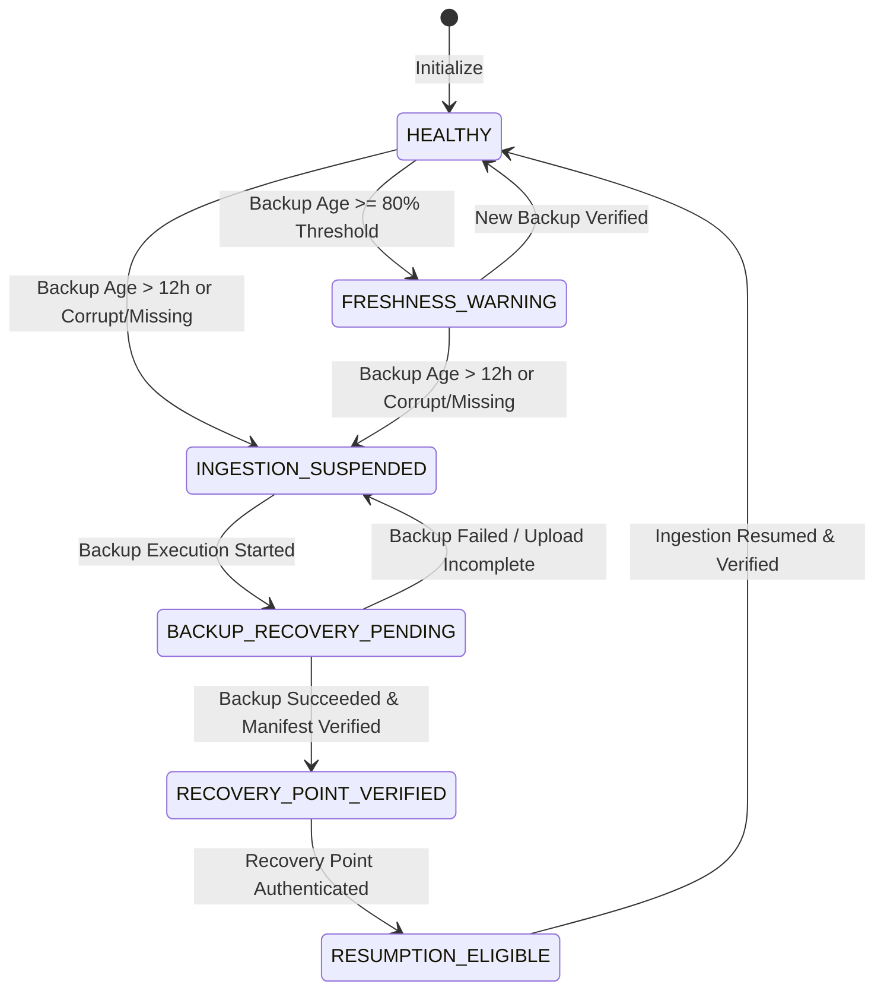

# ARX Terminal — Smart Money Form 4
# Recovery & Resumption Finite State Machine

**Component**: `BackupAgeContainmentGate`  
**States**: 6 Distinct Operational States  
**Idempotency Guarantee**: Form 4 Accession Deduplication Enforced  

---

## 1. State Machine Definition

The `BackupAgeContainmentGate` implements a deterministic, multi-state transition lifecycle:



### Detailed State Dictionary

| State | Ingestion Eligible | Mutation Eligible | Description |
| :--- | :--- | :--- | :--- |
| `HEALTHY` | **YES** | **YES** | Latest verified recovery point is within the 12-hour limit (< 43,200s). Normal operations. |
| `FRESHNESS_WARNING` | **YES** | **YES** | Backup age has reached or exceeded 80% of max age (>= 34,560s / 9.6h). Alert logged. |
| `INGESTION_SUSPENDED` | **NO** | **NO** | Backup age exceeded 12h, or manifest is missing, corrupt, or future-dated. All mutations blocked. |
| `BACKUP_RECOVERY_PENDING` | **NO** | **NO** | Ingestion remains suspended while backup scheduler or manual restore is actively executing. |
| `RECOVERY_POINT_VERIFIED` | **NO** | **NO** | Backup completed, upload verified in R2, sha256 checksum matched. Transition state. |
| `RESUMPTION_ELIGIBLE` | **YES** | **YES** | System verified that all recovery requirements are satisfied and locks are available. |

---

## 2. Transition Guard Conditions

| From State | To State | Trigger Event | Guard Condition |
| :--- | :--- | :--- | :--- |
| `HEALTHY` | `FRESHNESS_WARNING` | Freshness check | `receipt.backup_age_seconds >= (policy.max_age * 0.8)` |
| `HEALTHY` | `INGESTION_SUSPENDED` | Freshness check | `receipt.is_fresh == False` |
| `FRESHNESS_WARNING` | `INGESTION_SUSPENDED` | Freshness check | `receipt.is_fresh == False` |
| `INGESTION_SUSPENDED` | `BACKUP_RECOVERY_PENDING` | Scheduler signal | `mark_backup_in_progress()` called by scheduler |
| `BACKUP_RECOVERY_PENDING` | `INGESTION_SUSPENDED` | Scheduler signal | `mark_backup_completed()` called but check evaluates not fresh |
| `BACKUP_RECOVERY_PENDING` | `RECOVERY_POINT_VERIFIED` | Storage check | Manifest exists, sha256 verified, age < 12h |
| `RECOVERY_POINT_VERIFIED` | `RESUMPTION_ELIGIBLE` | Self-evaluation | Automatic internal progression |
| `RESUMPTION_ELIGIBLE` | `HEALTHY` | Worker cycle | Ingestion eligibility confirmed, `resumption_count += 1` |

---

## 3. Post-Recovery Resumption & Idempotency Guarantee

When ingestion resumes after containment suspension, the SEC poller will naturally fetch filings that arrived during the suspended period. To prevent duplicate data or corrupted trade calculations:

1. **Accession Deduplication**:
   `save_raw_filing` performs a deduplication check on `accession_number`:
   ```sql
   SELECT content_hash FROM smart_money_raw_filings WHERE accession_number = %s;
   ```
   If the filing was already recorded before suspension, the insert is skipped (`inserted = False`). Zero duplicate rows are created.
2. **Deterministic Transaction Parsing**:
   Form 4 transaction rows are keyed by `(accession_number, transaction_index)`. Re-processing an accession is entirely idempotent.
3. **Atomic Snapshot Integrity**:
   Market scanner snapshots update atomically in a single transaction with lease fencing. No intermediate or partial state is visible to users.

### Verification Evidence
- **Vector 21**: Idempotent raw filing persistence verified.
- **Fault-Injection Step T10**: Demonstrated replay of `ACC-001` resulted in 0 duplicates, while `ACC-002` was ingested cleanly.
