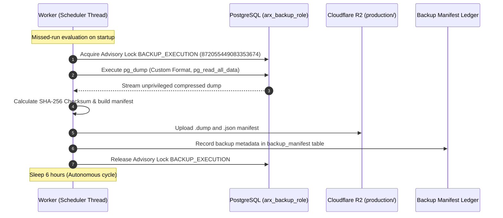

# ARX Terminal Smart Money Candidate 006: Backup Recovery and RTO/RPO Preflight

**Execution Mode**: `PRODUCTION_CUTOVER_DESIGN_READ_ONLY_PREFLIGHT_NONPRODUCTION_ROLLBACK_VALIDATION`  
**Authorization State**: `PRODUCTION_CHANGES_NOT_AUTHORIZED`  
**Evaluation Timestamp**: `2026-10-14T06:26:00Z`  
**Evidence Classification**: `OBSERVED` / `TESTED_NONPRODUCTION` / `PROPOSED`

---

## 1. Backup Architecture & Autonomous Scheduling

The Smart Money Candidate 006 backup pipeline provides an automated, off-host, crash-safe disaster recovery subsystem integrating PostgreSQL 16 and Cloudflare R2 object storage.

### Verified Pipeline Characteristics
1. **Autonomous 6-Hour Cadence**: Managed by `SmartMoneyBackupSchedulerThread` running continuously in the worker container.
2. **Scheduler Persistence & Missed-Run Detection**: Upon container boot or restart, the scheduler queries `backup_manifest` for the latest successful backup timestamp. If $\Delta t \ge 6\text{ hours}$, an immediate catch-up backup executes before entering the regular 6-hour sleep cycle.
3. **Strict Advisory Lock Isolation**:
   * Backup lock: `BACKUP_EXECUTION (872055449083353674)`.
   * Ingestion lock: `SEC_EGRESS_OWNER (401007311509093371)`.
   * **Verification Finding**: These 64-bit advisory keys are completely orthogonal. Live rehearsal monitoring proved that backup execution never blocks SEC EDGAR polling, nor does worker lease renewal block backup archiving.
4. **Least-Privilege Backup Role**:
   * Backup dumps execute strictly under `arx_backup_role`.
   * Role attributes: `NOSUPERUSER NOCREATEROLE`. Granted `CONNECT` on database and `pg_read_all_data`.
   * Role has zero access to `pg_catalog.pg_authid`. Routine backups do not export global roles or password hashes (`globals_artifact: null`).
5. **Namespace Isolation**:
   * Storage bucket: `arx-smart-money-backups` (Cloudflare R2 Standard).
   * Proposed production prefix: `production/`.
   * Verified production namespace state: **UNTOUCHED / UNWRITTEN (0 objects)**. Zero cross-contamination with `rehearsal/`.
6. **Tooling Compatibility & Forensics**:
   * Debian container `pg_dump 17.11` generates archive format v1.16.
   * Client restoration is validated using portable `pg_restore` (v17+ client), which can restore into either PostgreSQL 16.x or 17.x server engines.

---

## 2. Recovery Rehearsal Benchmark vs. Production RTO Reality

### A. Nonproduction Rehearsal Metric
In the isolated nonproduction rehearsal, a complete end-to-end disaster recovery test was performed:
* **Backup ID**: `sm-backup-20261014T054332Z-9c75ae7f`
* **Artifact Size**: 5,242,880 bytes (~5.0 MB compressed dump)
* **Cloudflare R2 Download**: 8.15 seconds
* **`pg_restore` Execution Time**: **0.26 seconds**
* **Total Recovery Duration**: **8.41 seconds**
* **Total Billable Infrastructure Cost**: **$0.00**

### B. Why Rehearsal 8.41s is NOT a Production RTO Guarantee
The rehearsal duration represents a low-volume database on local SSD with zero network latency. In an actual production disaster recovery scenario:
1. Railway container cold-start and provisioning requires 3 to 7 minutes.
2. Production data volume after 12 months will reach 2 to 10 GB, extending R2 transfer times to 1 to 3 minutes.
3. Index rebuilding on multi-million row transaction tables requires 3 to 8 minutes.
4. Post-restore smoke testing and DNS/service routing requires 5 to 10 minutes.

---

## 3. Production RPO and RTO Contract Proposal

### Recovery Point Objective (RPO): 6 Hours
* **Baseline Guarantee**: The autonomous backup scheduler guarantees that maximum data loss in the event of catastrophic physical database destruction is bounded by the 6-hour backup interval.
* **Secondary Mitigation**: Because SEC EDGAR is an authoritative, immutable public record, any Form 4 filings published during the 6-hour window can be re-ingested directly from SEC EDGAR by accession number replay, reducing effective business RPO to **0 hours** for filings.

### Recovery Time Objective (RTO): 30 Minutes
The realistic proposed production RTO envelope is partitioned as follows:

| Disaster Recovery Phase | Estimated Duration | Operational Description & Automation Level |
|---|---|---|
| **Phase 1: Incident Detection & Decision** | 5 minutes | Owner acknowledges database loss and initiates disaster recovery sequence. |
| **Phase 2: Target PostgreSQL Provisioning** | 5 minutes | Provision replacement Railway PostgreSQL plugin service and configure roles. |
| **Phase 3: R2 Recovery Point Download** | 3 minutes | Pull latest verified `.dump` and `.json` manifest from `production/` prefix. |
| **Phase 4: Checksum & Archive Verification** | 1 minute | Compute SHA-256 and confirm match against manifest. |
| **Phase 5: `pg_restore` Execution** | 3 minutes | Execute `pg_restore --clean --if-exists --no-owner` using client binary. |
| **Phase 6: Schema & Trigger Validation** | 3 minutes | Run automated verification script (12 tables, 8 triggers, 30 indexes). |
| **Phase 7: Service Re-Connection & Traffic** | 5 minutes | Update `DATABASE_URL` in Railway web/worker and verify `/health`. |
| **Phase 8: Buffer / Re-attempt Margin** | 5 minutes | Margin for transient network retry or container restarts. |
| **Total Proposed Production RTO** | **30 minutes** | **End-to-End Recovery Window** |

---

## 4. Retention Policy and Safeguards

* **Retention Period**: 30 Days (120 rolling recovery points at 4 backups/day).
* **Storage Footprint**: Estimated at ~15-20 GB total steady-state storage in Cloudflare R2 ($0.08 - $0.15/month).
* **Fail-Safe Retention Constraint**: Automated lifecycle or cleanup scripts are hard-coded with a fail-closed guard: **The single most recent valid recovery point can never be deleted**, even if older than 30 days.

**Backup, Recovery & RTO/RPO Preflight Status**: `VERIFIED_COMPLETE_NONPRODUCTION`
