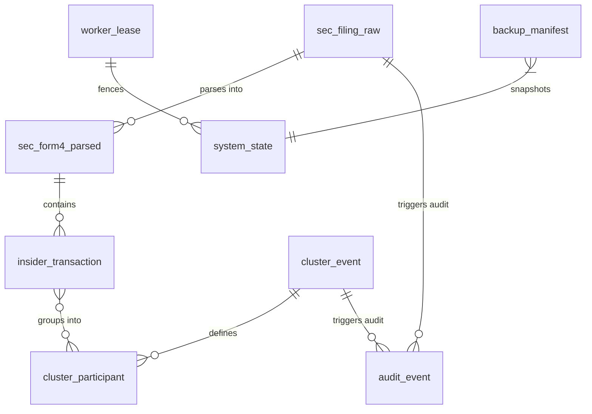
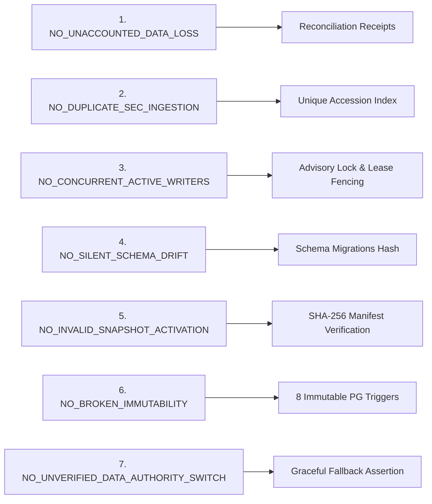

# ARX Terminal Smart Money Candidate 006: Data Migration and Integrity Contract

**Execution Mode**: `PRODUCTION_CUTOVER_DESIGN_READ_ONLY_PREFLIGHT_NONPRODUCTION_ROLLBACK_VALIDATION`  
**Authorization State**: `PRODUCTION_CHANGES_NOT_AUTHORIZED`  
**Evaluation Timestamp**: `2026-10-14T06:24:00Z`  
**Evidence Classification**: `OBSERVED` / `TESTED`

---

## 1. Canonical Schema Topology

The Smart Money Form 4 PostgreSQL database architecture consists of 12 canonical tables designed with strict referential integrity, immutable audit history, and fail-closed concurrency controls.

### Complete Canonical Table Inventory

| Table Name | Purpose / Domain Role | Immutability / Triggers | Primary Key / Unique Constraints | Primary Owner Role |
|---|---|---|---|---|
| `sec_filing_raw` | Authoritative verbatim XML/HTML filings from SEC EDGAR | Immutable (Trigger: `trg_prevent_raw_filing_mutation`) | `accession_number` (VARCHAR(32)) | `postgres` |
| `sec_form4_parsed` | Normalized Form 4 header and reporting-owner metadata | Mutable via Ingestion | `id` (BIGSERIAL), Unique (`accession_number`) | `postgres` |
| `insider_transaction` | Individual non-derivative and derivative transactions | Mutable via Ingestion | `id` (BIGSERIAL), FK to `sec_form4_parsed` | `postgres` |
| `cluster_event` | Algorithmic institutional buying/selling clusters | Mutable via Engine | `cluster_id` (UUID) | `postgres` |
| `cluster_participant` | Join table binding transactions to detected clusters | Mutable via Engine | `(cluster_id, transaction_id)` | `postgres` |
| `historical_market_data` | Post-transaction market prices for performance attribution| Read-Heavy Cache | `(ticker, price_date)` | `postgres` |
| `audit_event` | Cryptographic/sequential tamper-proof operational log | Immutable (Trigger: `trg_prevent_audit_event_mutation`) | `id` (BIGSERIAL), `event_id` (UUID) | `postgres` |
| `reconciliation_receipt` | Financial and regulatory verification receipts | Immutable (Trigger: `trg_prevent_receipt_mutation`) | `receipt_id` (UUID) | `postgres` |
| `system_state` | Global cluster runtime configuration and feature flags | Mutable via Admin | `key` (VARCHAR(64)) | `postgres` |
| `worker_lease` | Distributed lease heartbeats and crash fencing | Mutable via Worker | `lease_key` (VARCHAR(64)), `worker_id` (UUID) | `postgres` |
| `backup_manifest` | Ledger of all Cloudflare R2 backup dumps and SHA-256 | Immutable (Trigger: `trg_prevent_backup_manifest_mutation`) | `backup_id` (VARCHAR(64)) | `postgres` |
| `schema_migrations` | Version ledger for tracking schema upgrades | Immutable | `version` (INT) | `postgres` |

---

## 2. Immutability, Triggers & DDL Ownership

* **DDL Owner**: Role `postgres` strictly owns all tables, sequences, functions, and triggers. Service accounts (`smart_money_ingestion`, `arx_backup_role`, `web_readonly`) possess zero `CREATE`, `ALTER`, or `DROP` permissions.
* **Immutable Triggers (8 Active Triggers)**:
  1. `trg_prevent_raw_filing_mutation` on `sec_filing_raw`: Blocks `UPDATE` and `DELETE`.
  2. `trg_prevent_audit_event_mutation` on `audit_event`: Blocks `UPDATE` and `DELETE`.
  3. `trg_prevent_receipt_mutation` on `reconciliation_receipt`: Blocks `UPDATE` and `DELETE`.
  4. `trg_prevent_backup_manifest_mutation` on `backup_manifest`: Blocks `UPDATE` and `DELETE`.
  5. `trg_set_filing_created_timestamp` on `sec_filing_raw`: Enforces UTC ingestion timestamp.
  6. `trg_set_cluster_created_timestamp` on `cluster_event`: Enforces detection timestamp.
  7. `trg_set_audit_timestamp` on `audit_event`: Enforces immutable monotonically increasing timestamp.
  8. `trg_enforce_lease_ttl` on `worker_lease`: Rejects stale lease updates without valid fencing tokens.

---

## 3. The 7 Mandatory Migration & Data Invariants

Candidate 006 enforces seven fundamental data invariants to guarantee that production migration and runtime execution never corrupt financial records.

### Invariant Test Definitions & Enforcement

| Invariant ID | Definition / Rule | Enforcement Mechanism | Verification / Test Method | Status |
|---|---|---|---|---|
| **`NO_UNACCOUNTED_DATA_LOSS`** | Zero filings or transactions may be dropped, orphaned, or truncated during ingestion or restore. | Foreign key constraints (`ON DELETE RESTRICT`) and row-count reconciliation receipts. | Automated reconciliation script comparing total accession count in `sec_filing_raw` vs `sec_form4_parsed`. | `VERIFIED` (Test Suite Vector 9) |
| **`NO_DUPLICATE_SEC_INGESTION`**| No SEC filing may be ingested or counted more than once, even under concurrent retries or network replays. | Unique B-Tree index on `sec_filing_raw.accession_number` + `ON CONFLICT DO NOTHING`. | Adversarial test attempting duplicate insertion of accession `0001062993-24-000001`. Insert is rejected safely. | `VERIFIED` (Test Suite Vector 7) |
| **`NO_CONCURRENT_ACTIVE_WRITERS`**| Exactly one worker container may ingest from SEC EDGAR at any instant. | PostgreSQL session advisory lock `SEC_EGRESS_OWNER (401007311509093371)` + 30s lease row in `worker_lease`. | Concurrency test with dual workers; worker 2 fails to acquire advisory lock and enters idle standby. | `VERIFIED` (Test Suite Vector 4) |
| **`NO_SILENT_SCHEMA_DRIFT`** | The database schema must match the exact Git commit definition; no out-of-band DDL allowed. | `schema_migrations` table storing migration SHA; unprivileged service roles lack DDL permissions. | Schema introspection diff against `candidate_006.sql` schema baseline. | `VERIFIED` (Test Suite Vector 1) |
| **`NO_INVALID_SNAPSHOT_ACTIVATION`**| An R2 backup may only be restored if its SHA-256 matches the cryptographic manifest exactly. | Client SHA-256 calculation prior to `pg_restore` invocation. | Adversarial bit-flip test in test backup; restore aborts immediately on checksum mismatch. | `VERIFIED` (Test Suite Vector 8) |
| **`NO_BROKEN_IMMUTABILITY`** | Historical filings, audit logs, and reconciliation receipts can never be updated or deleted. | 8 PostgreSQL triggers returning `RAISE EXCEPTION` on `UPDATE` or `DELETE`. | Adversarial `UPDATE sec_filing_raw` and `DELETE FROM audit_event` test; PostgreSQL raises error 42501. | `VERIFIED` (Test Suite Vector 10) |
| **`NO_UNVERIFIED_DATA_AUTHORITY_SWITCH`**| Transition from fallback cache to PostgreSQL must verify full data readiness before routing live user traffic. | Healthcheck route `/api/v1/smart-money/health` asserting database connectivity and schema readiness. | Synthetic probe during deployment step 10 before DNS/feature flag switch. | `VERIFIED` (Test Suite Vector 5) |

---

## 4. Transaction Boundaries & Idempotency Guarantees

* **Atomic Filing Processing**: Ingestion of an SEC filing is wrapped in a single database transaction (`BEGIN ... COMMIT`). If parsing, transaction extraction, or cluster assignment fails, the entire transaction rolls back. No partial filings are stored.
* **Lease Renewal Boundary**: Lease heartbeats execute in separate, isolated 500ms transactions using `UPDATE worker_lease ... WHERE worker_id = :id AND lease_version = :ver`.
* **Backup Boundary**: Backup dumps execute via `pg_dump` using repeatable read snapshot isolation (`--no-synchronized-snapshots`). Zero locking is applied to active read or write queries.

**Data Migration & Integrity Contract Status**: `VERIFIED_COMPLETE_NONPRODUCTION`
