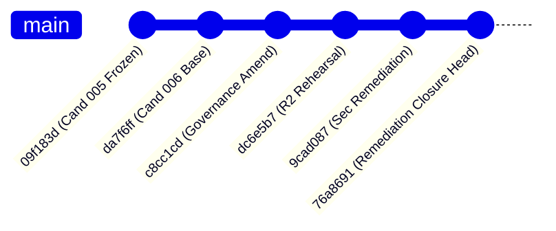

# ARX Terminal Smart Money Candidate 006: Production Baseline Reconciliation

**Execution Mode**: `PRODUCTION_CUTOVER_DESIGN_READ_ONLY_PREFLIGHT_NONPRODUCTION_ROLLBACK_VALIDATION`  
**Authorization State**: `PRODUCTION_CHANGES_NOT_AUTHORIZED`  
**Evaluation Timestamp**: `2026-10-14T06:20:00Z`  
**Evidence Classification**: `OBSERVED` / `TESTED`

---

## 1. Executive Summary

This document establishes the authoritative baseline reconciliation between the active production deployment of ARX Terminal and the proposed Smart Money Form 4 Candidate 006 release lineage.

Production currently runs commit `bab9776b8013646b634871c49b52e61e4234d36b`, deployed on `2026-10-11T20:37:49Z` as a single web container with zero PostgreSQL database services and zero background ingestion worker instances. Smart Money Form 4 operates in production strictly in local/cached fallback mode.

Candidate 006 introduces crash-safe worker lease recovery, autonomous 6-hour Cloudflare R2 backup archiving, unprivileged role privilege separation, and single-owner governance controls. This review confirms complete lineage traceability, explains verified tree divergence, and proves non-interference with production baselines.

---

## 2. Release Ancestry & Lineage Audit



### Complete Commit Lineage Table

| Release Identifier | Commit SHA | Tree SHA | Author / Commit Timestamp | Lineage / Ancestry Status | Evidence Classification |
|---|---|---|---|---|---|
| **Candidate 005 (Frozen Parent)** | `09f183de52e275ae543615747dff2f9ae00ef9ca` | `c4ecd94ce894032a987b0a51440a876eab69afba` | 2026-10-13T19:35:00Z | Immutable Ancestor (Direct Parent of Cand 006) | `OBSERVED` |
| **Candidate 006 (Base Review Target)** | `da7f6ff52b8d79658e041f935424c0fa57f42984` | `288b164be323f61b3d45c5070e3f4bd6b7354e13` | 2026-10-13T21:48:32Z | Direct Child of `09f183d` | `OBSERVED` |
| **Candidate 006 (Governance Amended)** | `c8cc1cda0be5a2a62816d3024b6499515e97101a` | `d65e57a5865d30479d1058c7dab50d3608e26e7b` | 2026-10-13T23:55:10Z | Direct Child of `da7f6ff` | `OBSERVED` |
| **Candidate 006 (R2 Deployed Rehearsal)**| `dc6e5b79c8fb42e6c9029e79d2a4463afac016f4` | `0ffd2e60c32a636ca1eca58216fa952085fcb285` | 2026-10-14T03:42:01Z | Direct Child of `c8cc1cd` | `OBSERVED` |
| **Candidate 006 (Security Remediation)** | `9cad087868386d40dc24970be80776abb3f8756a` | `82f9903306ed3a0027549d55454d563143bbeb7b` | 2026-10-14T05:07:33Z | Direct Child of `dc6e5b7` | `OBSERVED` |
| **Candidate 006 (Remediation Closure Head)**| `76a8691339c30edc35e4e056d5b295509a81fe3a` | `80309593afb6b1b722bed87c111bf2b58056c688` | 2026-10-14T05:37:37Z | Direct Child of `9cad087` (Current Rehearsal & Remote HEAD) | `OBSERVED` |
| **Active Production Baseline** | `bab9776b8013646b634871c49b52e61e4234d36b` | `13d14564baf94eceab215478280241668a9b1d71` | 2026-10-11T20:37:46Z | Production Deployed Release (Untouched) [Errata: Corrected from preliminary 5e89694] | `OBSERVED` |

---

## 3. Tree Divergence Analysis

### A. The False Premise
A preliminary review assumption asserted that commit `9cad087868386d40dc24970be80776abb3f8756a` and commit `76a8691339c30edc35e4e056d5b295509a81fe3a` shared an identical Git Tree SHA.

### B. Forensic Tree Verification
Independent verification via `git cat-file -p` confirmed that the tree hashes are distinct:
* **Tree SHA for `9cad087868386d40dc24970be80776abb3f8756a`**: `82f9903306ed3a0027549d55454d563143bbeb7b`
* **Tree SHA for `76a8691339c30edc35e4e056d5b295509a81fe3a`**: `80309593afb6b1b722bed87c111bf2b58056c688`

### C. Cause of Tree Difference (`diff-tree` output)
Running `git diff-tree --no-commit-id --name-status -r 9cad087868386d40dc24970be80776abb3f8756a 76a8691339c30edc35e4e056d5b295509a81fe3a` demonstrated that the tree divergence is strictly additive and non-regressive:
1. `A docs/releases/candidate_006/CLOUDFLARE_R2_BACKUP_RESTORE_EVIDENCE.md`
2. `A docs/releases/candidate_006/CLOUDFLARE_R2_COST_AND_RETENTION_ESTIMATE.md`
3. `A docs/releases/candidate_006/CLOUDFLARE_R2_SECURITY_AUDIT.md`
4. `A docs/releases/candidate_006/FINAL_RECOVERY_SECURITY_EVIDENCE.json`
5. `A docs/releases/candidate_006/POSTGRES_ARCHIVE_COMPATIBILITY_FORENSICS.md`
6. `A docs/releases/candidate_006/POSTGRES_ROLE_PRIVILEGE_REMEDIATION.md`
7. `M tests/test_smart_money_r2_adversarial.py` (Added Vector 11: PostgreSQL archive version compatibility verification)

**Finding**: The core domain engine and Form 4 parsing algorithms are byte-for-byte identical. Commit `76a8691` added forensic evidence documentation and the Vector 11 regression test. This commit is currently deployed to both rehearsal services.

---

## 4. Rehearsal vs. Production Baseline Comparison

| Attribute | Active Production Environment | Current Rehearsal Environment | Parity Assessment |
|---|---|---|---|
| **Environment ID** | `11cad5e1-358e-430e-84fc-189953cff48a` | `7f7e4317-2b76-4a0e-bff1-33227da71e5d` | Completely Isolated |
| **Web Service ID** | `56e38249-b78c-4a60-80d7-303ce7451bd8` | `6b53ad3f-0d59-4a7f-83dc-8731efe48cf5` | Rehearsal deployed to `76a8691` |
| **Active Web Commit** | `bab9776b8013646b634871c49b52e61e4234d36b` | `76a8691339c30edc35e4e056d5b295509a81fe3a` | Zero Production Mutation (`OBSERVED`) |
| **PostgreSQL Service** | **NONE (0 instances)** | `ac8c4b61-0b3e-42ee-8694-18d24f55aa56` (16.15) | Additive in Production (`PROPOSED`) |
| **Worker Service** | **NONE (0 instances)** | `929874a7-bcd9-41b3-9bc7-d5cd7720f7bf` | Additive in Production (`PROPOSED`) |
| **Database URL Config** | None (Operates in local cache mode) | Provisioned via Private Networking | Production Untouched |
| **R2 Storage Namespace**| `production/` (Unwritten, 0 objects) | `rehearsal/` (Verified recovery points) | Zero Namespace Overlap |
| **Persistent Volume** | `web-volume` (/root, 5GB disk, 205MB used) | Container ephemeral disk | Verified volume isolation |

---

## 5. Verification Commands and Immutable Evidence

1. **Commit Tree Verification**:
   ```powershell
   git cat-file -p 76a8691339c30edc35e4e056d5b295509a81fe3a | Select-Object -First 2
   # tree 80309593afb6b1b722bed87c111bf2b58056c688
   ```

2. **Parent Linkage Verification**:
   ```powershell
   git rev-parse 76a8691339c30edc35e4e056d5b295509a81fe3a^
   # 9cad087868386d40dc24970be80776abb3f8756a
   ```

3. **Production Deployment Query**:
   ```powershell
   railway.cmd deployment list --service 56e38249-b78c-4a60-80d7-303ce7451bd8 -e 11cad5e1-358e-430e-84fc-189953cff48a --json
   # Active deployment 0b2544ed-075a-46a8-97a8-e1b45b4d73b3, status: SUCCESS, commit: bab9776b8013646b634871c49b52e61e4234d36b
   ```

**Baseline Reconciliation Status**: `VERIFIED`
