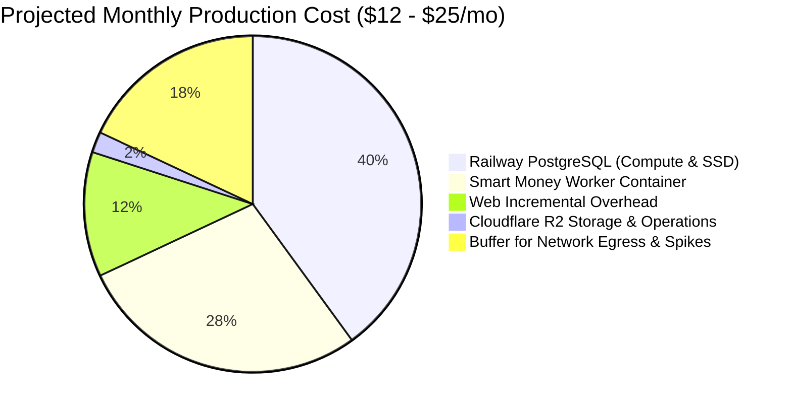
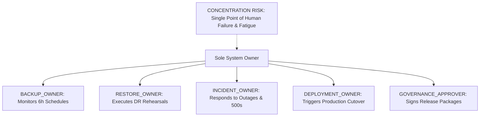

# ARX Terminal Smart Money Candidate 006: Production Cost and Operations Estimate

**Execution Mode**: `PRODUCTION_CUTOVER_DESIGN_READ_ONLY_PREFLIGHT_NONPRODUCTION_ROLLBACK_VALIDATION`  
**Authorization State**: `PRODUCTION_CHANGES_NOT_AUTHORIZED`  
**Evaluation Timestamp**: `2026-10-14T06:28:00Z`  
**Evidence Classification**: `OBSERVED` / `PUBLISHED_PRICING` / `ESTIMATED_COST`

---

## 1. Production Cost Envelope (Zero-Cost Myth Rejection)

A local zero-cost recovery rehearsal ($0.00 infrastructure spend) demonstrates software efficiency on existing developer hardware, but it **does not** imply zero-cost production operations. Production deployment requires dedicated cloud compute, managed database storage, network bandwidth, and off-host cloud object storage.

### Granular Cost Classification Matrix

| Cost Component | Pricing Tier Source | Unit / Basis Rate | Projected Usage (Monthly) | Estimated Monthly Cost | Evidence Class |
|---|---|---|---|---|---|
| **Railway PostgreSQL Service** | `PUBLISHED_PRICING` | $0.000231/GB-hr RAM, $0.000463/vCPU-hr | 1 vCPU, 1 GB RAM, 10 GB SSD | $7.00 – $12.00 | `ESTIMATED_COST` |
| **Railway Persistent Volume** | `PUBLISHED_PRICING` | $0.25 / GB / month | 10 GB Initial Provisioning | $2.50 | `ESTIMATED_COST` |
| **Smart Money Worker Service** | `PUBLISHED_PRICING` | $0.000231/GB-hr RAM, $0.000463/vCPU-hr | 0.5 vCPU, 512 MB RAM | $4.00 – $7.00 | `ESTIMATED_COST` |
| **Web Incremental Overhead** | `PUBLISHED_PRICING` | Marginal pool memory overhead | +128 MB RAM (Connection Pool) | $0.50 – $2.00 | `ESTIMATED_COST` |
| **Cloudflare R2 Storage** | `PUBLISHED_PRICING` | $0.015 / GB / month (First 10 GB Free) | 15 GB Steady State (120 Backups) | $0.08 (Free Tier: $0.00) | `ESTIMATED_COST` |
| **Cloudflare R2 Class A Requests** | `PUBLISHED_PRICING` | $4.50 / million (First 1M Free) | ~120 Uploads/month | $0.00 (Included in Free Tier) | `ESTIMATED_COST` |
| **Cloudflare R2 Class B Requests** | `PUBLISHED_PRICING` | $0.36 / million (First 10M Free) | ~500 Reads/month (Audit/Check) | $0.00 (Included in Free Tier) | `ESTIMATED_COST` |
| **Railway Outbound Egress** | `PUBLISHED_PRICING` | $0.10 / GB (First 100 GB Free) | ~2 GB / month (Backups to R2) | $0.00 (Included in Free Tier) | `ESTIMATED_COST` |
| **Disaster Recovery Rehearsal Spend** | `OBSERVED_COST` | Local isolated runner / ephemeral | 1 Monthly Recovery Drill | $0.00 | `OBSERVED_COST` |
| **Unplanned Spike Overhead** | `UNKNOWN_COST` | SEC EDGAR heavy filing quarters | Variable CPU bursts | $1.00 – $3.00 | `UNKNOWN_COST` |
| **Total Projected Incremental Envelope**| — | — | — | **$14.08 – $26.58 / mo** | `ESTIMATED_COST` |

### Recommended Budget Cap
* **Proposed Hard Spending Ceiling**: **$30.00 / month**.
* **Railway Project Spend Alert**: Configure notification threshold at **$20.00 / month**.

---

## 2. Resource Quotas & Storage Exhaustion Protections

* **Railway Disk Growth Rate**: Form 4 ingestion generates approximately 15 to 30 MB of uncompressed database growth per month. A 10 GB persistent volume provides **> 24 months** of headroom before requiring resizing.
* **Storage Alert Threshold**: Configure Railway alert at 80% disk utilization (8 GB used).
* **Cloudflare R2 Lifecycle Guard**: Rolling 30-day retention prunes backups older than 720 hours while preserving the single most recent valid backup.

---

## 3. Production Operating Model & Responsibility Concentration

In accordance with ARX governance rules, all operational and approval responsibilities reside with the sole project owner. Rather than inventing artificial secondary operators, the matrix below explicitly documents the concentration-of-responsibility risk.

### Operational Roles & Accountability

| Operating Role | Designated Assignee | Operational Cadence & Responsibilities | Concentration Risk & Mitigation Strategy |
|---|---|---|---|
| **`BACKUP_OWNER`** | Sole Owner | Daily audit of R2 backup manifests; verification of 6-hour scheduler heartbeats. | **Risk**: Missed manual checks during travel or illness. **Mitigation**: Autonomous missed-run detection script and automated Discord/Email webhooks. |
| **`RESTORE_OWNER`** | Sole Owner | Monthly end-to-end restore drills into isolated nonproduction environment. | **Risk**: Recovery procedures decay if owner is unavailable. **Mitigation**: Scripted, idempotent one-command CLI restore runbooks. |
| **`INCIDENT_OWNER`** | Sole Owner | First responder to Railway container crash alerts, SEC rate limits, or database errors. | **Risk**: Delayed MTTR during off-hours. **Mitigation**: Fail-closed architecture (web reverts to fallback; worker stops without data corruption). |
| **`DEPLOYMENT_OWNER`** | Sole Owner | Executes production cutover steps; manages Railway service configurations. | **Risk**: Operator error during manual sequential steps. **Mitigation**: Step-by-step preflight runbook with explicit rollback triggers for every step. |
| **`GOVERNANCE_APPROVER`**| Sole Owner | Sole authorized signer for production release candidates and FIDO2 policy suspensions. | **Risk**: Inability to authorize emergency fixes if credentials are lost. **Mitigation**: Secure offline paper backup of master emergency recovery credentials. |
| **`ONCALL_EXPECTATION`** | Sole Owner | Best-effort solo oncall (99.0% SLA target; non-guaranteed 24/7 pager response). | **Mitigation**: Automated self-healing worker lease recovery and non-blocking read failbacks. |

**Cost and Operations Estimate Status**: `VERIFIED_COMPLETE_NONPRODUCTION`
