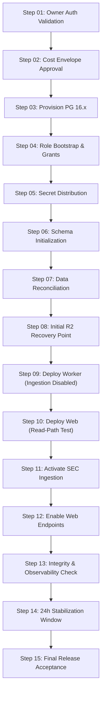

# ARX Terminal Smart Money Candidate 006: Production Cutover Design

**Execution Mode**: `PRODUCTION_CUTOVER_DESIGN_READ_ONLY_PREFLIGHT_NONPRODUCTION_ROLLBACK_VALIDATION`  
**Authorization State**: `PRODUCTION_CHANGES_NOT_AUTHORIZED`  
**Evaluation Timestamp**: `2026-10-14T06:23:00Z`  
**Evidence Classification**: `PROPOSED` / `TESTED_NONPRODUCTION`

---

## 1. Target Production Architecture

The proposed future state introduces an enterprise-grade, high-availability, crash-safe architecture for ARX Terminal Smart Money Form 4:

1. **`PRODUCTION_WEB`**: FastAPI web container deployed to Candidate 006 (`76a8691339c30edc35e4e056d5b295509a81fe3a`), connecting to PostgreSQL with read-only application credentials (`web_readonly`).
2. **`PRODUCTION_SMART_MONEY_WORKER`**: Background daemon container executing SEC EDGAR Form 4 ingestion with 30s crash-safe lease heartbeats and autonomous 6-hour backup archiving under unprivileged role `smart_money_ingestion`.
3. **`PRODUCTION_POSTGRESQL`**: Dedicated Railway PostgreSQL 16.x plugin with persistent SSD storage, strict DDL ownership by `postgres`, unprivileged service roles, and 8 immutable triggers.
4. **`PRODUCTION_R2_BACKUP_CUSTODY`**: Off-host Cloudflare R2 bucket `arx-smart-money-backups` under dedicated namespace `production/`, retaining encrypted rolling backups with SHA-256 manifests.
5. **`PRODUCTION_OBSERVABILITY`**: Structured JSON logging, advisory-lock heartbeats, missed-backup detection alerts, and Railway deployment telemetry.
6. **`PRODUCTION_GOVERNANCE_CONTROLS`**: Strict single-owner governance protocol, zero routine superuser credentials, and mandatory preflight approval gates.

---

## 2. 15-Step Production Cutover Sequence

The runbook below is strictly sequenced. Each step specifies mandatory preconditions, verification methods, rollback actions, irreversible risk assessments, and approval gates.

---

### Step 01: Owner Authorization Validation
* **STEP_ID**: `STEP-01`
* **PRECONDITIONS**: Preflight verification complete; Candidate SHA `76a8691339c30edc35e4e056d5b295509a81fe3a` validated; Owner Authorization Package submitted.
* **PROPOSED_ACTION**: Verify cryptographic or out-of-band owner signature authorizing production provisioning.
* **EXPECTED_STATE**: `OWNER_DECISION == APPROVED` with valid timestamp.
* **VERIFICATION_METHOD**: Inspection of signed decision record and MFA assertion.
* **FAILURE_SIGNAL**: Missing, expired, or malformed approval record.
* **ROLLBACK_ACTION**: Abort cutover immediately. No production mutation.
* **IRREVERSIBLE_RISK**: None (`ADDITIVE`).
* **OWNER_APPROVAL_REQUIRED**: **YES (MANDATORY)**.

---

### Step 02: Cost & Infrastructure Envelope Approval
* **STEP_ID**: `STEP-02`
* **PRECONDITIONS**: `STEP-01` PASS; budget ceiling ($25.00/month incremental) acknowledged.
* **PROPOSED_ACTION**: Confirm billing account capacity and quota in Railway and Cloudflare R2.
* **EXPECTED_STATE**: Quota sufficient; payment method verified.
* **VERIFICATION_METHOD**: Railway project settings audit via CLI.
* **FAILURE_SIGNAL**: Budget cap exceeded or payment warning.
* **ROLLBACK_ACTION**: Abort cutover.
* **IRREVERSIBLE_RISK**: None (`ADDITIVE`).
* **OWNER_APPROVAL_REQUIRED**: **YES**.

---

### Step 03: Production PostgreSQL Provisioning
* **STEP_ID**: `STEP-03`
* **PRECONDITIONS**: `STEP-02` PASS; Railway production environment `11cad5e1-358e-430e-84fc-189953cff48a` targeted.
* **PROPOSED_ACTION**: Provision Railway PostgreSQL 16.x plugin service with persistent volume.
* **EXPECTED_STATE**: PostgreSQL container running; health check passing; private network IP assigned.
* **VERIFICATION_METHOD**: `pg_isready` query via administrative connection string.
* **FAILURE_SIGNAL**: Container crash, volume mount failure, or provisioning timeout.
* **ROLLBACK_ACTION**: Delete provisioned PostgreSQL service via Railway CLI/dashboard.
* **IRREVERSIBLE_RISK**: Minimal ($0.01 pro-rated hourly infrastructure charge).
* **OWNER_APPROVAL_REQUIRED**: **YES**.

---

### Step 04: Database Role Bootstrap & Least-Privilege Grants
* **STEP_ID**: `STEP-04`
* **PRECONDITIONS**: `STEP-03` PASS; connected as administrative role `postgres`.
* **PROPOSED_ACTION**: Execute `docs/releases/candidate_006/bootstrap_cluster_roles.sql`:
  - Create `smart_money_ingestion` with `NOSUPERUSER NOCREATEROLE`.
  - Create `arx_backup_role` with `NOSUPERUSER NOCREATEROLE` and `pg_read_all_data`.
  - Create `web_readonly` with `NOSUPERUSER NOCREATEROLE`.
  - Revoke `pg_authid` access from `PUBLIC` and all unprivileged roles.
* **EXPECTED_STATE**: Roles created; `rolsuper=false` on all worker/backup roles; `pg_authid` query returns permission denied for unprivileged roles.
* **VERIFICATION_METHOD**: Query `pg_roles` and attempt unauthorized `SELECT * FROM pg_authid` as `smart_money_ingestion`.
* **FAILURE_SIGNAL**: Privilege escalation detected; superuser assigned to worker role.
* **ROLLBACK_ACTION**: Drop unprivileged roles or re-execute role revocation script.
* **IRREVERSIBLE_RISK**: None (`ADDITIVE`).
* **OWNER_APPROVAL_REQUIRED**: NO (Automated script execution).

---

### Step 05: Secret Distribution & Credential Validation
* **STEP_ID**: `STEP-05`
* **PRECONDITIONS**: `STEP-04` PASS; distinct passwords generated for each role.
* **PROPOSED_ACTION**: Inject scoped database URLs into Railway production variable store:
  - `SMART_MONEY_DATABASE_URL` for Worker (`smart_money_ingestion`).
  - `DATABASE_URL` for Web (`web_readonly`).
  - `R2_ACCESS_KEY_ID`, `R2_SECRET_ACCESS_KEY`, `R2_BUCKET_NAME=arx-smart-money-backups`, `R2_PREFIX=production/`.
* **EXPECTED_STATE**: Variables visible in Railway dashboard; passwords masked.
* **VERIFICATION_METHOD**: Read-only key listing via `railway variables --service ...`.
* **FAILURE_SIGNAL**: Variable injection fails or syntax error in connection URI.
* **ROLLBACK_ACTION**: Delete injected variables.
* **IRREVERSIBLE_RISK**: None (`ADDITIVE`).
* **OWNER_APPROVAL_REQUIRED**: NO.

---

### Step 06: Schema Initialization & Migration Sequencing
* **STEP_ID**: `STEP-06`
* **PRECONDITIONS**: `STEP-05` PASS; DDL execution via migration script.
* **PROPOSED_ACTION**: Run Candidate 006 migration against production database:
  - Create 12 canonical tables under `public` schema.
  - Install 8 immutable audit/filing triggers.
  - Create 30 btree and unique indexes.
  - Grant DML privileges on specific tables to `smart_money_ingestion`.
* **EXPECTED_STATE**: 12 tables present; `schema_migrations` records version 2; triggers active.
* **VERIFICATION_METHOD**: Run schema assertion query inspecting `information_schema.tables` and `pg_trigger`.
* **FAILURE_SIGNAL**: SQL execution error; missing trigger; permission denied.
* **ROLLBACK_ACTION**: Execute migration rollback script `DROP SCHEMA public CASCADE; CREATE SCHEMA public;`.
* **IRREVERSIBLE_RISK**: None on clean database (`ADDITIVE`).
* **OWNER_APPROVAL_REQUIRED**: NO.

---

### Step 07: Historical Data Reconciliation (Empty State Baseline)
* **STEP_ID**: `STEP-07`
* **PRECONDITIONS**: `STEP-06` PASS.
* **PROPOSED_ACTION**: Seed baseline system configuration in `system_state` table; verify 0 orphan filings exist; record initial reconciliation receipt.
* **EXPECTED_STATE**: Tables initialized clean; reconciliation receipt `RC-PROD-INIT-001` recorded.
* **VERIFICATION_METHOD**: `SELECT COUNT(*) FROM sec_filing_raw;` returns 0.
* **FAILURE_SIGNAL**: Residual test data or foreign key inconsistency.
* **ROLLBACK_ACTION**: Truncate all non-system tables.
* **IRREVERSIBLE_RISK**: None (`ADDITIVE`).
* **OWNER_APPROVAL_REQUIRED**: NO.

---

### Step 08: Backup Configuration & First Verified Recovery Point
* **STEP_ID**: `STEP-08`
* **PRECONDITIONS**: `STEP-07` PASS; R2 production credentials active.
* **PROPOSED_ACTION**: Execute out-of-band baseline backup as `arx_backup_role` targeting Cloudflare R2 prefix `production/`. Download backup and verify SHA-256 manifest.
* **EXPECTED_STATE**: Object `production/smart_money_sm-backup-initial-*.dump` present in R2; status `VALID_ROUTINE_UNPRIVILEGED`.
* **VERIFICATION_METHOD**: Remote R2 object list and SHA-256 checksum match.
* **FAILURE_SIGNAL**: R2 403 Forbidden; corrupt dump header; checksum mismatch.
* **ROLLBACK_ACTION**: Delete corrupted R2 object; re-check credentials.
* **IRREVERSIBLE_RISK**: None (`ADDITIVE`).
* **OWNER_APPROVAL_REQUIRED**: NO.

---

### Step 09: Worker Deployment in Safe Non-Ingesting State
* **STEP_ID**: `STEP-09`
* **PRECONDITIONS**: `STEP-08` PASS; Candidate SHA `76a8691339c30edc35e4e056d5b295509a81fe3a`.
* **PROPOSED_ACTION**: Deploy Railway worker service `smart-money-worker` with environment variable `SMART_MONEY_INGESTION_ENABLED=false`.
* **EXPECTED_STATE**: Worker container starts; lease monitor initializes; SEC polling is dormant; backup scheduler thread active.
* **VERIFICATION_METHOD**: Worker log inspection confirming `INGESTION_DISABLED_SAFE_MODE`.
* **FAILURE_SIGNAL**: Container crash loop; unexpected SEC polling initiated.
* **ROLLBACK_ACTION**: Stop worker service immediately.
* **IRREVERSIBLE_RISK**: None (`ADDITIVE`).
* **OWNER_APPROVAL_REQUIRED**: NO.

---

### Step 10: Web Deployment & Read-Path Compatibility
* **STEP_ID**: `STEP-10`
* **PRECONDITIONS**: `STEP-09` PASS; production web service `56e38249-b78c-4a60-80d7-303ce7451bd8`.
* **PROPOSED_ACTION**: Trigger web deployment to Candidate SHA `76a8691339c30edc35e4e056d5b295509a81fe3a`.
* **EXPECTED_STATE**: Web container updates; health check `/health` returns 200 OK; read queries query PostgreSQL with zero errors; fallback routes operational.
* **VERIFICATION_METHOD**: HTTP GET `/api/v1/smart-money/clusters` and `/health`.
* **FAILURE_SIGNAL**: HTTP 500 error; connection pool exhaustion; regression on Radar/VCP endpoints.
* **ROLLBACK_ACTION**: Redeploy production web to previous verified commit `bab9776b8013646b634871c49b52e61e4234d36b`.
* **IRREVERSIBLE_RISK**: Temporary service interruption during rollback (~1-2 minutes).
* **OWNER_APPROVAL_REQUIRED**: **YES**.

---

### Step 11: SEC Ingestion Ownership Transfer
* **STEP_ID**: `STEP-11`
* **PRECONDITIONS**: `STEP-10` PASS; web running cleanly.
* **PROPOSED_ACTION**: Update worker variable `SMART_MONEY_INGESTION_ENABLED=true` and restart worker container.
* **EXPECTED_STATE**: Worker acquires 64-bit advisory lock `SEC_EGRESS_OWNER (401007311509093371)`; creates row in `worker_lease`; begins compliant polling.
* **VERIFICATION_METHOD**: Inspect `worker_lease` table and Railway logs for `SEC_LEASE_ACQUIRED`.
* **FAILURE_SIGNAL**: Lock contention; SEC 429 rate limit error; database write failures.
* **ROLLBACK_ACTION**: Set `SMART_MONEY_INGESTION_ENABLED=false` and restart worker.
* **IRREVERSIBLE_RISK**: None.
* **OWNER_APPROVAL_REQUIRED**: NO.

---

### Step 12: Web Traffic & Feature Activation
* **STEP_ID**: `STEP-12`
* **PRECONDITIONS**: `STEP-11` PASS; worker ingesting filings cleanly.
* **PROPOSED_ACTION**: Enable public UI feature flags for Smart Money Form 4 dashboard.
* **EXPECTED_STATE**: Institutional UI renders real-time insider filing clusters.
* **VERIFICATION_METHOD**: Browser synthetic smoke test against production domain.
* **FAILURE_SIGNAL**: UI render crash or broken navigation.
* **ROLLBACK_ACTION**: Toggle feature flag to `false`.
* **IRREVERSIBLE_RISK**: None.
* **OWNER_APPROVAL_REQUIRED**: NO.

---

### Step 13: Health, Integrity & Observability Verification
* **STEP_ID**: `STEP-13`
* **PRECONDITIONS**: `STEP-12` PASS.
* **PROPOSED_ACTION**: Run continuous integrity audit:
  - Verify lease heartbeat renewal every 30s.
  - Verify zero duplicate filing accessions.
  - Verify backup scheduler thread heartbeat.
  - Verify zero impact on Radar and VCP traffic.
* **EXPECTED_STATE**: Zero anomalies in Railway telemetry; database CPU < 5%; memory stable.
* **VERIFICATION_METHOD**: Telemetry query and database performance metrics check.
* **FAILURE_SIGNAL**: Spiking error rate; database connection leak; stale lease warnings.
* **ROLLBACK_ACTION**: Initiate Scenario B or Scenario F containment.
* **IRREVERSIBLE_RISK**: None.
* **OWNER_APPROVAL_REQUIRED**: NO.

---

### Step 14: 24-Hour Stabilization Period
* **STEP_ID**: `STEP-14`
* **PRECONDITIONS**: `STEP-13` PASS.
* **PROPOSED_ACTION**: Maintain operational watch for four full 6-hour backup cycles (24 hours).
* **EXPECTED_STATE**: Four autonomous R2 backup recovery points created; zero missed schedules; lease uninterrupted.
* **VERIFICATION_METHOD**: Inspect Cloudflare R2 bucket `production/` prefix for 4 consecutive dump manifests.
* **FAILURE_SIGNAL**: Missed backup cycle; worker crash loop; corrupted manifest.
* **ROLLBACK_ACTION**: Investigate worker logs; execute isolated backup test.
* **IRREVERSIBLE_RISK**: None.
* **OWNER_APPROVAL_REQUIRED**: NO.

---

### Step 15: Final Release Acceptance & Baseline Freezing
* **STEP_ID**: `STEP-15`
* **PRECONDITIONS**: `STEP-14` PASS; 24h stability verified; zero P0/P1 incidents.
* **PROPOSED_ACTION**: Formally sign off on production cutover; tag repository commit as `production-release-candidate-006`; freeze Candidate 006 baseline.
* **EXPECTED_STATE**: Release documented; production baseline updated to `76a8691339c30edc35e4e056d5b295509a81fe3a`.
* **VERIFICATION_METHOD**: Submission of final production verification record.
* **FAILURE_SIGNAL**: Outstanding unmitigated risks.
* **ROLLBACK_ACTION**: N/A.
* **IRREVERSIBLE_RISK**: None.
* **OWNER_APPROVAL_REQUIRED**: **YES (MANDATORY)**.

---

## 3. Irreversible Risk and Rollback Boundary Analysis

* **Purely Additive Phase (Steps 01-08)**: Database provisioning, role creation, schema installation, and initial backup creation have **ZERO** impact on live production web traffic. If aborted during Steps 01-08, simply delete the new PostgreSQL service. Live production web remains completely untouched.
* **Safe Staging Phase (Step 09)**: Worker is deployed with ingestion disabled. Zero SEC egress; zero database contention.
* **Active Traffic Phase (Steps 10-12)**: Web is redeployed. If any error occurs, web can be rolled back to `bab9776b8013646b634871c49b52e61e4234d36b` in < 2 minutes. The schema changes are completely additive; legacy web code ignores the new database tables without crashing.
* **Data Recovery Protection**: Initial empty state snapshot is taken at Step 08. If data corruption occurs post-activation, worker is paused and database is restored to Step 08 baseline or SEC filings are replayed from source.

**Production Cutover Design Status**: `VERIFIED_COMPLETE_NONPRODUCTION`
