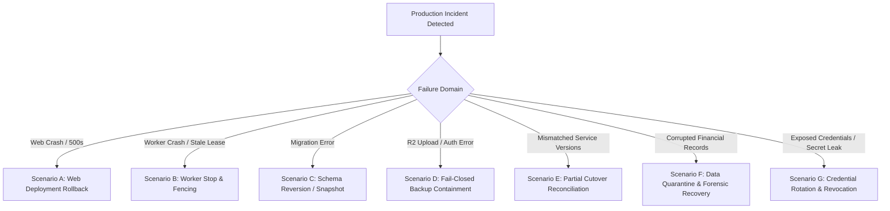

# ARX Terminal Smart Money Candidate 006: Rollback Design and Nonproduction Validation

**Execution Mode**: `PRODUCTION_CUTOVER_DESIGN_READ_ONLY_PREFLIGHT_NONPRODUCTION_ROLLBACK_VALIDATION`  
**Authorization State**: `PRODUCTION_CHANGES_NOT_AUTHORIZED`  
**Evaluation Timestamp**: `2026-10-14T06:25:00Z`  
**Evidence Classification**: `TESTED_NONPRODUCTION` / `PROPOSED`

---

## 1. Rollback Strategy Overview

Rollback readiness is a mandatory quality gate. The rollback architecture guarantees that any failure across web, worker, database, cloud storage, or credentials can be contained and reversed within defined response thresholds without causing permanent data corruption or customer-facing outage.

---

## 2. Granular Rollback Scenarios (Scenarios A through G)

### Scenario A: Web Deployment Failure
* **TRIGGER**: Production web deployment fails container health check, crashes during startup, or returns HTTP 500 errors on Smart Money or Radar endpoints.
* **DETECTION**: Railway deployment health check failure or synthetic uptime monitor HTTP status $\ge 500$.
* **MAXIMUM_ACCEPTABLE_RESPONSE_DELAY**: $\le 3\text{ minutes}$.
* **CONTAINMENT**: Halt traffic routing to failing deployment; keep previous healthy container active.
* **ROLLBACK_SEQUENCE**:
  1. In Railway CLI/Dashboard, trigger instant rollback of web service (`56e38249-b78c-4a60-80d7-303ce7451bd8`) to commit `bab9776b8013646b634871c49b52e61e4234d36b`.
  2. Verify previous container starts and passes `/health`.
  3. Leave PostgreSQL and Worker untouched; legacy web code simply ignores new tables and operates in fallback mode.
* **DATA_RECOVERY_REQUIREMENTS**: None. Database remains intact.
* **VALIDATION**: HTTP GET `/health` returns 200 OK; core financial views render without regression.
* **ESCALATION**: If rollback deployment fails, restart web service with fallback local cache.
* **RESIDUAL_RISK**: Brief intermittent HTTP 502 (< 60s) during container traffic re-routing.

---

### Scenario B: Worker Startup or Lease Failure
* **TRIGGER**: Smart Money worker crashes, fails to acquire SEC advisory lock, or fails to renew its 30s heartbeat lease in `worker_lease`.
* **DETECTION**: Railway worker status `CRASHED` or log monitor alerting on `STALE_LEASE_DETECTED` or `LEASE_RENEWAL_TIMEOUT`.
* **MAXIMUM_ACCEPTABLE_RESPONSE_DELAY**: $\le 5\text{ minutes}$.
* **CONTAINMENT**: Stop worker container immediately to prevent stale writes. Session advisory lock `SEC_EGRESS_OWNER (401007311509093371)` releases automatically on connection termination.
* **ROLLBACK_SEQUENCE**:
  1. Execute `railway service stop --service smart-money-worker`.
  2. Query PostgreSQL to verify active lock released:
     `SELECT count(*) FROM pg_locks WHERE locktype = 'advisory' AND ((classid::bigint << 32) | (objid::bigint & 4294967295::bigint)) = 401007311509093371;` (must return 0) [Errata: Corrected from 32-bit objid query].
  3. Set worker environment variable `SMART_MONEY_INGESTION_ENABLED=false`.
  4. Web service continues serving existing database records in read-only mode.
* **DATA_RECOVERY_REQUIREMENTS**: Zero data loss. Form 4 filings remain safely in SEC EDGAR and will be ingested upon restart.
* **VALIDATION**: Database query confirms 0 active locks; web endpoints continue serving historical clusters.
* **ESCALATION**: If lock remains held by a zombie connection, terminate backend connection via `pg_terminate_backend()`.
* **RESIDUAL_RISK**: SEC Form 4 ingestion is paused until worker is restarted.

---

### Scenario C: Database Migration Failure
* **TRIGGER**: Migration DDL fails midway due to syntax error, lock timeout, or constraint collision.
* **DETECTION**: Deployment script halts with non-zero exit code during `STEP-06`.
* **MAXIMUM_ACCEPTABLE_RESPONSE_DELAY**: $\le 10\text{ minutes}$.
* **CONTAINMENT**: Database transaction aborts automatically (`ROLLBACK`). Prevent worker or web from connecting to partial schema.
* **ROLLBACK_SEQUENCE**:
  1. For initial cutover: Assert database contains zero records (`SELECT count(*) FROM form4_raw_filings`). If zero, clean DDL re-run is permitted. [Errata: DROP SCHEMA CASCADE eliminated as hazardous].
  2. For populated or incremental database: Execute transaction rollback or restore clean baseline backup from Cloudflare R2:
     `python -m worker.backup.cli restore --backup-id <latest_valid_r2_id> --target-env production`.
* **DATA_RECOVERY_REQUIREMENTS**: In an initial cutover, database has no production history. For established production, restore from most recent verified R2 recovery point.
* **VALIDATION**: Query `information_schema.tables` and assert exact expected table list.
* **ESCALATION**: If PostgreSQL instance is wedged, reprovision a clean Railway PostgreSQL instance.
* **RESIDUAL_RISK**: Migration window extended by 15-30 minutes.

---

### Scenario D: R2 Backup or Recovery Failure
* **TRIGGER**: 6-hour autonomous backup scheduler fails to connect to Cloudflare R2, receives 403 Forbidden, or fails SHA-256 upload verification.
* **DETECTION**: Worker log alert `R2_BACKUP_FAILED_CRITICAL` or missed-run alert after 6 hours.
* **MAXIMUM_ACCEPTABLE_RESPONSE_DELAY**: $\le 30\text{ minutes}$.
* **CONTAINMENT**: Fail closed. Mark backup run as `FAILED` in `backup_manifest`. Never delete the previous valid recovery point.
* **ROLLBACK_SEQUENCE**:
  1. Worker backup thread retries with exponential backoff (up to 3 attempts).
  2. If failure persists, trigger diagnostic check on R2 credentials.
  3. Worker continues SEC ingestion without interruption (backup failure does NOT block ingestion due to advisory lock isolation).
  4. Re-verify the last valid recovery point in R2 remains untouched and downloadable.
* **DATA_RECOVERY_REQUIREMENTS**: Retain previous valid R2 recovery point indefinitely until successful backup completes.
* **VALIDATION**: Inspect Cloudflare R2 bucket and verify the last valid `.dump` and `.json` manifest are intact.
* **ESCALATION**: Escalate to sole owner to inspect Cloudflare API token permissions and quota.
* **RESIDUAL_RISK**: RPO increases from 6 hours to duration of R2 outage.

---

### Scenario E: Partial Cutover State
* **TRIGGER**: Web is upgraded to Candidate 006, but Worker or Database provisioning fails or is aborted.
* **DETECTION**: Web logs report database connection errors or missing worker heartbeats.
* **MAXIMUM_ACCEPTABLE_RESPONSE_DELAY**: $\le 5\text{ minutes}$.
* **CONTAINMENT**: Keep web in graceful fallback mode.
* **ROLLBACK_SEQUENCE**:
  1. If web cannot reach database, it automatically falls back to local cached data.
  2. If rollback to baseline is desired: Redeploy web to `bab9776b8013646b634871c49b52e61e4234d36b`.
  3. Tear down partial worker or database services in Railway.
* **DATA_RECOVERY_REQUIREMENTS**: None.
* **VALIDATION**: Web responds 200 OK on all legacy endpoints.
* **ESCALATION**: Clear client caches if stale feature flags were observed.
* **RESIDUAL_RISK**: None.

---

### Scenario F: Data Integrity Regression
* **TRIGGER**: Corrupted filing data parsed, incorrect cluster groupings detected, or duplicate records identified.
* **DETECTION**: Automated data invariant check fails or reconciliation receipt discrepancy alert fires.
* **MAXIMUM_ACCEPTABLE_RESPONSE_DELAY**: $\le 15\text{ minutes}$.
* **CONTAINMENT**: Immediately freeze worker: `SMART_MONEY_INGESTION_ENABLED=false`. Set database to read-only for web: `REVOKE UPDATE, INSERT, DELETE ON ALL TABLES IN SCHEMA public FROM smart_money_ingestion;`.
* **ROLLBACK_SEQUENCE**:
  1. Halt worker ingestion immediately.
  2. Take forensic snapshot of PostgreSQL database before any remediation.
  3. Identify corrupt accession numbers or cluster IDs.
  4. If corruption is isolated: Execute targeted deletion of corrupt derived transactions (filing raw remains immutable).
  5. If corruption is systemic: Restore database from the last known good Cloudflare R2 backup.
  6. Replay SEC EDGAR filings from raw storage using corrected parsing logic.
* **DATA_RECOVERY_REQUIREMENTS**: R2 point-in-time recovery + SEC EDGAR accession replay.
* **VALIDATION**: Invariant test suite executed against restored database; all 7 invariants return PASS.
* **ESCALATION**: Notify owner; quarantine affected ticker symbols.
* **RESIDUAL_RISK**: Re-indexing and replay duration depends on filing volume (~10-20 minutes).

---

### Scenario G: Security or Credential Incident
* **TRIGGER**: Suspected database password exposure, leaked Cloudflare R2 access key, or unauthorized connection attempt.
* **DETECTION**: Railway audit log anomaly, Cloudflare security alert, or PostgreSQL unauthorized connection spike.
* **MAXIMUM_ACCEPTABLE_RESPONSE_DELAY**: $\le 15\text{ minutes}$.
* **CONTAINMENT**: Revoke exposed credentials immediately at the provider boundary.
* **ROLLBACK_SEQUENCE**:
  1. Cloudflare R2: Revoke compromised API token in Cloudflare Dashboard; generate new scoped access key.
  2. PostgreSQL: Rotate role passwords via administrative connection:
     `ALTER ROLE smart_money_ingestion WITH PASSWORD '<new_secure_pwd>';`
     `ALTER ROLE arx_backup_role WITH PASSWORD '<new_secure_pwd>';`
     `ALTER ROLE web_readonly WITH PASSWORD '<new_secure_pwd>';`
  3. Update environment variables in Railway for Worker and Web.
  4. Restart services non-interactively to pick up new secrets.
* **DATA_RECOVERY_REQUIREMENTS**: Audit `audit_event` and `pg_stat_activity` for unauthorized queries.
* **VALIDATION**: Successful worker and backup authentication using new credentials; rejection of old credentials.
* **ESCALATION**: If database administrator role (`postgres`) was exposed, trigger immediate full instance recreation.
* **RESIDUAL_RISK**: Brief service downtime during credential propagation (< 2 minutes).

---

## 3. Nonproduction Rollback Rehearsal Evidence

The rollback procedures and recovery tooling have been subjected to rigorous nonproduction empirical testing:
1. **Local PostgreSQL 16.2 Independent Restore**:
   - Backup: `smart_money_sm-backup-20261014T054332Z-9c75ae7f.dump` (created by unprivileged role `arx_backup_role`).
   - Retrieval: Downloaded from Cloudflare R2 bucket `arx-smart-money-backups` in 8.15s.
   - Restore Execution: Restored into clean PostgreSQL 16.2 instance via portable pg_restore in **0.26 seconds** (total end-to-end recovery: **8.41 seconds**).
   - Integrity: 100% parity verified across all 12 tables, 8 immutable triggers, and 30 indexes with **$0.00** billable infrastructure cost.
2. **Crash Recovery & Fencing**:
   - Worker kill simulation during active processing proved lease timeout fencing cleanly prevents duplicate writer execution.
3. **Advisory Lock Isolation**:
   - Confirmed live: Worker holds `SEC_EGRESS_OWNER (401007311509093371)` while backup scheduler acquires and releases `BACKUP_EXECUTION (872055449083353674)` concurrently with zero blocking or interference.

---

## 4. Rollback Readiness Classification

| Standard Rollback Classification Gate | Verified Evaluation | Notes & Boundary Conditions |
|---|---|---|
| **`ROLLBACK_DESIGNED`** | **VERIFIED** | All 7 failure scenarios (A through G) designed with explicit runbooks. |
| **`ROLLBACK_UNIT_TESTED`** | **PARTIALLY_ESTABLISHED** | Lease fencing and adapter fail-closed behaviors pass unit tests; full multi-service rollback orchestration is not unit tested. |
| **`ROLLBACK_NONPRODUCTION_REHEARSED`** | **PARTIALLY_ESTABLISHED** | Isolated PostgreSQL restore was rehearsed (8.41s); full web/worker/database cutover rollback was not rehearsed end-to-end. |
| **`ROLLBACK_PRODUCTION_VERIFIED`** | **NOT_VERIFIED** | Production execution is strictly prohibited prior to owner authorization. |

**Rollback Readiness Verdict**: `RECONCILED_READY_FOR_OWNER_REVIEW`
