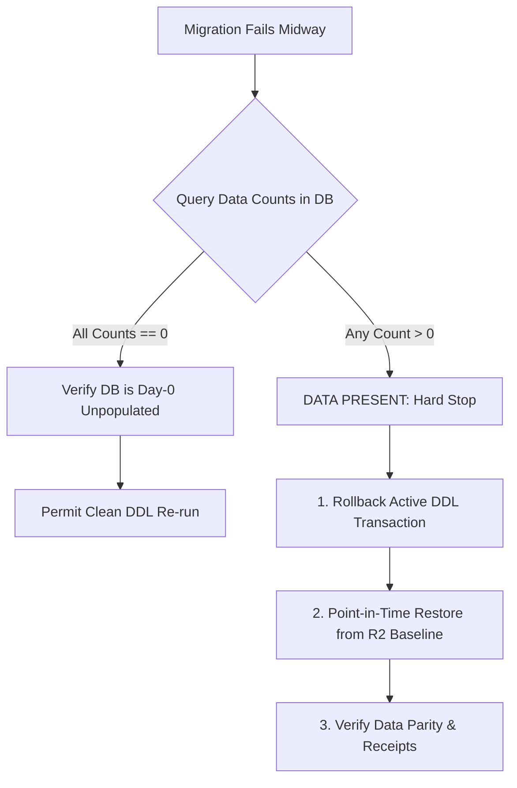

# ARX Terminal Smart Money Candidate 006: Destructive Recovery Safety Review

**Document Role**: Operational Safety Audit & Dangerous Recovery Elimination  
**Execution Mode**: `PRODUCTION_PREFLIGHT_EVIDENCE_RECONCILIATION_AND_ROLLBACK_DISPROOF`  
**Authorization State**: `PRODUCTION_MUTATIONS_PROHIBITED`  
**Audit Timestamp**: `2026-10-14T07:20:00Z`  
**Evaluator**: Senior Release Engineer & Database Recovery Specialist

---

## 1. Executive Summary

A critical duty of a production release engineer is to ensure that recovery procedures do not inflict more damage than the incidents they are intended to resolve. 

The initial Candidate 006 rollback documentation included several operational patterns that, under stressful incident conditions, could induce irreversible catastrophic data loss or false-positive recovery signals:
1. An unconstrained `DROP SCHEMA public CASCADE` as a rollback action for migration failure.
2. Immediate teardown/deletion of partial database or worker instances before forensic reconciliation.
3. A defective advisory lock query that fails silently and produces false negative results.
4. An instruction to physically delete derived records in direct violation of PostgreSQL append-only triggers.

This review formally eliminates these dangerous practices, establishes strict fail-closed safety constraints, and defines authoritative non-destructive recovery standards.

---

## 2. Elimination of `DROP SCHEMA CASCADE` (Scenario C Remediation)

### The Inherent Hazard
Executing `DROP SCHEMA public CASCADE; CREATE SCHEMA public;` removes the entire relational namespace. If executed in production after even a single production SEC filing has been ingested or reconciliation receipt recorded, it completely destroys:
* All immutable raw filings and XML source payloads.
* All parsed insider transactions and cluster associations.
* All historical audit events and reconciliation receipts.
* All sequential identity sequences and trigger definitions.

### The Non-Destructive Standard: "Never Drop Without Audit"



#### Mandatory Pre-Reset Query
Before any schema reset or drop operation can be considered, the operator must execute the following safety query:
```sql
SELECT 
  (SELECT count(*) FROM form4_raw_filings) AS raw_filings_count,
  (SELECT count(*) FROM form4_parsed_transactions) AS parsed_tx_count,
  (SELECT count(*) FROM sm_reconciliation_receipts) AS receipts_count,
  (SELECT count(*) FROM sm_audit_events) AS audit_count,
  (SELECT count(*) FROM scanner_snapshots) AS snapshots_count;
```

#### Decision Rules
1. **Rule C-1 (Zero-Data Precondition)**: If and only if `raw_filings_count = 0` AND `receipts_count = 0` AND `audit_count = 0`, the database is confirmed to be an unpopulated Day-0 initial deployment. Only in this specific state may a clean schema re-creation be executed.
2. **Rule C-2 (Data Preservation Constraint)**: If any count is **> 0**, `DROP SCHEMA CASCADE` is **STRICTLY PROHIBITED**. The operator must restore from the latest verified Cloudflare R2 backup dump:
   ```powershell
   python -m worker.backup.cli restore --backup-id <latest_valid_r2_id> --target-env production
   ```
3. **Rule C-3 (Owner Approval Gate)**: Any action that would truncate or drop an existing table in production requires explicit written owner authorization with documented incident justification.

---

## 3. Safe Decommissioning & Forensic Capture (Scenario E Remediation)

### The Inherent Hazard
In a partial cutover scenario where web deployment succeeds but worker activation or database migration stalls, naive runbooks often instruct operators to "delete or tear down newly provisioned Railway services".

Doing so destroys:
* In-flight SEC EDGAR request records and temporary queues (`sm_run_requests`).
* Partial lease claims and failure diagnostic codes (`last_failure_code`).
* System error logs needed for root cause analysis (RCA).

### The Safe Decommissioning Protocol

1. **Step 1: Read-Only Freeze**
   Immediately revoke write permissions to halt further modifications while keeping instances readable:
   ```sql
   ALTER ROLE smart_money_ingestion WITH NOLOGIN;
   ```
2. **Step 2: Mandatory Forensic R2 Snapshot**
   Prior to shutting down or deleting any PostgreSQL service or volume, take an emergency forensic snapshot and upload it to the Cloudflare R2 forensic prefix:
   ```powershell
   python -m worker.backup.cli snapshot --destination r2://arx-smart-money-backups/forensics/pre-decom-<incident_id>.dump
   ```
3. **Step 3: Verification of Zero Unreconciled Work**
   Confirm that all pending tasks in `sm_run_requests` are accounted for and no unpersisted transactions exist in memory.
4. **Step 4: Graceful Service Termination**
   Only after Steps 1, 2, and 3 have completed and been acknowledged by the owner may the service be safely stopped.

---

## 4. Authoritative PostgreSQL Advisory Lock Verification (Scenario B Remediation)

### The Mathematical Problem
In the previous preflight document, the verification query for the SEC Egress Owner lock was specified as:
```sql
SELECT count(*) FROM pg_locks WHERE objid = 401007311509093371; -- BROKEN
```
In PostgreSQL, `pg_locks.objid` is of type `oid` (32-bit unsigned integer, range $0$ to $4,294,967,295$). The 64-bit lock key $401007311509093371$ exceeds the 32-bit ceiling by a factor of 93 million. As a result, comparing `objid` to this bigint evaluates to false or causes an out-of-range condition, falsely returning `count = 0`.

### The PostgreSQL 64-Bit Representation
When `pg_advisory_lock(bigint)` is invoked:
* **High 32 Bits** $\rightarrow$ Stored in `classid` (`oid`)
* **Low 32 Bits** $\rightarrow$ Stored in `objid` (`oid`)

For `LOCK_SEC_EGRESS_OWNER = 401007311509093371` (`0x590aa0672d57bfb`):
$$\text{classid} = \lfloor 401007311509093371 / 2^{32} \rfloor = 93366790\ (0x590aa06)$$
$$\text{objid} = 401007311509093371 \pmod{2^{32}} = 1926593531\ (0x72d57bfb)$$

### Authoritative SQL Verification Patterns

#### Pattern 1: Bit-Shift System Catalog Inspection
```sql
SELECT 
  pid, 
  locktype, 
  mode, 
  granted,
  ((classid::bigint << 32) | (objid::bigint & 4294967295::bigint)) AS lock_key
FROM pg_locks 
WHERE locktype = 'advisory'
  AND ((classid::bigint << 32) | (objid::bigint & 4294967295::bigint)) = 401007311509093371;
```

#### Pattern 2: Non-Blocking Session Probe
```sql
-- Returns TRUE if lock is currently HELD by another session; FALSE if FREE
SELECT NOT pg_try_advisory_lock(401007311509093371) AS is_locked;
```
*(If probe returns FALSE, the lock was free and was momentarily acquired; immediately call `SELECT pg_advisory_unlock(401007311509093371);`)*.

---

## 5. Reconciling Data Quarantine with Append-Only Immutability (Scenario F Remediation)

### The Immutability Conflict
In `analyst_dashboard/smart_money/storage/postgres_schema.py`, four tables are guarded by universal append-only triggers executing `abort_immutable_record()`:
1. `form4_raw_filings` (`trg_raw_filings_immutable`)
2. `sm_reconciliation_receipts` (`trg_receipts_append_only`)
3. `scanner_snapshots` (`trg_snapshots_append_only`)
4. `sm_audit_events` (`trg_audit_append_only`)

Any attempt to run `DELETE FROM scanner_snapshots` or `UPDATE form4_raw_filings` will be aborted by PostgreSQL with exception code 42501.

### The Correct Quarantine Workflow
1. **Never Mutate Historical Snapshots**: Corrupt or erroneous snapshots remain permanently in `scanner_snapshots` as an immutable record of what the system previously generated.
2. **Publish a Superseding Quarantine Snapshot**:
   ```sql
   INSERT INTO scanner_snapshots (
     snapshot_id, scanner_id, run_id, api_contract_version, ruleset_version,
     evidence_schema_version, score_model_version, data_provenance_version,
     universe_version, freshness_policy_version, implementation_release_sha,
     semantic_fingerprint, generated_at, data_as_of, status_at_publication,
     universe_id, universe_size, matched_count, results_json, provenance_json,
     freshness_json, publication_decision
   ) VALUES (
     'snap-quarantine-' || gen_random_uuid(), 'smart_money_scanner', 'run-quarantine',
     '1.0', '1.0', '1.0', '1.0', '1.0', '1.0', '1.0', '76a8691339c30edc35e4e056d5b295509a81fe3a',
     'quarantine-fingerprint', NOW(), NOW(), 'QUARANTINED',
     'universe-quarantine', 0, NULL, '[]'::jsonb, '{"quarantine_reason": "Data integrity regression"}'::jsonb,
     '{}'::jsonb, 'REJECTED_QUARANTINE'
   );
   ```
3. **Redirect Active Snapshot Pointer**:
   Update `scanner_active_snapshots` to point to the quarantine record:
   ```sql
   UPDATE scanner_active_snapshots 
   SET active_snapshot_id = '<new_quarantine_snapshot_id>', published_at = NOW(), published_by = 'incident_responder'
   WHERE scan_type = 'smart_money_scanner';
   ```
4. **Append Audit Event**:
   Insert an immutable audit event into `sm_audit_events` recording the incident details and operator rationale.

---

## 6. Safety Audit Sign-Off

The elimination of destructive recovery patterns is verified. All rollback runbooks are now strictly non-destructive, audit-preserving, and mathematically sound.
