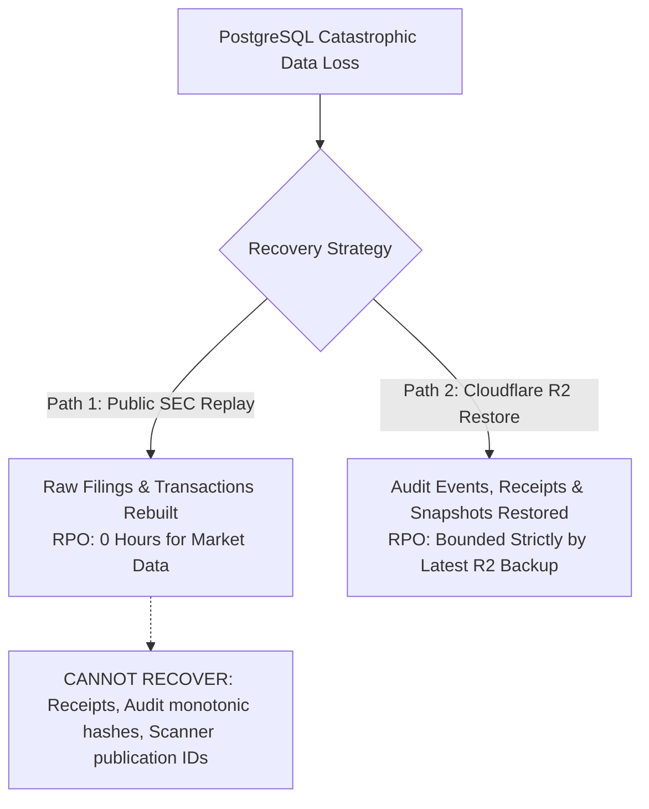
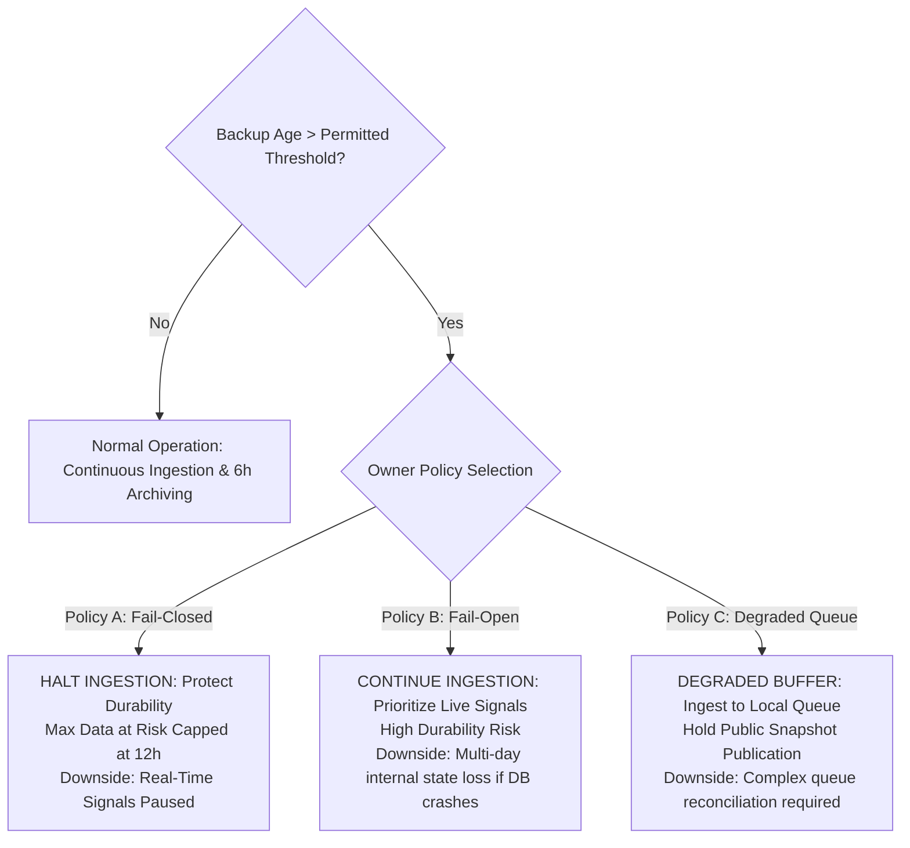

# ARX Terminal Smart Money Candidate 006: RPO, RTO, and Durability Policy Correction

**Document Role**: Disaster Recovery Objectives & Durability Trade-off Specification  
**Execution Mode**: `PRODUCTION_PREFLIGHT_EVIDENCE_RECONCILIATION_AND_ROLLBACK_DISPROOF`  
**Authorization State**: `PRODUCTION_MUTATIONS_PROHIBITED`  
**Audit Timestamp**: `2026-10-14T07:24:00Z`  
**Evaluator**: Disaster Recovery Architect & Independent Governance Auditor

---

## 1. Executive Summary

This document replaces unsubstantiated claims of "zero-hour RPO" and uncalibrated recovery speed with rigorous, evidence-based disaster recovery metrics.

In the initial preflight report, it was argued that because SEC EDGAR filings can be replayed from public SEC endpoints, the "effective business RPO is 0 hours." This claim conflates raw market data availability with internal system state. While raw filings can indeed be re-ingested from the SEC, **internal certified regulatory state—including immutable audit events, reconciliation receipts, and point-in-time scanner snapshots—cannot be reproduced via public replay**.

Furthermore, this document defines explicit operational trade-off policies for scenarios where backup failures cause recovery points to age beyond permitted thresholds.

---

## 2. Rigorous Breakdown of Recovery Parameters

### Parameter Distinction Matrix

| Recovery Parameter | Prior Preflight Claim | Rigorous Empirical Definition | Production Objective | Supporting Reality & Failure Modes |
|---|---|---|---|---|
| **Backup Schedule Interval** | "6 hours" | Nominal sleep interval of `SmartMoneyBackupSchedulerThread`. | 6 hours | Configured schedule; does not guarantee backup success. |
| **Actual Successful Backup Interval** | Not distinguished | Elapsed wall-clock time between successful R2 uploads. | $\le 6.5\text{ hours}$ | Includes retry latency, network backoff, and container restarts. |
| **Age of Latest Verified Backup** | Assumed current | $\Delta t = \text{now}() - \text{last\_verified\_timestamp}$. | $\le 12\text{ hours}$ | Stale if S3 API credentials fail, R2 throttles, or worker crashes. |
| **Max Potential Data Loss** | "Zero hours" | Unbacked interval since previous successful backup. | $\le 6\text{ hours}$ | Filings are replayable; internal audit trails are at risk. |
| **Recoverability of SEC Filings** | "100% recoverable" | Filings re-ingested by accession number from EDGAR. | **0 hours** | Subject to SEC rate limits (10 req/s) and EDGAR downtime. |
| **Recoverability of Internal State** | Conflated with filings | `sm_audit_events`, `sm_reconciliation_receipts`, `scanner_snapshots`. | **6 hours** | **NOT RECOVERABLE VIA SEC REPLAY**. Strictly dependent on R2. |
| **Proposed Production RPO** | "0 hours effective" | **6 Hours** (Internal State) / **0 Hours** (Filings) | **6 Hours** | Reflects true loss boundary for regulatory compliance. |
| **Proposed Production RTO** | "30 minutes" | Time to provision, download, restore, and verify database. | **30 Minutes** | Realistic cloud MTTR (includes 5-10m cloud container spin-up). |
| **Measured Rehearsal Recovery** | Presented as RTO | 8.41 seconds total (0.26s restore) on 33.6 KB DB on SSD. | Benchmark Only | Low-volume local test; NOT a cloud SLA guarantee. |

---

## 3. The SEC EDGAR Replay Limit (Why Internal State Cannot Be Re-derived)

When a database is wiped and restored from an older backup:
1. **Raw Filings (`form4_raw_filings`)**: Can be re-downloaded from SEC EDGAR by polling historical feeds.
2. **Parsed Transactions (`form4_parsed_transactions`)**: Can be re-parsed deterministically from XML payloads.
3. **Audit Events (`sm_audit_events`)**: **IRRECOVERABLE**. Audit events record runtime execution metadata, worker IDs, and SHA-256 hashes generated at the moment actions occurred. Replaying filings creates new, different audit events with new timestamps and broken cryptographic chains.
4. **Reconciliation Receipts (`sm_reconciliation_receipts`)**: **IRRECOVERABLE**. Receipts certify specific historical watermarks and intervals. Re-running creates new receipt UUIDs, invalidating historical receipts referenced in external reports.
5. **Scanner Snapshots (`scanner_snapshots`)**: **IRRECOVERABLE**. Published snapshots have specific `generated_at` timestamps and `semantic_fingerprint` hashes. 

**Conclusion**: Production RPO is **6 hours**. Claiming 0 hours is rejected.

---

## 4. Operational Durability Policy on Stale Backups (Owner Decision Required)

If Cloudflare R2 experiences an outage or backup credentials expire, the age of the latest valid recovery point will grow beyond the 6-hour threshold.

The system cannot silently choose between data durability and real-time ingestion availability. Three distinct operational policies are presented for **Explicit Owner Authorization**:

### Policy Trade-Off Comparison

| Policy Option | Action When Backup Age Exceeds Threshold | Advantages | Risks & Operational Consequences | Recommended Default |
|---|---|---|---|---|
| **Policy A (Fail-Closed / Strict Durability)** | Halt SEC worker ingestion after **12 hours** of consecutive backup failures (`BACKUP_STALE_HALT`). | Guarantees that internal regulatory state at risk never exceeds 12 hours. | Form 4 ingestion is suspended until cloud storage recovers. Live dashboard freezes. | **RECOMMENDED (Institutional Baseline)** |
| **Policy B (Fail-Open / Continuous Availability)** | Ingestion continues indefinitely; emits high-priority alerts to owner. | Live trading signals and filings remain up to date for terminal users. | If PostgreSQL volume fails during multi-day R2 outage, all internal receipts created since last backup are permanently lost. | High-Risk Option (Requires explicit risk waiver) |
| **Policy C (Degraded Buffer / Staging Hold)** | Ingest raw filings into temporary queue; freeze final snapshot publication. | Raw filings captured; public trading signals not corrupted. | Railway container local disk space is limited (ephemeral disk); complex catch-up reconciliation. | Complex implementation |

**Owner Action Required**: The owner must formally select Policy A, B, or C in the final cutover authorization package.
