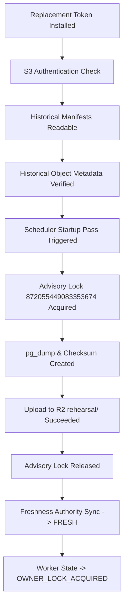

# Backup Continuity & Replacement Credential Verification Protocol

## 1. 12-Point Verification Protocol

Following the installation of the replacement Cloudflare R2 credential, the following automated checks verify end-to-end backup continuity:

### Verification Criteria Checklist
1. **Authentication Success**: S3 client successfully issues `ListObjectsV2` against bucket `arx-smart-money-backups`.
2. **Historical Manifest Readability**: Existing rehearsal manifests (e.g. `manifest_sm-backup-20261014T101809Z-31d5e534.json`) downloaded and parsed cleanly.
3. **Historical Dump Readability**: Existing `.dump` archives accessible via S3 `GetObject`.
4. **Metadata Verification**: S3 `HeadObject` returns valid `Metadata.sha256` matching recorded checksums.
5. **Scheduled Pass Execution**: Normal `SmartMoneyBackupSchedulerThread` initiates backup pass without manual script invocation.
6. **Manifest Validity**: Newly uploaded JSON manifest adheres to schema `SMART_MONEY_POSTGRES_SCHEMA_V2`.
7. **SHA-256 Metadata Agreement**: Computed SHA-256 of new dump matches manifest and remote object metadata.
8. **Byte-Level Integrity**: Downloaded archive bytes independently corroborated via SHA-256 digest.
9. **Freshness Authority Advancement**: `BackupFreshnessAuthority.evaluate_freshness()` recognizes the new recovery point with status `FRESH` and age < 60s.
10. **Advisory Lock Isolation**: Dedicated lock `872055449083353674` held during dump generation and cleanly released.
11. **Worker Ownership Exclusivity**: Primary lock `401007311509093371` maintained continuously without dropped session.
12. **Web & Worker Health**: HTTP `/health` returns 200 OK; zero container crash loops.

---

## 2. Integrity Protections

- **Zero Mock Uploads**: Verification relies strictly on the genuine `SmartMoneyBackupSchedulerThread` calling `pg_dump` and `BackupStorageAdapter`. Manually writing synthetic test objects to R2 is strictly prohibited.
- **Cadence Timing**: If a scheduled backup pass is not immediately due, verification remains classified as **`PENDING`** until the pass executes or an authorized thread startup cycle runs.
