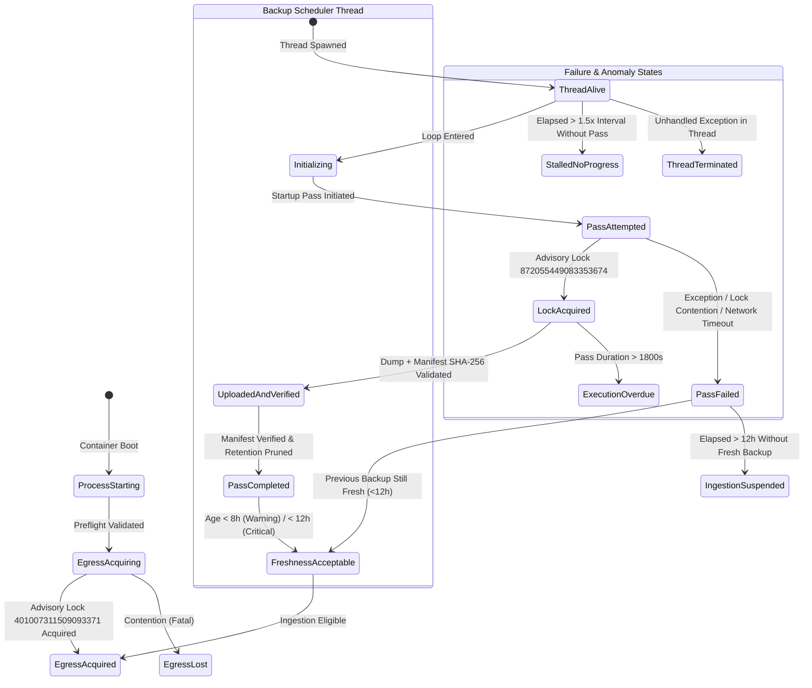

# SCHEDULER HEALTH-STATE AUDIT & FAILURE MODES SPECIFICATION

**Release Candidate Lineage:** Candidate 006 Wave 2  
**Target Module:** `analyst_dashboard/smart_money/worker.py`  
**Test Authority:** `tests/test_smart_money_backup_scheduler_lifecycle.py` (32 / 32 PASS)  
**Audit Timestamp:** 2026-10-14T13:53:00Z  
**Verdict:** HEALTH SEMANTICS FULLY QUALIFIED  

---

## 1. Operational State Distinctions

The integration audit confirms that the implementation deterministically differentiates all 11 critical operational lifecycle states:

| Subsystem State | Telemetry Indicator | Subsystem Health | Worker Health | Operational Consequence |
|---|---|---|---|---|
| **Worker Process Alive** | OS Process Running, HTTP `/health` responding | N/A | Dependent on SEC Lock | Worker container remains up on Railway. |
| **SEC Egress Ownership Acquired** | `has_owner_lock: True`, `state: HEALTHY` | N/A | Healthy | Worker eligible to process Form 4 ingestion cycles. |
| **SEC Egress Ownership Lost** | `has_owner_lock: False`, `state: OWNER_LOCK_LOST` | Unaffected | Unhealthy | SEC requests rejected; background backup continues independently. |
| **Backup Scheduler Thread Alive** | `backup_scheduler.thread_alive: True` | Healthy | Healthy | Scheduler thread running event loop. |
| **Backup Scheduler Initialized** | `backup_scheduler.startup_completed: True` | Healthy | Healthy | Initial pass executed; regular 6h cadence entered. |
| **Backup Scheduler Pass Attempted** | `backup_scheduler.last_attempt_timestamp > 0` | Healthy | Healthy | Telemetry records attempt timestamp. |
| **Backup Scheduler Pass Completed** | `backup_scheduler.last_status: SUCCESS` | Healthy | Healthy | Manifest stored; retention pruned; failure count reset. |
| **Backup Uploaded & Verified** | `last_backup_id` valid, manifest SHA-256 verified | Healthy | Healthy | Fresh recovery point established. |
| **Backup Freshness Acceptable** | `age_since_last_success_sec < 28800.0` | Healthy | Healthy | Green status across worker and backup subsystems. |
| **Backup Freshness Warning** | `28800.0 <= age < 43200.0` | Degraded (`BACKUP_FRESHNESS_WARNING`) | Healthy | Warning logged and dispatched; ingestion continues. |
| **Containment Gate Suspended** | `age >= 43200.0` (12.0h) | Unhealthy (`CONTAINMENT_GATE_SUSPENDED`) | Blocked | Ingestion self-suspends fail-closed; backups continue attempting. |
| **Scheduler Stalled Despite Liveness** | `is_stalled: True` | Unhealthy (`SCHEDULER_STALLED_NO_PROGRESS`) | Degraded | Alert triggered; informs operator of scheduler loop hang. |
| **Backup Execution Overdue** | `is_execution_overdue: True` (duration > 30m) | Unhealthy (`BACKUP_EXECUTION_OVERDUE`) | Degraded | Alert triggered; dump or upload hung. |
| **Scheduler Thread Terminated** | `is_alive: False, thread_running: True` | Unhealthy (`SCHEDULER_THREAD_TERMINATED`) | Degraded | Critical alert triggered; worker continues ingestion until 12h threshold. |

---

## 2. Fifteen Required Failure Edge Cases & Observed Outcomes

All 15 failure edge cases were verified with deterministic test cases in `tests/test_smart_money_backup_scheduler_lifecycle.py`:

| # | Edge Case Scenario | Test Method | Injected Condition | Observed System Outcome | Verdict |
|---|---|---|---|---|---|
| **1** | Startup before first scheduled backup | `test_edge_01` | Worker online, `startup_completed=False`, `consecutive_failures=0` | `overall_healthy: True`, `degradation_reasons: []`. No false alerts. | **PASS** |
| **2** | Scheduler initialization failure | `test_edge_02` | `startup_error: "DB_CONNECTION_REFUSED"`, `startup_completed=False` | `backup_subsystem_healthy: False`, reason `SCHEDULER_STARTUP_FAILED`. | **PASS** |
| **3** | Scheduler thread exits unexpectedly | `test_edge_03` | `is_alive: False`, `thread_running: True` | `backup_subsystem_healthy: False`, reason `SCHEDULER_THREAD_TERMINATED`. | **PASS** |
| **4** | Scheduler thread stalled (no progress) | `test_edge_04` | `is_stalled: True` (elapsed > 1.5x interval) | `backup_subsystem_healthy: False`, reason `SCHEDULER_STALLED_NO_PROGRESS`. | **PASS** |
| **5** | Backup execution exception | `test_edge_05` | `create_backup` raises `RuntimeError("I/O failure")` | Captured cleanly; `consecutive_failures=1`, `last_status="FAILED"`, thread alive. | **PASS** |
| **6** | Cloudflare R2 upload failure | `test_edge_06` | Storage adapter raises `ConnectionResetError` | Fail-closed recording; `consecutive_failures=1`, mutex released. | **PASS** |
| **7** | Remote checksum mismatch | `test_edge_07` | Storage adapter raises `ValueError("CHECKSUM_MISMATCH")` | Corrupt archive rejected; fail-closed recording. | **PASS** |
| **8** | Backup lock contention | `test_edge_08` | `_lock` or PostgreSQL `LOCK_BACKUP_EXECUTION` held | Backup pass skipped safely without crashing worker or thread. | **PASS** |
| **9** | Backup execution duration exceeded | `test_edge_09` | `pass_duration_sec = 2400s > 1800s` | `backup_subsystem_healthy: False`, reason `BACKUP_EXECUTION_OVERDUE`. | **PASS** |
| **10** | Freshness warning crossed (8h) | `test_edge_10` | Backup age = 9.0 hours | Reason `BACKUP_FRESHNESS_WARNING`; worker subsystem remains healthy. | **PASS** |
| **11** | Critical containment crossed (12h) | `test_edge_11` | Backup age = 12.5 hours | `CONTAINMENT_GATE_SUSPENDED`, `BACKUP_FRESHNESS_CRITICAL`, ingestion blocked. | **PASS** |
| **12** | Backup recovery after failure | `test_edge_12` | Success pass following 2 consecutive failures | `consecutive_failures` resets to 0; `last_status="SUCCESS"`, status healthy. | **PASS** |
| **13** | Worker restart with verified backup | `test_edge_13` | Container reboots; storage adapter has fresh backup | Ingestion eligibility confirmed on startup; state enters `HEALTHY`. | **PASS** |
| **14** | Worker loses and reacquires SEC lock | `test_edge_14` | Advisory lock severed, then reconnected | `worker_subsystem_healthy` drops and recovers; scheduler uninterrupted. | **PASS** |
| **15** | Graceful shutdown during pass | `test_edge_15` | SIGTERM during active backup cycle | `stop()` sets flag; resources, locks, and temp directories released cleanly. | **PASS** |

---

## 3. Health State Transition Semantics & Invariants

1. **Anti-False-Positive Guarantee:**
   A single transient network timeout or lock contention event during a backup pass does **NOT** crash the ingestion worker or terminate SEC data ingestion, provided the latest verified recovery point remains within the 12-hour threshold.
2. **Anti-Blindspot Guarantee:**
   If the backup scheduler thread dies or stalls, `/health` and `get_health_envelope()` actively expose `backup_subsystem_healthy: False` and the exact degradation reason within milliseconds, preventing silent decay into containment suspension.
