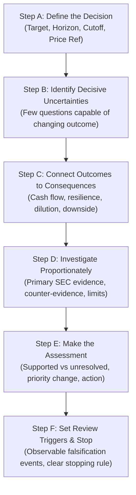

# ARX Terminal — Decision-Focused Research Process Standard & Canonical Template

**Standard ID:** `ARX-DECISION-RESEARCH-PROCESS-V1`  
**Effective Date:** October 22, 2026  
**Governing Authority:** Product Owner Approval — Issue [daakara/finance#43](https://github.com/daakara/finance/issues/43)  
**Methodological Context:** ARX Closure Model v2 (Decision-First, Minimum Sufficient Evidence)  
**Applicability:** Prospective across all candidate discovery, research prioritization, Quality-WATCH candidate preparation, and dossier maintenance.

---

## 1. Objective and Operating Boundary

This standard defines a compact, reusable, decision-focused research process for the ARX Terminal. Its objective is to **standardize how research decisions are made**—not to impose identical financial metrics, mandatory industry sections, arbitrary report lengths, or mechanical scoring rubrics.

### Core Governance Invariants:
1. **Decision-First Inquiry:** Every research interaction must declare the specific decision it is intended to resolve before evidence collection begins.
2. **Separation of Distinct Realities:**
   - **WATCH is not BUY:** A published Quality-WATCH dossier establishes that an asset represents high business quality with observable monitoring conditions; it does **not** constitute an investment recommendation or buy signal.
   - **Publication Readiness $\neq$ Investment Attractiveness:** Internal exploratory hypotheses, prospective validation candidates, and public Quality-WATCH additions remain governed by distinct criteria.
   - **Technical Verification $\neq$ Investment Performance:** Deterministic calculation checks, schema validation, and git receipts establish evidence integrity; they do **not** demonstrate empirical investment skill or predictive alpha.
3. **Prospective-Only Application:** Completed releases (e.g., PR #39, PR #41) remain closed. Existing published dossiers adopt this decision process prospectively at their next scheduled or triggered material review. No retrospective decision records may be fabricated.
4. **No Arbitrary Quotas or Checklists:** No fixed asset-count publication quota applies. Research does not mandate universal metrics (e.g., market-share tables, customer lifetime value, brand-lifecycle scores, or artificial contrarian theses) where the underlying business model does not support them.

---

## 2. The Six Universal Research Steps

Every research interaction—whether screening a candidate, evaluating an expansion opportunity, or updating a published dossier—must progress through six sequential steps:



### Step A: Define the Decision
Explicitly state what the research task is intended to decide among five canonical outcomes:
1. **Investigate Further:** Proceed to deep primary evidence collection.
2. **Prioritize Relative to Alternatives:** Rank or sequence candidate attention against the active queue.
3. **Prepare for Quality-WATCH Publication:** Audit and format candidate against the six Quality-Watch pillars.
4. **Maintain, Revise, or Discontinue an Assessment:** Re-evaluate an existing dossier following a trigger event.
5. **Conduct Deeper Investment Analysis:** Internal exploratory evaluation of fundamental valuation and risk.

*Mandatory Preamble Fields:*
- **Analytical Horizon:** Default 3 to 5 years (explicitly designated as a provisional analytical horizon, not a ratified product policy), with intermediate evidence events tracked separately.
- **Information Cutoff Date:** Explicit date/time of latest examined public disclosures.
- **Reference Price & Date:** Stated trading session and closing price where market valuation informs the decision.

### Step B: Identify Decision-Relevant Uncertainties
Select the **few decisive uncertainties** most capable of changing the assessment.
- Explain specifically *why* each uncertainty matters to the business.
- State *what conclusion or priority* it could alter.
- Assess *whether public evidence can realistically reduce the uncertainty* within a reasonable effort budget.
- *Negative Invariant:* Do not turn every conceivable operational risk into a mandatory research section.

### Step C: Connect Outcomes to Consequences
Describe plausible alternative outcomes for the decisive uncertainties and trace their concrete financial transmission:
- **Revenue and Operating Profitability:** Gross margin resilience, pricing power, and volume trajectory.
- **Cash Generation & Reinvestment:** Working capital absorption, growth vs. maintenance capex, and cash conversion ($FCF / CFO$).
- **Financial Resilience & Dilution:** Funded debt service obligations, debt covenant headroom, and stock-based compensation dilution.
- **Per-Share Economics:** Cash generation per diluted share after external claims.
- **Valuation Bounds:** Reverse-DCF implied growth hurdles where applicable (standard reverse-DCF is optional and suppressed for unsuitable business models).
- *Downside Invariant:* Explicitly analyze material downside mechanisms without manufacturing subjective probabilities or synthetic consensus views.

### Step D: Investigate Proportionately
Conduct evidence collection proportional to the decision's importance:
- **Primary Source Grounding:** Reconcile material assertions to SEC EDGAR filings (Forms 10-K, 10-Q, 8-K), audited financial notes, and regulatory records.
- **Strict Epistemic Classification:** Rigorously categorize every claim:
  - *Reported Fact:* Primary regulatory filing or financial statement line item (distinguishing audited annual statements, e.g. Form 10-K, from unaudited interim reports, e.g. Form 10-Q or regulatory notices Form 8-K; "reported fact" does not imply every SEC filing or quarterly statement is audited).
  - *Management Statement:* Executive commentary and earnings call statements (treated as management evidence, not independent confirmation).
  - *Derived Calculation:* Deterministic mathematical formula applied to verified reported inputs.
  - *Analyst Assumption:* Forward-looking modeling input or third-party projection.
  - *Hypothesis:* Falsifiable internal conjecture undergoing testing.
- **Counter-Evidence Seeking:** Actively search for evidence contradicting the preferred thesis (e.g., customer concentration, deferred capex, aggressive revenue recognition).
- **Explicit Limitations:** If data is undisclosed or unavailable, explicitly record it as an unknown rather than substituting unverified industry estimates.

### Step E: Make the Assessment
State clearly and concisely:
- What the evidence **supports**.
- What remains **unresolved**.
- Whether the **decision or research priority changed**.
- What **concrete action follows** (e.g., promote to candidate queue, defer pending cycle, discontinue, withdraw).
- *Equivalence Rule:* `No differentiated expectation established` and `Insufficient evidence to proceed` are fully acceptable, valid terminal conclusions.

### Step F: Set Review Triggers and Stop
Define the specific, observable conditions that will trigger the next review:
- Specify the metric, primary source, and measurement period (e.g., "Form 10-Q Q3 2026: Operating margin compression below 25.0%").
- **Stopping Rule:** Cease research immediately when available evidence supports the decision, or when an uncertainty cannot be resolved using public disclosures. Preserve the unresolved question in the record rather than generating speculative analysis.

---

## 3. Business-Specific Illustrative Examples

The following short examples demonstrate how decisive uncertainties vary by business model.  
*(Explicit Governance Note: These are illustrative examples of decision focus, not newly verified findings, and do not mandate retrospective reviews or edits to published dossiers.)*

* **`DECK` (Deckers Outdoor Corp.):** Focus on brand profitability durability, international marketing expansion costs, and the seasonal margin contribution of UGG relative to HOKA running shoe competition.
* **`FIX` (Comfort Systems USA, Inc.):** Focus on hyperscale data center backlog conversion pace, modular off-site prefabrication execution capacity, and gross margin durability under fixed-price contracts.
* **`DUOL` (Duolingo, Inc.):** Focus on free-to-paid user retention curves, Max tier subscription monetization elasticity, and the unit economics of generative AI feature serving.
* **`ULTA` (Ulta Beauty, Inc.):** Focus on mature store comparable sales trajectory, prestige cosmetics market share defense against Sephora at Kohl's, and operating leverage on store labor.
* **`MEDP` (Medpace Holdings, Inc.):** Focus on clinical trial study cancellations, net new business backlog conversion velocity, and venture capital funding flows into small-to-midsize biotech sponsors.
* **`ISRG` (Intuitive Surgical, Inc.):** Focus on da Vinci 5 clinical adoption ramp, procedure volume growth across general surgery, and competitive robotic surgery platform trials.

---

## 4. Canonical Reusable Research Record Template

All future research dossiers, discovery notes, and material update logs must implement the following compact schema:

> **Template Usage Invariants:**
> - **Reference Price:** May be `null` or omitted when market price is not decision-relevant to the immediate action.
> - **Distinct Time Dimensions:** Evidence cutoff date, measurement period, and future review trigger events are strictly distinct fields.
> - **Valid Terminal States:** `UNRESOLVED_EVIDENCE` and `INSUFFICIENT_EVIDENCE` are valid, supported states; no data should be invented to fill unknowns.
> - **No Mandatory Universal Thresholds:** Illustrative figures or examples in this template do not become mandatory screening rules or universal hurdles.

```markdown
# [Symbol] — Decision-Focused Research Record

**Document ID:** `REC-[SYMBOL]-[YYYYMMDD]-V1`  
**Company Name:** [Full Legal Corporate Name]  
**CIK:** [SEC EDGAR CIK]  
**Analytical Horizon:** [e.g., 3–5 Years (Provisional Pilot Horizon)]  
**Information Cutoff Date:** [YYYY-MM-DD]  
**Reference Price & Session:** [Reference Price (e.g., $XXX.XX as of YYYY-MM-DD Close), or null / N/A when not decision-relevant]  
**Research Author / Agent:** [Name / Role]  

---

### 1. Decision Sought
- **Target Decision:** [Investigate Further | Prioritize Queue | Prepare Quality-WATCH | Maintain / Revise | Discontinue]
- **Context & Operational Purpose:** [State why this research was commissioned and what operational action depends on the outcome.]

---

### 2. Decision-Relevant Uncertainties
1. **[Uncertainty 1 Title]:**
   - *Why it matters:* [Direct connection to business model or moat]
   - *Decisive impact:* [What outcome or priority changes depending on the answer]
   - *Evidence feasibility:* [Can public SEC / regulatory filings resolve this?]
2. **[Uncertainty 2 Title]:**
   - *Why it matters:* [...]
   - *Decisive impact:* [...]
   - *Evidence feasibility:* [...]

---

### 3. Plausible Outcomes & Financial Consequences
- **Bull / Base Case Outcome:**
  - *Operational Trajectory:* [Revenue, margins, volume]
  - *Cash Flow & Balance Sheet:* [Capex, working capital, FCF conversion, debt service]
  - *Per-Share Consequences:* [Diluted share count, cash generation per share, implied valuation]
- **Downside Case Outcome:**
  - *Failure Mechanism:* [Customer churn, fixed-price cost overrun, pricing erosion]
  - *Downside Resilience:* [Fixed charges, debt covenant compliance, liquidity survival]

---

### 4. Evidence, Counter-Evidence & Limitations
- **Supporting Primary Evidence:**
  - `[FACT]` [Item, Period, Amount, Form, Accession No., Note/Table Locator — distinguishing audited annual from unaudited interim]
  - `[CALCULATION]` [Formula applied to verified facts]
- **Counter-Evidence & Conflicting Observations:**
  - `[RISK/FRICTION]` [Customer concentration, inventory build, margin compression]
- **Explicit Limitations & Unknowns:**
  - `[LIMITATION / UNRESOLVED]` [Unreported unit economics, non-disclosed customer churn, etc.]

---

### 5. Assessment & Next Action
- **Supported Conclusions:** [What the verified evidence definitively establishes]
- **Unresolved Inquiries:** [What remains genuinely unknown]
- **Decision & Priority Outcome:** [State whether priority changed or candidate qualifies]
- **Concrete Next Action:** [e.g., Stage for Quality-Watch Review, Defer to Queue, Discontinue]

---

### 6. Review Triggers & Stopping Rationale
- **Next Review Trigger Event:** [Specific future filing, metric threshold, or calendar checkpoint]
- **Measurement Period:** [Specific reporting period to evaluate, distinct from cutoff date]
- **Stopping Rationale:** [Reason research is complete now; evidence sufficient to resolve decision or uncertainty unresolvable via public data]
```

---

## 5. Machine-Readable Schema Representation

To facilitate programmatic verification, internal ledgers map to this standard using the schema illustrated below.

> **Governance Notice:** The following JSON block is a **SYNTHETIC DEMONSTRATION EXAMPLE — NOT INVESTMENT RESEARCH**. It uses an illustrative synthetic entity (`SYNTH`) to demonstrate valid fields, distinct temporal horizons, `null` reference pricing, and valid unresolved evidence states without prescribing mandatory screening thresholds.

```json
{
  "_comment": "SYNTHETIC DEMONSTRATION EXAMPLE — NOT INVESTMENT RESEARCH",
  "record_id": "REC-SYNTH-20261022-V1",
  "symbol": "SYNTH",
  "company_name": "Synthetic Industrial Systems Inc.",
  "cik": "0000000000",
  "decision_sought": {
    "action": "PRIORITIZE_RELATIVE_TO_ALTERNATIVES",
    "provisional_analytical_horizon": "3-5_YEARS",
    "information_cutoff_date": "2026-10-22",
    "reference_price": null
  },
  "decision_relevant_uncertainties": [
    {
      "uncertainty": "Durability of contract renewal terms with primary distribution partner",
      "decisive_impact": "Could alter gross margin baseline by +/- 300 bps",
      "resolvable_via_public_data": true
    }
  ],
  "plausible_outcomes_and_consequences": {
    "base_case": "Standard contract renewal preserves operating margins near recent operating levels",
    "downside_case": "Margin compression absorbs organic cash generation and requires working capital draw",
    "resilience_profile": "Sufficient liquidity and zero short-term maturities provide downside cushion"
  },
  "evidence_synthesis": {
    "reported_facts": [
      {
        "source": "SEC Form 10-K (audited annual)",
        "period": "FY2025",
        "fact": "Reported operating income and debt terms as stated in Note 8"
      },
      {
        "source": "SEC Form 10-Q (unaudited interim)",
        "period": "Q2 2026",
        "fact": "Operating cash flow and cash balance as stated in unaudited cash flow statement"
      }
    ],
    "unresolved_evidence": [
      "Segment-level customer retention rate is not disclosed in public filings"
    ],
    "counter_evidence": [
      "Inventory growth outpaced revenue in latest interim period"
    ],
    "limitations": [
      "Private commercial contract renewal discussions are confidential prior to public filing"
    ]
  },
  "assessment": {
    "status": "PRIORITIZED_FOR_INTERNAL_MONITORING",
    "decision_outcome": "RETAIN_IN_QUEUE",
    "priority_change": "UNPROMOTED_PENDING_NEXT_FILING",
    "next_action": "HOLD_IN_INTERNAL_MONITORING_QUEUE"
  },
  "review_triggers": {
    "trigger_event": "Filing of Form 10-Q for Q3 2026 (expected Nov 2026) or announcement of master contract renewal",
    "measurement_period": "Q3 2026",
    "evidence_cutoff_date": "2026-10-22"
  },
  "stopping_rationale": "Sufficient evidence collected to determine current queue priority; further research cannot resolve private commercial negotiations ahead of public disclosure."
}
```

---

## 6. Integration Across Discovery, Publication & Maintenance

1. **Candidate Discovery (Issue #43 Scope):**
   - Applies the 6 steps to evaluate surfaced ideas across multiple generation routes (financial change, industry constraints, customer/supplier tracing).
   - Triage records determine whether to investigate further, defer, or discontinue.
2. **Quality-WATCH Publication Preparation:**
   - Evaluates the 6 Quality-Watch pillars using the decision-focused framework.
   - Ensures that public dossiers present explicit, observable watch corridors rather than generic corporate descriptions.
3. **Dossier Maintenance & Trigger Reviews:**
   - When a trigger event occurs (e.g., 10-K filing, capital structure change), the review executes Steps A through F to decide whether the dossier remains `PUBLISHED`, enters `STALE_MONITORING`, or requires `WITHDRAWN` status.
