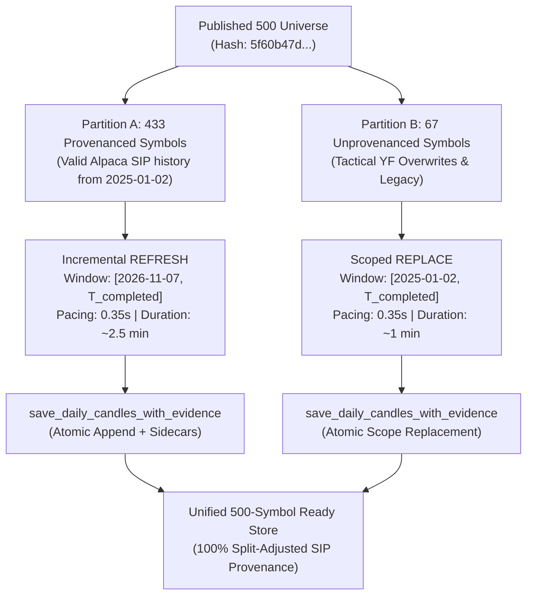

# ARX Radar 500 Market Data Refresh Plan (Issue #166)

- **Document Version:** 1.0.0-QUALIFIED
- **Plan Reference:** `RADAR-500-MARKET-DATA-REFRESH-PLAN-166`
- **Issue Reference:** Issue #166
- **Date:** 2026-11-20
- **Operational Status:** **DEFERRED PENDING SEC INGESTION TRIAL COMPLETION**
- **Topic Branch:** `audit/radar-readiness-assessment-166`
- **Baseline Audit Commit:** `a8c2cc554865882e3c09f3e098492cfa7e56b461`

---

## 1. Executive Summary & Objective

This operational plan defines the bounded, offline-qualified procedure for refreshing market data across the published 500-symbol candidate universe (`UB-ARX-EXPANSION-500-20261108`).

### Objectives
1. Eliminate the market data staleness deficit (464 stale symbols as of the 2026-11-06 baseline export) by advancing bars to the latest completed exchange trading session $T_{\text{completed}}$.
2. Resolve the provenance deficit across 67 unprovenanced symbols (including 35 tactical candidate symbols with unprovenanced Yahoo Finance bars up to 2026-11-19) by executing bounded scoped replacement with certified Alpaca SIP split-adjusted provenance.
3. Preserve existing operational holds and the armed SEC worker trial. **Execution of this plan in production is strictly DEFERRED while the SEC trial runs.**

---

## 2. Production Authority & Storage Target

Read-only inspection of the active Railway production infrastructure establishes the authoritative environment:

| Property | Value | Notes |
| :--- | :--- | :--- |
| **Hosting Platform** | Railway | Production environment |
| **Serving Service** | `web` | UUID: `56e38249-b78c-4a60-80d7-303ce7451bd8` |
| **Serving Deployment ID** | `9f28fb4e-c804-4b6a-9a25-1092c496026d` | Running production container |
| **Git Revision SHA** | `868d7afcd528006c2323e6b79b5a17f2f20f677c` | Head commit of deployed service |
| **Persistent Volume Mount** | `/root` | Shared persistent disk volume |
| **Target Market Store** | `/root/market_store.db` | SQLite store for daily bars & provenance |
| **Target Universe Store** | `/root/universe_store.db` | Stores candidate universes & build lineage |
| **Target Scanner Store** | `/root/scanner_store.db` | Stores VCP scanner snapshots |

### Universe Target Specification
- **Universe Build ID:** `UB-ARX-EXPANSION-500-20261108`
- **Membership SHA-256 Digest:** `5f60b47d5402c0fc29fa545b244b778ca99a017f47448f47ebdfc257db8881b0`
- **Symbol Count:** 500 published institutional candidates
- **Baseline Ingestion Date:** `2026-11-08` (supervised weekend publication)

---

## 3. Market Data Contract & Ingestion Adapter

The refresh path uses the canonical, offline-qualified adapter in `scripts/ingest_alpaca_historical.py` (`AlpacaHistoricalSipIngestionAdapter`).

### Provider & Feed Contract
- **Primary Provider:** Alpaca Market Data API v2 (`https://data.alpaca.markets/v2/stocks/bars`)
- **Market Data Feed:** `feed="sip"` (Strictly Consolidated Tape: CTA Plan A/B, UTP Plan C, FINRA TRF)
- **Adjustment Convention:** `adjustment="split"` (`SPLIT_ADJUSTED_ONLY`, dividends unadjusted per Package B contract)
- **Exchange Calendar Authority:** NYSE (`XNYS`) via `exchange_calendars`
- **Rate Limit:** 200 requests/minute (Alpaca paid tier limit)
- **Adapter Pacing Delay:** 0.35 seconds between symbol requests ($\le 171.4$ requests/minute, operating safely below the 200 req/min cap)
- **Batch Checkpoint:** 50 symbols per batch checkpoint
- **Persistence Mechanism:** `MarketDatabaseEngine.save_daily_candles_with_evidence(..., replace_existing_scope=..., scope_start_date=..., scope_end_date=...)` with single-transaction atomicity

---

## 4. Execution-Time Cutoff Determination

Execution-time cutoff $T_{\text{completed}}$ is derived dynamically using official NYSE exchange calendar logic (`derive_expected_completed_session`):

1. **Market Hours Rule:**
   - If execution occurs prior to 16:15 ET on an active trading day, $T_{\text{completed}}$ resolves to the **immediately preceding completed session**.
   - If execution occurs after 16:15 ET on an active trading day, $T_{\text{completed}}$ resolves to **that day's completed session**.
2. **Weekend / Holiday Rule:**
   - If execution occurs on a weekend (Saturday/Sunday) or official exchange holiday (e.g. Thanksgiving, Labor Day), $T_{\text{completed}}$ rolls back to the **most recent preceding completed business session**.
3. **CLI Argument Invariant:**
   - Because `scripts/ingest_alpaca_historical.py` maintains a default backward-compatible limit of `2026-10-19`, the CLI parameters `--max-completed-session <T_completed>` and `--end-date <T_completed>` **must be explicitly passed**.

---

## 5. Partitioned Execution Blueprint

To address the provenance gap and staleness without violating the adapter's safety invariant (`INCOMPATIBLE_HISTORY_OUTSIDE_REVIEWED_SCOPE`), the 500 symbols are partitioned into two distinct cohorts:



### Partition A: 433 Provenanced Symbols (Incremental Refresh)
- **Cohort:** 433 symbols with verified Alpaca SIP split-adjusted provenance from `2025-01-02` through `2026-11-06`.
- **Action Type:** `REFRESH`
- **Query Range:** Start Date `2026-11-07` through `T_completed`.
- **Persistence Contract:** Retains existing prefix `[2025-01-02, 2026-11-06]`; appends missing tail bars and writes sidecar provenance records in a single transaction.
- **Estimated Volume:** 433 symbols $\times$ 1 API page = 433 requests $\times$ 0.35s $\approx$ 152 seconds ($\approx 2.5$ minutes).

### Partition B: 67 Unprovenanced Symbols (Scoped Repair Replacement)
- **Cohort:** 67 symbols lacking provenance in `asset_ohlcv_provenance` (53 tactical setup candidates e.g. `AAPL`, `NVDA`, `PLTR`, `TSLA` whose provenance was purged by `save_daily_candles`, plus 14 legacy seed symbols).
- **Symbol List (67):**
  `AAPL`, `ABT`, `ACLS`, `ADBE`, `AMD`, `AMZN`, `ANET`, `APP`, `AVGO`, `BAC`, `CDNS`, `CELH`, `CIEN`, `COIN`, `CRWD`, `CSCO`, `DDOG`, `DECK`, `DIS`, `DUOL`, `DXCM`, `ELF`, `EME`, `ETN`, `FIX`, `GEV`, `GOOGL`, `HOOD`, `IONQ`, `ISRG`, `JNJ`, `JPM`, `KLAC`, `LLY`, `LNTH`, `LRCX`, `LULU`, `MARA`, `MDB`, `MEDP`, `META`, `MNST`, `MPWR`, `MRK`, `MSFT`, `MSTR`, `NET`, `NOW`, `NVDA`, `ON`, `ONON`, `PANW`, `PFE`, `PG`, `PLTR`, `PODD`, `POWI`, `PWR`, `RKLB`, `SMCI`, `SNPS`, `TMDX`, `TSLA`, `TXN`, `ULTA`, `VRTX`, `WMT`.
- **Action Type:** `REPLACE`
- **Query Range:** Start Date `2025-01-02` through `T_completed`.
- **Persistence Contract:** Invokes `save_daily_candles_with_evidence(..., replace_existing_scope=True, scope_start_date="2025-01-02", scope_end_date=T_completed)`. Atomically replaces unprovenanced bars with pure Alpaca SIP split-adjusted bars and sidecars.
- **Estimated Volume:** 67 symbols $\times$ 2 API pages = 134 requests $\times$ 0.35s $\approx$ 47 seconds ($\approx 1$ minute).

---

## 6. Pre-Execution Backup & Rollback Protocol

Before executing any write operation against production SQLite stores:

### 1. Online SQLite Backup Command
To capture a consistent, WAL-safe snapshot without stopping the web service:
```bash
python3 -c "
import sqlite3, sys
src = sqlite3.connect('/root/market_store.db')
dst = sqlite3.connect('/root/backup_market_store_pre_refresh_166.db')
src.backup(dst)
dst.close()
src.close()
print('Pre-refresh backup completed successfully.')
"
```

### 2. Attributable Backup Checksum
Record the SHA-256 hash and byte size of `/root/backup_market_store_pre_refresh_166.db` prior to running the ingestion script.

### 3. Atomic Rollback Command
If any stop condition is triggered or post-refresh verification fails:
```bash
cp /root/backup_market_store_pre_refresh_166.db /root/market_store.db
rm -f /root/market_store.db-wal /root/market_store.db-shm
```

---

## 7. Execution Commands (Staged)

> [!CAUTION]
> **DO NOT RUN IN PRODUCTION NOW.** These commands are documented for execution only after formal authorization following completion of the SEC ingestion trial.

### Step 1: Execute Partition B (Scoped Replacement for 67 Unprovenanced Symbols)
```bash
python3 scripts/ingest_alpaca_historical.py \
  --manifest-path docs/research/manifests/candidate_expansion_500.json \
  --symbols "AAPL,ABT,ACLS,ADBE,AMD,AMZN,ANET,APP,AVGO,BAC,CDNS,CELH,CIEN,COIN,CRWD,CSCO,DDOG,DECK,DIS,DUOL,DXCM,ELF,EME,ETN,FIX,GEV,GOOGL,HOOD,IONQ,ISRG,JNJ,JPM,KLAC,LLY,LNTH,LRCX,LULU,MARA,MDB,MEDP,META,MNST,MPWR,MRK,MSFT,MSTR,NET,NOW,NVDA,ON,ONON,PANW,PFE,PG,PLTR,PODD,POWI,PWR,RKLB,SMCI,SNPS,TMDX,TSLA,TXN,ULTA,VRTX,WMT" \
  --feed sip \
  --adjustment split \
  --start-date 2025-01-02 \
  --end-date ${T_COMPLETED} \
  --max-completed-session ${T_COMPLETED} \
  --db-path /root/market_store.db \
  --output-summary-path /root/partition_b_replacement_summary.json \
  --apply
```

### Step 2: Execute Partition A (Incremental Refresh for 433 Provenanced Symbols)
```bash
python3 scripts/ingest_alpaca_historical.py \
  --manifest-path docs/research/manifests/candidate_expansion_500.json \
  --feed sip \
  --adjustment split \
  --start-date 2026-11-07 \
  --end-date ${T_COMPLETED} \
  --max-completed-session ${T_COMPLETED} \
  --db-path /root/market_store.db \
  --output-summary-path /root/partition_a_refresh_summary.json \
  --apply
```

---

## 8. Fail-Closed Stop Conditions

The execution harness must halt immediately and fail closed upon encountering any of the following events:

1. **HTTP 401 / 403:** Credential rejection or unauthorized feed tier (`feed="sip"` requires valid entitlement).
2. **HTTP 429 Rate Limit Exhaustion:** If Alpaca API returns HTTP 429 and rate-limit backoff exceeds 3 consecutive retries.
3. **Database Concurrency Lock:** SQLite `OperationalError: database is locked` persisting longer than 10 seconds.
4. **Active Scanner / Worker Concurrency:** Detection of any active background scan, VCP execution, or Smart Money worker process.
5. **Structural Error Rate $> 1\%$:** More than 5 symbols rejected for bar validation defects (e.g. non-finite floats, inverted high/low, out-of-order dates).
6. **SEC Ingestion / Protected Store Contention:** Any query, connection, or locking attempt directed at the 12 protected Smart Money PostgreSQL tables or advisory lock `401007311509093371`.

---

## 9. Post-Refresh Readiness Verification

Upon completion of writes, the authoritative readiness auditor must be executed against the updated database:

```bash
python3 scripts/diagnostics/audit_radar_universe_readiness_166.py \
  --market-db-path /root/market_store.db \
  --universe-db-path /root/universe_store.db \
  --scanner-db-path /root/scanner_store.db \
  --candidate-manifest-path docs/research/manifests/candidate_expansion_500.json \
  --cutoff ${T_COMPLETED} \
  --output-json-path docs/research/radar_universe_readiness_post_refresh_166.json \
  --output-md-path docs/research/RADAR_UNIVERSE_READINESS_POST_REFRESH_166.md
```

### Acceptance Gate Criteria
- **`READY` Count:** 500 (or $500 - \text{confirmed delistings}$)
- **`STALE_MARKET_DATA` Count:** 0
- **`MISSING_PROVENANCE` Count:** 0
- **`symbols_with_provenance`:** 500
- **Arithmetic Closure:** `is_closed: true`

---

## 10. Operational Containment & Deferral Rationale

> [!IMPORTANT]
> **Strict Deferral Binding:**
> 1. The armed SEC trial (`ARX-TRIAL-2026-NVDA-AAPL-001`, Day 1 grant `dc58b294...`) is currently active on Railway.
> 2. Executing market data refresh against the production container would consume network bandwidth, write heavily to SQLite on `/root`, and risk worker disruption or memory contention.
> 3. Therefore, execution of this qualified refresh plan is strictly **DEFERRED** until the SEC ingestion trial completes its natural scheduled cycle and report reconciliation.
> 4. All six operational holds (`HOLD_SCAN_001`, `HOLD_SEC_001`, `HOLD_EXEC_001`, `PHASE_3_HOLD`, `ARX_CONFLUENCE_INTEGRITY_HOLD`, `PHASE_A3_UX_HOLD`) remain 100% active.
