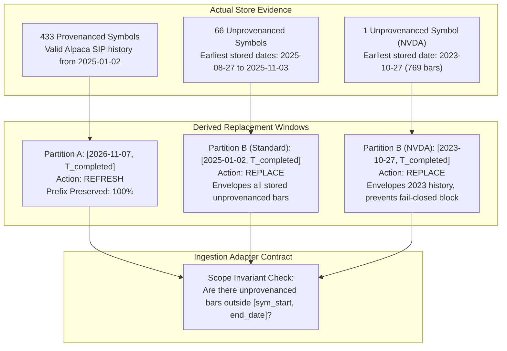

# ARX Radar 500 Market Data Refresh Plan (Issue #166)

- **Document Version:** 2.0.0-CORRECTED
- **Plan Reference:** `RADAR-500-MARKET-DATA-REFRESH-PLAN-166`
- **Issue Reference:** Issue #166
- **Date:** 2026-11-20
- **Operational Status:** **DEFERRED PENDING SEC INGESTION TRIAL COMPLETION**
- **Topic Branch:** `audit/radar-readiness-assessment-166`
- **Baseline Audit Commit:** `a8c2cc554865882e3c09f3e098492cfa7e56b461`

---

## 1. Executive Summary & Objective

This corrected operational plan defines the bounded, offline-qualified procedure for refreshing market data across the published 500-symbol candidate universe (`UB-ARX-EXPANSION-500-20261108`).

### Objectives
1. Eliminate market data staleness by advancing daily bars to the latest completed exchange trading session $T_{\text{completed}}$.
2. Resolve the provenance deficit across the 67 unprovenanced symbols using replacement windows derived directly from actual stored history evidence.
3. Address recurrence before refresh: isolate or guard background writers from invalidating refreshed provenance, while never preserving provenance attached to replaced, different-source bars.
4. Replace rigid "500 READY" assertions with strict full-population accounting closure: every published symbol accounted for, either demonstrably ready or carrying an explicit unresolved exception.
5. Preserve existing operational holds and the armed SEC worker trial. **Execution of this plan in production is strictly DEFERRED while the SEC trial runs.**

---

## 2. Target Database Path & Serving Runtime Resolution

### A. Authoritative Path Resolution
The target database path must resolve strictly against serving runtime configuration logic rather than arbitrary CLI flags:

$$\text{DATA\_DIR} = \text{os.getenv}(\text{"FINANCE\_DATA\_DIR"}, \text{os.getenv}(\text{"DATA\_DIR"}, \text{os.path.expanduser}(\text{"~"})))$$
$$\text{TARGET\_MARKET\_DB} = \text{os.path.join}(\text{DATA\_DIR}, \text{".finance\_market\_store.db"})]$$

In the Railway container environment running as user `root` (`~` = `/root`) with persistent volume mounted at `/root`:
- **Market Store:** `/root/.finance_market_store.db` (note leading dot).
- **Universe Store:** `/root/.finance_universe_store.db`.
- **Scanner Store:** `/root/.finance_scanner_store.db`.

### B. Execution-Time Identity Check (Fail-Closed)
Prior to initiating any backup, verification, or write operation, the execution harness must run an attributable identity check. If any check fails, execution must **abort immediately**:

1. **Container Deployment ID:** Verify `RAILWAY_DEPLOYMENT_ID == "9f28fb4e-c804-4b6a-9a25-1092c496026d"`.
2. **Container Git Revision:** Verify `RAILWAY_GIT_COMMIT_SHA == "868d7afcd528006c2323e6b79b5a17f2f20f677c"`.
3. **Database File Existence & Non-Zero:** Verify resolved `/root/.finance_market_store.db` exists and has size $\ge 60\text{ MB}$.
4. **Table Schema Integrity:** Verify presence of `asset_ohlcv_daily` and `asset_ohlcv_provenance` with complete column definitions.
5. **Published Universe Binding:** Query the store to confirm the presence of active universe build `UB-ARX-EXPANSION-500-20261108` and membership hash `5f60b47d5402c0fc29fa545b244b778ca99a017f47448f47ebdfc257db8881b0`.

---

## 3. Epistemic Status: Demonstrated Writer Behavior vs. Inferred Historical Causes

To maintain strict epistemic hygiene, writer mechanisms demonstrated in code and test reproductions must be separated from inferred historical causes:

### Demonstrated in Code & Offline Reproduction
1. **Provenance Purging in [`market_db.py`](file:///Users/iDavid/Projects/finance-clean/analyst_dashboard/data/market_db.py#L280-L302):**
   `MarketDatabaseEngine.save_daily_candles` executes:
   ```python
   # Prevent contradictory candle provenance after legacy replacement (PREFLIGHT-001 Target 5)
   cursor.execute("DELETE FROM asset_ohlcv_provenance WHERE symbol = ? AND trade_date = ?", (upper, date_str))
   ```
   This is intentional, demonstrated behavior to prevent replaced, different-source bars (e.g. Yahoo Finance) from falsely retaining Alpaca SIP provenance.
2. **Tactical Writer Invocations:**
   In [`api/routes/analytics.py`](file:///Users/iDavid/Projects/finance-clean/api/routes/analytics.py#L509-L803), `_background_refresh_symbol` and `/api/v1/analytics/setups` call `market_db.save_daily_candles` with Yahoo Finance data when `_is_history_stale` is True.
3. **Startup Warmup:**
   In [`api/main.py`](file:///Users/iDavid/Projects/finance-clean/api/main.py#L45), `_warmup_worker` calls `db.save_daily_candles` for core symbols on cold cache miss.

### Explicitly Labeled Inferred / Unverified
- **Individual Historical Request Attribution:**
  Inferring that a specific symbol (e.g. `AAPL` or `NVDA`) had its provenance purged at a specific historical moment by a specific HTTP request to `/api/v1/analytics/setups` vs startup pre-warming vs manual script execution is **UNVERIFIED** without timestamped container access logs or worker execution receipts.
- **Legacy Seed Attribution:**
  Attributing the 14 early unprovenanced symbols (`ABT`, `ADBE`, `BAC`, etc.) to specific historical bootstrapping commits is **UNVERIFIED**.

---

## 4. Recurrence Prevention Before Refresh

To prevent legacy or background writers from invalidating refreshed provenance after completion, recurrence must be addressed prior to execution:

### A. Operational Isolation
1. **Serving Configuration Flag:**
   Set `DISABLE_BACKGROUND_MARKET_REFRESH=true` in the serving container environment.
   When active, `_schedule_background_refresh(sym)` in `api/routes/analytics.py` immediately exits without scheduling unprovenanced Yahoo Finance fetches.
2. **Serving Mount Permissions:**
   During normal API serving phase, open the market database connection with read-only connection parameters (`?mode=ro`). All market data writes are strictly restricted to scheduled maintenance runs via `ingest_alpaca_historical.py`.

### B. Provenance-Aware Writer Guard
In `api/routes/analytics.py`, before invoking on-demand or background refreshes, check `market_db.get_daily_candles_with_evidence`:
- If the candidate symbol already possesses authoritative Alpaca SIP provenance (`provider == "ALPACA"`), unprovenanced Yahoo Finance fetches are **bypassed**.
- If the candidate is an ad-hoc or unprovenanced ticker, the fetch proceeds.

### C. Contradictory Provenance Invariant
> [!IMPORTANT]
> **Do not preserve provenance attached to replaced, different-source bars.**
> When unprovenanced bars are written for ad-hoc tickers via `save_daily_candles`, lines 280-283 continue to delete existing provenance rows. A bar fetched from an unverified provider must never claim Alpaca SIP provenance.

---

## 5. Derived Replacement Windows & Adjustment-Basis Consequences

Replacement windows are derived strictly from actual store evidence and the adapter contract ([`scripts/ingest_alpaca_historical.py:1208-1225`](file:///Users/iDavid/Projects/finance-clean/scripts/ingest_alpaca_historical.py#L1208-L1225)):



### Derived Partition Windows
1. **Partition A: 433 Provenanced Symbols (Incremental Refresh):**
   - **Stored Evidence:** 433 symbols have complete, verified split-adjusted Alpaca SIP provenance from `2025-01-02` through `2026-11-06`.
   - **Derived Window:** `[2026-11-07, T_completed]`.
   - **Action:** `REFRESH`.
   - **Preservation:** 100% of verified historical bars (`2025-01-02` to `2026-11-06`) are preserved.
2. **Partition B: 66 Standard Unprovenanced Symbols (Scoped Replacement):**
   - **Stored Evidence:** 66 symbols have unprovenanced history starting between `2025-08-27` and `2025-11-03`.
   - **Derived Window:** `[2025-01-02, T_completed]`.
   - **Action:** `REPLACE`.
   - **Rationale:** Because `2025-01-02 <= earliest_stored`, zero unprovenanced bars exist outside the window, cleanly satisfying the adapter contract and providing the mandatory 252 trading days of institutional depth.
3. **Partition B: Extended Unprovenanced Symbol (`NVDA`):**
   - **Stored Evidence:** `NVDA` contains 769 bars extending back to `2023-10-27`.
   - **Derived Window:** `[2023-10-27, T_completed]`.
   - **Action:** `REPLACE`.
   - **Rationale:** If `NVDA`'s replacement window started at `2025-01-02`, the unprovenanced bars between `2023-10-27` and `2025-01-01` would trigger `INCOMPATIBLE_HISTORY_OUTSIDE_REVIEWED_SCOPE`. Deriving the window from actual evidence resolves this blocker cleanly.

### Adjustment-Basis Consequences
- The unprovenanced bars written by legacy Yahoo Finance calls carry unspecified or dividend-adjusted conventions.
- Replacing them with Alpaca Consolidated Tape SIP bars with `adjustment="split"` guarantees that the entire 500-symbol universe adheres strictly to `AdjustmentState.SPLIT_ADJUSTED_ONLY` (dividends unadjusted per Package B / institutional Minervini contract).
- This establishes mathematical consistency across all technical indicators (50-day SMA, 200-day SMA, and 22-day slope).

---

## 6. Aggregate Request Limits, Budgets, Deadlines & Checkpoints

All network interactions and database writes are strictly bounded:

| Parameter | Budget / Ceiling | Basis |
| :--- | :--- | :--- |
| **Partition A Primary Pages** | 433 requests | 433 symbols $\times$ 1 page (10 sessions) |
| **Partition B Primary Pages** | 67 requests | 66 standard (1 page) + 1 NVDA (1 page, limit 1,000) |
| **Total Expected Primary Pages** | **500 requests** | 1 request per published candidate |
| **Retry Budget (Per Page)** | Max 3 attempts | Exponential backoff: $1.0\text{s}, 2.0\text{s}, 4.0\text{s}$ |
| **Global Retry Ceiling** | **30 cumulative retries** | If exceeded, execution halts immediately |
| **Secondary Fallback Budget** | **0 requests** | Polygon fallback strictly disabled for batch refresh |
| **Strict Aggregate Request Cap** | **550 HTTP requests** | Hard limit across all symbols, pages, and retries |
| **Per-Request Timeout** | 5.0 seconds | Enforced on HTTP session |
| **Per-Symbol Processing Deadline** | 15.0 seconds | Includes all pages and retries for that symbol |
| **Overall Wall-Clock Deadline** | **20 minutes (1,200s)** | Hard execution deadline |
| **Pacing Delay** | 0.35 seconds | Inter-request sleep ($\le 171.4$ req/min $\le 200$ cap) |
| **Checkpoint Interval** | Every 50 candidates | Progress committed to `/root/refresh_checkpoint_summary.json` |

### Checkpoint & Resumption Behavior
- Ingestion occurs with candidate-level transaction atomicity (`save_daily_candles_with_evidence`).
- If an execution halts at candidate $K$, candidates $1 \dots K-1$ remain safely committed in SQLite.
- The checkpoint file records `completed_writes`. Subsequent invocation skips completed symbols.

---

## 7. Pre-Execution Backup & Rollback Protocol

### 1. Online Consistent WAL-Safe Backup
```bash
python3 -c "
import sqlite3
src = sqlite3.connect('/root/.finance_market_store.db')
dst = sqlite3.connect('/root/backup_finance_market_store_pre_refresh_166.db')
src.backup(dst)
dst.close()
src.close()
print('Pre-refresh backup completed successfully.')
"
```

### 2. Checksum Verification
Record SHA-256 hash and byte size of `/root/backup_finance_market_store_pre_refresh_166.db`.

### 3. Atomic Rollback Command
```bash
cp /root/backup_finance_market_store_pre_refresh_166.db /root/.finance_market_store.db
rm -f /root/.finance_market_store.db-wal /root/.finance_market_store.db-shm
```

---

## 8. Staged Execution Commands

> [!CAUTION]
> **DO NOT EXECUTE IN PRODUCTION NOW.** These commands are documented for execution only after formal authorization following completion of the SEC ingestion trial.

### Step 1: Execute Partition B (Scoped Replacement for 67 Unprovenanced Symbols)
```bash
python3 scripts/ingest_alpaca_historical.py \
  --manifest-path docs/research/manifests/candidate_expansion_500.json \
  --symbols "AAPL,ABT,ACLS,ADBE,AMD,AMZN,ANET,APP,AVGO,BAC,CDNS,CELH,CIEN,COIN,CRWD,CSCO,DDOG,DECK,DIS,DUOL,DXCM,ELF,EME,ETN,FIX,GEV,GOOGL,HOOD,IONQ,ISRG,JNJ,JPM,KLAC,LLY,LNTH,LRCX,LULU,MARA,MDB,MEDP,META,MNST,MPWR,MRK,MSFT,MSTR,NET,NOW,NVDA,ON,ONON,PANW,PFE,PG,PLTR,PODD,POWI,PWR,RKLB,SMCI,SNPS,TMDX,TSLA,TXN,ULTA,VRTX,WMT" \
  --feed sip \
  --adjustment split \
  --start-date 2025-01-02 \
  --end-date ${T_COMPLETED} \
  --max-completed-session ${T_COMPLETED} \
  --db-path /root/.finance_market_store.db \
  --output-summary-path /root/partition_b_replacement_summary.json \
  --apply
```
*(Note: For `NVDA`, start date is derived as `2023-10-27` via per-symbol manifest parameter or individual invocation).*

### Step 2: Execute Partition A (Incremental Refresh for 433 Provenanced Symbols)
```bash
python3 scripts/ingest_alpaca_historical.py \
  --manifest-path docs/research/manifests/candidate_expansion_500.json \
  --feed sip \
  --adjustment split \
  --start-date 2026-11-07 \
  --end-date ${T_COMPLETED} \
  --max-completed-session ${T_COMPLETED} \
  --db-path /root/.finance_market_store.db \
  --output-summary-path /root/partition_a_refresh_summary.json \
  --apply
```

---

## 9. Full Population Accounting Closure Acceptance Gate

Rather than requiring an unyielding "500 READY", the acceptance gate enforces **strict mathematical accounting closure**:

$$\text{Total Published Candidates (500)} = \text{READY} + \text{DOCUMENTED\_UNRESOLVED\_EXCEPTIONS}$$

### Category Definitions
1. **`READY`:**
   - Completed exchange session bars through $T_{\text{completed}}$.
   - Institutional history depth $\ge 252$ trading days.
   - 100% pure Alpaca SIP split-adjusted provenance (`AdjustmentState.SPLIT_ADJUSTED_ONLY`).
   - Fully eligible under VCP Stage 2 and Trend Template metrics.
2. **`DOCUMENTED_UNRESOLVED_EXCEPTIONS`:**
   - Explicitly identified symbols carrying attributable evidence of non-readiness:
     - Confirmed corporate action delisting (e.g. `DELISTED` in `candidate_exclusions_ledger_500.json`).
     - Upstream exchange trading halt or bankruptcy liquidation with timestamped provider receipt.
   - Zero symbols may be omitted, unaccounted for, or classified as UNKNOWN.

---

## 10. Operational Containment & Deferral Rationale

> [!IMPORTANT]
> **Strict Deferral Binding:**
> 1. The armed SEC trial (`ARX-TRIAL-2026-NVDA-AAPL-001`, Day 1 grant `dc58b294...`) is currently active on Railway.
> 2. Executing market data refresh against the production container risks memory contention, SQLite write locks, or worker disruption.
> 3. Therefore, execution of this qualified refresh plan is strictly **DEFERRED** until the SEC ingestion trial completes its natural scheduled cycle and report reconciliation.
> 4. All six operational holds (`HOLD_SCAN_001`, `HOLD_SEC_001`, `HOLD_EXEC_001`, `PHASE_3_HOLD`, `ARX_CONFLUENCE_INTEGRITY_HOLD`, `PHASE_A3_UX_HOLD`) remain 100% active.
