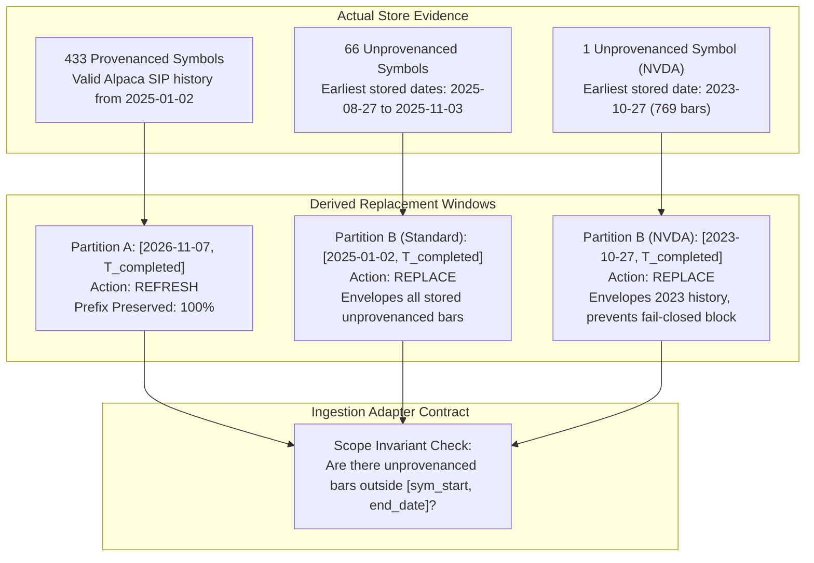

# ARX Radar 500 Market Data Refresh Plan (Issue #166)

- **Document Version:** 2.1.0-IMPLEMENTED
- **Plan Reference:** `RADAR-500-MARKET-DATA-REFRESH-PLAN-166`
- **Issue Reference:** Issue #166
- **Date:** 2026-11-20
- **Operational Status:** **QUALIFIED OFFLINE — PRODUCTION REFRESH STRICTLY DEFERRED**
- **Topic Branch:** `audit/radar-readiness-assessment-166`
- **Baseline Audit Commit:** `a8c2cc554865882e3c09f3e098492cfa7e56b461`

---

## 1. Executive Summary & Objective

This corrected operational plan defines the bounded, offline-qualified procedure for refreshing market data across the published 500-symbol candidate universe (`UB-ARX-EXPANSION-500-20261108`).

### Objectives
1. Eliminate market data staleness by advancing daily bars to the latest completed exchange trading session $T_{\text{completed}}$.
2. Resolve the provenance deficit across the 67 unprovenanced symbols using replacement windows derived directly from actual stored history evidence.
3. Address recurrence before refresh: isolate or guard background writers from invalidating refreshed provenance, while never preserving provenance attached to replaced, different-source bars.
4. Replace rigid "500 READY" assertions with strict full-population accounting closure: every published symbol accounted for, either demonstrably ready or carrying an explicit unresolved exception.
5. Preserve existing operational holds and the armed SEC worker trial. **Execution of this plan in production is strictly DEFERRED while the SEC trial runs.**

---

## 2. Target Database Path & Serving Runtime Resolution

### A. Authoritative Path Resolution
The target database path must resolve strictly against serving runtime configuration logic rather than arbitrary CLI flags:

$$\text{DATA\_DIR} = \text{os.getenv}(\text{"FINANCE\_DATA\_DIR"}, \text{os.getenv}(\text{"DATA\_DIR"}, \text{os.path.expanduser}(\text{"~"})))$$
$$\text{TARGET\_MARKET\_DB} = \text{os.path.join}(\text{DATA\_DIR}, \text{".finance\_market\_store.db"})]$$

In the Railway container environment running as user `root` (`~` = `/root`) with persistent volume mounted at `/root`:
- **Market Store:** `/root/.finance_market_store.db` (note leading dot).
- **Universe Store:** `/root/.finance_universe_store.db`.
- **Scanner Store:** `/root/.finance_scanner_store.db`.

### B. Execution-Time Identity Check (Fail-Closed)
Prior to initiating any backup, verification, or write operation, the execution harness runs an attributable identity check implemented in `verify_serving_runtime_identity` (`scripts/ingest_alpaca_historical.py`). If any check fails, execution **aborts immediately (fails closed)**:

1. **Rejection of Missing Identity:** `RAILWAY_DEPLOYMENT_ID` and `RAILWAY_GIT_COMMIT_SHA` are mandatory in the runtime environment. If either variable is missing or empty, execution aborts with `MISSING_RUNTIME_IDENTITY`.
2. **Full SHA Equality:** `RAILWAY_GIT_COMMIT_SHA` must be a valid 40-character hex string and match the expected revision byte-for-byte (`==`). Prefix matching is strictly prohibited (`INVALID_GIT_SHA_FORMAT` or `GIT_REVISION_MISMATCH`).
3. **Container Deployment ID & Pinned Deployment:** By default, validates against the historical serving deployment:
   - `HISTORICAL_SERVING_DEPLOYMENT_ID = "9f28fb4e-c804-4b6a-9a25-1092c496026d"`
   - `HISTORICAL_SERVING_GIT_SHA = "868d7afcd528006c2323e6b79b5a17f2f20f677c"`
   The implementation also supports pinning an explicitly authorized future qualified deployment via `--expected-deployment-id` and `--expected-git-sha` while keeping the current deployment identifiers as historical evidence.
4. **Database File Existence & Non-Zero:** Asserts the target database file exists and is non-empty (`stat().st_size > 0`).
5. **Authoritative Universe Store Validation:** When `--universe-db-path` is provided (e.g. `/root/.finance_universe_store.db`), connects in read-only mode (`?mode=ro`) and verifies:
   - `universe_builds` contains build `UB-ARX-EXPANSION-500-20261108` with `publication_decision == 'PUBLISHED'`, `eligible_count == 500`, and membership hash `5f60b47d5402c0fc29fa545b244b778ca99a017f47448f47ebdfc257db8881b0`.
   - `universe_eligibility_ledger` contains exactly 500 eligible symbols matching the published membership hash. Any mismatch aborts execution.

---

## 3. Epistemic Status: Demonstrated Writer Behavior vs. Inferred Historical Causes

To maintain strict epistemic hygiene, writer mechanisms demonstrated in code and test reproductions must be separated from inferred historical causes:

### Demonstrated in Code & Offline Reproduction
1. **Provenance Purging in [`market_db.py`](file:///Users/iDavid/Projects/finance-clean/analyst_dashboard/data/market_db.py#L280-L302):**
   `MarketDatabaseEngine.save_daily_candles` executes:
   ```python
   # Prevent contradictory candle provenance after legacy replacement (PREFLIGHT-001 Target 5)
   cursor.execute("DELETE FROM asset_ohlcv_provenance WHERE symbol = ? AND trade_date = ?", (upper, date_str))
   ```
   This is intentional, demonstrated behavior to prevent replaced, different-source bars (e.g. Yahoo Finance) from falsely retaining Alpaca SIP provenance.
2. **Tactical Writer Invocations:**
   In [`api/routes/analytics.py`](file:///Users/iDavid/Projects/finance-clean/api/routes/analytics.py#L509-L803), `_background_refresh_symbol` and `/api/v1/analytics/setups` call `market_db.save_daily_candles` with Yahoo Finance data when `_is_history_stale` is True.
3. **Startup Warmup:**
   In [`api/main.py`](file:///Users/iDavid/Projects/finance-clean/api/main.py#L45), `_warmup_worker` calls `db.save_daily_candles` for core symbols on cold cache miss.

### Explicitly Labeled Inferred / Unverified
- **Individual Historical Request Attribution:**
  Inferring that a specific symbol (e.g. `AAPL` or `NVDA`) had its provenance purged at a specific historical moment by a specific HTTP request to `/api/v1/analytics/setups` vs startup pre-warming vs manual script execution is **UNVERIFIED** without timestamped container access logs or worker execution receipts.
- **Legacy Seed Attribution:**
  Attributing the 14 early unprovenanced symbols (`ABT`, `ADBE`, `BAC`, etc.) to specific historical bootstrapping commits is **UNVERIFIED**.

---

## 4. Recurrence Prevention Before Refresh

To prevent legacy or background writers from invalidating refreshed provenance after completion, recurrence has been addressed directly in production application code:

### A. Smallest Production Guard Implementation
1. **Core Database Engine Guard ([`analyst_dashboard/data/market_db.py`](file:///Users/iDavid/Projects/finance-clean/analyst_dashboard/data/market_db.py#L254-L285)):**
   - Implemented `MarketDatabaseEngine.has_authoritative_provenance(symbol: str) -> bool`:
     Executes a fast indexed query against `asset_ohlcv_provenance` asserting `provider = 'ALPACA'` and `adjustment_state = 'SPLIT_ADJUSTED_ONLY'`.
   - Updated `save_daily_candles(symbol, data, reject_if_authoritative: bool = False)`:
     When `reject_if_authoritative=True` and `has_authoritative_provenance(symbol)` returns True, the unprovenanced write is safely bypassed, logging `RECURRENCE_GUARD: Bypassed unprovenanced write for '{symbol}'`.
2. **Background Writers Guard ([`api/routes/analytics.py`](file:///Users/iDavid/Projects/finance-clean/api/routes/analytics.py#L504-L528)):**
   - `_schedule_background_refresh`: Immediately returns without queueing if candidate has authoritative provenance.
   - `_background_refresh_symbol`: Checks `has_authoritative_provenance` before making external HTTP requests, and passes `reject_if_authoritative=True` to `save_daily_candles`.
3. **Direct On-Demand Writers Guard ([`api/routes/analytics.py`](file:///Users/iDavid/Projects/finance-clean/api/routes/analytics.py#L593-L815,L1210)):**
   - `_compute_single_setup`: Bypasses cold-cache Yahoo Finance fetch and background scheduling if candidate has authoritative provenance; passes `reject_if_authoritative=True`.
   - `get_tactical_setup_for_symbol`: Skips synchronous Yahoo Finance fetch on stale data if candidate is authoritative; passes `reject_if_authoritative=True`.
   - `get_chart_history` & `get_asset_analytics`: Passes `reject_if_authoritative=True` to prevent ad-hoc overwrites.
4. **Warmup Writer Guard ([`api/main.py`](file:///Users/iDavid/Projects/finance-clean/api/main.py#L38-L55)):**
   - `_warmup_worker`: Checks `db.has_authoritative_provenance(sym)` and skips warmup pre-fetching for authoritative candidates; passes `reject_if_authoritative=True`.

### B. Contradictory Provenance Invariant
> [!IMPORTANT]
> **Preserve contradictory-provenance deletion whenever different-source bars are legitimately replaced.**
> In `market_db.py` (lines 292-295 and 311-314), `save_daily_candles` executes:
> ```python
> cursor.execute("DELETE FROM asset_ohlcv_provenance WHERE symbol = ? AND trade_date = ?", (upper, date_str))
> ```
> When non-authoritative bars are legitimately written (e.g. ad-hoc user query for an out-of-universe ticker), any existing contradictory provenance for those dates is cleanly deleted. A bar fetched from an unverified provider must never inherit false Alpaca SIP provenance. Qualified in `test_recurrence_prevention_guards_authoritative_provenance`.

---

## 5. Derived Replacement Windows & Adjustment-Basis Consequences

Replacement windows are derived strictly from actual store evidence and the adapter contract ([`scripts/ingest_alpaca_historical.py:1208-1225`](file:///Users/iDavid/Projects/finance-clean/scripts/ingest_alpaca_historical.py#L1208-L1225)):



### Derived Partition Windows
1. **Partition A: 433 Provenanced Symbols (Incremental Refresh):**
   - **Stored Evidence:** 433 symbols have complete, verified split-adjusted Alpaca SIP provenance from `2025-01-02` through `2026-11-06`.
   - **Derived Window:** `[2026-11-07, T_completed]`.
   - **Action:** `REFRESH`.
   - **Preservation:** 100% of verified historical bars (`2025-01-02` to `2026-11-06`) are preserved.
2. **Partition B: 66 Standard Unprovenanced Symbols (Scoped Replacement):**
   - **Stored Evidence:** 66 symbols have unprovenanced history starting between `2025-08-27` and `2025-11-03`.
   - **Derived Window:** `[2025-01-02, T_completed]`.
   - **Action:** `REPLACE`.
   - **Rationale:** Because `2025-01-02 <= earliest_stored`, zero unprovenanced bars exist outside the window, cleanly satisfying the adapter contract and providing the mandatory 252 trading days of institutional depth.
3. **Partition B: Extended Unprovenanced Symbol (`NVDA`):**
   - **Stored Evidence:** `NVDA` contains 769 bars extending back to `2023-10-27`.
   - **Derived Window:** `[2023-10-27, T_completed]`.
   - **Action:** `REPLACE`.
   - **Rationale:** If `NVDA`'s replacement window started at `2025-01-02`, the unprovenanced bars between `2023-10-27` and `2025-01-01` would trigger `INCOMPATIBLE_HISTORY_OUTSIDE_REVIEWED_SCOPE`. Deriving the window from actual evidence resolves this blocker cleanly.

### Adjustment-Basis Consequences
- The unprovenanced bars written by legacy Yahoo Finance calls carry unspecified or dividend-adjusted conventions.
- Replacing them with Alpaca Consolidated Tape SIP bars with `adjustment="split"` guarantees that the entire 500-symbol universe adheres strictly to `AdjustmentState.SPLIT_ADJUSTED_ONLY` (dividends unadjusted per Package B / institutional Minervini contract).
- This establishes mathematical consistency across all technical indicators (50-day SMA, 200-day SMA, and 22-day slope).

---

## 6. Aggregate Request Limits, Budgets, Deadlines & Checkpoints

All network interactions and database writes are strictly governed by `SharedExecutionBudget` in `scripts/ingest_alpaca_historical.py`:

| Parameter | CLI Flag | Budget / Ceiling | Basis & Enforcement |
| :--- | :--- | :--- | :--- |
| **Strict Aggregate Request Cap** | `--max-aggregate-requests` | **550 requests** | Hard ceiling across all candidates, pages, and retries. Exceeding raises `EXECUTION_BUDGET_EXHAUSTED`. |
| **Cumulative Retry Ceiling** | `--max-cumulative-retries` | **30 retries** | Shared retry budget across all pages. Exceeding raises `RETRY_BUDGET_EXHAUSTED`. |
| **Fallback Budget** | `--max-fallback-requests` | **0 requests** | Polygon fallback strictly disabled for batch refresh. |
| **Per-Request Timeout** | (HTTP Session) | 5.0 seconds | Enforced on every Alpaca HTTP GET call. |
| **Per-Symbol Processing Deadline** | (Loop Timer) | 15.0 seconds | Includes all pagination and retries for that symbol. |
| **Overall Wall-Clock Deadline** | `--overall-deadline-seconds` | **1,200.0s (20m)** | Hard global deadline. Exceeding raises `EXECUTION_BUDGET_TIMEOUT`. |
| **Pacing Delay** | `--sleep-seconds` | 0.35 seconds | Inter-request delay ensuring rate $\le 171.4\text{ req/min} < 200\text{ req/min}$ rate limit. |
| **Checkpoint Interval** | `--checkpoint-interval` | 50 candidates | Incremental state written to `--checkpoint-summary-path`. |
| **Safe Resume Support** | `--resume` | Flag | Resumes from checkpoint, skipping already-committed symbols without duplicate requests. |

### Failure Injection & Invariant Enforcement
Injected failure tests in `test_aggregate_request_limits_and_checkpoint_behavior` verify:
1. Cap exhaustion halts execution immediately without writing uncommitted candidates.
2. Retry exhaustion triggers immediate fail-closed abort.
3. Timeout and interruption persist completed candidate checkpoints and mark remaining symbols `UNPROCESSED`.
4. Resumption cleanly processes remaining candidates without re-fetching completed symbols.

---

## 7. Pre-Execution Backup & Quiesced WAL-Safe Recovery Protocol

Live file-copy rollback is strictly prohibited because SQLite WAL mode maintains active shared memory (`-shm`) and write-ahead log (`-wal`) state that can corrupt or desynchronize stores on copy. The documented recovery procedure is implemented in `quiesce_and_recover_database` (`scripts/ingest_alpaca_historical.py`) and qualified on disposable stores in `test_wal_safe_quiesced_recovery_rehearsal`:

### Phase 1: Pre-Refresh Consistent Backup Creation
```bash
python3 -c "
import sqlite3
src = sqlite3.connect('/root/.finance_market_store.db')
dst = sqlite3.connect('/root/backup_finance_market_store_pre_refresh_166.db')
src.backup(dst)
dst.close()
src.close()
print('Pre-refresh consistent backup completed successfully.')
"
```
Verify the pre-refresh backup SHA-256 and byte size before proceeding.

### Phase 2: Quiesced WAL-Safe Recovery Procedure
In the event of an aborted run, partial failure, or need to restore pre-refresh state:

1. **Quiesce Database Users & Checkpoint WAL:**
   Ensure all writer and reader processes are quiesced. Connect to the target database and execute:
   ```sql
   PRAGMA wal_checkpoint(TRUNCATE);
   ```
   This flushes all committed WAL frames back into the main database file and truncates the WAL file to zero bytes.
2. **Remove Unquiesced Sidecars & Target File:**
   Safely unlink `/root/.finance_market_store.db-wal` and `/root/.finance_market_store.db-shm` to prevent stale frame replay. Unlink `/root/.finance_market_store.db`.
3. **Byte-for-Byte Restoration:**
   Copy the pre-refresh backup to the target path using byte-preserving copy (`shutil.copy2`):
   ```bash
   cp /root/backup_finance_market_store_pre_refresh_166.db /root/.finance_market_store.db
   ```
4. **Integrity & Digest Verification:**
   Open the recovered database in read-only mode (`?mode=ro`) to prevent header modification:
   ```sql
   PRAGMA integrity_check;
   ```
   Unlink any ephemeral sidecars created during inspection. Assert that `hashlib.sha256(recovered_bytes) == hashlib.sha256(backup_bytes)`.
5. **Programmatic Recovery API:**
   The entire procedure can be invoked via Python:
   ```python
   from scripts.ingest_alpaca_historical import quiesce_and_recover_database
   res = quiesce_and_recover_database(
       target_db_path="/root/.finance_market_store.db",
       backup_path="/root/backup_finance_market_store_pre_refresh_166.db"
   )
   assert res["status"] == "RECOVERED"
   ```

---

## 8. Staged Execution Commands

> [!CAUTION]
> **DO NOT EXECUTE IN PRODUCTION NOW.** These commands are documented for execution only after formal authorization following completion of the SEC ingestion trial.

### Step 1: Execute Partition B (Scoped Replacement for 67 Unprovenanced Symbols)
```bash
python3 scripts/ingest_alpaca_historical.py \
  --manifest-path docs/research/manifests/candidate_expansion_500.json \
  --symbols "AAPL,ABT,ACLS,ADBE,AMD,AMZN,ANET,APP,AVGO,BAC,CDNS,CELH,CIEN,COIN,CRWD,CSCO,DDOG,DECK,DIS,DUOL,DXCM,ELF,EME,ETN,FIX,GEV,GOOGL,HOOD,IONQ,ISRG,JNJ,JPM,KLAC,LLY,LNTH,LRCX,LULU,MARA,MDB,MEDP,META,MNST,MPWR,MRK,MSFT,MSTR,NET,NOW,NVDA,ON,ONON,PANW,PFE,PG,PLTR,PODD,POWI,PWR,RKLB,SMCI,SNPS,TMDX,TSLA,TXN,ULTA,VRTX,WMT" \
  --feed sip \
  --adjustment split \
  --start-date 2025-01-02 \
  --end-date ${T_COMPLETED} \
  --max-completed-session ${T_COMPLETED} \
  --db-path /root/.finance_market_store.db \
  --universe-db-path /root/.finance_universe_store.db \
  --verify-runtime-identity \
  --max-aggregate-requests 550 \
  --max-cumulative-retries 30 \
  --max-fallback-requests 0 \
  --overall-deadline-seconds 1200 \
  --checkpoint-summary-path /root/partition_b_checkpoint.json \
  --output-summary-path /root/partition_b_replacement_summary.json \
  --apply
```
*(Note: For `NVDA`, start date is derived as `2023-10-27` via per-symbol manifest parameter or individual invocation).*

### Step 2: Execute Partition A (Incremental Refresh for 433 Provenanced Symbols)
```bash
python3 scripts/ingest_alpaca_historical.py \
  --manifest-path docs/research/manifests/candidate_expansion_500.json \
  --feed sip \
  --adjustment split \
  --start-date 2026-11-07 \
  --end-date ${T_COMPLETED} \
  --max-completed-session ${T_COMPLETED} \
  --db-path /root/.finance_market_store.db \
  --universe-db-path /root/.finance_universe_store.db \
  --verify-runtime-identity \
  --max-aggregate-requests 550 \
  --max-cumulative-retries 30 \
  --max-fallback-requests 0 \
  --overall-deadline-seconds 1200 \
  --checkpoint-summary-path /root/partition_a_checkpoint.json \
  --output-summary-path /root/partition_a_refresh_summary.json \
  --apply
```

---

## 9. Full Population Accounting Closure Acceptance Gate

Rather than requiring an unyielding "500 READY", the acceptance gate enforces **strict mathematical accounting closure**:

$$\text{Total Published Candidates (500)} = \text{READY} + \text{DOCUMENTED\_UNRESOLVED\_EXCEPTIONS}$$

### Category Definitions
1. **`READY`:**
   - Completed exchange session bars through $T_{\text{completed}}$.
   - Institutional history depth $\ge 252$ trading days.
   - 100% pure Alpaca SIP split-adjusted provenance (`AdjustmentState.SPLIT_ADJUSTED_ONLY`).
   - Fully eligible under VCP Stage 2 and Trend Template metrics.
2. **`DOCUMENTED_UNRESOLVED_EXCEPTIONS`:**
   - Explicitly identified symbols carrying attributable evidence of non-readiness:
     - Confirmed corporate action delisting (e.g. `DELISTED` in `candidate_exclusions_ledger_500.json`).
     - Upstream exchange trading halt or bankruptcy liquidation with timestamped provider receipt.
   - Zero symbols may be omitted, unaccounted for, or classified as UNKNOWN.

---

## 10. Operational Containment & Deferral Rationale

> [!IMPORTANT]
> **Strict Deferral Binding:**
> 1. The armed SEC trial (`ARX-TRIAL-2026-NVDA-AAPL-001`, Day 1 grant `dc58b294...`) is currently active on Railway.
> 2. Executing market data refresh against the production container risks memory contention, SQLite write locks, or worker disruption.
> 3. Therefore, execution of this qualified refresh plan is strictly **DEFERRED** until the SEC ingestion trial completes its natural scheduled cycle and report reconciliation.
> 4. All six operational holds (`HOLD_SCAN_001`, `HOLD_SEC_001`, `HOLD_EXEC_001`, `PHASE_3_HOLD`, `ARX_CONFLUENCE_INTEGRITY_HOLD`, `PHASE_A3_UX_HOLD`) remain 100% active.
