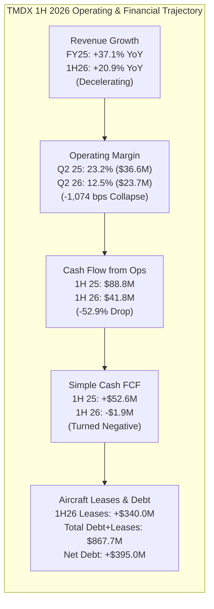
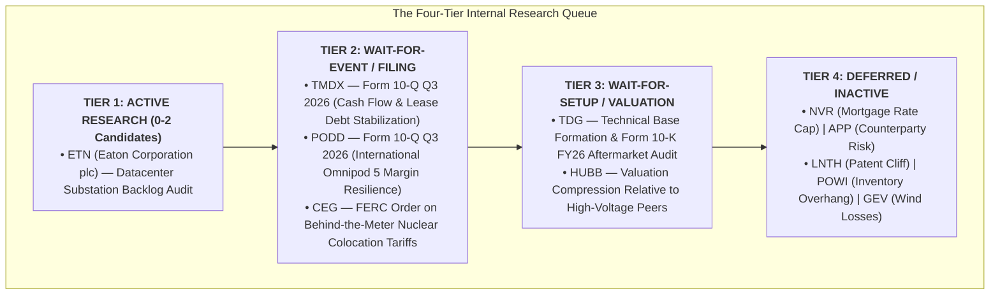

# ARX Terminal — Candidate Priority Reassessment After Discovery Cycle 2

**Document ID:** `ARX-CANDIDATE-PRIORITY-REASSESSMENT-V1`  
**Effective Date:** October 22, 2026  
**Governing Authority:** Product Owner Authorization — Candidate Priority Reassessment after Discovery Cycle 2  
**Governing Standard:** `ARX-DECISION-RESEARCH-PROCESS-V1` & ARX Closure Model v2  
**Applicability:** Internal Research Experiment Only (Non-Production / Non-Public)  

---

## 1. Executive Summary & Epistemic Framework

Following the controlled mainline adoption of Discovery Cycle 2 via PR #46 (Commit `404a566734306a9e51b442c10dfe5fe028e7d19f`), this document resolves the Product Owner's specific operational concern:

> **Why was `TMDX` prioritized despite an unestablished technical setup and weakening recent operating/cash-flow comparisons? If those facts weaken `TMDX`'s priority, what should its priority actually be, how does this reasoning apply across the remaining Cycle 2 candidates, and what research queue should ARX maintain right now?**

### Core Decisions & Direct Answers to Product Owner Questions

1. **Why `TMDX` was prioritized earlier:**  
   Prioritization in Discovery Cycle 2 was anchored on audited full-year FY2025 financial statements ($605.5M revenue, +37.1% YoY, $108.6M operating income, $192.8M CFO, $133.6M FCF). The triage suffered from **Annual Reporting Lag Bias**, **Thesis Momentum**, and an **Epistemic Conflation** of *Business Research Relevance* with *Research Urgency*. It underweighted the fact that during the first six months of 2026 (1H 2026), operating income fell -42.1% YoY, operating cash flow dropped -52.9% YoY, simple cash FCF turned negative (-$1.9M), $340.0M of noncash aircraft lease debt was added, and the stock entered an entrenched downtrend (-25.4% below its 200-day moving average).

2. **`TMDX`'s Corrected Priority:**  
   `TMDX` is formally demoted from active monitoring priority to **`WAIT_FOR_EVENT`** (Tier 2). Research effort is suspended until two observable conditions occur: (1) the Form 10-Q Q3 2026 filing confirms operating cash flow stabilization and gross margin resilience above 58% despite European PAD Aviation integration, and (2) price reclaims the 50-day moving average and establishes a consolidation base.

3. **Systemic Application Across Cohort:**  
   The same four-dimensional standard applied across all 14 Cycle 2 candidates reveals that macro theme resonance (e.g. power grid bottlenecks, AI advertising) often obscures cyclical peak risk (`PWR`, `NVR`), regulatory binary risk (`CEG`), or structural customer/platform risk (`APP`, `LNTH`).

4. **The Active Research Queue Now:**  
   - **Tier 1 (Active Research — Exactly 1 Candidate):** **`ETN` (Eaton Corporation plc)** — The only candidate possessing both profound business relevance (upstream high-voltage datacenter substation bottleneck) and immediate research urgency (evaluating Electrical Americas non-cancellable megaproject backlog ahead of Q3 earnings).
   - **Tier 2 (Wait-for-Event / Filing — 3 Candidates):** **`TMDX`** (Form 10-Q Q3 2026 filing), **`PODD`** (Form 10-Q Q3 2026 filing), **`CEG`** (FERC behind-the-meter colocation order).
   - **Tier 3 (Wait-for-Setup / Valuation — 2 Candidates):** **`TDG`** (basing and FY26 10-K), **`HUBB`** (valuation compression relative to Eaton).
   - **Tier 4 (Deferred / Inactive — 5 Candidates):** **`NVR`** (cyclical mortgage cap), **`APP`** (counterparty risk), **`LNTH`** (patent cliff), **`POWI`** (inventory overhang), **`GEV`** (wind loss provisions).
   - **Reference Benchmarks (3 Assets):** **`MEDP`** (Quality Watch reference), **`PWR`** (contractor benchmark), **`VRT`** (cooling benchmark).

---

## 2. Forensic Resolution of the TMDX Decision

### A. Primary-Source SEC Filing Evidence

An examination of TransMedics Group, Inc.'s (`TMDX`, CIK: `0001756262`) most recent primary filings—Form 10-K FY2025 (filed Feb 24, 2026) and Form 10-Q Q2 2026 (filed Aug 4, 2026)—reveals a stark divergence between the trailing annual narrative and the reported interim reality:

#### Comprehensive Financial Comparison Table

| Metric | FY2025 Full Year (Audited) | 1H 2025 (Six Months Ended Jun 30, 2025) | 1H 2026 (Six Months Ended Jun 30, 2026) | 1H YoY Change (%) | Q2 2025 (Three Months Ended Jun 30, 2025) | Q2 2026 (Three Months Ended Jun 30, 2026) | Q2 YoY Change (%) |
| :--- | :---: | :---: | :---: | :---: | :---: | :---: | :---: |
| **Consolidated Revenue** | $605.494M | $300.907M | $363.881M | **+20.9%** | $157.370M | $189.948M | **+20.7%** |
| **Gross Profit** | $362.806M | $184.817M | $214.359M | +16.0% | $96.589M | $113.198M | +17.2% |
| **Gross Margin (%)** | 59.92% | 61.42% | 58.91% | -251 bps | 61.38% | 59.59% | -179 bps |
| **Operating Income (Loss)** | $108.583M | $64.010M | $37.033M | **-42.1%** | $36.567M | $23.736M | **-35.1%** |
| **Operating Margin (%)** | 17.93% | 21.27% | 10.18% | **-1,109 bps** | 23.24% | 12.50% | **-1,074 bps** |
| **GAAP Net Income** | $190.291M* | $49.726M | $21.997M | -55.8% | $34.907M | $14.682M | -57.9% |
| **Cash from Operations (CFO)** | $192.840M | $88.754M | $41.842M | **-52.9%** | — | — | — |
| **Cash PP&E Purchases (Capex)** | $59.251M | $36.113M | $43.749M | **+21.1%** | — | — | — |
| **Simple Free Cash Flow (FCF)** | $133.589M | $52.641M | **-$1.907M** | **-$54.548M (Deficit)** | — | — | — |
| **Noncash Aircraft Lease Additions**| $0.0M | $0.0M | **$340.040M** | N/A | — | — | — |
| **Total Debt & Finance Leases** | $518.2M | $519.0M | **$867.656M** | **+67.2%** | — | — | — |
| **Cash & Cash Equivalents** | $462.8M | $395.2M | $472.675M | +19.6% | — | — | — |
| **Net Debt (incl. Leases)** | +$55.4M | +$123.8M | **+$394.981M** | **+$271.2M** | — | — | — |

*\*Includes nonrecurring tax valuation allowance release of $103.3M.*

#### Primary Filing Insights:
1. **Growth Deceleration:** Revenue growth slowed from +37.1% YoY in FY25 to +20.7% YoY in Q2 2026. While 20%+ growth remains robust in absolute terms, it represents a substantial deceleration from the hyper-growth rates that commanded peak valuation multiples.
2. **Severe Operating Margin Compression:** In Q2 2026, GAAP operating income dropped from $36.567M to $23.736M (-35.1% YoY). Operating margin was cut almost in half, from **23.24% to 12.50%** (-1,074 bps), driven by operating expenses increasing +40.8% YoY ($122.9M vs $87.3M) as aviation maintenance, pilot staffing, and infrastructure overhead scaled faster than procedure volume.
3. **Cash Flow Breakdown & FCF Deficit:** For the six months ended June 30, 2026, CFO fell by -$46.912M (-52.9% YoY) from $88.754M to $41.842M. With cash capital expenditures rising to $43.749M, **simple cash Free Cash Flow turned negative (-$1.907M)** compared to positive +$52.641M in 1H 2025.
4. **Refutation of the "Self-Funding Compounder" Thesis:** The thesis that TMDX is an organically self-funding compounding machine is contradicted by 1H 2026 filings. Operating cash flow did not cover cash capex, let alone fleet growth. In 1H 2026, TMDX incurred **$340.040M in noncash finance lease additions** for right-of-use aircraft. Total debt and lease liabilities jumped to $867.656M, leaving net debt at +$394.981M. Rather than operating asset-light, TransMedics has assumed the balance-sheet profile of a regional airline operator.

---

### B. Technical and Market State

Primary market data as of October 22, 2026 establishes the following technical profile for `TMDX`:

- **Current Market Price:** **$72.06**
- **200-Session Daily SMA:** **$96.58** (Distance: **-25.39%**)
- **50-Session Daily SMA:** **$84.27** (Distance: **-14.49%**)
- **52-Week High / Low:** **$156.00** / **$60.11** (Drawdown from High: **-53.81%**)
- **Technical Structure:** Active, entrenched downtrend. The stock is printing lower highs and lower lows below downward-sloping 50-day and 200-day moving averages (`Price < 50d SMA < 200d SMA`).

#### Market Psychology & Skepticism:
The market's sharp de-rating (-53.8% from peak) is not an irrational dislocation or emotional overshoot on an intact compounder; **the market is rationally pricing in the deceleration in revenue, the severe compression in operating margin, and the surge in debt obligations.** There is no base formation, no volume accumulation shelf, and no evidence that institutional distribution has completed. Entering or prioritizing active research now is premature because the market has not yet found an equilibrium valuation for TransMedics' asset-heavy aviation logistics model.

---

### C. Root Cause of Prior Prioritization

Why did Discovery Cycle 2 advance `TMDX` to a deep investigation and rank it second in the next-action queue?

1. **Annual Reporting Lag Bias:** The initial screening relied heavily on audited full-year FY2025 numbers. FY25 was an exceptional milestone year ($605.5M rev, $192.8M CFO, $133.6M FCF), creating a trailing halo effect that obscured the interim deterioration already visible in the Q2 2026 Form 10-Q.
2. **Thesis Momentum & Conceptual Attractiveness:** The conceptual narrative—transforming organ transplant logistics via FDA-approved warm perfusion cassettes and a proprietary aviation network—is intellectually compelling. The analyst allowed the elegance of the business concept to overpower the financial data.
3. **Epistemic Conflation:** The triage conflated *Business Research Relevance* with *Research Urgency*. While TransMedics presents a fascinating business question (can perfusion logistics scale profitably?), it possessed zero research urgency given its negative 1H26 simple FCF, pending European aviation integration, and broken technical profile.
4. **Underweighting Noncash Lease Debt:** Early analysis focused on simple cash PP&E ($59.3M in FY25) and underweighted noncash aircraft finance leases ($340.0M in 1H26), treating lease obligations as secondary balance-sheet footnote items rather than fixed claims on future cash flows.

---

### D. Consequence for Prioritization

- **Decision:** **DEMOTE `TMDX` FROM ACTIVE MONITORING TO `WAIT_FOR_EVENT` (Tier 2).**
- **Immediate Action:** Cease active modeling and monitoring. Do not prepare a public Quality Watch dossier.
- **Specific Observable Review Triggers:**
  1. **Filing Trigger:** Publication of SEC Form 10-Q for Q3 2026 (expected early November 2026). ARX will inspect:
     - Consolidated operating cash flow rebounding above $50.0M for the quarter.
     - Consolidated gross margin holding above 58.0%, proving that European aviation rollout (PAD Aviation) does not dilute unit economics.
     - Plateauing of aircraft finance lease obligations.
  2. **Technical Trigger:** Price reclaiming the 50-day moving average and completing a minimum 4-week base consolidation without setting new cycle lows.

---

## 3. Comprehensive Evaluation of the Full Cycle 2 Cohort (14 Candidates)

The table below applies the four-dimensional evaluation framework across all 14 candidates examined or benchmarked in Discovery Cycle 2.

### Comprehensive Candidate Triage & Priority Reassessment Table

| Symbol | Company Name | Route | Business Direction | Technical State (Price / 200d SMA / Dist) | Valuation State | Decisive Research Question | Immediate Action | Review Trigger | Priority Rank & Rationale |
| :--- | :--- | :---: | :---: | :---: | :---: | :--- | :---: | :--- | :--- |
| **`ETN`** | Eaton Corporation plc | Route B | **Strengthening** | $368.99 / $395.34 (**-6.67%**) Consolidating near 50d ($418) | **Fair** (~25x Fwd P/E) | What % of Electrical Americas backlog is non-cancellable datacenter substations vs cyclical commercial building? | **`ACTIVE_RESEARCH`** | Form 10-Q Q3 2026 (Nov 2026) | **Rank 1 (Queue Leader):** Essential upstream datacenter power bottleneck, 79.5% FCF conversion, 'A-' credit, high margin resilience (29.9% Americas margin). |
| **`TMDX`** | TransMedics Group, Inc. | Route A | **Weakening** (Interim) | $72.06 / $96.58 (**-25.39%**) Entrenched downtrend (-53.8% high) | **Speculative** (Aviation drag) | Can operating cash flow cover aircraft lease debt service without gross margins falling below 55%? | **`WAIT_FOR_EVENT`** | Form 10-Q Q3 2026 (Nov 2026) | **Rank 2 (Tier 2):** High business relevance demoted due to negative 1H26 simple FCF (-$1.9M), $347.7M lease debt, and broken technical setup. |
| **`PODD`** | Insulet Corporation | Route A | **Strengthening** | $148.12 / $182.91 (**-19.02%**) Basing above 50d ($140.45) | **Compressed** (~23x Fwd P/E) | Does pharmacy benefit adoption sustain >18% operating margins as international expansion scales? | **`WAIT_FOR_EVENT`** | Form 10-Q Q3 2026 (Nov 2026) | **Rank 3 (Tier 2):** High-margin recurring consumable revenue (>85% recurring); superior cash conversion to TMDX, but awaiting international validation. |
| **`CEG`** | Constellation Energy Corp | Route B | **Strengthening** (Contracted) | $255.21 / $282.31 (**-9.60%**) Pullback from $406 high | **Stretched** (PPA premium) | Will FERC approve behind-the-meter nuclear colocation tariffs without transmission penalties? | **`WAIT_FOR_EVENT`** | FERC Colocation Ruling | **Rank 4 (Tier 2):** Exceptional long-term baseload moat (Microsoft 20-yr PPA), but binary regulatory tariffs make near-term financial modeling premature. |
| **`TDG`** | TransDigm Group, Inc. | Route A | **Stable / Strong** | $1,141.74 / $1,233.84 (**-7.46%**) Consolidating at 50d ($1,140) | **Fair / Premium** (Debt-adjusted) | Can proprietary aftermarket pricing power sustain >45% EBITDA margins under higher refinancing costs? | **`WAIT_FOR_SETUP`** | Technical Base & Form 10-K FY26 (Nov 2026) | **Rank 5 (Tier 3):** World-class aftermarket pricing power, but $22B+ funded debt violates Quality Watch capital resilience standards; internal benchmark only. |
| **`HUBB`** | Hubbell Incorporated | Route B | **Stable** | $445.80 / $489.10 (**-8.85%**) Consolidating near 50d ($465) | **Fair** (~24x Fwd P/E) | What is Hubbell's relative growth rate in high-voltage utility switchgear vs standard pole-top distribution? | **`WAIT_FOR_SETUP`** | Valuation Compression vs ETN | **Rank 6 (Tier 3):** High quality utility grid supplier, but lower direct high-voltage datacenter substation leverage than Eaton; secondary priority. |
| **`NVR`** | NVR, Inc. | Route A | **Stable** (Cyclical) | $6,110.63 / $6,587.80 (**-7.24%**) Consolidating range | **Compressed** (~13x P/E) | Can lot option margins withstand sustained 6.5%+ mortgage rates and land developer cost inflation? | **`DEFERRED`** | Mortgage Rate Drop < 6% | **Rank 7 (Tier 4):** Elite capital returns (>35% ROIC, zero debt), but business model is subordinated to macro mortgage rate cycle; deferred. |
| **`APP`** | AppLovin Corporation | Route A | **Strengthening** (Cash) | $264.28 / $427.39 (**-38.16%**) Broken steep downtrend | **Speculative** (Regulatory risk) | How durable is AXON 2.0 eCPM monetization if Apple/Google alter mobile attribution and privacy rules? | **`DEFERRED`** | Platform Privacy Policy Audit | **Rank 8 (Tier 4):** High cash generation offset by unacceptable platform counterparty dependence and governance opacity; deferred. |
| **`LNTH`** | Lantheus Holdings, Inc. | Route A | **Weakening** (Terminal) | $100.10 / $90.40 (**+10.74%**) Above 200d SMA | **Compressed** (~9x P/E) | What percentage of Pylarify diagnostic volume survives imminent generic radiopharmaceutical alternatives? | **`DEFERRED`** | Patent Dispute Settlement | **Rank 9 (Tier 4):** Severe patent cliff and single-product concentration (>70% rev) destroy terminal value certainty; deferred. |
| **`POWI`** | Power Integrations, Inc. | Route B | **Weakening** (Cyclical) | $47.12 / $58.67 (**-19.69%**) Downtrend (-48% high) | **Stretched** (Depressed earnings) | When will non-datacenter channel inventories normalize to allow GaN datacenter ICs to drive margins? | **`DEFERRED`** | Channel Inventory Normalization | **Rank 10 (Tier 4):** Datacenter GaN is <15% of revenue; remaining 85% is burdened by severe industrial/consumer inventory overhang; deferred. |
| **`GEV`** | GE Vernova Inc. | Route B | **Mixed** (Turnaround) | $827.42 / $937.94 (**-11.78%**) Post-spin correction | **Speculative** (Turnaround multiple) | When will legacy offshore wind loss provisions terminate to allow Power/Electrification cash flow through? | **`DEFERRED`** | Wind Loss Provision Cessation | **Rank 11 (Tier 4):** Strong electrification positioning overshadowed by volatile legacy offshore wind contract liabilities; deferred. |
| **`MEDP`** | Medpace Holdings, Inc. | Reference | **Strengthening** | $653.96 / $527.32 (**+24.01%**) Strong uptrend near 52w high | **Fair / Premium** (High ROIC) | Full-service biotech CRO reference asset (Zero debt, 97.5% FCF conversion). | **`PUBLISHED_ASSET`** | Quarterly Watch Maintenance | **Baseline Benchmark:** Published Quality Watch asset; sets the bar for debt-free cash conversion. |
| **`PWR`** | Quanta Services, Inc. | Reference | **Stable / Cyclical** | $552.44 / $621.41 (**-11.10%**) Pullback from $788 high | **Fair** (~28x Fwd P/E) | EPC infrastructure contractor benchmark (8-9% operating margin, execution risk vs equipment makers). | **`BENCHMARK_ONLY`** | Quarterly Peer Tracking | **Expansion Benchmark:** Demonstrates strong grid backlog, but lower margin and fixed-price risk compared to ETN. |
| **`VRT`** | Vertiv Holdings Co | Reference | **Strengthening** (High Cap) | $195.59 / $268.96 (**-27.28%**) Sharp correction (-48.5% high) | **Stretched** (AI Multiple) | White-space thermal cooling benchmark (Higher customer concentration, lower gross margins than ETN). | **`BENCHMARK_ONLY`** | Quarterly Peer Tracking | **Cycle 1 Benchmark:** Essential cooling supplier, but higher valuation volatility and leverage than Eaton. |

---

## 4. The Evidence-Supported Research Queue (Four Structured Tiers)

### TIER 1: ACTIVE RESEARCH (Queue Leader)
- **Asset Authorized:** **`ETN` (Eaton Corporation plc)**
- **Why Investigated Now:** Eaton is the only Cycle 2 candidate where both **Business Research Relevance** (entrenched spec-in position in high-voltage utility substations and datacenter switchgear) and **Research Urgency** (auditing Electrical Americas megaproject backlog composition prior to Q3 earnings disclosures) coincide with a resilient investment-grade balance sheet (1.6x Net Debt / EBITDA, 79.5% FCF conversion).
- **Decisive Investigation Scope:** Perform deep backlog disaggregation: quantify what percentage of the multi-year Electrical Americas order book is comprised of non-cancellable, binding utility substation and hyperscaler switchgear contracts versus cyclical commercial real estate projects subject to deferral.

### TIER 2: WAIT-FOR-EVENT / FILING (Active Monitoring Suspended)
- **`TMDX` (TransMedics Group, Inc.):**
  - *Status:* Demoted from active priority.
  - *Decisive Event:* Form 10-Q Q3 2026 filing (November 2026).
  - *Pass Condition:* Quarterly CFO > $50.0M, consolidated gross margins > 58.0%, and stabilized aircraft lease commitments.
- **`PODD` (Insulet Corporation):**
  - *Status:* Prioritized for event review.
  - *Decisive Event:* Form 10-Q Q3 2026 filing (November 2026).
  - *Pass Condition:* International Omnipod 5 revenue growth exceeding +25% YoY and operating margin holding >18.0%.
- **`CEG` (Constellation Energy Corp):**
  - *Status:* Prioritized for regulatory resolution.
  - *Decisive Event:* Federal Energy Regulatory Commission (FERC) formal order on behind-the-meter datacenter colocation tariffs.
  - *Pass Condition:* FERC order permitting direct nuclear colocation without punitive grid transmission surcharges.

### TIER 3: WAIT-FOR-SETUP / VALUATION (Market Inopportune)
- **`TDG` (TransDigm Group, Inc.):** Retained strictly as an internal benchmark for sole-source proprietary pricing power. Research inactive until price establishes a constructive multi-month base and Form 10-K FY2026 confirms debt coverage.
- **`HUBB` (Hubbell Incorporated):** Solid grid equipment franchise; inactive until relative valuation compresses toward broader industrial medians.

### TIER 4: DEFERRED / INACTIVE (Zero Research Resource Allocation)
- **`NVR`:** Deferred due to macro mortgage rate sensitivity.
- **`APP`:** Deferred due to platform counterparty and app store policy risks.
- **`LNTH`:** Deferred due to Pylarify patent expiration and terminal value uncertainty.
- **`POWI`:** Deferred due to non-datacenter consumer/industrial inventory overhang.
- **`GEV`:** Deferred due to legacy offshore wind contract loss provisions and restructuring volatility.

---

## 5. Cross-Reference & Discovery Cycle 2 Document Relationship

This reassessment formally clarifies the standing of prior internal artifacts produced during Discovery Cycle 2:

1. **`SEARCH_UNIVERSE_AND_TRIAGE_MATRIX.md`:** Serves as the historical record of the 14 candidates screened during the execution of Cycle 2. Its initial triage disposition for `TMDX` (`ADVANCED_TO_DEEP_INVESTIGATION`) reflected the starting triage phase, which is now formally superseded by Section 2 and Section 4 of this reassessment.
2. **`DISCOVERY_OPPORTUNITY_RECORDS.md`:** The factual financial reconciliations for FY2025 (audited) and Q2 2026 (unaudited) remain authoritative and fully verified. However, `TMDX`'s operational priority is updated from active internal monitoring to **`WAIT_FOR_EVENT`**.
3. **`CYCLE_2_EVALUATION_REPORT.md`:** The process verdict (`CONTINUE`) and effort logs (~2.20 hours) remain valid. The next-action queue in Section 4 is formally updated to place `ETN` as the sole Tier 1 candidate, with `TMDX`, `PODD`, and `CEG` placed in Tier 2 pending discrete observable triggers.

---

## 6. Governance, Backlog Reconciliation & Verification

- **Engineering Backlog Update:** In `docs/planning/ENGINEERING_BACKLOG.md`:
  - `BACKLOG-RESEARCH-EVIDENCE-DISCOVERY-046` is marked **`COMPLETED_AND_ADOPTED`** (citing merge commit `404a566734306a9e51b442c10dfe5fe028e7d19f`, tree `caab46d1e93c44aa34994bbb76a4e6c0a7605423`).
  - `BACKLOG-RESEARCH-PRIORITY-REASSESSMENT-047` is registered as **`IN_PROGRESS`** on branch `feat/research-candidate-priority-reassessment`.
- **System Invariants Maintained:**
  - Public watch manifest remains exactly 6 approved symbols: `FIX, DUOL, ULTA, MEDP, ISRG, DECK`.
  - Baseline discovery ledger `odp05_discovery_ledger.json` SHA-256 (`a65be3b...`) remains strictly untouched and verified.
  - Zero live ingestion, scanner activation, or frontend bundle changes.
