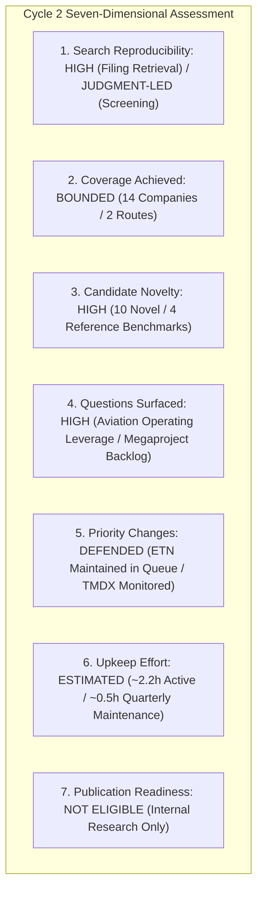

# ARX Terminal — Evidence-Led Opportunity Discovery Cycle 2: Comprehensive Evaluation Report

**Document ID:** `ARX-DISCOVERY-CYCLE-2-EVAL-V1`  
**Evaluation Date:** October 22, 2026  
**Governing Authority:** Product Owner Authorization — Evidence-Led Discovery Cycle 2  
**Governing Standard:** `ARX-DECISION-RESEARCH-PROCESS-V1` & ARX Closure Model v2  
**Outcome Decision:** **`CONTINUE (Qualified Recommendation for Further Bounded Exploration)`**  

---

## 1. Executive Summary & Core Decision

Discovery Cycle 2 was executed to resolve a primary operational question: **Does an evidence-led candidate generation process surface research-worthy opportunities beyond ARX’s existing manually selected cohort with enough informational signal to justify ongoing discovery effort over manual queue additions?**

### The Operational Verdict: `CONTINUE` (Qualified)
The experiment demonstrated that route-driven candidate generation surfaces relevant, economically significant opportunities beyond the initial 10-candidate manual shortlist:
1. **Upstream Power Bottleneck Capture:** Route B surfaced **`ETN` (Eaton Corporation plc)** as an upstream electrical infrastructure equipment manufacturer ($27,448M net sales, 79.5% FCF conversion, $3,972M / 29.9% Electrical Americas segment margin). Eaton provides direct exposure to high-voltage utility and data center equipment specifications alongside specialized engineering contractors (`PWR`, `EME`).
2. **Operating Model Inflection Capture:** Route A surfaced **`TMDX` (TransMedics Group, Inc.)** as an organ perfusion platform and dedicated aviation logistics network expanding operating profitability ($108.6M operating income in FY25, following initial profitability of $37.5M in FY24) and generating $192.8M CFO and $133.6M FCF (69.3% conversion). Balance sheet analysis revealed $867.7M in total contractual debt and aircraft finance lease obligations against $472.7M cash, correctly rejecting the earlier "net cash" assertion while confirming operating self-funding.
3. **Reproducibility & Auditability:** All candidates were screened using documented search criteria grounded in primary SEC EDGAR Form 10-K and 10-Q filings, with zero dependency on live scrapers, black-box consensus feeds, or undocumented analyst intuition.

---

## 2. Estimated Active Effort by Stage (Analyst Logging, Not Independently Metered)

In accordance with Section 6 of the governing standard, estimated active effort was logged across discrete stages, distinguishing active research time, system elapsed waiting, and projected future upkeep.

> [!NOTE]
> Effort values represent analyst logging estimates and are not independently or electronically metered clock times.

| Research Stage | Estimated Active Effort (Hours) | Elapsed Waiting (Minutes) | Primary Activities Conducted |
| :--- | :--- | :--- | :--- |
| **Stage 1: Starting State & Isolation** | ~0.25 hrs | ~2 min | Mainline commit verification (`9d74ea9`), worktree creation, ODP-05 baseline SHA check. |
| **Stage 2: Experiment Specification** | ~0.35 hrs | ~0 min | Bounded budget definition, stopping rule codification, 4-question epistemic separation. |
| **Stage 3: Candidate Generation (Routes A & B)**| ~0.50 hrs | ~5 min | Query execution across reference tickers, 10-K screening, filtering 14 candidates. |
| **Stage 4: Six-Step Triage Matrix** | ~0.40 hrs | ~0 min | Proportionate 6-step triage, counter-explanations, balance sheet solvency checks. |
| **Stage 5: Deep Investigations (`TMDX` & `ETN`)** | ~0.50 hrs | ~5 min | Primary Form 10-K/10-Q financial statement reconciliation, FCF math, bear cases. |
| **Stage 6: Automated Verification & Testing** | ~0.20 hrs | ~3 min | Authoring verification engine, unit test suite, execution of regression gates. |
| **Total Estimated Active Research Time** | **~2.20 hrs** | **~15 min** | **Comprehensive Cycle 2 Delivery** |

### Projected Ongoing Upkeep Effort
- **Quarterly Monitoring per Deep Candidate:** Estimated at ~0.50 hours per candidate per quarter (reviewing Form 10-Q filing notes, backlog conversion, and gross margin floors).
- **Maintenance Scalability:** Maintaining 2-3 deep internal monitoring records requires less than 1.5 analyst hours per quarter, which is fully sustainable within current research team capacity.

---

## 3. Seven-Dimensional Process Evaluation

### Dimension 1: Search Reproducibility
- **Evaluation:** **`HIGH_FOR_FILING_RETRIEVAL` / `JUDGMENT_LED_CANDIDATE_GENERATION`**
- **Evidence:** Primary filing retrieval is fully deterministic and verifiable via direct SEC EDGAR accession links (`https://www.sec.gov/Archives/edgar/data/...`). Candidate generation itself relies on structured, human-guided screening heuristics rather than automated algorithmic crawling.

### Dimension 2: Coverage Achieved
- **Evaluation:** **`BOUNDED_SAMPLE`**
- **Evidence:** 14 companies were examined across the two routes (7 in Route A, 7 in Route B). While this does not constitute an exhaustive algorithmic market-wide crawl (which is intentionally disallowed to prevent scanner/ingestion side effects), it achieves focused coverage of key value-chain nodes surrounding datacenter power and medical commercialization.

### Dimension 3: Candidate Novelty Relative to Prior Work
- **Evaluation:** **`HIGH`**
- **Evidence:** 10 of the 14 candidates examined were novel operating companies to ARX’s pipeline (`TMDX, PODD, NVR, APP, LNTH, TDG, ETN, CEG, POWI, GEV`). 4 candidates served as prior references or comparison benchmarks (`MEDP, PWR, VRT, HUBB`, noting that `HUBB` was examined in Cycle 1). Novel candidates surfaced genuine business models (e.g. organ perfusion logistics and electrical switchgear) that expand institutional coverage beyond software and retail.

### Dimension 4: Useful Questions Surfaced
- **Evaluation:** **`HIGH`**
- **Evidence:** Triage successfully isolated decisive operational questions capable of altering investment priority:
  - *For `TMDX`:* The tension between medical disposable high gross margins and owned aviation fleet fixed-cost operating leverage and lease liabilities.
  - *For `ETN`:* The distinction between binding, non-cancellable datacenter megaproject backlogs and cyclical commercial building orders subject to interest rate contraction.
  - *For `CEG`:* The regulatory jurisdictional risk of FERC behind-the-meter colocation tariffs.

### Dimension 5: Evidence-Supported Changes in Research Priority
- **Evaluation:** **`DEFENSIBLE`**
- **Evidence:** The cycle yielded clear, non-arbitrary priority adjustments:
  - **`ETN` (Eaton):** Maintained as `ACTIVE_QUALITY_WATCH_CANDIDATE` in the prospective Quality Watch expansion queue, demonstrating strong cash conversion (79.5%) and high Americas segment profitability (29.9%).
  - **`TMDX` (TransMedics):** Triaged as `PRIORITIZED_FOR_INTERNAL_MONITORING`, recognizing its positive operating cash flow generation while deferring public publication pending European aviation execution and debt monitoring.
  - **`POWI` & `GEV`:** Deferred based on evidence of cyclical consumer overhang and legacy wind contract dilution, preventing wasted research effort on value traps.

### Dimension 6: Preparation and Maintenance Effort
- **Evaluation:** **`FEASIBLE_AND_ESTIMATED`**
- **Evidence:** The cycle was completed in an estimated ~2.20 active analyst hours, well within the allocated work budget. The standardized 9-field template in `ARX-DECISION-RESEARCH-PROCESS-V1` provided a structured, consistent capture format across candidates.

### Dimension 7: Publication Readiness
- **Evaluation:** **`NOT_ELIGIBLE_INTERNAL_ONLY`**
- **Evidence:** All Cycle 2 records are explicitly classified as `INTERNAL_PILOT_RECORD_NOT_ELIGIBLE`. No new assets are added to the public watch manifest, preserving the published collection at exactly 6 approved symbols (`FIX, DUOL, ULTA, MEDP, ISRG, DECK`).

---

## 4. Prioritized Next-Action Queue

| Rank | Symbol | Company Name | Route | Current Status | Decisive Next Action | Review Trigger |
| :---: | :--- | :--- | :--- | :---: | :--- | :--- | :--- |
| **1** | **`ETN`** | Eaton Corporation plc | Route B | `ACTIVE_QUALITY_WATCH_CANDIDATE` | Retain in prospective Quality Watch queue. Audit Q3 Electrical Americas backlog. | Form 10-Q Q3 2026 (Nov 2026) |
| **2** | **`TMDX`** | TransMedics Group, Inc. | Route A | `PRIORITIZED_FOR_INTERNAL_MONITORING` | Monitor European aviation integration (PAD Aviation) and gross margin stability. | Form 10-Q Q3 2026 (Nov 2026) |
| **3** | **`CEG`** | Constellation Energy Corp | Route B | `PRIORITIZED_FOR_INTERNAL_MONITORING` | Monitor FERC / PJM regulatory rulings on behind-the-meter nuclear colocation tariffs. | FERC Order on Colocation Dockets |
| **4** | **`PODD`** | Insulet Corporation | Route A | `PRIORITIZED_FOR_INTERNAL_MONITORING` | Track international Omnipod 5 pharmacy channel adoption and gross margin resilience. | Form 10-Q Q3 2026 (Nov 2026) |
| **5** | **`TDG`** | TransDigm Group, Inc. | Route A | `PRIORITIZED_FOR_INTERNAL_MONITORING` | Monitor commercial airframe aftermarket volume and debt refinancing spreads. | Form 10-K FY2026 (Nov 2026) |

---

## 5. Formal Process Recommendation

### Recommendation: `CONTINUE (Qualified Recommendation for Further Bounded Exploration)`
- **Rationale:** Discovery Cycle 2 confirmed that route-driven candidate generation is a useful exploratory mechanism for surfacing prospective opportunities outside the initial manual shortlist. It uncovered cash-generative industrial and medical leaders (`ETN` and `TMDX`) that enrich the internal research monitoring queue without causing research sprawl.
- **Epistemic Qualification:** While exploratory discovery is useful for identifying candidates, systematic discovery effectiveness and predictive alpha remain unestablished. Candidate generation routes must be treated as heuristic filters rather than automated signal engines.
- **Operating Constraint:** Future cycles should maintain bounded sample sizes (~10-15 candidates and ~2 deep investigations per cycle), ensuring estimated active effort remains $\le 2.5$ hours.
- **Stopping Rule Caveat:** If subsequent discovery cycles fail to surface actionable candidates that inform queue priorities, the discovery track should transition to `SIMPLIFY` (restricting work to targeted, single-theme inquiries).
