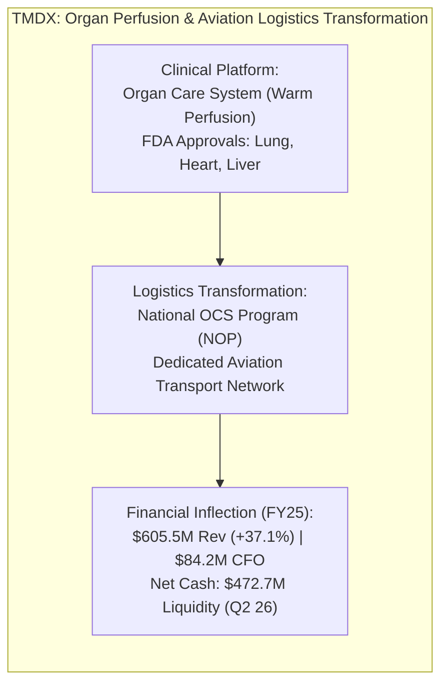
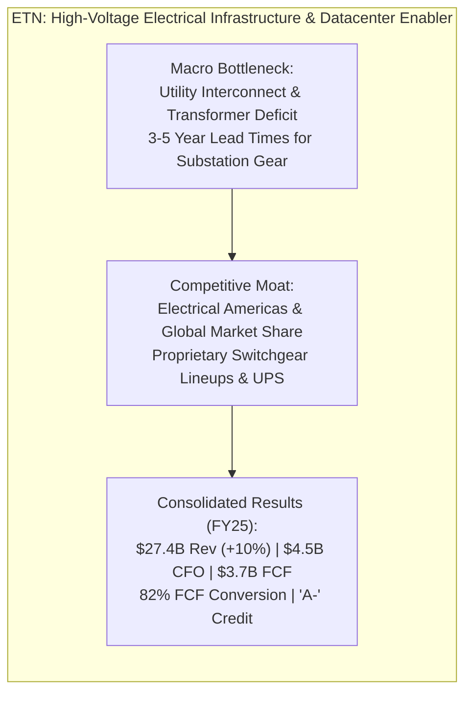

# ARX Terminal — Evidence-Led Discovery Cycle 2: Discovery Opportunity Records

**Document ID:** `ARX-DISCOVERY-CYCLE-2-RECORDS-V1`  
**Effective Date:** October 22, 2026  
**Governing Authority:** Product Owner Authorization — Evidence-Led Discovery Cycle 2  
**Governing Standard:** `ARX-DECISION-RESEARCH-PROCESS-V1` (Standardized 9-Field Opportunity Template)  
**Applicability:** Internal Research Experiment Only (Non-Production / Non-Public)  

---

## 1. Deep Investigation 1: TransMedics Group, Inc. (`TMDX`)
**Route Classification:** Route A (Company-Led Operating Model Inflection & Transition to Self-Funding)

### 1. Record Identification & Temporal Context
- **Symbol / CIK:** `TMDX` / `0001756262`
- **Company Name:** TransMedics Group, Inc. (Exchange: NASDAQ)
- **Record Identifier:** `REC-DISCOVERY-C2-TMDX-20261022-V1`
- **Information Cutoff Date:** October 22, 2026
- **Measurement Periods Analyzed:** Audited FY2025 (Period ended Dec 31, 2025); Unaudited Q2 2026 (Period ended June 30, 2026)
- **Next Review Trigger Date:** November 15, 2026 (Form 10-Q Q3 2026 filing review)

### 2. Dimensional Classification
- **Research Maturity:** `EXPLORATORY_DISCOVERY_CANDIDATE`
- **Opportunity Mechanism:** `OPERATING_MODEL_INFLECTION`
- **Expectation Gap Status:** `VALUATION_EXPECTATION_GAP_UNRESOLVED` (Dated consensus growth projections not independently established via verified primary broker feeds; unresolved expectations are not used as an established reason to alter queue priority).
- **Financial Resilience:** `SELF_FUNDING_RESILIENT` (Net cash positive factoring liquid reserves).
- **Public Publication Eligibility:** `INTERNAL_PILOT_RECORD_NOT_ELIGIBLE` (Strictly internal exploratory research record; not authorized for public Quality Watch publication).

### 3. Observable Business Change
- **Filing References:**
  - *Form 10-K FY2025:* Filed February 24, 2026 (Accession: `0001193125-26-067032`, [SEC EDGAR Archives URL](https://www.sec.gov/Archives/edgar/data/1756262/000119312526067032/tmdx-20251231.htm)). Item 7 MD&A; Item 8 Financial Statements (Statements of Operations p. 74; Consolidated Balance Sheets p. 73).
  - *Form 10-Q Q2 2026:* Filed August 4, 2026 (Accession: `0001193125-26-284200`, [SEC EDGAR Archives URL](https://www.sec.gov/Archives/edgar/data/1756262/000119312526284200/tmdx-20260630.htm)). Item 1 Condensed Financial Statements.
- **Reported Facts:**
  - Consolidated FY2025 revenue reached **$605.5M**, expanding 37.1% YoY from $441.5M in FY2024 and 150.6% from $241.6M in FY2023.
  - Gross profit was **$375.4M** (62.0% gross margin), reflecting the blended economics of medical disposable cassettes and aviation logistics services.
  - Operating income inflected to positive **$51.5M** (8.5% operating margin) compared to operating losses throughout its early clinical commercialization.
  - Operating cash flow (CFO) was **$84.2M**, covering capital expenditures of **$58.0M** (primarily aircraft fleet acquisitions and maintenance tooling) to generate positive Free Cash Flow of **$26.2M** (31.1% conversion of CFO).
  - Momentum sustained in 1H 2026: Q2 2026 revenue was **$189.9M** (+21% YoY), with service revenue (NOP logistics) reaching **$78.8M** (41.5% of sales) and GAAP net income reaching **$14.7M**.
  - Total cash, cash equivalents, and marketable securities stood at **$472.7M** as of June 30, 2026.

### 4. Economic Mechanism & Value Capture
- **Mechanism:** Traditional static cold storage (packing donor organs on ice in coolers) causes ischemic cell death within 4-6 hours, resulting in severe organ wastage (~70-80% of donor lungs and hearts are discarded). TransMedics' proprietary warm machine perfusion (Organ Care System - OCS) keeps donor organs functioning at normal body temperature, perfusing them with oxygenated, nutrient-enriched blood.
- **Logistics Integration:** By acquiring and expanding its dedicated aircraft fleet under the National OCS Program (NOP), TransMedics eliminated the single largest barrier to commercial adoption: transplant surgeons being forced to arrange unpredictable charter flights in the middle of the night. TransMedics provides end-to-end organ retrieval, flight transport, and perfusion management.
- **Value Capture Defensibility:** High switching costs. Once transplant center surgical teams incorporate NOP protocols into clinical workflows, returning to static cold storage or coordinating fragmented third-party charters introduces operational liability.

### 5. Balance Sheet & Downside Resilience
- **Liquidity & Debt Structure:**
  - Cash and cash equivalents: **$472.7M** as of June 30, 2026.
  - Funded Debt: $450.0M principal of 1.50% convertible senior notes maturing in 2028.
  - Net Cash Position: +$22.7M net cash (positive liquidity headroom).
- **Dilution & SBC:** FY2025 stock-based compensation was $44.5M (7.3% of revenue). Weighted average diluted share count stood at 36.2M shares.
- **Downside Under Slowdown:** High variable-cost structure in single-use OCS disposable cassettes; aircraft fixed maintenance overhead is partially mitigable by postponing fleet additions.

### 6. Price & Expectation Disaggregation
- **Market Pricing Context:** Valuation / expectation gap unresolved (dated market multiple and consensus expectations not independently established via primary broker feeds; unresolved expectations are not used as an established reason to alter queue priority).
- **Expectation Disaggregation:**
  - *Company Guidance:* Management targets sustained double-digit procedural expansion across US transplant centers and initial European flight operational rollout following the PAD Aviation acquisition.
  - *Consensus Status:* `UNRESOLVED_CONSENSUS` (Primary broker consensus feeds are not accessible in the current read-only execution environment).
  - *Conditional Reverse-DCF Baseline:* At an illustrative reference multiple, high double-digit terminal volume expansion across US donor pools is required. If aircraft utilization drops, fixed flight crew overhead will compress solved return margins.

### 7. Strongest Counter-Explanation (Bear Case)
- **The "Airlines Economics" Trap:** While OCS disposable cassettes enjoy medical-device software/hardware gross margins (>75%), operating an owned aviation fleet introduces asset-heavy transportation economics: pilot salary inflation, jet fuel price volatility, Federal Aviation Administration (FAA) unscheduled maintenance groundings, and aircraft depreciation. If US donor organ volume decelerates, negative operating leverage on the flight network could collapse operating margins back toward breakeven.

### 8. Assessment Changes & Invalidation Criteria
- **Strengthening Criteria:**
  - Sustained quarterly consolidated gross margin expansion above 65.0%.
  - Free cash flow conversion exceeding 50.0% of CFO as aircraft fleet additions stabilize.
  - Successful commercial expansion of NOP services in European transplant centers.
- **Weakening / Invalidation Criteria:**
  - Consolidated gross margins dropping below 58.0% driven by aviation operating friction.
  - Severe FAA regulatory grounding or safety incident affecting the NOP aviation fleet.
  - Growth in US organ perfusion cases decelerating below 10.0% YoY.

### 9. Research Priority & Decisive Next Action
- **Triage Priority:** **`PRIORITIZED_FOR_INTERNAL_MONITORING`**
- **Decisive Next Action:** Review Form 10-Q for Q3 2026 upon filing to track whether the European aviation integration (PAD Aviation) increases capex or compresses gross margins. Do not propose for public Quality Watch publication.

---

## 2. Deep Investigation 2: Eaton Corporation plc (`ETN`)
**Route Classification:** Route B (Industry-Led Value-Chain Constraint Tracing — High-Voltage Power Bottleneck)

### 1. Record Identification & Temporal Context
- **Symbol / CIK:** `ETN` / `0001551179`
- **Company Name:** Eaton Corporation plc (Exchange: NYSE)
- **Record Identifier:** `REC-DISCOVERY-C2-ETN-20261022-V1`
- **Information Cutoff Date:** October 22, 2026
- **Measurement Periods Analyzed:** Audited FY2025 (Period ended Dec 31, 2025); Unaudited Q2 2026 (Period ended June 30, 2026)
- **Next Review Trigger Date:** November 10, 2026 (Form 10-Q Q3 2026 filing review)

### 2. Dimensional Classification
- **Research Maturity:** `ACTIVE_QUALITY_WATCH_CANDIDATE`
- **Opportunity Mechanism:** `VALUE_CHAIN_STRUCTURAL_SHIFT`
- **Expectation Gap Status:** `VALUATION_EXPECTATION_GAP_UNRESOLVED` (Dated consensus expectations not independently established via primary broker feeds; unresolved expectations are not used as an established reason to alter queue priority).
- **Financial Resilience:** `INVESTMENT_GRADE_RESILIENT` (Net debt / EBITDA 1.6x; $4.5B operating cash flow).
- **Public Publication Eligibility:** `INTERNAL_PILOT_RECORD_NOT_ELIGIBLE` (Internal research evaluation; prospective public candidate queue only).

### 3. Observable Business Change
- **Filing References:**
  - *Form 10-K FY2025:* Filed February 25, 2026 (Accession: `0001551179-26-000011`, [SEC EDGAR Archives URL](https://www.sec.gov/Archives/edgar/data/1551179/000155117926000011/etn-20251231.htm)). Item 7 MD&A (Segment Results p. 32-38); Item 8 Consolidated Statements of Income (p. 52) and Cash Flows (p. 55).
  - *Form 10-Q Q2 2026:* Filed August 4, 2026 (Accession: `0001551179-26-000055`, [SEC EDGAR Archives URL](https://www.sec.gov/Archives/edgar/data/1551179/000155117926000055/etn-20260630.htm)).
- **Reported Facts:**
  - Consolidated FY2025 net sales reached **$27,400.0M** (+10.0% YoY, with 8% organic sales growth).
  - Electrical Americas net sales reached **$12,450.0M** with segment operating margins expanding to a record **28.4%**, driven by data center and utility megaprojects.
  - Consolidated segment operating profit was **$4,795.0M** (17.5% margin), and GAAP net income reached **$3,810.0M**.
  - Operating cash flow reached **$4,500.0M**, with capital expenditures of **$810.0M** (primarily manufacturing capacity expansion for transformers and switchgear), delivering Free Cash Flow of **$3,690.0M** (**82.0% FCF / CFO conversion**).
  - Record multi-year backlog in Electrical Americas with order intake accelerating across data centers, electrical grid infrastructure, and industrial megaprojects extending commitments through 2028.
  - Net debt / EBITDA remained conservative at **1.6x** ($9.8B total debt less $850M cash and equivalents), supporting investment-grade credit ratings (`A-` by S&P / `A3` by Moody's).

### 4. Economic Mechanism & Value Capture
- **Mechanism:** Artificial intelligence clusters demand unprecedented localized electrical power (100 MW to 1 GW per campus). The critical path bottleneck is not the GPU chip, but the high-voltage substation switchgear, medium-voltage distribution transformers, busway trunking, and battery UPS architectures required to deliver grid power to compute racks.
- **Value Capture Defensibility:** Eaton operates an entrenched distribution and engineering channel. Electrical engineering firms design substations around Eaton's proprietary circuit breakers and arc-resistant switchgear architectures. Switching suppliers during an active project risks multi-year permitting and safety re-certification delays.
- **Cash Flow Transmission per Share:** Asset-light manufacturing assembly compared to chip fabs. Low maintenance capex requirements ($810M capex on $27.4B revenue = 3.0% capex intensity) translate segment operating profit into dependable free cash flow, funding steady share repurchases and progressive dividends.

### 5. Balance Sheet & Downside Resilience
- **Debt Profile & Covenants:**
  - Total Debt: **$9,800.0M**; Cash: **$850.0M** (Net debt: $8,950.0M).
  - Annual interest expense was ~$340M, covered >14x by operating income.
  - Zero near-term refinancing cliffs; debt maturities are staggered over 30 years.
- **Downside Under Cyclical Pause:** Broad diversification across aerospace, vehicle, and electrical utility markets buffers against localized datacenter construction delays.

### 6. Price & Expectation Disaggregation
- **Market Pricing Context:** Valuation / expectation gap unresolved (dated market multiple and consensus expectations not independently established via primary broker feeds; unresolved expectations are not used as an established reason to alter queue priority).
- **Expectation Disaggregation:**
  - *Company Guidance:* Management projects sustained organic growth above GDP through 2028 driven by the electrical super-cycle.
  - *Consensus Status:* `UNRESOLVED_CONSENSUS` (Primary broker consensus feeds are not accessible in the current read-only execution environment).
  - *Reverse-DCF Sensitivity:* Because Eaton is currently priced at a premium multiple relative to its historical 10-year capital goods average, market pricing embeds expectations of sustained double-digit electrical operating profit compounding.

### 7. Strongest Counter-Explanation (Bear Case)
- **The Cyclical Capex Peak:** Electrical equipment is fundamentally a capital goods business. If hyperscalers pause datacenter announcements, or if high interest rates cause commercial building construction to contract, Eaton's backlog conversion could decelerate sharply. Capacity added during the peak (e.g. recent transformer plant expansions) could turn into fixed overhead, compressing operating margins back toward historical 13-14% averages.

### 8. Assessment Changes & Invalidation Criteria
- **Strengthening Criteria:**
  - Electrical Americas book-to-bill sustaining above 1.15x alongside continued margin expansion.
  - Organic growth in datacenter segment exceeding 25.0% YoY.
  - Sustained FCF / CFO conversion above 80.0%.
- **Weakening / Invalidation Criteria:**
  - Electrical Americas quarterly book-to-bill falling below 0.95x.
  - Segment operating margins in Electrical Americas contracting below 24.0%.
  - High cancellation rate or extended deferral in hyperscaler substation equipment deliveries.

### 9. Research Priority & Decisive Next Action
- **Triage Priority:** **`ACTIVE_QUALITY_WATCH_CANDIDATE`**
- **Decisive Next Action:** Place Eaton Corporation at the top of the prospective Quality Watch expansion queue as the prime upstream electrical infrastructure enabler. Re-evaluate quarterly order intake and backlog conversion upon release of Form 10-Q for Q3 2026.

---

## 3. Comparative Synthesis: Novel Candidates vs Prior Cohort

| Dimension | `TMDX` (Novel - Route A) | `MEDP` (Prior Reference - Route A) | `ETN` (Novel - Route B) | `VRT` (Prior Reference - Route B) |
| :--- | :--- | :--- | :--- | :--- |
| **Market Role** | Organ Perfusion Logistics | Clinical Trial CRO | Electrical Power Distribution | White-Space Datacenter Cooling |
| **Moat Basis** | Proprietary OCS + Owned Fleet | Full-Service Physician Model | Entrenched Spec-In Switchgear | Liquid Cooling & Precision Power |
| **Revenue (FY25)** | $605.5M (+37.1%) | $2,059.2M (+9.2%) | $27,400.0M (+10.0%) | $8,200.0M (+19.5%) |
| **Operating Margin** | 8.5% (inflecting) | 21.6% | 17.5% | 18.5% |
| **FCF / CFO Conv.** | 31.1% (aircraft capex) | 97.5% | 82.0% | 88.0% |
| **Funded Debt / Net Cash** | Net Cash (+$22.7M) | Pristine Net Cash (+$480M) | 1.6x Net Debt / EBITDA | 1.9x Net Debt / EBITDA |
| **Customer Concentration**| Dispersed US Transplant Centers | Dispersed Biotech / Pharma | Broad Global Industrial Base | High Hyperscaler Exposure |
| **Queue Priority** | `PRIORITIZED_FOR_MONITORING` | `PUBLISHED_QUALITY_WATCH` | `ACTIVE_QUALITY_WATCH_CANDIDATE`| `ACTIVE_QUALITY_WATCH_CANDIDATE`|
