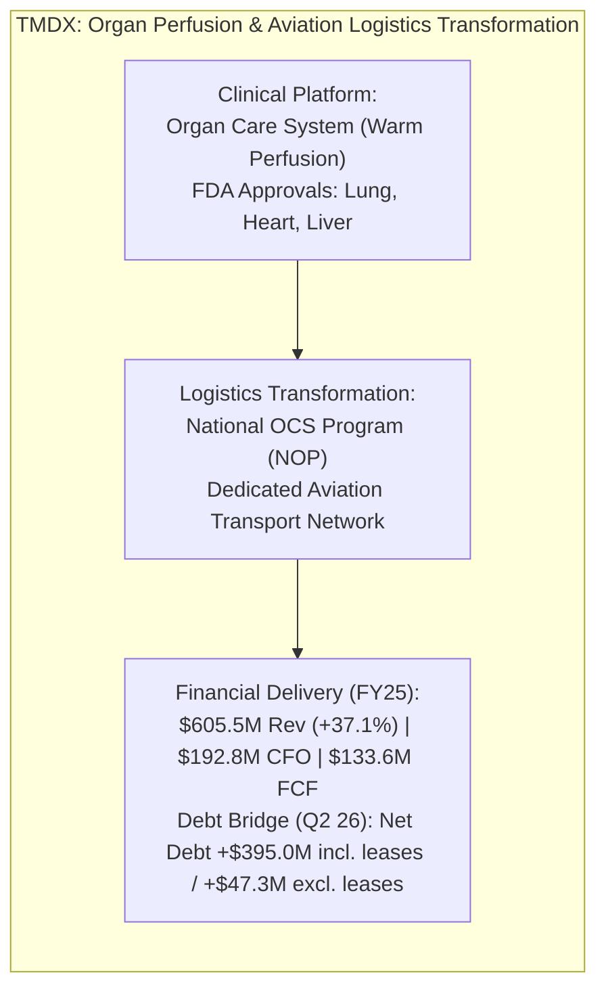
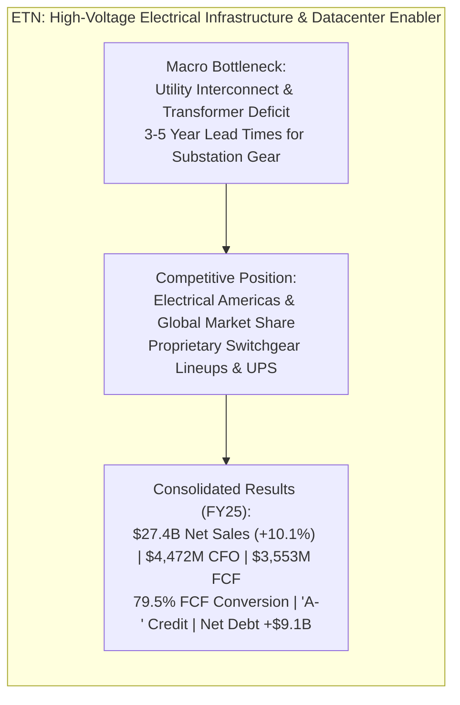

# ARX Terminal — Evidence-Led Discovery Cycle 2: Discovery Opportunity Records

**Document ID:** `ARX-DISCOVERY-CYCLE-2-RECORDS-V1`  
**Effective Date:** October 22, 2026  
**Governing Authority:** Product Owner Authorization — Evidence-Led Discovery Cycle 2  
**Governing Standard:** `ARX-DECISION-RESEARCH-PROCESS-V1` (Standardized 9-Field Opportunity Template)  
**Applicability:** Internal Research Experiment Only (Non-Production / Non-Public)  

---

## 1. Deep Investigation 1: TransMedics Group, Inc. (`TMDX`)
**Route Classification:** Route A (Company-Led Operating Model Inflection & Transition to Self-Funding)

### 1. Record Identification & Temporal Context
- **Symbol / CIK:** `TMDX` / `0001756262`
- **Company Name:** TransMedics Group, Inc. (Exchange: NASDAQ)
- **Record Identifier:** `REC-DISCOVERY-C2-TMDX-20261022-V1`
- **Information Cutoff Date:** October 22, 2026
- **Measurement Periods Analyzed:** Audited FY2025 (Period ended Dec 31, 2025); Unaudited Q2 2026 (Period ended June 30, 2026)
- **Next Review Trigger Date:** November 15, 2026 (Form 10-Q Q3 2026 filing review)

### 2. Dimensional Classification
- **Research Maturity:** `EXPLORATORY_DISCOVERY_CANDIDATE`
- **Opportunity Mechanism:** `OPERATING_MODEL_INFLECTION`
- **Expectation Gap Status:** `VALUATION_EXPECTATION_GAP_UNRESOLVED` (Dated consensus growth projections not independently established via verified primary broker feeds; unresolved expectations are not used as an established reason to alter queue priority).
- **Financial Resilience:** `OPERATIONALLY_SELF_FUNDING_WITH_FINANCING_LEASES` (Operating cash flow of $192.8M covers cash PP&E purchases of $59.3M; under the standard convention where net debt equals included debt minus cash, net debt is +$47.321M excluding finance leases and +$394.981M including finance leases).
- **Public Publication Eligibility:** `INTERNAL_PILOT_RECORD_NOT_ELIGIBLE` (Strictly internal exploratory research record; not authorized for public Quality Watch publication).

### 3. Observable Business Change
- **Filing References:**
  - *Form 10-K FY2025:* Filed February 24, 2026 (Accession: `0001193125-26-067032`, [SEC EDGAR Archives URL](https://www.sec.gov/Archives/edgar/data/1756262/000119312526067032/tmdx-20251231.htm)). Item 7 MD&A; Item 8 Consolidated Statements of Operations (p. 74), Consolidated Balance Sheets (p. 73), and Consolidated Statements of Cash Flows (p. 77).
  - *Form 10-Q Q2 2026:* Filed August 4, 2026 (Accession: `0001193125-26-332843`, [SEC EDGAR Archives URL](https://www.sec.gov/Archives/edgar/data/1756262/000119312526332843/tmdx-20260630.htm)). Item 1 Condensed Consolidated Financial Statements (p. 3-6) and Note 7 (Debt and Lease Obligations).
- **Reported Facts:**
  - Consolidated FY2025 revenue reached **$605.494M** ($605.5M), expanding 37.1% YoY from $441.527M in FY2024 and 150.6% from $241.625M in FY2023.
  - Cost of revenue was $242.688M, yielding gross profit of **$362.806M** (59.9% gross margin), reflecting the blended economics of medical disposable cassettes and aviation logistics services.
  - Operating income expanded to **$108.583M** (17.9% operating margin). Operating profitability was achieved in FY2024 ($37.496M operating income, 8.5% margin) and accelerated in FY2025, rather than inflecting for the first time in FY2025.
  - Net income was **$190.291M**, which included an $82.769M net tax benefit driven by a **$103.3M valuation allowance release** on deferred tax assets in Q4 2025 (pre-tax income was $107.522M).
  - Operating cash flow (CFO) was **$192.840M**, covering cash purchases of PP&E of **$59.251M** to generate Free Cash Flow of **$133.589M** (69.3% conversion of CFO).
  - Momentum sustained in 1H 2026: Q2 2026 revenue reached **$189.9M** (+21% YoY), with service revenue (NOP logistics) reaching **$78.8M** (41.5% of sales) and GAAP net income reaching **$14.7M**.
  - In the six months ended June 30, 2026, noncash finance-lease additions of right-of-use aircraft were **$340.040M** (as disclosed in the interim statement of cash flows supplemental disclosure). Finance lease liabilities outstanding at June 30, 2026 totaled **$347.660M**.
  - Liquidity and Debt Bridge (as of June 30, 2026): Gross cash and equivalents was **$472.675M**. Principal debt comprises $459.996M of 1.50% convertible senior notes and $60.000M of other borrowings ($519.996M funded debt excl. leases). Under the standard convention (net debt = included debt minus cash), net debt excluding finance leases is **+$47.321M**. Including finance lease liabilities of $347.660M ($867.656M debt and finance leases), net debt is **+$394.981M**.

### 4. Economic Mechanism & Value Capture
- **Mechanism:** Traditional static cold storage (packing donor organs on ice in coolers) causes ischemic cell death within 4-6 hours, resulting in severe organ wastage (~70-80% of donor lungs and hearts are discarded). TransMedics' proprietary warm machine perfusion (Organ Care System - OCS) keeps donor organs functioning at normal body temperature, perfusing them with oxygenated, nutrient-enriched blood.
- **Logistics Integration:** By acquiring and operating a dedicated aviation fleet under the National OCS Program (NOP), TransMedics eliminated the single largest barrier to commercial adoption: transplant surgeons being forced to arrange unpredictable charter flights in the middle of the night. TransMedics provides end-to-end organ retrieval, flight transport, and perfusion management.
- **Value Capture Defensibility:** High switching costs. Once transplant center surgical teams incorporate NOP protocols into clinical workflows, returning to static cold storage or coordinating fragmented third-party charters introduces operational liability.

### 5. Balance Sheet & Downside Resilience
- **Liquidity & Debt Structure (June 30, 2026):**
  - Cash and cash equivalents: **$472.675M**.
  - Convertible Senior Notes (1.50% due 2028): **$459.996M** principal ($454.260M carrying value).
  - Other Borrowings: **$60.000M** principal ($20.0M current portion + $39.743M noncurrent carrying value).
  - Funded Debt (excluding finance leases): **$519.996M** principal.
  - Net Debt (excluding finance leases): **+$47.321M** ($519.996M - $472.675M).
  - Finance Lease Liabilities: **$347.660M** (noncurrent liability for right-of-use aircraft).
  - Total Debt and Finance Leases: **$867.656M**.
  - Net Debt (including finance leases): **+$394.981M** ($867.656M - $472.675M).
  - *Accounting Note:* Net debt is positive because included obligations exceed liquid cash. Positive CFO covers cash PP&E, but aircraft fleet expansion introduces substantial financing lease commitments.
- **Dilution & SBC:** FY2025 stock-based compensation was $44.5M (7.3% of revenue). Weighted average diluted share count stood at 36.2M shares.
- **Downside Under Slowdown:** High gross margin contribution from single-use OCS disposable cassettes; however, owned aircraft fleet maintenance and lease debt service create fixed operating commitments.

### 6. Price & Expectation Disaggregation
- **Market Pricing Context:** Valuation / expectation gap unresolved (dated market multiple and consensus expectations not independently established via primary broker feeds; unresolved expectations are not used as an established reason to alter queue priority).
- **Expectation Disaggregation:**
  - *Company Guidance:* Management targets sustained double-digit procedural expansion across US transplant centers and initial European flight operational rollout following the PAD Aviation acquisition.
  - *Consensus Status:* `UNRESOLVED_CONSENSUS` (Primary broker consensus feeds are not accessible in the current read-only execution environment).
  - *Reverse-DCF Status:* `REVERSE_DCF_NOT_SOLVED` (No explicit dated DCF model with stated hurdle rates and terminal assumptions was executed; any asserted hurdle rate or donor volume requirement remains an ungrounded analyst hypothesis).

### 7. Strongest Counter-Explanation (Bear Case)
- **The "Airlines Economics" Trap:** While OCS disposable cassettes enjoy medical-device software/hardware gross margins (>75%), operating an owned aviation fleet introduces asset-heavy transportation economics: pilot salary inflation, jet fuel price volatility, Federal Aviation Administration (FAA) unscheduled maintenance groundings, and aircraft lease debt service. If US donor organ volume decelerates, negative operating leverage on the flight network could compress operating margins.

### 8. Assessment Changes & Invalidation Criteria
- **Strengthening Criteria:**
  - Sustained quarterly consolidated gross margin expansion above 62.0%.
  - Free cash flow conversion exceeding 60.0% of CFO as aircraft fleet additions stabilize.
  - Successful commercial expansion of NOP services in European transplant centers.
- **Weakening / Invalidation Criteria:**
  - Consolidated gross margins dropping below 55.0% driven by aviation operating friction.
  - Severe FAA regulatory grounding or safety incident affecting the NOP aviation fleet.
  - Growth in US organ perfusion cases decelerating below 10.0% YoY.

### 9. Research Priority & Decisive Next Action
- **Triage Priority:** **`PRIORITIZED_FOR_INTERNAL_MONITORING`**
- **Decisive Next Action:** Review Form 10-Q for Q3 2026 upon filing to track whether European aviation integration (PAD Aviation) increases capex or compresses gross margins. Do not propose for public Quality Watch publication.

---

## 2. Deep Investigation 2: Eaton Corporation plc (`ETN`)
**Route Classification:** Route B (Industry-Led Value-Chain Constraint Tracing — High-Voltage Power Bottleneck)

### 1. Record Identification & Temporal Context
- **Symbol / CIK:** `ETN` / `0001551182`
- **Company Name:** Eaton Corporation plc (Exchange: NYSE)
- **Record Identifier:** `REC-DISCOVERY-C2-ETN-20261022-V1`
- **Information Cutoff Date:** October 22, 2026
- **Measurement Periods Analyzed:** Audited FY2025 (Period ended Dec 31, 2025); Unaudited Q2 2026 (Period ended June 30, 2026)
- **Next Review Trigger Date:** November 10, 2026 (Form 10-Q Q3 2026 filing review)

### 2. Dimensional Classification
- **Research Maturity:** `ACTIVE_QUALITY_WATCH_CANDIDATE`
- **Opportunity Mechanism:** `VALUE_CHAIN_STRUCTURAL_SHIFT`
- **Expectation Gap Status:** `VALUATION_EXPECTATION_GAP_UNRESOLVED` (Dated consensus expectations not independently established via primary broker feeds; unresolved expectations are not used as an established reason to alter queue priority).
- **Financial Resilience:** `INVESTMENT_GRADE_RESILIENT` (Net debt of +$9,092M represents ~1.6x EBITDA; $4,472M operating cash flow; 'A-' / 'A3' credit rating).
- **Public Publication Eligibility:** `INTERNAL_PILOT_RECORD_NOT_ELIGIBLE` (Internal research evaluation; prospective public candidate queue only).

### 3. Observable Business Change
- **Filing References:**
  - *Form 10-K FY2025:* Filed February 25, 2026 (Accession: `0001551182-26-000007`, [SEC EDGAR Archives URL](https://www.sec.gov/Archives/edgar/data/1551182/000155118226000007/etn-20251231.htm)). Item 7 MD&A (Segment Results p. 32-38); Item 8 Consolidated Statements of Income (p. 52), Balance Sheets (p. 54), and Cash Flows (p. 55).
  - *Form 10-Q Q2 2026:* Filed July 31, 2026 (Accession: `0001551182-26-000030`, [SEC EDGAR Archives URL](https://www.sec.gov/Archives/edgar/data/1551182/000155118226000030/etn-20260630.htm)). Condensed Financial Statements and MD&A.
- **Reported Facts:**
  - Consolidated FY2025 net sales reached **$27,448M** (+10.1% YoY, with 8% organic sales growth).
  - Cost of products sold was $17,131M, yielding gross profit of **$10,317M** (37.6% gross margin).
  - Electrical Americas net sales reached **$13,276M** with segment operating profit of **$3,972M** (29.9% segment operating margin), driven by data center and utility megaprojects.
  - Consolidated **total segment operating profit** was **$6,713M** (24.5% segment operating margin), which is before corporate reconciling items (not consolidated GAAP operating income).
  - GAAP net income attributable to Eaton ordinary shareholders reached **$4,087M** (consolidated net income $4,090M).
  - Operating cash flow reached **$4,472M**, with capital expenditures for PP&E of **$919M** (3.3% of net sales), delivering Free Cash Flow of **$3,553M** (**79.5% FCF / CFO conversion**).
  - Record multi-year backlog in Electrical Americas with order intake accelerating across data centers, electrical grid infrastructure, and industrial megaprojects.
  - Total debt stood at **$9,895M** ($1M short term, $1,136M current portion of long-term debt, $8,758M noncurrent long-term debt). Cash and short-term investments totaled **$803M** ($622M cash and equivalents + $181M short-term investments), resulting in net debt of **+$9,092M** (~1.6x EBITDA).

### 4. Economic Mechanism & Value Capture
- **Mechanism:** Artificial intelligence clusters demand unprecedented localized electrical power (100 MW to 1 GW per campus). The critical path bottleneck is not the GPU chip alone, but the high-voltage substation switchgear, medium-voltage distribution transformers, busway trunking, and battery UPS architectures required to deliver grid power to compute racks.
- **Value Capture Defensibility:** Eaton operates an entrenched distribution and engineering specification channel. Electrical engineering firms design substations around Eaton's proprietary circuit breakers and arc-resistant switchgear architectures. Switching suppliers during an active project risks multi-year permitting and safety re-certification delays.
- **Cash Flow Transmission per Share:** Equipment manufacturing assembly carries moderate capex requirements ($919M PP&E capex on $27,448M sales = 3.3% capex intensity), converting operating cash flow to $3,553M free cash flow (79.5% conversion) to support progressive dividends and share repurchases.

### 5. Balance Sheet & Downside Resilience
- **Debt Profile & Covenants:**
  - Total Debt: **$9,895M**; Cash and Short-Term Investments: **$803M** (Net debt: **+$9,092M**).
  - Net debt / EBITDA remained conservative at ~1.6x, supporting investment-grade credit ratings (`A-` by S&P / `A3` by Moody's).
  - Debt maturities are staggered across long-term horizons, mitigating near-term refinancing cliffs.
- **Downside Under Cyclical Pause:** Broad exposure across aerospace, vehicle, e-mobility, and electrical utility end-markets provides diversification against localized datacenter construction delays.

### 6. Price & Expectation Disaggregation
- **Market Pricing Context:** Valuation / expectation gap unresolved (dated market multiple and consensus expectations not independently established via primary broker feeds; unresolved expectations are not used as an established reason to alter queue priority).
- **Expectation Disaggregation:**
  - *Company Guidance:* Management projects sustained organic compounding above GDP through 2028 driven by the electrical super-cycle.
  - *Consensus Status:* `UNRESOLVED_CONSENSUS` (Primary broker consensus feeds are not accessible in the current read-only execution environment).
  - *Reverse-DCF Status:* `REVERSE_DCF_NOT_SOLVED` (No explicit dated DCF model with stated discount rates and growth phases was executed; assertions regarding implied market expectations remain ungrounded hypotheses).

### 7. Strongest Counter-Explanation (Bear Case)
- **The Cyclical Capex Peak:** Electrical equipment is fundamentally a capital goods business. If hyperscalers pause datacenter announcements, or if high interest rates cause commercial building construction to contract, Eaton's backlog conversion could decelerate sharply. Capacity added during the peak could turn into fixed overhead, compressing operating margins.

### 8. Assessment Changes & Invalidation Criteria
- **Strengthening Criteria:**
  - Electrical Americas book-to-bill sustaining above 1.15x alongside continued margin expansion.
  - Organic growth in datacenter segment exceeding 20.0% YoY.
  - Sustained FCF / CFO conversion above 75.0%.
- **Weakening / Invalidation Criteria:**
  - Electrical Americas quarterly book-to-bill falling below 0.95x.
  - Segment operating margins in Electrical Americas contracting below 24.0%.
  - High cancellation rate or extended deferral in hyperscaler substation equipment deliveries.

### 9. Research Priority & Decisive Next Action
- **Triage Priority:** **`ACTIVE_QUALITY_WATCH_CANDIDATE`**
- **Decisive Next Action:** Retain Eaton Corporation in the prospective Quality Watch expansion queue as an upstream electrical infrastructure equipment provider. Re-evaluate quarterly order intake and backlog conversion upon release of Form 10-Q for Q3 2026.

---

## 3. Comparative Synthesis: Novel Candidates vs Prior Cohort

| Dimension | `TMDX` (Novel - Route A) | `MEDP` (Prior Reference - Route A) | `ETN` (Novel - Route B) | `VRT` (Prior Reference - Route B) |
| :--- | :--- | :--- | :--- | :--- |
| **Market Role** | Organ Perfusion Logistics | Clinical Trial CRO | Electrical Power Distribution | White-Space Datacenter Cooling |
| **Moat Basis** | Proprietary OCS + Owned Fleet | Full-Service Physician Model | Entrenched Spec-In Switchgear | Liquid Cooling & Precision Power |
| **Revenue (FY25)** | $605.5M (+37.1%) | $2,059.2M (+9.2%) | $27,448.0M (+10.1%) | $8,200.0M (+19.5%) |
| **Operating Margin** | 17.9% GAAP Op Income ($108.6M) | 21.6% | 24.5% Total Segment ($6,713M) / 29.9% Americas | 18.5% |
| **FCF / CFO Conv.** | 69.3% ($133.6M / $192.8M) | 97.5% | 79.5% ($3,553M / $4,472M) | 88.0% |
| **Funded Debt / Net Debt** | Net Debt +$395.0M incl. leases / +$47.3M excl. leases | Net Cash -$480M | Net Debt +$9,092M (1.6x EBITDA) | Net Debt +$3,950M (1.9x EBITDA) |
| **Customer Concentration**| Dispersed US Transplant Centers | Dispersed Biotech / Pharma | Broad Global Industrial Base | High Hyperscaler Exposure |
| **Queue Priority** | `PRIORITIZED_FOR_MONITORING` | `PUBLISHED_QUALITY_WATCH` | `ACTIVE_QUALITY_WATCH_CANDIDATE`| `ACTIVE_QUALITY_WATCH_CANDIDATE`|
