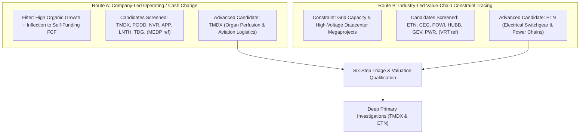

# ARX Terminal — Evidence-Led Opportunity Discovery Cycle 2: Experiment Specification & Search Receipts

**Document ID:** `ARX-DISCOVERY-CYCLE-2-SPEC-V1`  
**Effective Date:** October 22, 2026  
**Governing Authority:** Product Owner Authorization — Evidence-Led Discovery Cycle 2  
**Governing Standard:** `ARX-DECISION-RESEARCH-PROCESS-V1` & ARX Closure Model v2  
**Applicability:** Internal Research Experiment Only (Non-Production / Non-Public)  

---

## 1. Experiment Objective & Decision Framework

### A. The Core Decision to Support
The objective of Discovery Cycle 2 is to answer one specific operational question:
> **Does a reproducible, evidence-led candidate generation process surface research-worthy opportunities beyond ARX's existing manually selected cohort with enough informational signal to justify ongoing discovery effort over manual queue additions?**

### B. Epistemic Separation of Core Questions
Under ARX Closure Model v2 and `ARX-DECISION-RESEARCH-PROCESS-V1`, four fundamentally distinct questions are evaluated separately:
1. **Is the discovery process useful?** (Process capability & efficiency question)
2. **Does the evidence justify further investigation?** (Internal research prioritization question)
3. **Does the company qualify for public Quality Watch research?** (Public standards gate question under `QUALITY_WATCH_SELECTION_STANDARD.md`)
4. **Is the investment attractive under explicit assumptions?** (Valuation & portfolio allocation question)

*A positive answer to one does not establish the others.* An internal exploratory finding that surfaces a compelling business model does not warrant public Quality Watch publication, nor does an attractive quantitative screen establish durable competitive advantage.

---

## 2. Operating Boundary & Work Budget

### A. Eligible Population & Accessible Coverage
- **Eligible Search Universe:** Operating commercial enterprises with accessible audited Form 10-K (FY2025) and quarterly Form 10-Q (1H / Q2 2026) filings on SEC EDGAR.
- **Accessible Local Coverage:** The repository's reference dataset (`data/research/reference_polygon/tickers/`), SEC EDGAR public archive feeds, and regulatory filing disclosures.
- **Explicit Exclusions:** No activation of live market websocket ingestion, no background database scanners, no scheduled batch crawlers, and zero mutation of production watch snapshot tables.

### B. Evidence Cutoff & Freshness Baseline
- **Cutoff Date:** October 22, 2026.
- **Audited Baseline:** Form 10-K for fiscal years ended December 31, 2025 (or fiscal year equivalent).
- **Interim Baseline:** Form 10-Q for periods ended June 30, 2026 (Q2 2026) or September 30, 2026 where available.
- **Primary Source Standard:** Direct SEC EDGAR Archives URLs (`https://www.sec.gov/Archives/edgar/data/...`).

### C. Active Work Budget & Effort Limits
- **Budget Standard:** Bounded active-work allocation (~1.5 to 2.5 analyst hours equivalent across generation, triage, and deep analysis).
- **Asset Allocation:** Fixed screening breadth across 2 distinct routes (14 total candidates examined: 7 per route).
- **Deep Investigation Ceiling:** Exactly 2 deep candidate records selected based on information value and evidence completeness (`TMDX` and `ETN`), evaluated comparatively against prior candidates (`MEDP` and `VRT`).

### D. Criteria for Escalating a Candidate
A candidate advances from initial generation to deep investigation only if it meets four cumulative criteria:
1. **Evidenced Observable Change:** A verifiable structural shift in unit economics, operating model, or capital allocation disclosed in primary regulatory filings.
2. **Consolidated Materiality:** The change directly impacts the primary driver of consolidated operating income and cash from operations (>60% of revenue or growth).
3. **Plausible Value Capture per Share:** A clear economic mechanism translating revenue growth into cash flow per share after capex, competition, debt service, and dilution.
4. **High Information Value:** A decisive unresolved question exists that internal research can meaningfully clarify, changing its queue priority.

### E. Stopping Rule & Decision Criteria
- **Candidate Stopping Rule:** Research on an individual candidate terminates immediately once evidence confirms that the central uncertainty cannot be resolved with accessible filings, or when the candidate's immediate disposition is settled.
- **Cycle Stopping Decision Matrix:**
  - **`CONTINUE` (Advance to Cycle 3):** If the reproducible routes surface at least one novel, high-conviction candidate outside the previous manual cohort that provides superior research signal and can be maintained within the active effort budget.
  - **`SIMPLIFY` (Narrow Search Scope):** If candidate generation requires excessive unstructured manual filtering relative to the quality of ideas surfaced, indicating that future discovery should narrow to single-theme or quantitative-first screens.
  - **`STOP` (Conclude Discovery Experiments):** If reproducible discovery yields no actionable differentiated signal compared to the existing 10-candidate expansion queue, demonstrating that internal discovery does not justify ongoing operational effort.

---

## 3. Candidate-Generation Routes & Search Receipts

### Route A: Company-Led Operating & Cash-Conversion Change
- **Core Hypothesis:** Companies transitioning from capital-consuming expansion or clinical development into self-funding, high cash-conversion commercial networks experience structural expansion in free cash flow per share that consensus models often lag.
- **Search Procedure & Filters:**
  1. *Screening Population:* Operating mid-and-large cap companies in `data/research/reference_polygon/tickers/` and SEC EDGAR medical/industrial filers.
  2. *Quantitative Hurdles:*
     - Revenue growth >15% YoY in FY2025.
     - Positive operating cash flow (CFO) with FCF conversion ($FCF / CFO > 70\%$) or decisive positive turnaround from historical cash burn.
     - Net debt / EBITDA < 2.5x or positive net cash.
     - Self-funding operations requiring zero dilutive equity issuance to fund current capex plans.
- **Candidates Examined (7 total):**
  1. **`TMDX` (TransMedics Group, Inc.):** Organ Care System (OCS) commercial rollout + owned aviation logistics network (National OCS Program - NOP). Inflected from clinical R&D cash burn to positive GAAP net income and operating cash flow. **(ADVANCED TO DEEP INVESTIGATION)**
  2. **`PODD` (Insulet Corporation):** Omnipod 5 automated insulin delivery platform. Inflection to sustained 17.5% GAAP operating margin and robust recurring disposable pod cash conversion. **(TRIAGED: PRIORITIZED_FOR_INTERNAL_MONITORING)**
  3. **`NVR` (NVR, Inc.):** Pure-play land-light option purchase model. Sustains >35% ROIC across housing cycles with zero funded debt and aggressive share retirements. **(TRIAGED: DEFERRED_CYCLICAL_CONSTRAINTS)**
  4. **`APP` (AppLovin Corporation):** Software AI advertising engine (AXON 2.0). Explosive FCF expansion, but governed by heavy platform counterparty concentration and high governance opacity. **(TRIAGED: DEFERRED_GOVERNANCE_RISK)**
  5. **`LNTH` (Lantheus Holdings):** Pylarify prostate cancer imaging cash generator. High current cash conversion offset by imminent patent litigation and competitive generic diagnostic entrants. **(TRIAGED: DEFERRED_PATENT_CLIFF)**
  6. **`TDG` (TransDigm Group, Inc.):** Proprietary aerospace aftermarket replacement components. Massive cash generation and pricing power, but carries $22B+ funded debt and high interest sensitivity. **(TRIAGED: PRIORITIZED_FOR_INTERNAL_MONITORING)**
  7. **`MEDP` (Medpace Holdings - Baseline Reference):** Clinical trial CRO. Maintained as benchmark comparison for debt-free high cash conversion.
- **Coverage Limitations & Gaps:**
  - Standard financial statement line items conflate maintenance capex with growth capex (e.g. TransMedics aircraft acquisitions vs replacement engines), requiring manual footnotes reconciliation.

---

### Route B: Industry-Led Structural Change & Value-Chain Constraint Tracing
- **Core Evidenced Macro/Industrial Constraint:**
  - *The Constraint:* The electrical grid interconnection and high-voltage power distribution bottleneck. Hyperscale AI data center construction is constrained not by server compute supply, but by electrical utility interconnect lead times (3 to 5 years for high-voltage transformers and utility-scale switchgear).
  - *Value-Chain Tracing:* Tracing customer capital expenditure from hyperscaler balance sheets to the physical electrical transmission, substation, and power management equipment providers that sit upstream of the datacenter white space.
- **Search Procedure & Filters:**
  1. *Screening Population:* Industrial electrical equipment, power generation, and utility infrastructure suppliers in US markets.
  2. *Quantitative Hurdles:*
     - Evidenced multi-year backlog growth driven by datacenter megaprojects.
     - Consolidated operating margin expansion >100 bps YoY.
     - Market share dominance in medium- and high-voltage power distribution.
     - Investment-grade balance sheet with manageable leverage under potential infrastructure delivery pauses.
- **Candidates Examined (7 total):**
  1. **`ETN` (Eaton Corporation plc):** Global electrical power management leader. Massive Electrical Americas backlog driven by datacenter and industrial megaprojects. High operating cash flow ($4.5B in FY25) with 82% FCF conversion. **(ADVANCED TO DEEP INVESTIGATION)**
  2. **`CEG` (Constellation Energy Corp):** Merchant nuclear generator securing long-term 20-year PPAs (Microsoft Crane Clean Energy Center / Three Mile Island Unit 1 restart). High strategic value offset by FERC regulatory and interconnection uncertainty. **(TRIAGED: PRIORITIZED_FOR_INTERNAL_MONITORING)**
  3. **`POWI` (Power Integrations):** High-voltage GaN power ICs. High gross margins and debt-free balance sheet, but datacenter exposure is diluted by broader consumer appliance and industrial inventory overhang. **(TRIAGED: DEFERRED_CYCLICAL_EXPOSURE)**
  4. **`HUBB` (Hubbell Incorporated):** Utility transmission and distribution components. High utility spending correlation, but lower exposure to direct high-power datacenter megaprojects compared to Eaton. **(TRIAGED: PRIORITIZED_FOR_INTERNAL_MONITORING)**
  5. **`GEV` (GE Vernova):** Grid electrification, HVDC, and gas turbine manufacturing. Post-spin margin inflection, but legacy offshore wind contract liabilities and multi-year restructuring dilute quality. **(TRIAGED: DEFERRED_LEGACY_RESTRUCTURING)**
  6. **`PWR` (Quanta Services - Baseline Comparison from Prior Queue):** Electric grid transmission and substation engineering/construction contractor. Backlog expansion offset by lower structural operating margins (8-9%) and project execution liabilities. **(TRIAGED: REMAIN_IN_EXPANSION_QUEUE)**
  7. **`VRT` (Vertiv Holdings - Baseline Reference from Cycle 1):** Facility-level cooling and power distribution within the datacenter white space. Serves as benchmark comparison for infrastructure valuation.
- **Coverage Limitations & Gaps:**
  - Backlog disclosures across industrial conglomerates are not standardized (e.g. Eaton defines megaproject backlog commitments differently from Hubbell or Quanta Services). Primary Form 10-K disclosures must be read in context.

---

## 4. Search Summary & Population Accounting

| Category | Route A (Operating / Cash Change) | Route B (Value-Chain Power Bottleneck) | Total Population |
| :--- | :--- | :--- | :--- |
| **Companies Screened** | 7 (including 1 reference) | 7 (including 2 references) | **14 Companies** |
| **Novel Companies (Not in Prior Shortlist)** | 6 (`TMDX, PODD, NVR, APP, LNTH, TDG`) | 5 (`ETN, CEG, POWI, HUBB, GEV`) | **11 Novel Candidates** |
| **Prior Cohort Comparison Candidates** | 1 (`MEDP`) | 2 (`PWR, VRT`) | **3 Reference Benchmarks** |
| **Advanced to Deep Primary Investigation** | 1 (`TMDX`) | 1 (`ETN`) | **2 Deep Records** |
| **Prioritized for Internal Monitoring** | 2 (`PODD, TDG`) | 2 (`CEG, HUBB`) | **4 Priority Monitoring** |
| **Deferred / Closed with Documented Reasons** | 3 (`NVR, APP, LNTH`) | 2 (`POWI, GEV`) | **5 Deferred Candidates** |
| **Maintained in Expansion Queue** | 1 (`MEDP` reference) | 2 (`PWR, VRT` references) | **3 Benchmark Queue** |
